# Philippine Public-Sector HRIS MVP

## Conceptual Entity-Relationship Diagram

**Document status:** Draft for review  
**Source documents:** Public-Sector HRIS BRD v1.0, Workflow Specification v1.0, Controls Specification v1.0  
**Primary profile:** Civilian National Government Agency  
**Version:** 1.2
**Date:** September 15, 2026

---

# 1. Purpose

This document defines the conceptual data model for the Philippine Public-Sector HRIS MVP.

It identifies major entities, domain boundaries, relationships, and cardinalities. It does not yet define PostgreSQL data types, Prisma models, indexes, Row-Level Security policies, or migration scripts.

---

# 2. Modeling Principles

1. `AGENCY` is the tenant and ownership boundary.
2. `USER`, `AGENCY_MEMBERSHIP`, and `EMPLOYEE` are separate concepts.
3. A plantilla position exists independently from its incumbent.
4. Recruitment begins from an authorized vacant position.
5. Appointment issuance is separate from assumption to duty.
6. Personnel history is effective-dated and never silently overwritten.
7. Raw attendance events are separate from calculated attendance days.
8. Leave and COC balances use immutable ledger entries.
9. Finalized payroll lines are immutable.
10. Shared approvals never bypass domain validation.
11. Documents, audit events, notifications, and AI requests are cross-domain services.
12. Biometric-device integrations and biometric-file imports are outside MVP.

---

# 3. Cardinality Legend

```text
||  exactly one
o|  zero or one
|{  one or many
o{  zero or many
```

---

# 4. Consolidated High-Level ERD

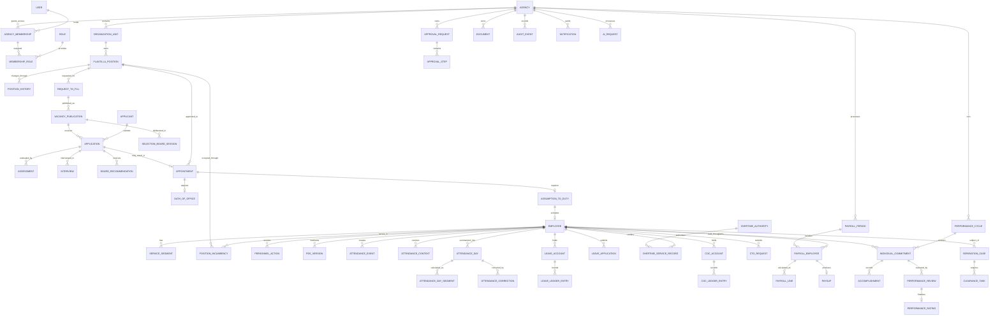

---

# 5. Identity and Agency Domain

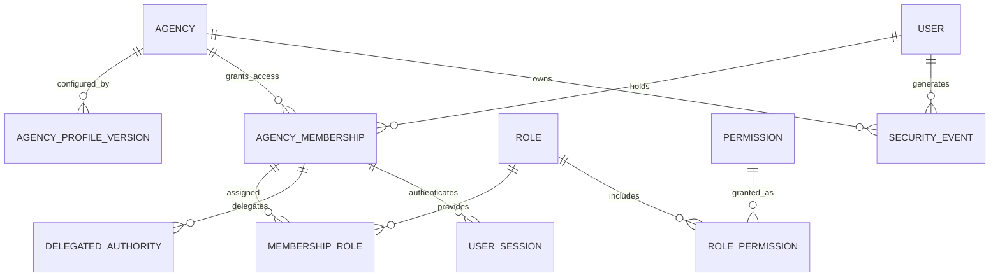

| Entity | Purpose |
| ------------------------ | -------------------------------------------------- |
| `AGENCY` | Root tenant and government-agency record |
| `AGENCY_PROFILE_VERSION` | Effective-dated agency rules and configuration |
| `USER` | Authenticated identity |
| `AGENCY_MEMBERSHIP` | Connects a user to an agency and optional employee |
| `ROLE` | Reusable role definition |
| `PERMISSION` | Atomic authorization capability |
| `MEMBERSHIP_ROLE` | Assigns roles to agency memberships |
| `ROLE_PERMISSION` | Assigns permissions to roles |
| `DELEGATED_AUTHORITY` | Time-bound acting or delegated authority |
| `USER_SESSION` | Active authenticated session |
| `SECURITY_EVENT` | Login, lockout, role change, or revocation event |

---

# 6. Organization and Plantilla Domain

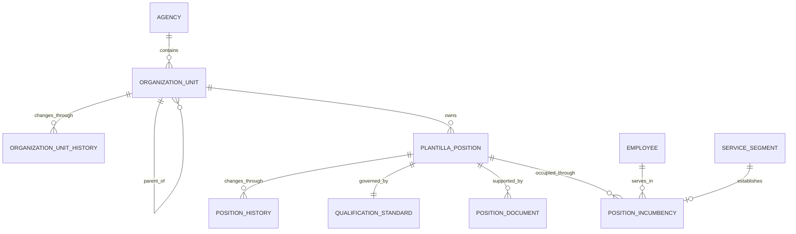

| Entity | Purpose |
| --------------------------- | ------------------------------------------------------------------------- |
| `ORGANIZATION_UNIT` | Office, bureau, service, division, section, or unit |
| `ORGANIZATION_UNIT_HISTORY` | Effective-dated reorganizations and name changes |
| `PLANTILLA_POSITION` | Authorized position or item |
| `POSITION_HISTORY` | Position title, grade, office, status, and funding history |
| `QUALIFICATION_STANDARD` | Education, training, experience, eligibility, and competency requirements |
| `POSITION_DOCUMENT` | Position description and staffing authority |
| `POSITION_INCUMBENCY` | Historical relationship between an employee and a position |

Conceptual constraint:

```text
One plantilla position may have many historical incumbencies,
but normally only one active incumbency.
```

---

# 7. Recruitment and Merit Selection Domain

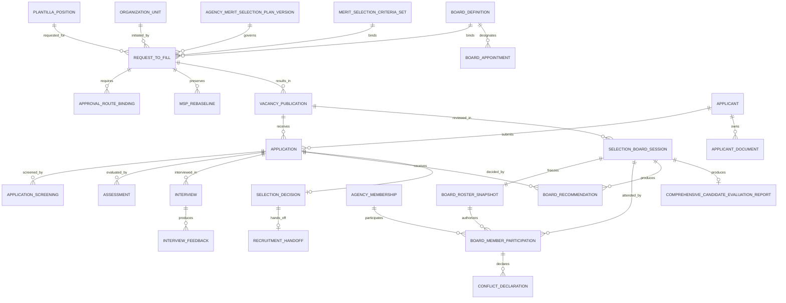

| Entity | Purpose |
| ------------------------------------------- | ------------------------------------------------------------------------- |
| `REQUEST_TO_FILL` | Approved request to recruit for a vacant item |
| `AGENCY_MERIT_SELECTION_PLAN_VERSION` | Immutable, effective-dated governing merit-selection plan                 |
| `MERIT_SELECTION_CRITERIA_SET`         | Bound criteria, weights, scales, cutoffs, evidence, and calculation rules |
| `APPROVAL_ROUTE_BINDING`      | Immutable checkpoint-to-route-version binding                             |
| `MSP_REBASELINE`              | Evidence-backed pre-publication replacement of governing bindings         |
| `VACANCY_PUBLICATION`         | Official publication cycle with exact CS Form No. 9 and evidence versions |
| `APPLICANT` | Person applying for one or more vacancies |
| `APPLICATION` | Applicant submission for one vacancy |
| `APPLICATION_SCREENING` | Qualification-standard comparison |
| `ASSESSMENT` | Examination or competency assessment |
| `INTERVIEW` | Interview event |
| `INTERVIEW_FEEDBACK` | Structured evaluator feedback |
| `BOARD_DEFINITION`            | Versioned seats, alternates, and quorum rule                              |
| `BOARD_APPOINTMENT`           | Effective-dated, evidence-backed designation to a board seat              |
| `SELECTION_BOARD_SESSION` | HRMPSB or equivalent deliberation |
| `BOARD_ROSTER_SNAPSHOT`       | Roster frozen when deliberation begins                                    |
| `BOARD_MEMBER_PARTICIPATION`  | Actual attendance, role, conflict, and recusal record                     |
| `CONFLICT_DECLARATION` | Conflict-of-interest record |
| `BOARD_RECOMMENDATION` | Board recommendation |
| `COMPREHENSIVE_CANDIDATE_EVALUATION_REPORT` | Versioned advisory comparative evaluation report                          |
| `SELECTION_DECISION` | Appointing-authority decision |
| `RECRUITMENT_HANDOFF`         | Idempotent immutable selected-candidate package sent to Appointment       |

The server resolves the governing configuration during controlled review. Zero or multiple matches fail closed. Publication freezes every binding, and a material later change requires cancellation and republication rather than mutation.

---

# 8. Appointment and Assumption Domain

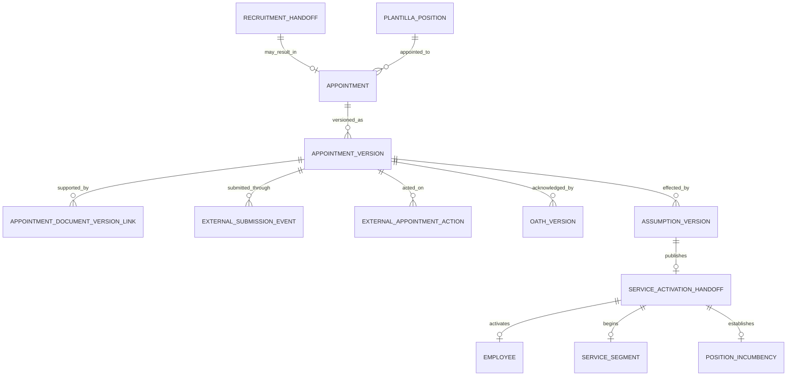

| Entity | Purpose |
| ----------------------------------- | ---------------------------------------------------------------------------------------------------------- |
| `APPOINTMENT` | Government appointment transaction |
| `APPOINTMENT_VERSION`               | Draft or immutable issued or replacement version with separate Employment Status and Nature of Appointment |
| `APPOINTMENT_DOCUMENT_VERSION_LINK` | Exact form or supporting Document Version used by an Appointment Version                                   |
| `EXTERNAL_SUBMISSION_EVENT`         | Append-only submission, receipt, return, or resubmission evidence                                          |
| `EXTERNAL_APPOINTMENT_ACTION`       | Append-only official approval, validation, disapproval, or invalidation evidence                           |
| `OATH_VERSION`                      | Immutable oath evidence version; correction creates a replacement                                          |
| `ASSUMPTION_VERSION`                | Immutable actual start-of-service certification version                                                    |
| `SERVICE_ACTIVATION_HANDOFF`        | Idempotent Assumed Appointment Contract consumed by Personnel and Plantilla                                |

Important lifecycle:

```text
Selection Decision
→ Recruitment handoff
→ Issued Appointment Contract
├── External CSC tracking
└── Oath → Assumption to Duty → Assumed Appointment Contract
                              ├── Personnel service activation
                              └── Plantilla occupancy
```

External CSC tracking and oath or assumption advance independently after issuance. CSC approval or validation is not a prerequisite for oath, assumption, salary entitlement, service activation, or occupancy. A later adverse action is preserved and routed to the applicable personnel response without rewriting prior history.

---

# 9. Personnel Records and Service History Domain

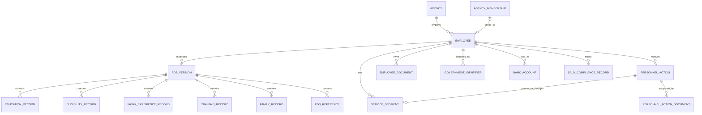

| Entity | Purpose |
| ------------------------ | ------------------------------------------------------------------- |
| `EMPLOYEE` | Agency personnel master record |
| `PDS_VERSION` | Draft or certified PDS version |
| `SERVICE_SEGMENT` | Effective period of government service |
| `PERSONNEL_ACTION` | Promotion, transfer, reassignment, step increment, separation, etc. |
| `EMPLOYEE_DOCUMENT` | Controlled personnel document |
| `GOVERNMENT_IDENTIFIER` | GSIS, PhilHealth, Pag-IBIG, and TIN identifiers |
| `BANK_ACCOUNT` | Protected payroll account |
| `SALN_COMPLIANCE_RECORD` | Filing status and acknowledgment |

Certified PDS versions and completed service segments must remain historically available.

---

# 10. Attendance and DTR Domain

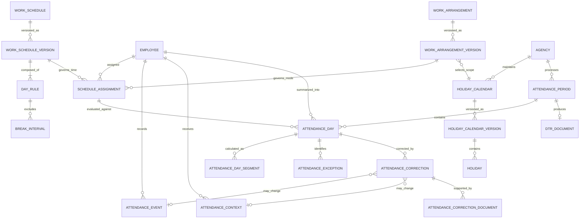

| Entity | Purpose |
| -------------------------- | -------------------------------------------------------------------------------------- |
| `WORK_SCHEDULE` | Stable identity for a reusable schedule |
| `WORK_SCHEDULE_VERSION` | Immutable effective Day Rules, time zone, event windows, and authority |
| `DAY_RULE` | Fixed, flexible, or rest-day duty rule for one weekday |
| `WORK_ARRANGEMENT_VERSION` | Immutable authorized operating mode and holiday-calendar scope |
| `SCHEDULE_ASSIGNMENT` | Effective binding of eligible Appointed Personnel to schedule and arrangement versions |
| `HOLIDAY_CALENDAR_VERSION` | Immutable scoped holiday and suspension classifications |
| `ATTENDANCE_EVENT` | Immutable raw manual or web-clock event |
| `ATTENDANCE_CONTEXT` | Evidence-backed official business, travel, training, or approved non-leave absence |
| `ATTENDANCE_DAY` | Versioned calculated attendance summary for one Work Date |
| `ATTENDANCE_DAY_SEGMENT` | Immutable interval-level calculation result and provenance |
| `ATTENDANCE_EXCEPTION` | Blocking missing or ambiguous calculation input |
| `ATTENDANCE_CORRECTION` | Approved add, replace, or void request for an event or context |
| `ATTENDANCE_PERIOD` | Review and payroll-locking period |
| `DTR_DOCUMENT` | Generated Daily Time Record |

---

# 11. Leave Administration Domain

```mermaid
erDiagram
    AGENCY ||--o{ LEAVE_TYPE : configures
    LEAVE_TYPE ||--o{ LEAVE_POLICY_VERSION : governed_by

    EMPLOYEE ||--o{ LEAVE_ACCOUNT : holds
    LEAVE_TYPE ||--o{ LEAVE_ACCOUNT : categorizes
    LEAVE_ACCOUNT ||--o{ LEAVE_LEDGER_ENTRY : records
    LEAVE_ACCOUNT ||--o{ LEAVE_CREDIT_COMMITMENT : reserves

    EMPLOYEE ||--o{ LEAVE_APPLICATION : submits
    LEAVE_APPLICATION ||--o{ LEAVE_APPLICATION_VERSION : preserves
    LEAVE_TYPE ||--o{ LEAVE_APPLICATION_VERSION : requested_as
    LEAVE_APPLICATION_VERSION ||--o{ LEAVE_APPLICATION_VERSION_DOCUMENT : supported_by
    DOCUMENT_VERSION ||--o{ LEAVE_APPLICATION_VERSION_DOCUMENT : linked_as
    LEAVE_APPLICATION_VERSION ||--|| APPROVAL_REQUEST : routed_by
    LEAVE_APPLICATION_VERSION ||--|{ LEAVE_CALCULATION_SEGMENT : calculated_as
    LEAVE_POLICY_VERSION ||--o{ LEAVE_CALCULATION_SEGMENT : governs
    LEAVE_APPLICATION_VERSION ||--o{ LEAVE_ELIGIBILITY_ASSESSMENT : evaluated_by
    LEAVE_APPLICATION_VERSION ||--o| LEAVE_CREDIT_CERTIFICATION : certified_by
    APPROVAL_DECISION ||--o| LEAVE_CREDIT_CERTIFICATION : records
    LEAVE_CREDIT_CERTIFICATION ||--|{ LEAVE_CREDIT_CERTIFICATION_LINE : contains
    LEAVE_ACCOUNT ||--o{ LEAVE_CREDIT_CERTIFICATION_LINE : certifies
    LEAVE_APPLICATION_VERSION ||--o{ LEAVE_CREDIT_COMMITMENT : reserves
    LEAVE_CREDIT_COMMITMENT o|--o| LEAVE_CREDIT_COMMITMENT : narrowed_by
    LEAVE_APPLICATION_VERSION ||--o| LEAVE_RECOMMENDATION : recommended_by
    APPROVAL_DECISION ||--o| LEAVE_RECOMMENDATION : records
    LEAVE_APPLICATION_VERSION ||--o| LEAVE_APPROVAL_ALLOCATION : resolved_by
    APPROVAL_DECISION ||--o| LEAVE_APPROVAL_ALLOCATION : authorizes
    LEAVE_APPROVAL_ALLOCATION ||--|{ LEAVE_APPROVAL_ALLOCATION_LINE : contains
    LEAVE_APPLICATION_VERSION ||--o| LEAVE_POSTING : posted_by
    LEAVE_POSTING ||--o{ LEAVE_POSTING_EFFECT : creates
    LEAVE_APPLICATION ||--o{ LEAVE_CANCELLATION : corrected_by
    LEAVE_CANCELLATION ||--|| APPROVAL_REQUEST : routed_by
    LEAVE_CANCELLATION ||--|{ LEAVE_CANCELLATION_SCOPE : targets
    LEAVE_CANCELLATION ||--o{ LEAVE_CANCELLATION_EFFECT : applies

    EMPLOYEE ||--o{ MANDATORY_LEAVE_ASSESSMENT : assessed_for
    LEAVE_POLICY_VERSION ||--o{ MANDATORY_LEAVE_ASSESSMENT : governs

    EMPLOYEE ||--o{ LEAVE_MONETIZATION_REQUEST : requests
    LEAVE_ACCOUNT ||--o{ LEAVE_MONETIZATION_REQUEST : funded_by
    LEAVE_MONETIZATION_REQUEST ||--o{ LEAVE_LEDGER_ENTRY : posts
    LEAVE_MONETIZATION_REQUEST ||--o| PAYROLL_INPUT : creates
```

| Entity | Purpose |
| ------------------------------------ | -------------------------------------------------------------------------------- |
| `LEAVE_TYPE` | Government leave category |
| `LEAVE_POLICY_VERSION`         | Immutable agency-scoped effective-dated rules and authority bindings      |
| `LEAVE_ACCOUNT` | Employee account for a leave type |
| `LEAVE_LEDGER_ENTRY`           | Immutable signed posting whose source owns its business meaning |
| `LEAVE_CREDIT_COMMITMENT`      | Unposted claim considered when calculating available credits    |
| `LEAVE_APPLICATION`                  | Stable case preserving the full leave request lifecycle                          |
| `LEAVE_APPLICATION_VERSION`          | Immutable submitted facts, attestation, evidence, assessment, and route binding  |
| `LEAVE_APPLICATION_VERSION_DOCUMENT` | Exact supporting or rendered Document Version linked to one submission           |
| `LEAVE_CALCULATION_SEGMENT`    | Immutable effective-dated quantity calculation within a request |
| `LEAVE_ELIGIBILITY_ASSESSMENT` | Explainable eligible, ineligible, or indeterminate evaluation   |
| `LEAVE_CREDIT_CERTIFICATION`   | HR-certified available credits across affected accounts                  |
| `LEAVE_CREDIT_CERTIFICATION_LINE` | Certified posted, committed, requested, and available quantities for one account |
| `LEAVE_RECOMMENDATION`               | Immutable advisory Supervisor recommendation                                     |
| `LEAVE_APPROVAL_ALLOCATION`          | Authorized exact approved periods and charged, paid, or unpaid quantities        |
| `LEAVE_APPROVAL_ALLOCATION_LINE`     | One exact portion of the authorized allocation                                   |
| `LEAVE_POSTING`                      | Atomic source of ledger, Attendance, and Payroll effects                         |
| `LEAVE_POSTING_EFFECT`               | Stable owner-issued identifier and state for one posting effect                  |
| `LEAVE_CANCELLATION`                 | Authorized whole or partial correction of approved or posted leave               |
| `LEAVE_CANCELLATION_SCOPE`           | Exact approved period and quantity targeted by cancellation                      |
| `LEAVE_CANCELLATION_EFFECT`          | Owner-issued reversal or correction handoff and current state                    |
| `MANDATORY_LEAVE_ASSESSMENT`   | Explainable as-of evaluation of a mandatory-leave obligation    |
| `LEAVE_MONETIZATION_REQUEST` | Monetization request |
| `PAYROLL_INPUT` | Approved HR input consumed by payroll |

---

# 12. Overtime, COC, and CTO Domain

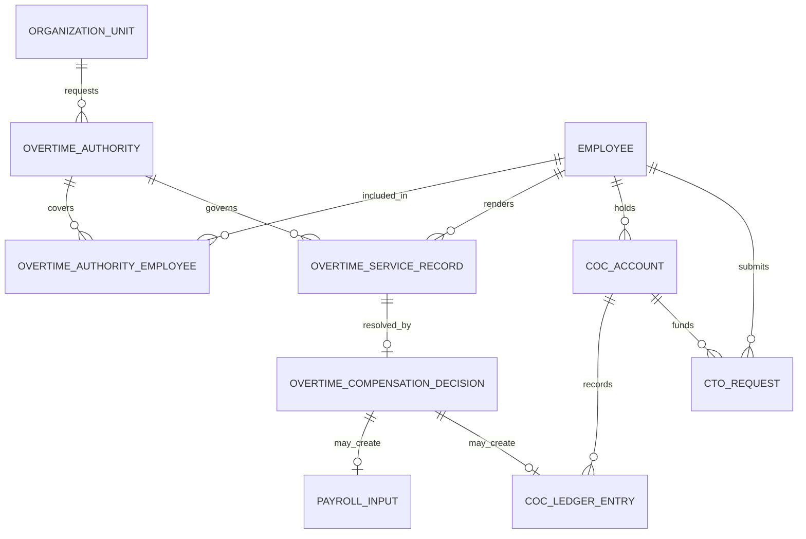

| Entity | Purpose |
| -------------------------------- | ------------------------------------------------ |
| `OVERTIME_AUTHORITY` | Prior authorization for overtime |
| `OVERTIME_AUTHORITY_EMPLOYEE` | Covered employee list |
| `OVERTIME_SERVICE_RECORD` | Actual rendered service |
| `OVERTIME_COMPENSATION_DECISION` | OT pay, COC, or non-compensable decision |
| `COC_ACCOUNT` | Compensatory Overtime Credit account |
| `COC_LEDGER_ENTRY` | Earned, used, adjusted, expired, or reversed COC |
| `CTO_REQUEST` | Request to use COC as compensatory time off |

---

# 13. Government Payroll Domain

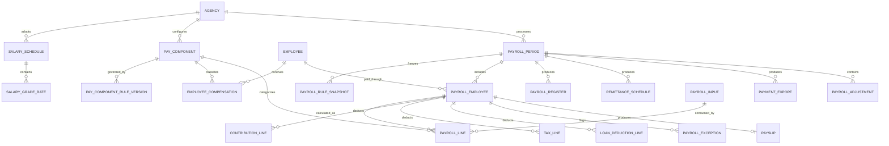

| Entity | Purpose |
| ----------------------- | ----------------------------------------------------- |
| `SALARY_SCHEDULE` | Effective government salary schedule |
| `SALARY_GRADE_RATE` | Grade-and-step amount |
| `PAY_COMPONENT` | Earning, deduction, contribution, or adjustment type |
| `EMPLOYEE_COMPENSATION` | Effective employee compensation assignment |
| `PAYROLL_PERIOD` | Payroll run |
| `PAYROLL_RULE_SNAPSHOT` | Frozen rules used by the run |
| `PAYROLL_EMPLOYEE` | Employee-level payroll result |
| `PAYROLL_LINE` | Detailed immutable calculation line |
| `CONTRIBUTION_LINE` | Employee and employer contribution detail |
| `TAX_LINE` | Withholding-tax detail |
| `LOAN_DEDUCTION_LINE` | Loan or authorized deduction |
| `PAYROLL_EXCEPTION` | Warning or blocking issue |
| `PAYSLIP` | Employee payroll statement |
| `PAYROLL_ADJUSTMENT` | Supplemental, correction, refund, or replacement item |

---

# 14. SPMS Performance Domain

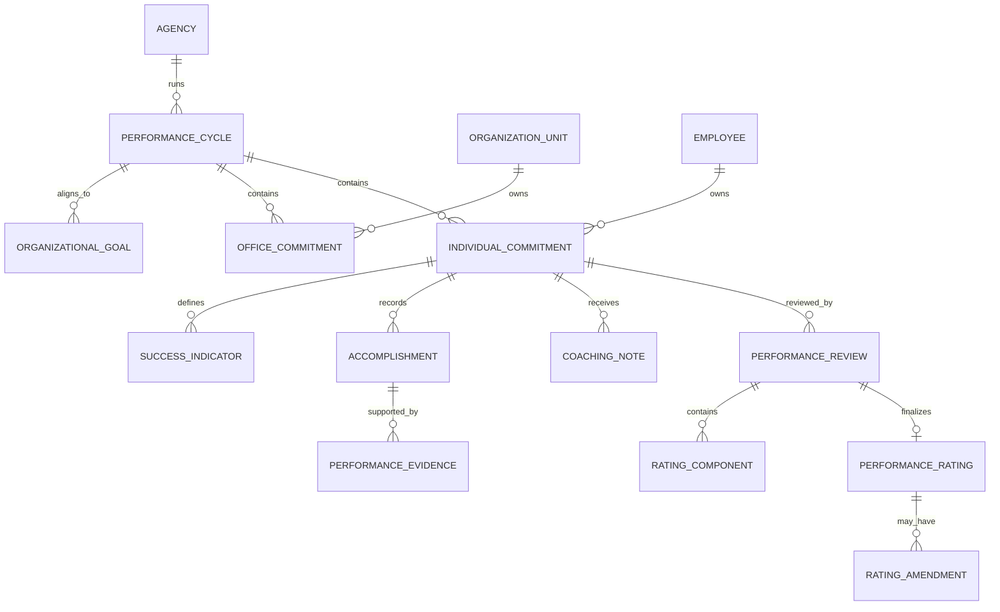

| Entity | Purpose |
| ----------------------- | -------------------------------------------------------- |
| `PERFORMANCE_CYCLE` | SPMS rating cycle |
| `ORGANIZATIONAL_GOAL` | Agency or office goal |
| `OFFICE_COMMITMENT` | OPCR, DPCR, or equivalent |
| `INDIVIDUAL_COMMITMENT` | IPCR or equivalent |
| `SUCCESS_INDICATOR` | Target, measure, weight, quality, efficiency, timeliness |
| `ACCOMPLISHMENT` | Actual result |
| `PERFORMANCE_EVIDENCE` | Supporting file or reference |
| `COACHING_NOTE` | Monitoring and coaching record |
| `PERFORMANCE_REVIEW` | Supervisor or calibration review |
| `PERFORMANCE_RATING` | Final rating |
| `RATING_AMENDMENT` | Controlled correction preserving original rating |

---

# 15. Separation and Clearance Domain

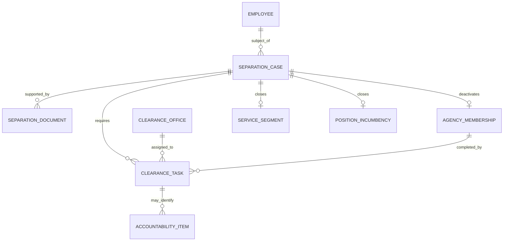

| Entity | Purpose |
| --------------------- | ------------------------------------------------------------------------- |
| `SEPARATION_CASE` | Resignation, retirement, transfer, expiration, death, or other separation |
| `SEPARATION_DOCUMENT` | Acceptance, authority, or supporting evidence |
| `CLEARANCE_OFFICE` | Office participating in clearance |
| `CLEARANCE_TASK` | Individual clearance requirement |
| `ACCOUNTABILITY_ITEM` | Property, cash, document, or other accountability |

---

# 16. Shared Workflow, Documents, Audit, Notifications, and AI

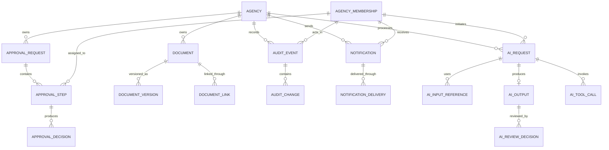

| Entity | Purpose |
| ----------------------- | -------------------------------------------------- |
| `APPROVAL_REQUEST` | Shared approval workflow linked to a domain entity |
| `APPROVAL_STEP` | Sequential or parallel approval step |
| `APPROVAL_DECISION` | Approve, reject, return, or delegate |
| `DOCUMENT` | Controlled document identity |
| `DOCUMENT_VERSION` | Immutable or draft document version |
| `DOCUMENT_LINK` | Associates a document with domain records |
| `AUDIT_EVENT` | Append-only business or security event |
| `AUDIT_CHANGE` | Field-level before-and-after values |
| `NOTIFICATION` | In-app notification |
| `NOTIFICATION_DELIVERY` | Email or other delivery attempt |
| `AI_REQUEST` | Controlled AI task |
| `AI_INPUT_REFERENCE` | Minimum source records used |
| `AI_OUTPUT` | Validated draft or structured output |
| `AI_REVIEW_DECISION` | Human accept, edit, or reject decision |
| `AI_TOOL_CALL` | Controlled application tool invocation |

A generic approval engine records decisions, but the owning domain service must execute the approved business action.

---

# 17. Cross-Domain Lifecycle Rules

## 17.1 Identity separation

```text
USER
└── AGENCY_MEMBERSHIP
    └── optional EMPLOYEE link
```

A user may:

- belong to multiple agencies;
- be an auditor without being an employee;
- retain identity history after agency membership is deactivated.

## 17.2 Position occupancy

```text
PLANTILLA_POSITION
└── POSITION_INCUMBENCY
    └── EMPLOYEE
```

A position may be vacant, reserved, occupied, frozen, or abolished independently of an employee record.

## 17.3 Recruitment to service

```text
VACANT POSITION
→ REQUEST TO FILL
→ GOVERNING CONFIGURATION BINDINGS
→ VACANCY PUBLICATION
→ APPLICATION
→ SELECTION DECISION
→ RECRUITMENT HANDOFF
→ ISSUED APPOINTMENT CONTRACT
→ ASSUMED APPOINTMENT CONTRACT
→ PERSONNEL SERVICE SEGMENT + PLANTILLA INCUMBENCY
```

## 17.4 Immutable ledger model

These entities use immutable entries:

- finalized governing Recruitment bindings and MSP Rebaselines;
- Assessment Result Versions, Board Roster Snapshots, Board Recommendations, and Selection Decisions;
- issued Appointment Versions, external submission and action events, Oath Versions, and Assumption Versions;
- `LEAVE_LEDGER_ENTRY`;
- `COC_LEDGER_ENTRY`;
- finalized `PAYROLL_LINE`;
- `AUDIT_EVENT`.

Corrections create adjustment or reversal entries.

## 17.5 Effective-dated records

The logical model should effective-date:

- agency profile versions;
- organization and position history;
- qualification standards;
- service segments;
- personnel actions;
- schedules and work arrangements;
- leave policies;
- salary schedules;
- compensation assignments;
- delegated authority.

---

# 18. Conceptual Constraints for Logical Design

The logical ERD must later enforce:

1. one active membership per user and agency;
2. no cycle in the organization-unit hierarchy;
3. unique active item number within an agency;
4. normally one active incumbent per plantilla position;
5. no Recruitment publication unless exactly one governing configuration set is bound;
6. no position occupancy without an Assumed Appointment Contract or effective personnel action;
7. assumption date cannot precede appointment issuance;
8. service segments must not improperly overlap;
9. certified PDS versions cannot be overwritten;
10. raw attendance events cannot be edited directly;
11. locked attendance requires an adjustment;
12. leave and COC reversals must reference original ledger entries;
13. one payroll-employee result per employee and payroll period;
14. finalized payroll lines cannot be edited;
15. final performance ratings require controlled amendment;
16. effectual separation closes service and occupancy but preserves history;
17. every operational entity is traceable to one agency.

---

# 19. Proposed Module Ownership

| Module | Aggregate roots |
| ----------- | --------------------------------------------------------------------------------------------------- |
| Identity | User, AgencyMembership, Role |
| Agency | Agency, OrganizationUnit |
| Plantilla | PlantillaPosition, QualificationStandard |
| Recruitment | RequestToFill, VacancyPublication, Application, SelectionBoardSession, SelectionDecision |
| Appointment | Appointment, ExternalAppointmentAction, OathVersion, AssumptionVersion                   |
| Personnel | Employee, PdsVersion, PersonnelAction, ServiceSegment |
| Attendance | WorkSchedule, AttendancePeriod, AttendanceDay |
| Leave       | LeaveType, LeaveAccount, LeaveApplication, LeaveApplicationVersion, LeavePosting, LeaveCancellation |
| Overtime | OvertimeAuthority, CocAccount, CtoRequest |
| Payroll | SalarySchedule, PayComponent, PayrollPeriod |
| Performance | PerformanceCycle, IndividualCommitment |
| Separation | SeparationCase |
| Workflow | ApprovalRequest |
| Documents | Document |
| Audit | AuditEvent |
| AI | AiRequest |

Cross-module reads and writes occur through owning application services, not direct access to another module's tables. The Recruitment-to-Appointment handoff is idempotent. Personnel service activation and Plantilla occupancy consume the same Assumed Appointment Contract and commit atomically with the originating business event.

---

# 20. Next Logical ERD Files

After approval, split the model into:

```text
docs/data-model/
├── identity-and-agency-logical-erd.md
├── organization-and-plantilla-logical-erd.md
├── recruitment-and-selection-logical-erd.md
├── appointment-and-personnel-logical-erd.md
├── attendance-and-leave-logical-erd.md
├── overtime-coc-cto-logical-erd.md
├── payroll-logical-erd.md
├── spms-logical-erd.md
├── separation-logical-erd.md
└── approvals-documents-audit-ai-logical-erd.md
```

Each logical ERD will add:

- primary and foreign keys;
- candidate columns;
- uniqueness;
- nullability;
- tenant keys;
- status constraints;
- effective dates;
- deletion behavior;
- immutable-record rules.

---

# 21. Review Checklist

- [ ] Agency is the root tenant.
- [ ] User, membership, and employee are separate.
- [ ] Organization units support hierarchy and history.
- [ ] Positions are separate from incumbents.
- [ ] Recruitment begins from an authorized vacancy.
- [ ] Application, appointment, assumption, and employee are separate.
- [ ] PDS versions and service segments preserve history.
- [ ] Raw and calculated attendance are separate.
- [ ] Leave and COC use ledgers.
- [ ] Payroll stores employee-level and line-level results.
- [ ] Finalized payroll can be immutable.
- [ ] SPMS commitments, evidence, reviews, and ratings are separated.
- [ ] Separation closes service without deleting history.
- [ ] Generic approval cannot bypass domain rules.
- [ ] Documents and audit records are cross-domain.
- [ ] AI output remains subject to human review.
- [ ] No biometric import entity exists in MVP.

---

# 22. Approval

| Role | Name | Decision | Date |
| ----------------------------- | ---- | -------- | ---- |
| Product Owner |  | Pending |  |
| Government HR / HRMO Reviewer |  | Pending |  |
| Payroll / Accounting Reviewer |  | Pending |  |
| Technical Owner |  | Pending |  |
| Data / Security Reviewer |  | Pending |  |

---

# 23. Change Log

| Version | Date | Description |
| ------- | -------------- | ---------------------------------------------------------------- |
| 1.0 | August 6, 2026 | Initial conceptual ERD for the Philippine Public-Sector HRIS MVP |
