# Philippine Public-Sector HRIS MVP
## Conceptual Entity-Relationship Diagram

**Document status:** Draft for review  
**Source documents:** Public-Sector HRIS BRD v1.0, Workflow Specification v1.0, Controls Specification v1.0  
**Primary profile:** Civilian National Government Agency  
**Version:** 1.0  
**Date:** August 6, 2026

---

# 1. Purpose

This document defines the conceptual data model for the Philippine Public-Sector HRIS MVP.

It identifies major entities, domain boundaries, relationships, and cardinalities. It does not yet define PostgreSQL data types, Prisma models, indexes, Row-Level Security policies, or migration scripts.

---

# 2. Modeling Principles

1. `AGENCY` is the tenant and ownership boundary.
2. `USER`, `AGENCY_MEMBERSHIP`, and `EMPLOYEE` are separate concepts.
3. A plantilla position exists independently from its incumbent.
4. Recruitment begins from an authorized vacant position.
5. Appointment issuance is separate from assumption to duty.
6. Personnel history is effective-dated and never silently overwritten.
7. Raw attendance events are separate from calculated attendance days.
8. Leave and COC balances use immutable ledger entries.
9. Finalized payroll lines are immutable.
10. Shared approvals never bypass domain validation.
11. Documents, audit events, notifications, and AI requests are cross-domain services.
12. Biometric-device integrations and biometric-file imports are outside MVP.

---

# 3. Cardinality Legend

```text
||  exactly one
o|  zero or one
|{  one or many
o{  zero or many
```

---

# 4. Consolidated High-Level ERD

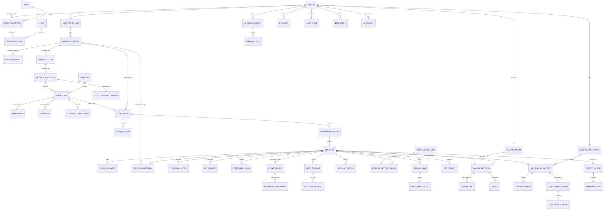

---

# 5. Identity and Agency Domain

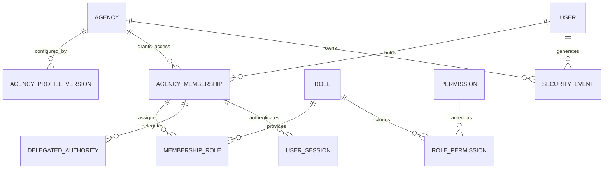

| Entity | Purpose |
|---|---|
| `AGENCY` | Root tenant and government-agency record |
| `AGENCY_PROFILE_VERSION` | Effective-dated agency rules and configuration |
| `USER` | Authenticated identity |
| `AGENCY_MEMBERSHIP` | Connects a user to an agency and optional employee |
| `ROLE` | Reusable role definition |
| `PERMISSION` | Atomic authorization capability |
| `MEMBERSHIP_ROLE` | Assigns roles to agency memberships |
| `ROLE_PERMISSION` | Assigns permissions to roles |
| `DELEGATED_AUTHORITY` | Time-bound acting or delegated authority |
| `USER_SESSION` | Active authenticated session |
| `SECURITY_EVENT` | Login, lockout, role change, or revocation event |

---

# 6. Organization and Plantilla Domain

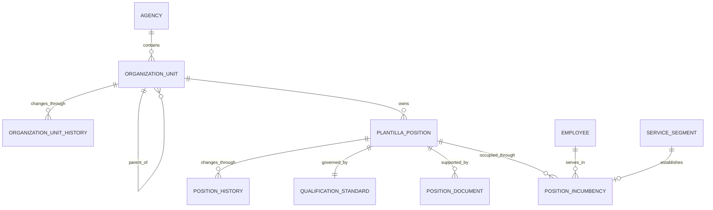

| Entity | Purpose |
|---|---|
| `ORGANIZATION_UNIT` | Office, bureau, service, division, section, or unit |
| `ORGANIZATION_UNIT_HISTORY` | Effective-dated reorganizations and name changes |
| `PLANTILLA_POSITION` | Authorized position or item |
| `POSITION_HISTORY` | Position title, grade, office, status, and funding history |
| `QUALIFICATION_STANDARD` | Education, training, experience, eligibility, and competency requirements |
| `POSITION_DOCUMENT` | Position description and staffing authority |
| `POSITION_INCUMBENCY` | Historical relationship between an employee and a position |

Conceptual constraint:

```text
One plantilla position may have many historical incumbencies,
but normally only one active incumbency.
```

---

# 7. Recruitment and Merit Selection Domain

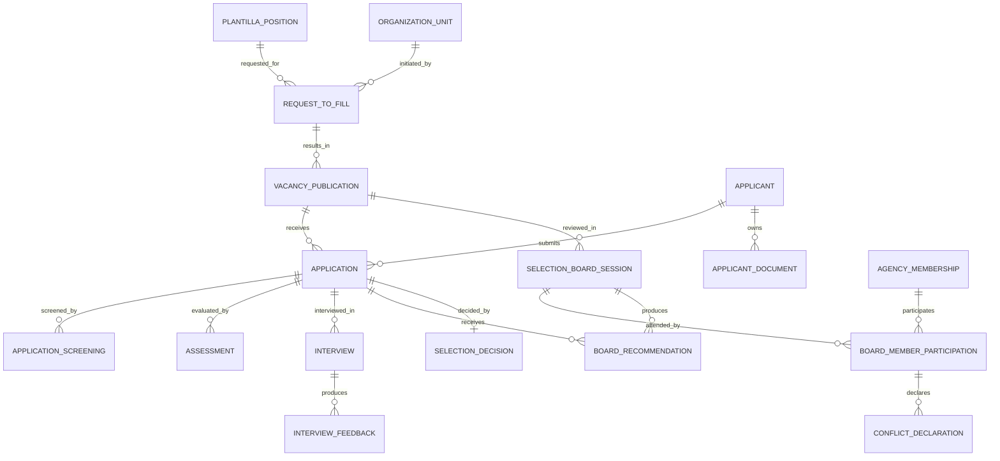

| Entity | Purpose |
|---|---|
| `REQUEST_TO_FILL` | Approved request to recruit for a vacant item |
| `VACANCY_PUBLICATION` | Official publication cycle |
| `APPLICANT` | Person applying for one or more vacancies |
| `APPLICATION` | Applicant submission for one vacancy |
| `APPLICATION_SCREENING` | Qualification-standard comparison |
| `ASSESSMENT` | Examination or competency assessment |
| `INTERVIEW` | Interview event |
| `INTERVIEW_FEEDBACK` | Structured evaluator feedback |
| `SELECTION_BOARD_SESSION` | HRMPSB or equivalent deliberation |
| `BOARD_MEMBER_PARTICIPATION` | Board attendance and role |
| `CONFLICT_DECLARATION` | Conflict-of-interest record |
| `BOARD_RECOMMENDATION` | Board recommendation |
| `SELECTION_DECISION` | Appointing-authority decision |

---

# 8. Appointment and Assumption Domain

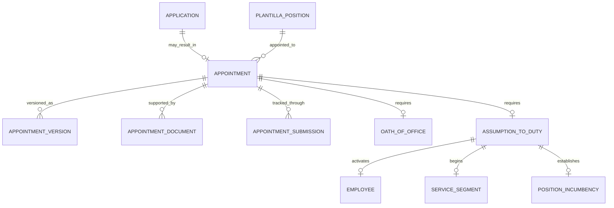

| Entity | Purpose |
|---|---|
| `APPOINTMENT` | Government appointment transaction |
| `APPOINTMENT_VERSION` | Issued, corrected, returned, or replacement version |
| `APPOINTMENT_DOCUMENT` | Supporting appointment documents |
| `APPOINTMENT_SUBMISSION` | CSC or external submission tracking |
| `OATH_OF_OFFICE` | Oath record |
| `ASSUMPTION_TO_DUTY` | Actual start-of-service certification |

Important lifecycle:

```text
Application
→ Appointment
→ Oath
→ Assumption to Duty
→ Employee Service
```

Selection or appointment issuance alone does not create active service.

---

# 9. Personnel Records and Service History Domain

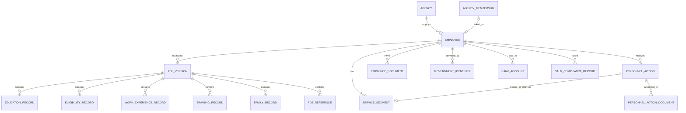

| Entity | Purpose |
|---|---|
| `EMPLOYEE` | Agency personnel master record |
| `PDS_VERSION` | Draft or certified PDS version |
| `SERVICE_SEGMENT` | Effective period of government service |
| `PERSONNEL_ACTION` | Promotion, transfer, reassignment, step increment, separation, etc. |
| `EMPLOYEE_DOCUMENT` | Controlled personnel document |
| `GOVERNMENT_IDENTIFIER` | GSIS, PhilHealth, Pag-IBIG, and TIN identifiers |
| `BANK_ACCOUNT` | Protected payroll account |
| `SALN_COMPLIANCE_RECORD` | Filing status and acknowledgment |

Certified PDS versions and completed service segments must remain historically available.

---

# 10. Attendance and DTR Domain

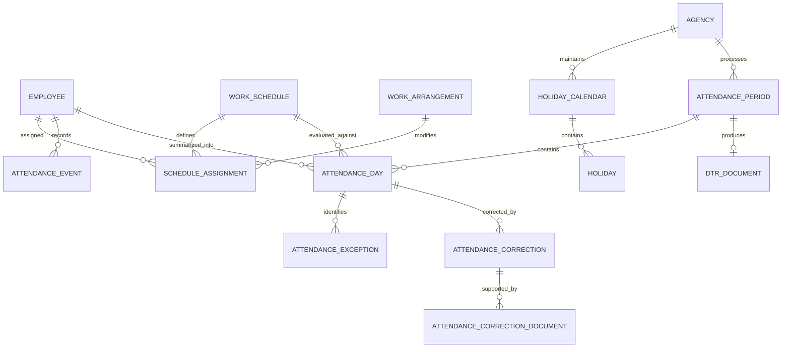

| Entity | Purpose |
|---|---|
| `WORK_SCHEDULE` | Reusable schedule pattern |
| `WORK_ARRANGEMENT` | Office, hybrid, WFH, field, or other arrangement |
| `SCHEDULE_ASSIGNMENT` | Effective employee schedule |
| `ATTENDANCE_EVENT` | Immutable raw manual or web-clock event |
| `ATTENDANCE_DAY` | Calculated daily attendance |
| `ATTENDANCE_EXCEPTION` | Missing event, tardiness, undertime, or mismatch |
| `ATTENDANCE_CORRECTION` | Correction request and decision |
| `ATTENDANCE_PERIOD` | Review and payroll-locking period |
| `DTR_DOCUMENT` | Generated Daily Time Record |

---

# 11. Leave Administration Domain

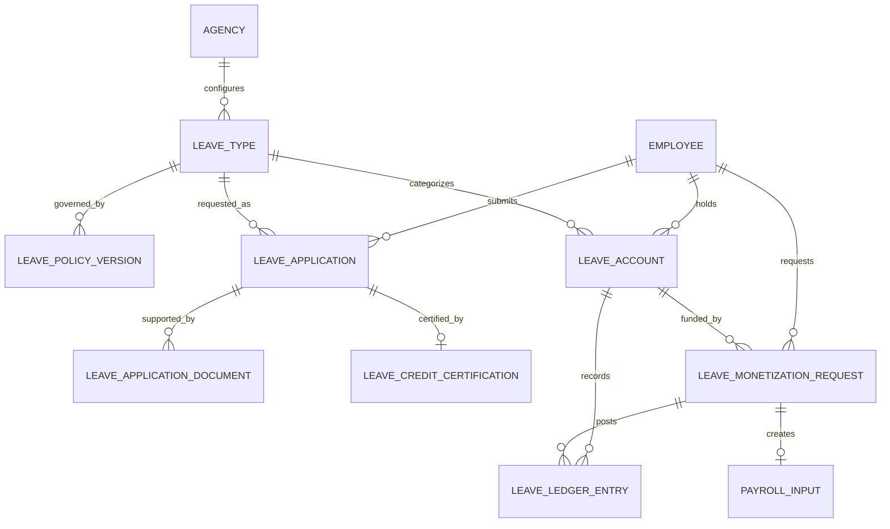

| Entity | Purpose |
|---|---|
| `LEAVE_TYPE` | Government leave category |
| `LEAVE_POLICY_VERSION` | Effective-dated leave rules |
| `LEAVE_ACCOUNT` | Employee account for a leave type |
| `LEAVE_LEDGER_ENTRY` | Immutable credit, debit, adjustment, or reversal |
| `LEAVE_APPLICATION` | Leave request |
| `LEAVE_CREDIT_CERTIFICATION` | HR-certified available credits |
| `LEAVE_MONETIZATION_REQUEST` | Monetization request |
| `PAYROLL_INPUT` | Approved HR input consumed by payroll |

---

# 12. Overtime, COC, and CTO Domain

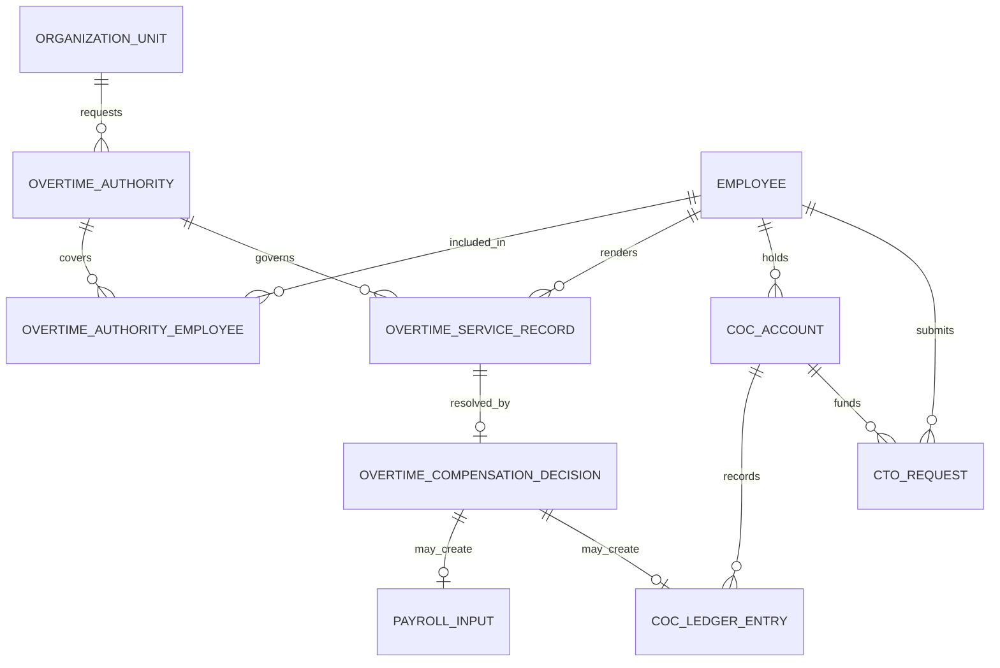

| Entity | Purpose |
|---|---|
| `OVERTIME_AUTHORITY` | Prior authorization for overtime |
| `OVERTIME_AUTHORITY_EMPLOYEE` | Covered employee list |
| `OVERTIME_SERVICE_RECORD` | Actual rendered service |
| `OVERTIME_COMPENSATION_DECISION` | OT pay, COC, or non-compensable decision |
| `COC_ACCOUNT` | Compensatory Overtime Credit account |
| `COC_LEDGER_ENTRY` | Earned, used, adjusted, expired, or reversed COC |
| `CTO_REQUEST` | Request to use COC as compensatory time off |

---

# 13. Government Payroll Domain

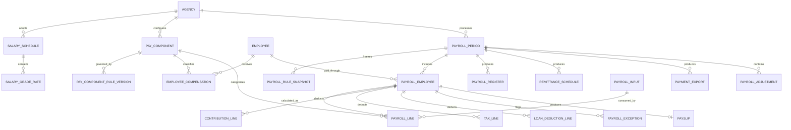

| Entity | Purpose |
|---|---|
| `SALARY_SCHEDULE` | Effective government salary schedule |
| `SALARY_GRADE_RATE` | Grade-and-step amount |
| `PAY_COMPONENT` | Earning, deduction, contribution, or adjustment type |
| `EMPLOYEE_COMPENSATION` | Effective employee compensation assignment |
| `PAYROLL_PERIOD` | Payroll run |
| `PAYROLL_RULE_SNAPSHOT` | Frozen rules used by the run |
| `PAYROLL_EMPLOYEE` | Employee-level payroll result |
| `PAYROLL_LINE` | Detailed immutable calculation line |
| `CONTRIBUTION_LINE` | Employee and employer contribution detail |
| `TAX_LINE` | Withholding-tax detail |
| `LOAN_DEDUCTION_LINE` | Loan or authorized deduction |
| `PAYROLL_EXCEPTION` | Warning or blocking issue |
| `PAYSLIP` | Employee payroll statement |
| `PAYROLL_ADJUSTMENT` | Supplemental, correction, refund, or replacement item |

---

# 14. SPMS Performance Domain

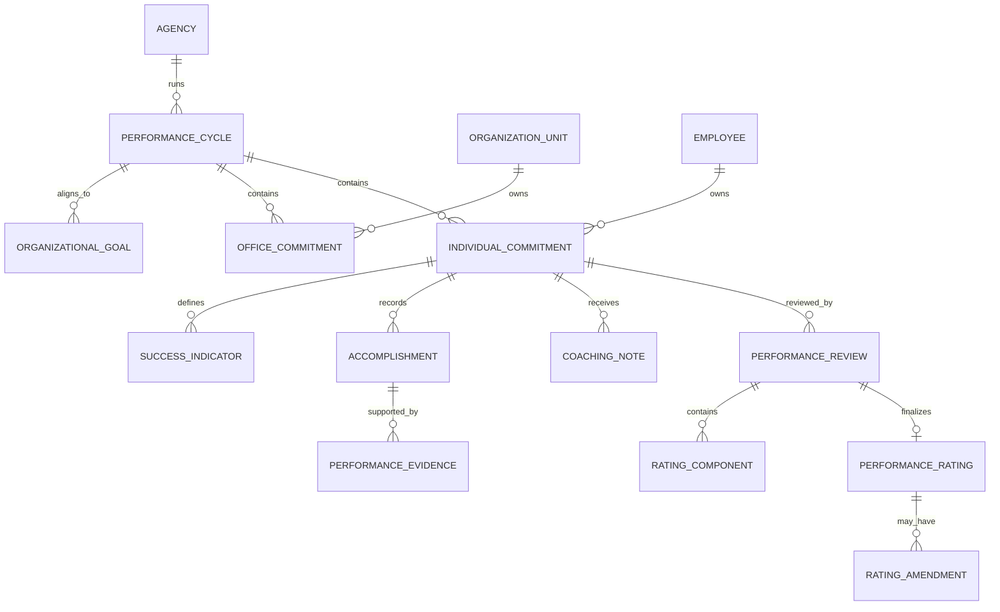

| Entity | Purpose |
|---|---|
| `PERFORMANCE_CYCLE` | SPMS rating cycle |
| `ORGANIZATIONAL_GOAL` | Agency or office goal |
| `OFFICE_COMMITMENT` | OPCR, DPCR, or equivalent |
| `INDIVIDUAL_COMMITMENT` | IPCR or equivalent |
| `SUCCESS_INDICATOR` | Target, measure, weight, quality, efficiency, timeliness |
| `ACCOMPLISHMENT` | Actual result |
| `PERFORMANCE_EVIDENCE` | Supporting file or reference |
| `COACHING_NOTE` | Monitoring and coaching record |
| `PERFORMANCE_REVIEW` | Supervisor or calibration review |
| `PERFORMANCE_RATING` | Final rating |
| `RATING_AMENDMENT` | Controlled correction preserving original rating |

---

# 15. Separation and Clearance Domain

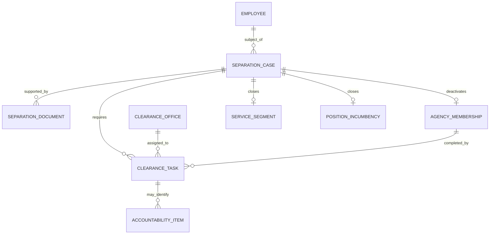

| Entity | Purpose |
|---|---|
| `SEPARATION_CASE` | Resignation, retirement, transfer, expiration, death, or other separation |
| `SEPARATION_DOCUMENT` | Acceptance, authority, or supporting evidence |
| `CLEARANCE_OFFICE` | Office participating in clearance |
| `CLEARANCE_TASK` | Individual clearance requirement |
| `ACCOUNTABILITY_ITEM` | Property, cash, document, or other accountability |

---

# 16. Shared Workflow, Documents, Audit, Notifications, and AI

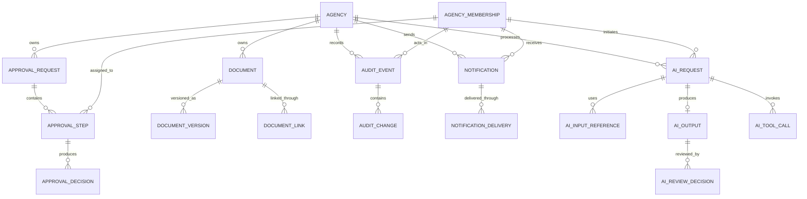

| Entity | Purpose |
|---|---|
| `APPROVAL_REQUEST` | Shared approval workflow linked to a domain entity |
| `APPROVAL_STEP` | Sequential or parallel approval step |
| `APPROVAL_DECISION` | Approve, reject, return, or delegate |
| `DOCUMENT` | Controlled document identity |
| `DOCUMENT_VERSION` | Immutable or draft document version |
| `DOCUMENT_LINK` | Associates a document with domain records |
| `AUDIT_EVENT` | Append-only business or security event |
| `AUDIT_CHANGE` | Field-level before-and-after values |
| `NOTIFICATION` | In-app notification |
| `NOTIFICATION_DELIVERY` | Email or other delivery attempt |
| `AI_REQUEST` | Controlled AI task |
| `AI_INPUT_REFERENCE` | Minimum source records used |
| `AI_OUTPUT` | Validated draft or structured output |
| `AI_REVIEW_DECISION` | Human accept, edit, or reject decision |
| `AI_TOOL_CALL` | Controlled application tool invocation |

A generic approval engine records decisions, but the owning domain service must execute the approved business action.

---

# 17. Cross-Domain Lifecycle Rules

## 17.1 Identity separation

```text
USER
└── AGENCY_MEMBERSHIP
    └── optional EMPLOYEE link
```

A user may:

- belong to multiple agencies;
- be an auditor without being an employee;
- retain identity history after agency membership is deactivated.

## 17.2 Position occupancy

```text
PLANTILLA_POSITION
└── POSITION_INCUMBENCY
    └── EMPLOYEE
```

A position may be vacant, reserved, occupied, frozen, or abolished independently of an employee record.

## 17.3 Recruitment to service

```text
VACANT POSITION
→ REQUEST TO FILL
→ VACANCY PUBLICATION
→ APPLICATION
→ SELECTION DECISION
→ APPOINTMENT
→ ASSUMPTION TO DUTY
→ EMPLOYEE SERVICE SEGMENT
```

## 17.4 Immutable ledger model

These entities use immutable entries:

- `LEAVE_LEDGER_ENTRY`;
- `COC_LEDGER_ENTRY`;
- finalized `PAYROLL_LINE`;
- `AUDIT_EVENT`.

Corrections create adjustment or reversal entries.

## 17.5 Effective-dated records

The logical model should effective-date:

- agency profile versions;
- organization and position history;
- qualification standards;
- service segments;
- personnel actions;
- schedules and work arrangements;
- leave policies;
- salary schedules;
- compensation assignments;
- delegated authority.

---

# 18. Conceptual Constraints for Logical Design

The logical ERD must later enforce:

1. one active membership per user and agency;
2. no cycle in the organization-unit hierarchy;
3. unique active item number within an agency;
4. normally one active incumbent per plantilla position;
5. no position occupancy without valid appointment or personnel action;
6. assumption date cannot precede appointment issuance;
7. service segments must not improperly overlap;
8. certified PDS versions cannot be overwritten;
9. raw attendance events cannot be edited directly;
10. locked attendance requires an adjustment;
11. leave and COC reversals must reference original ledger entries;
12. one payroll-employee result per employee and payroll period;
13. finalized payroll lines cannot be edited;
14. final performance ratings require controlled amendment;
15. effectual separation closes service and occupancy but preserves history;
16. every operational entity is traceable to one agency.

---

# 19. Proposed Module Ownership

| Module | Aggregate roots |
|---|---|
| Identity | User, AgencyMembership, Role |
| Agency | Agency, OrganizationUnit |
| Plantilla | PlantillaPosition, QualificationStandard |
| Recruitment | RequestToFill, VacancyPublication, Application, SelectionBoardSession |
| Appointment | Appointment, AssumptionToDuty |
| Personnel | Employee, PdsVersion, PersonnelAction, ServiceSegment |
| Attendance | WorkSchedule, AttendancePeriod, AttendanceDay |
| Leave | LeaveType, LeaveAccount, LeaveApplication |
| Overtime | OvertimeAuthority, CocAccount, CtoRequest |
| Payroll | SalarySchedule, PayComponent, PayrollPeriod |
| Performance | PerformanceCycle, IndividualCommitment |
| Separation | SeparationCase |
| Workflow | ApprovalRequest |
| Documents | Document |
| Audit | AuditEvent |
| AI | AiRequest |

Cross-module changes should occur through application services and domain events, not direct updates to another module's tables.

---

# 20. Next Logical ERD Files

After approval, split the model into:

```text
docs/data-model/
├── identity-and-agency-logical-erd.md
├── organization-and-plantilla-logical-erd.md
├── recruitment-and-selection-logical-erd.md
├── appointment-and-personnel-logical-erd.md
├── attendance-and-leave-logical-erd.md
├── overtime-coc-cto-logical-erd.md
├── payroll-logical-erd.md
├── spms-logical-erd.md
├── separation-logical-erd.md
└── approvals-documents-audit-ai-logical-erd.md
```

Each logical ERD will add:

- primary and foreign keys;
- candidate columns;
- uniqueness;
- nullability;
- tenant keys;
- status constraints;
- effective dates;
- deletion behavior;
- immutable-record rules.

---

# 21. Review Checklist

- [ ] Agency is the root tenant.
- [ ] User, membership, and employee are separate.
- [ ] Organization units support hierarchy and history.
- [ ] Positions are separate from incumbents.
- [ ] Recruitment begins from an authorized vacancy.
- [ ] Application, appointment, assumption, and employee are separate.
- [ ] PDS versions and service segments preserve history.
- [ ] Raw and calculated attendance are separate.
- [ ] Leave and COC use ledgers.
- [ ] Payroll stores employee-level and line-level results.
- [ ] Finalized payroll can be immutable.
- [ ] SPMS commitments, evidence, reviews, and ratings are separated.
- [ ] Separation closes service without deleting history.
- [ ] Generic approval cannot bypass domain rules.
- [ ] Documents and audit records are cross-domain.
- [ ] AI output remains subject to human review.
- [ ] No biometric import entity exists in MVP.

---

# 22. Approval

| Role | Name | Decision | Date |
|---|---|---|---|
| Product Owner |  | Pending |  |
| Government HR / HRMO Reviewer |  | Pending |  |
| Payroll / Accounting Reviewer |  | Pending |  |
| Technical Owner |  | Pending |  |
| Data / Security Reviewer |  | Pending |  |

---

# 23. Change Log

| Version | Date | Description |
|---|---|---|
| 1.0 | August 6, 2026 | Initial conceptual ERD for the Philippine Public-Sector HRIS MVP |
