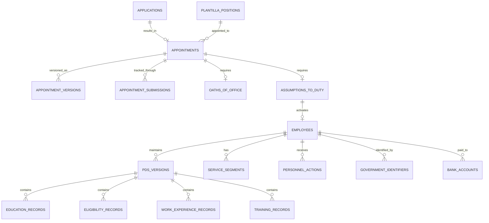

# Appointment and Personnel Logical ERD

**Document status:** Draft for review  
**Model level:** Logical ERD  
**Primary profile:** Civilian Philippine National Government Agency  
**Version:** 1.0  
**Date:** August 6, 2026

---

## Shared logical conventions

- Primary keys use UUIDs.
- All agency-owned operational records carry `agency_id`.
- Timestamps are stored in UTC and displayed in Philippine Standard Time by default.
- Status values are constrained enums or reference values, never unrestricted text.
- Effective-dated records use `effective_from` and nullable `effective_to`.
- `created_at`, `created_by_membership_id`, `updated_at`, and `updated_by_membership_id` are included where a record is mutable.
- Ledger, issued, certified, finalized, and audit records are append-only after posting.
- Sensitive values are encrypted or tokenized and are omitted from ordinary logs.
- Normal application deletion is restricted. Historical transactions are voided, superseded, deactivated, or archived.
- PostgreSQL Row-Level Security and physical indexes will be specified in the physical-schema phase.
- Cross-module actions go through owning application services rather than direct table updates.

## Relationship diagram

# Entity definitions

## `appointments`

Stable appointment transaction

| Column | Logical type | Null? | Key / rule | Description |
| --- | --- | --- | --- | --- |
| id | uuid | No | PK | Appointment |
| agency_id | uuid | No | FK agencies | Tenant |
| application_id | uuid | Yes | FK applications | Selected application |
| position_id | uuid | No | FK plantilla_positions | Position |
| appointee_person_key | uuid | No |  | Applicant/employee person link |
| appointment_type | enum | No |  | ORIGINAL, PROMOTION, TRANSFER, REAPPOINTMENT, OTHER |
| appointment_status | string | No |  | Government appointment status |
| status | enum | No |  | DRAFT, FOR_REVIEW, FOR_SIGNATURE, ISSUED, SUBMITTED, RETURNED, VALIDATED, INVALIDATED, CANCELLED |
| current_version_id | uuid | Yes | FK appointment_versions | Current version |
| issued_at | datetime | Yes |  | Issue time |

**Constraints and indexes**

- Position must be RESERVED or lawfully available before issue.
- One active issued appointment per reserved position and selected person.

**Deletion behavior:** Cancel or invalidate; never delete.
## `appointment_versions`

Versioned appointment details

| Column | Logical type | Null? | Key / rule | Description |
| --- | --- | --- | --- | --- |
| id | uuid | No | PK | Version |
| agency_id | uuid | No | FK agencies | Tenant |
| appointment_id | uuid | No | FK appointments | Appointment |
| version_no | integer | No |  | Version |
| salary_grade | integer | No |  | Grade |
| salary_step | integer | No |  | Step |
| effectivity_date | date | No |  | Proposed effectivity |
| appointing_authority_membership_id | uuid | Yes | FK agency_memberships | Authority |
| nature_of_appointment | string | No |  | Nature/status text |
| form_version | string | No |  | Official form version |
| effective_from | date | No |  | Version start |
| effective_to | date | Yes |  | Version end |
| status | enum | No |  | DRAFT, ISSUED, SUPERSEDED |

**Constraints and indexes**

- Unique `(appointment_id, version_no)`.
- Issued versions immutable.

**Deletion behavior:** Supersede.
## `appointment_submissions`

External CSC or authority transaction tracking

| Column | Logical type | Null? | Key / rule | Description |
| --- | --- | --- | --- | --- |
| id | uuid | No | PK | Submission |
| agency_id | uuid | No | FK agencies | Tenant |
| appointment_id | uuid | No | FK appointments | Appointment |
| submission_no | string | Yes |  | Reference |
| submitted_at | datetime | No |  | Submission |
| received_at | datetime | Yes |  | Acknowledgment |
| action | enum | No |  | SUBMITTED, RETURNED, RESUBMITTED, VALIDATED, INVALIDATED |
| action_date | date | No |  | Action date |
| reason | string | Yes |  | Return/invalidation basis |
| document_id | uuid | Yes | FK documents | Evidence |

**Constraints and indexes**

- Submission history is append-only.

**Deletion behavior:** Never delete.
## `oaths_of_office`

Oath record

| Column | Logical type | Null? | Key / rule | Description |
| --- | --- | --- | --- | --- |
| id | uuid | No | PK | Oath |
| agency_id | uuid | No | FK agencies | Tenant |
| appointment_id | uuid | No | FK appointments | Appointment |
| oath_date | date | No |  | Date |
| administered_by | string | No |  | Administering official |
| place | string | Yes |  | Place |
| document_id | uuid | Yes | FK documents | Signed oath |

**Constraints and indexes**

- At most one effective oath per appointment; corrections are versioned.

**Deletion behavior:** Retain.
## `assumptions_to_duty`

Actual assumption and service-start certification

| Column | Logical type | Null? | Key / rule | Description |
| --- | --- | --- | --- | --- |
| id | uuid | No | PK | Assumption |
| agency_id | uuid | No | FK agencies | Tenant |
| appointment_id | uuid | No | FK appointments | Appointment |
| actual_assumption_date | date | No |  | Actual start |
| certified_by_membership_id | uuid | No | FK agency_memberships | Certifier |
| certified_at | datetime | No |  | Certification |
| status | enum | No |  | PENDING, ASSUMED, DID_NOT_ASSUME, CANCELLED |
| document_id | uuid | Yes | FK documents | Certification |

**Constraints and indexes**

- Assumption cannot precede appointment issuance.
- Only ASSUMED may create active service.

**Deletion behavior:** Retain.
## `employees`

Stable agency personnel master record

| Column | Logical type | Null? | Key / rule | Description |
| --- | --- | --- | --- | --- |
| id | uuid | No | PK | Employee |
| agency_id | uuid | No | FK agencies | Tenant |
| employee_number | string | No |  | Agency employee number |
| person_key | uuid | No |  | Stable person identity within agency |
| membership_id | uuid | Yes | FK agency_memberships | Self-service account |
| current_service_segment_id | uuid | Yes | FK service_segments | Current service |
| status | enum | No |  | PREBOARDING, ACTIVE, ON_EXTENDED_LEAVE, SUSPENDED, SEPARATED, DECEASED |
| first_government_service_date | date | Yes |  | First service |
| agency_service_start_date | date | Yes |  | Agency start |

**Constraints and indexes**

- Unique `(agency_id, employee_number)`.
- Unique `(agency_id, membership_id)` where membership exists.

**Deletion behavior:** Preserve permanently under records policy.
## `pds_versions`

Versioned PDS header and certification

| Column | Logical type | Null? | Key / rule | Description |
| --- | --- | --- | --- | --- |
| id | uuid | No | PK | PDS version |
| agency_id | uuid | No | FK agencies | Tenant |
| employee_id | uuid | No | FK employees | Employee |
| version_no | integer | No |  | Version |
| form_version | string | No |  | CSC form version |
| status | enum | No |  | DRAFT, SUBMITTED, CERTIFIED, SUPERSEDED |
| as_of_date | date | No |  | PDS as-of |
| certified_by_employee_at | datetime | Yes |  | Employee certification |
| verified_by_membership_id | uuid | Yes | FK agency_memberships | HR verifier |
| verified_at | datetime | Yes |  | Verification |

**Constraints and indexes**

- Unique `(employee_id, version_no)`.
- Certified versions immutable.

**Deletion behavior:** Supersede.
## `pds_personal_details`

One-to-one personal section per PDS version

| Column | Logical type | Null? | Key / rule | Description |
| --- | --- | --- | --- | --- |
| pds_version_id | uuid | No | PK/FK pds_versions | PDS |
| surname | string | No |  | Name |
| first_name | string | No |  | Name |
| middle_name | string | Yes |  | Name |
| birth_date | date | No |  | Protected personal data |
| birth_place | string | Yes |  | Protected |
| sex | string | Yes |  | Form value |
| civil_status | string | Yes |  | Form value |
| citizenship | string | Yes |  | Citizenship |
| residential_address | json | Yes |  | Structured address |
| permanent_address | json | Yes |  | Structured address |
| contact_details | json | Yes |  | Protected contacts |

**Constraints and indexes**

- Sensitive field-level access required.

**Deletion behavior:** Follows parent PDS retention.
## `pds_family_records`

Repeated family records

| Column | Logical type | Null? | Key / rule | Description |
| --- | --- | --- | --- | --- |
| id | uuid | No | PK | Family row |
| agency_id | uuid | No | FK agencies | Tenant |
| pds_version_id | uuid | No | FK pds_versions | PDS |
| relationship_type | enum | No |  | SPOUSE, FATHER, MOTHER, CHILD |
| full_name | string | No |  | Name |
| birth_date | date | Yes |  | Birth date |
| occupation | string | Yes |  | Occupation |
| employer | string | Yes |  | Employer |

**Constraints and indexes**

- Order column may be added physically for form rendering.

**Deletion behavior:** Follows PDS retention.
## `education_records`

Education history

| Column | Logical type | Null? | Key / rule | Description |
| --- | --- | --- | --- | --- |
| id | uuid | No | PK | Education |
| agency_id | uuid | No | FK agencies | Tenant |
| pds_version_id | uuid | No | FK pds_versions | PDS |
| level | enum | No |  | ELEMENTARY, SECONDARY, VOCATIONAL, COLLEGE, GRADUATE |
| school_name | string | No |  | School |
| degree_course | string | Yes |  | Degree |
| period_from | date | Yes |  | Start |
| period_to | date | Yes |  | End |
| highest_level_units | string | Yes |  | Units |
| year_graduated | integer | Yes |  | Year |
| honors | string | Yes |  | Honors |

**Deletion behavior:** Follows PDS retention.
## `eligibility_records`

Civil service and professional eligibility

| Column | Logical type | Null? | Key / rule | Description |
| --- | --- | --- | --- | --- |
| id | uuid | No | PK | Eligibility |
| agency_id | uuid | No | FK agencies | Tenant |
| pds_version_id | uuid | No | FK pds_versions | PDS |
| eligibility_name | string | No |  | Eligibility |
| rating | string | Yes |  | Rating |
| exam_date | date | Yes |  | Date |
| exam_place | string | Yes |  | Place |
| license_no | string | Yes |  | License |
| valid_until | date | Yes |  | Expiry |
| document_id | uuid | Yes | FK documents | Evidence |

**Deletion behavior:** Follows PDS retention.
## `work_experience_records`

PDS work-experience rows

| Column | Logical type | Null? | Key / rule | Description |
| --- | --- | --- | --- | --- |
| id | uuid | No | PK | Work experience |
| agency_id | uuid | No | FK agencies | Tenant |
| pds_version_id | uuid | No | FK pds_versions | PDS |
| date_from | date | No |  | Start |
| date_to | date | Yes |  | End |
| position_title | string | No |  | Title |
| agency_company | string | No |  | Employer |
| monthly_salary | decimal | Yes |  | Salary |
| salary_grade_step | string | Yes |  | SG/step |
| appointment_status | string | Yes |  | Status |
| government_service | boolean | No |  | Government flag |

**Deletion behavior:** Follows PDS retention.
## `training_records`

Learning and development history

| Column | Logical type | Null? | Key / rule | Description |
| --- | --- | --- | --- | --- |
| id | uuid | No | PK | Training |
| agency_id | uuid | No | FK agencies | Tenant |
| pds_version_id | uuid | No | FK pds_versions | PDS |
| title | string | No |  | Program |
| date_from | date | No |  | Start |
| date_to | date | No |  | End |
| hours | decimal | No |  | Hours |
| type | string | Yes |  | Type |
| sponsor | string | Yes |  | Provider |
| document_id | uuid | Yes | FK documents | Certificate |

**Constraints and indexes**

- Hours must be non-negative.

**Deletion behavior:** Follows PDS retention.
## `service_segments`

Effective government-service segment

| Column | Logical type | Null? | Key / rule | Description |
| --- | --- | --- | --- | --- |
| id | uuid | No | PK | Service segment |
| agency_id | uuid | No | FK agencies | Tenant |
| employee_id | uuid | No | FK employees | Employee |
| appointment_id | uuid | Yes | FK appointments | Appointment basis |
| personnel_action_id | uuid | Yes | FK personnel_actions | Action basis |
| position_id | uuid | Yes | FK plantilla_positions | Position |
| organization_unit_id | uuid | No | FK organization_units | Office |
| appointment_status | string | No |  | Status |
| salary_grade | integer | Yes |  | Grade |
| salary_step | integer | Yes |  | Step |
| effective_from | date | No |  | Start |
| effective_to | date | Yes |  | End |
| status | enum | No |  | ACTIVE, CLOSED, VOIDED |

**Constraints and indexes**

- No improper overlapping active primary service segments for an employee.
- Agency must match all references.

**Deletion behavior:** Close or void.
## `personnel_actions`

Formal HR action affecting service

| Column | Logical type | Null? | Key / rule | Description |
| --- | --- | --- | --- | --- |
| id | uuid | No | PK | Action |
| agency_id | uuid | No | FK agencies | Tenant |
| employee_id | uuid | No | FK employees | Employee |
| action_type | enum | No |  | PROMOTION, TRANSFER, REAPPOINTMENT, REASSIGNMENT, DETAIL, DESIGNATION, STEP_INCREMENT, SALARY_ADJUSTMENT, SEPARATION, OTHER |
| status | enum | No |  | DRAFT, FOR_REVIEW, FOR_APPROVAL, APPROVED, EFFECTIVE, RETURNED, REJECTED, CANCELLED, SUPERSEDED |
| effectivity_date | date | No |  | Effectivity |
| from_service_segment_id | uuid | Yes | FK service_segments | Prior service |
| to_position_id | uuid | Yes | FK plantilla_positions | Target position |
| authority_document_id | uuid | Yes | FK documents | Authority |
| reason | string | Yes |  | Reason |

**Constraints and indexes**

- EFFECTIVE action creates or updates service history through domain service.

**Deletion behavior:** Retain.
## `government_identifiers`

Protected government identifiers

| Column | Logical type | Null? | Key / rule | Description |
| --- | --- | --- | --- | --- |
| id | uuid | No | PK | Identifier |
| agency_id | uuid | No | FK agencies | Tenant |
| employee_id | uuid | No | FK employees | Employee |
| identifier_type | enum | No |  | GSIS, PHILHEALTH, PAGIBIG, TIN, OTHER |
| encrypted_value | binary | No |  | Encrypted identifier |
| masked_value | string | No |  | Display-safe value |
| verified_at | datetime | Yes |  | Verification |
| status | enum | No |  | ACTIVE, REPLACED, INVALID |

**Constraints and indexes**

- One active identifier per employee and type unless rules allow multiple.

**Deletion behavior:** Replace; retain history.
## `bank_accounts`

Protected payroll account

| Column | Logical type | Null? | Key / rule | Description |
| --- | --- | --- | --- | --- |
| id | uuid | No | PK | Bank account |
| agency_id | uuid | No | FK agencies | Tenant |
| employee_id | uuid | No | FK employees | Employee |
| bank_code | string | No |  | Bank |
| encrypted_account_no | binary | No |  | Encrypted number |
| masked_account_no | string | No |  | Display-safe |
| account_name | string | No |  | Account name |
| effective_from | date | No |  | Start |
| effective_to | date | Yes |  | End |
| status | enum | No |  | PENDING_VERIFICATION, ACTIVE, INACTIVE |

**Constraints and indexes**

- At most one active primary payroll account per employee/profile.

**Deletion behavior:** End-date.
## `saln_compliance_records`

Tracks SALN filing compliance without broad content storage

| Column | Logical type | Null? | Key / rule | Description |
| --- | --- | --- | --- | --- |
| id | uuid | No | PK | Compliance |
| agency_id | uuid | No | FK agencies | Tenant |
| employee_id | uuid | No | FK employees | Employee |
| filing_year | integer | No |  | Year |
| filing_type | enum | No |  | ANNUAL, ASSUMPTION, SEPARATION, OTHER |
| due_date | date | No |  | Due |
| submitted_at | datetime | Yes |  | Submission |
| status | enum | No |  | NOT_REQUIRED, PENDING, SUBMITTED, VERIFIED, LATE |
| acknowledgment_document_id | uuid | Yes | FK documents | Receipt |

**Constraints and indexes**

- Unique `(employee_id, filing_year, filing_type)`.

**Deletion behavior:** Retain.

# Domain invariants

- Appointment issuance and assumption to duty are separate legal/business events.
- Active service and position occupancy begin only through assumption or an effective personnel action.
- Certified PDS versions, issued appointment versions, and closed service segments are immutable.
- Protected identifiers and bank accounts require field-level permission and encryption.
