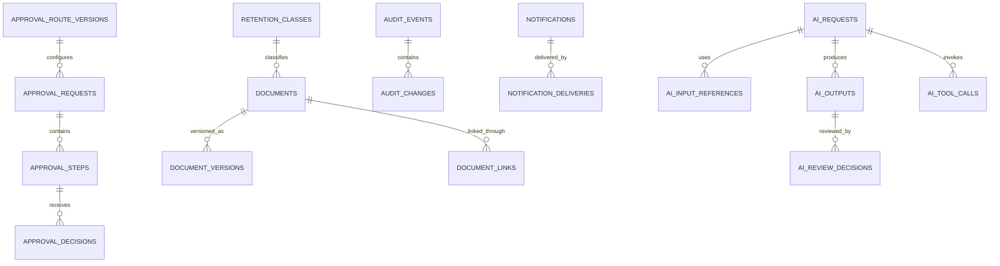

# Approvals, Documents, Audit, Notifications, and AI Logical ERD

**Document status:** Draft for review  
**Model level:** Logical ERD  
**Primary profile:** Civilian Philippine National Government Agency  
**Version:** 1.0  
**Date:** August 6, 2026

---

## Shared logical conventions

- Primary keys use UUIDs.
- All agency-owned operational records carry `agency_id`.
- Timestamps are stored in UTC and displayed in Philippine Standard Time by default.
- Status values are constrained enums or reference values, never unrestricted text.
- Effective-dated records use `effective_from` and nullable `effective_to`.
- `created_at`, `created_by_membership_id`, `updated_at`, and `updated_by_membership_id` are included where a record is mutable.
- Ledger, issued, certified, finalized, and audit records are append-only after posting.
- Sensitive values are encrypted or tokenized and are omitted from ordinary logs.
- Normal application deletion is restricted. Historical transactions are voided, superseded, deactivated, or archived.
- PostgreSQL Row-Level Security and physical indexes will be specified in the physical-schema phase.
- Cross-module actions go through owning application services rather than direct table updates.

## Relationship diagram

# Entity definitions

## `approval_route_versions`

Versioned workflow route definition

| Column | Logical type | Null? | Key / rule | Description |
| --- | --- | --- | --- | --- |
| id | uuid | No | PK | Route version |
| agency_id | uuid | No | FK agencies | Tenant |
| route_code | string | No |  | Stable route code |
| version_no | integer | No |  | Version |
| domain | string | No |  | Owning domain |
| step_definition | json | No |  | Validated sequential/parallel steps |
| effective_from | date | No |  | Start |
| effective_to | date | Yes |  | End |
| status | enum | No |  | DRAFT, ACTIVE, SUPERSEDED |

**Constraints and indexes**

- Unique `(agency_id, route_code, version_no)`.
- No overlapping ACTIVE versions.

**Deletion behavior:** Supersede.
## `approval_requests`

Approval instance linked to a business object

| Column | Logical type | Null? | Key / rule | Description |
| --- | --- | --- | --- | --- |
| id | uuid | No | PK | Request |
| agency_id | uuid | No | FK agencies | Tenant |
| route_version_id | uuid | No | FK approval_route_versions | Route |
| subject_type | string | No |  | Domain entity type |
| subject_id | uuid | No |  | Domain entity ID |
| requested_by_membership_id | uuid | No | FK agency_memberships | Requester |
| status | enum | No |  | PENDING, IN_PROGRESS, APPROVED, REJECTED, RETURNED, CANCELLED, EXPIRED |
| current_step_no | integer | Yes |  | Current step |
| requested_at | datetime | No |  | Request |
| completed_at | datetime | Yes |  | Completion |

**Constraints and indexes**

- One active approval request per subject/workflow phase unless explicitly versioned.
- Polymorphic subject validated by owning domain service.

**Deletion behavior:** Retain.
## `approval_steps`

Resolved approval step

| Column | Logical type | Null? | Key / rule | Description |
| --- | --- | --- | --- | --- |
| id | uuid | No | PK | Step |
| agency_id | uuid | No | FK agencies | Tenant |
| approval_request_id | uuid | No | FK approval_requests | Request |
| step_no | integer | No |  | Order |
| step_mode | enum | No |  | SEQUENTIAL, PARALLEL_ANY, PARALLEL_ALL |
| required_permission | string | No |  | Permission |
| assigned_membership_id | uuid | Yes | FK agency_memberships | Resolved approver |
| assigned_role_code | string | Yes |  | Role-based resolution |
| status | enum | No |  | PENDING, ACTIVE, APPROVED, REJECTED, RETURNED, SKIPPED, EXPIRED |
| activated_at | datetime | Yes |  | Activation |
| completed_at | datetime | Yes |  | Completion |

**Constraints and indexes**

- Unique `(approval_request_id, step_no, assigned_membership_id)` as resolved.
- Assigned approver must be active or delegated.

**Deletion behavior:** Retain.
## `approval_decisions`

Append-only human decision

| Column | Logical type | Null? | Key / rule | Description |
| --- | --- | --- | --- | --- |
| id | uuid | No | PK | Decision |
| agency_id | uuid | No | FK agencies | Tenant |
| approval_step_id | uuid | No | FK approval_steps | Step |
| decided_by_membership_id | uuid | No | FK agency_memberships | Actor |
| decision | enum | No |  | APPROVE, REJECT, RETURN, ABSTAIN, DELEGATE |
| comments | string | Yes |  | Comments |
| decided_at | datetime | No |  | Time |
| delegated_authority_id | uuid | Yes | FK delegated_authorities | Delegation basis |
| request_id | string | Yes |  | Request correlation |

**Constraints and indexes**

- Decider must match assigned/delegated authority.
- Decisions are immutable.

**Deletion behavior:** Never delete.
## `documents`

Stable controlled document identity

| Column | Logical type | Null? | Key / rule | Description |
| --- | --- | --- | --- | --- |
| id | uuid | No | PK | Document |
| agency_id | uuid | No | FK agencies | Tenant |
| document_no | string | Yes |  | Agency reference |
| document_type | string | No |  | Type |
| classification | enum | No |  | PUBLIC, INTERNAL, CONFIDENTIAL, HIGHLY_SENSITIVE |
| status | enum | No |  | DRAFT, FOR_REVIEW, APPROVED, ISSUED, ARCHIVED, SUPERSEDED, VOIDED |
| current_version_id | uuid | Yes | FK document_versions | Current version |
| retention_class_id | uuid | Yes | FK retention_classes | Retention |

**Constraints and indexes**

- Document classification governs access and export.

**Deletion behavior:** Archive/void/supersede.
## `document_versions`

Stored file and metadata version

| Column | Logical type | Null? | Key / rule | Description |
| --- | --- | --- | --- | --- |
| id | uuid | No | PK | Version |
| agency_id | uuid | No | FK agencies | Tenant |
| document_id | uuid | No | FK documents | Document |
| version_no | integer | No |  | Version |
| storage_key | string | No | Unique | Private object key |
| content_hash | string | No |  | Integrity hash |
| mime_type | string | No |  | MIME |
| size_bytes | integer | No |  | Size |
| created_by_membership_id | uuid | No | FK agency_memberships | Creator |
| created_at | datetime | No |  | Creation |
| issued_at | datetime | Yes |  | Issue |
| signature_metadata | json | Yes |  | E-sign metadata |

**Constraints and indexes**

- Unique `(document_id, version_no)`.
- Issued version immutable.

**Deletion behavior:** Retention-controlled physical purge only.
## `document_links`

Links documents to domain entities

| Column | Logical type | Null? | Key / rule | Description |
| --- | --- | --- | --- | --- |
| id | uuid | No | PK | Link |
| agency_id | uuid | No | FK agencies | Tenant |
| document_id | uuid | No | FK documents | Document |
| subject_type | string | No |  | Domain entity |
| subject_id | uuid | No |  | Entity ID |
| link_role | string | No |  | Supporting, output, authority, evidence |
| linked_at | datetime | No |  | Link time |
| linked_by_membership_id | uuid | No | FK agency_memberships | Actor |

**Constraints and indexes**

- Unique `(document_id, subject_type, subject_id, link_role)`.

**Deletion behavior:** Unlink only with audit; document remains.
## `retention_classes`

Agency records-retention classification

| Column | Logical type | Null? | Key / rule | Description |
| --- | --- | --- | --- | --- |
| id | uuid | No | PK | Class |
| agency_id | uuid | No | FK agencies | Tenant |
| code | string | No |  | Code |
| name | string | No |  | Name |
| retention_years | integer | Yes |  | Years; null may mean permanent |
| disposition_action | enum | No |  | DESTROY, ARCHIVE, REVIEW, PERMANENT |
| legal_basis | string | Yes |  | Basis |
| status | enum | No |  | ACTIVE, INACTIVE |

**Constraints and indexes**

- Unique `(agency_id, code)`.

**Deletion behavior:** Inactivate.
## `audit_events`

Append-only material business/security event

| Column | Logical type | Null? | Key / rule | Description |
| --- | --- | --- | --- | --- |
| id | uuid | No | PK | Event |
| agency_id | uuid | No | FK agencies | Tenant |
| actor_membership_id | uuid | Yes | FK agency_memberships | Actor |
| actor_type | enum | No |  | USER, SYSTEM, INTEGRATION |
| action | string | No |  | Action code |
| entity_type | string | No |  | Entity type |
| entity_id | uuid | No |  | Entity |
| previous_status | string | Yes |  | Before status |
| new_status | string | Yes |  | After status |
| reason | string | Yes |  | Reason |
| request_id | string | Yes |  | Correlation |
| occurred_at | datetime | No |  | Time |
| metadata | json | No |  | Sanitized metadata |

**Constraints and indexes**

- Append-only.
- Never store authentication secrets or full highly sensitive values.

**Deletion behavior:** Retention-controlled archival; normally permanent for critical records.
## `audit_changes`

Field-level change attached to audit event

| Column | Logical type | Null? | Key / rule | Description |
| --- | --- | --- | --- | --- |
| id | uuid | No | PK | Change |
| agency_id | uuid | No | FK agencies | Tenant |
| audit_event_id | uuid | No | FK audit_events | Event |
| field_path | string | No |  | Field |
| old_value_redacted | json | Yes |  | Redacted before |
| new_value_redacted | json | Yes |  | Redacted after |
| sensitivity | enum | No |  | NORMAL, SENSITIVE, HIGHLY_SENSITIVE |

**Constraints and indexes**

- Highly sensitive values should store hashes/masks rather than raw data.

**Deletion behavior:** Follows event.
## `notifications`

In-application user notification

| Column | Logical type | Null? | Key / rule | Description |
| --- | --- | --- | --- | --- |
| id | uuid | No | PK | Notification |
| agency_id | uuid | No | FK agencies | Tenant |
| recipient_membership_id | uuid | No | FK agency_memberships | Recipient |
| notification_type | string | No |  | Type |
| title | string | No |  | Title |
| body_safe | string | No |  | No unnecessary sensitive content |
| subject_type | string | Yes |  | Related entity |
| subject_id | uuid | Yes |  | Related ID |
| status | enum | No |  | PENDING, SENT, READ, ARCHIVED |
| created_at | datetime | No |  | Creation |
| read_at | datetime | Yes |  | Read |

**Constraints and indexes**

- Recipient must belong to agency.

**Deletion behavior:** Archive/purge by retention.
## `notification_deliveries`

Delivery attempt for email or future channel

| Column | Logical type | Null? | Key / rule | Description |
| --- | --- | --- | --- | --- |
| id | uuid | No | PK | Delivery |
| agency_id | uuid | No | FK agencies | Tenant |
| notification_id | uuid | No | FK notifications | Notification |
| channel | enum | No |  | EMAIL, IN_APP |
| attempt_no | integer | No |  | Attempt |
| status | enum | No |  | QUEUED, SENT, DELIVERED, FAILED, PERMANENT_FAILURE |
| provider_message_id | string | Yes |  | Provider ref |
| attempted_at | datetime | Yes |  | Attempt |
| error_code | string | Yes |  | Sanitized error |

**Constraints and indexes**

- Unique `(notification_id, channel, attempt_no)`.

**Deletion behavior:** Purge provider metadata by retention.
## `ai_requests`

Controlled AI operation

| Column | Logical type | Null? | Key / rule | Description |
| --- | --- | --- | --- | --- |
| id | uuid | No | PK | Request |
| agency_id | uuid | No | FK agencies | Tenant |
| initiated_by_membership_id | uuid | No | FK agency_memberships | User |
| feature_code | string | No |  | Approved feature |
| model_provider | string | No |  | Provider |
| model_name | string | No |  | Model |
| prompt_version | string | No |  | Version |
| status | enum | No |  | CREATED, PROCESSING, VALIDATED, NEEDS_REVIEW, ACCEPTED, REJECTED, FAILED, CANCELLED |
| created_at | datetime | No |  | Creation |
| completed_at | datetime | Yes |  | Completion |
| request_hash | string | No |  | Idempotency/integrity |

**Constraints and indexes**

- Feature must be enabled for agency and user permission.

**Deletion behavior:** Retain metadata under AI audit policy.
## `ai_input_references`

Minimum source records used by AI

| Column | Logical type | Null? | Key / rule | Description |
| --- | --- | --- | --- | --- |
| id | uuid | No | PK | Reference |
| agency_id | uuid | No | FK agencies | Tenant |
| ai_request_id | uuid | No | FK ai_requests | Request |
| subject_type | string | No |  | Source type |
| subject_id | uuid | No |  | Source ID |
| field_scope | json | No |  | Permitted fields |
| redaction_profile | string | Yes |  | Redaction profile |

**Constraints and indexes**

- No cross-agency source reference.

**Deletion behavior:** Retain reference metadata; not duplicated source content.
## `ai_outputs`

Validated AI output

| Column | Logical type | Null? | Key / rule | Description |
| --- | --- | --- | --- | --- |
| id | uuid | No | PK | Output |
| agency_id | uuid | No | FK agencies | Tenant |
| ai_request_id | uuid | No | FK ai_requests | Request |
| output_type | enum | No |  | STRUCTURED, TEXT_DRAFT, SUMMARY |
| structured_output | json | Yes |  | Schema-validated output |
| text_output | string | Yes |  | Draft text |
| validation_status | enum | No |  | VALID, INVALID, PARTIAL |
| validation_errors | json | Yes |  | Errors |
| created_at | datetime | No |  | Creation |

**Constraints and indexes**

- At most one accepted current output; retries may create additional outputs.

**Deletion behavior:** Retain under policy.
## `ai_review_decisions`

Human review of AI output

| Column | Logical type | Null? | Key / rule | Description |
| --- | --- | --- | --- | --- |
| id | uuid | No | PK | Review |
| agency_id | uuid | No | FK agencies | Tenant |
| ai_output_id | uuid | No | FK ai_outputs | Output |
| reviewed_by_membership_id | uuid | No | FK agency_memberships | Reviewer |
| decision | enum | No |  | ACCEPT, EDIT, REJECT |
| edited_output | json | Yes |  | Human-edited result |
| reason | string | Yes |  | Reason |
| reviewed_at | datetime | No |  | Time |

**Constraints and indexes**

- AI acceptance does not equal domain approval.

**Deletion behavior:** Immutable.
## `ai_tool_calls`

Controlled application tool invocation from AI workflow

| Column | Logical type | Null? | Key / rule | Description |
| --- | --- | --- | --- | --- |
| id | uuid | No | PK | Tool call |
| agency_id | uuid | No | FK agencies | Tenant |
| ai_request_id | uuid | No | FK ai_requests | Request |
| tool_code | string | No |  | Allowlisted tool |
| arguments_redacted | json | No |  | Sanitized arguments |
| status | enum | No |  | REQUESTED, VALIDATED, EXECUTED, REJECTED, FAILED |
| result_reference | string | Yes |  | Safe result reference |
| executed_at | datetime | Yes |  | Execution |

**Constraints and indexes**

- No arbitrary SQL or unrestricted tool codes.

**Deletion behavior:** Retain.

# Domain invariants

- Approval infrastructure records decisions; owning domain services validate and apply business effects.
- Generic subject references are intentionally polymorphic and must be validated by the owning domain.
- Issued document versions and audit events are immutable.
- Notifications contain no unnecessary salary, PDS, bank, or government-identifier data.
- AI output is untrusted until schema validation and human review.
- AI cannot directly approve appointments, payroll, leave, recruitment selection, or position changes.
