# Attendance and Leave Logical ERD

**Document status:** Draft for review  
**Model level:** Logical ERD  
**Primary profile:** Civilian Philippine National Government Agency  
**Version:** 1.1
**Date:** September 15, 2026

---

## Shared logical conventions

- Primary keys use UUIDs.
- All agency-owned operational records carry `agency_id`.
- Timestamps are stored in UTC and displayed in Philippine Standard Time by default.
- Status values are constrained enums or reference values, never unrestricted text.
- Effective-dated records use `effective_from` and nullable `effective_to`.
- `created_at`, `created_by_membership_id`, `updated_at`, and `updated_by_membership_id` are included where a record is mutable.
- Ledger, issued, certified, finalized, and audit records are append-only after posting.
- Sensitive values are encrypted or tokenized and are omitted from ordinary logs.
- Normal application deletion is restricted. Historical transactions are voided, superseded, deactivated, or archived.
- PostgreSQL Row-Level Security and physical indexes will be specified in the physical-schema phase.
- Cross-module actions go through owning application services rather than direct table updates.

## Relationship diagram

```mermaid
erDiagram
    WORK_SCHEDULES ||--o{ WORK_SCHEDULE_VERSIONS : versioned_as
    WORK_SCHEDULE_VERSIONS ||--|{ WORK_SCHEDULE_DAY_RULES : contains
    WORK_SCHEDULE_DAY_RULES ||--o{ WORK_SCHEDULE_BREAK_INTERVALS : excludes
    WORK_ARRANGEMENTS ||--o{ WORK_ARRANGEMENT_VERSIONS : versioned_as
    EMPLOYEES ||--o{ SCHEDULE_ASSIGNMENTS : assigned
    WORK_SCHEDULE_VERSIONS ||--o{ SCHEDULE_ASSIGNMENTS : uses
    WORK_ARRANGEMENT_VERSIONS ||--o{ SCHEDULE_ASSIGNMENTS : uses
    HOLIDAY_CALENDARS ||--o{ HOLIDAY_CALENDAR_VERSIONS : versioned_as
    HOLIDAY_CALENDAR_VERSIONS ||--o{ HOLIDAY_CALENDAR_ENTRIES : contains
    AGENCIES ||--o{ ATTENDANCE_PERIODS : owns
    EMPLOYEES ||--o{ ATTENDANCE_EVENTS : records
    EMPLOYEES ||--o{ ATTENDANCE_CONTEXTS : receives
    ATTENDANCE_PERIODS ||--o{ ATTENDANCE_DAYS : contains
    EMPLOYEES ||--o{ ATTENDANCE_DAYS : has
    ATTENDANCE_DAYS ||--o{ ATTENDANCE_DAY_SEGMENTS : calculated_as
    ATTENDANCE_DAYS ||--o{ ATTENDANCE_EXCEPTIONS : flags
    ATTENDANCE_DAYS ||--o{ ATTENDANCE_CORRECTIONS : corrected_by
    LEAVE_TYPES ||--o{ LEAVE_POLICY_VERSIONS : versioned_as
    LEAVE_POLICY_VERSIONS ||--|{ LEAVE_POLICY_AUTHORITIES : supported_by
    EMPLOYEES ||--o{ LEAVE_ACCOUNTS : holds
    LEAVE_TYPES ||--o{ LEAVE_ACCOUNTS : categorizes
    LEAVE_ACCOUNTS ||--o{ LEAVE_LEDGER_ENTRIES : records
    LEAVE_ACCOUNTS ||--o{ LEAVE_CREDIT_COMMITMENTS : reserves
    EMPLOYEES ||--o{ LEAVE_APPLICATIONS : submits
    LEAVE_APPLICATIONS ||--|{ LEAVE_APPLICATION_PERIODS : requests
    LEAVE_APPLICATIONS ||--|{ LEAVE_CALCULATION_SEGMENTS : calculated_as
    LEAVE_POLICY_VERSIONS ||--o{ LEAVE_CALCULATION_SEGMENTS : governs
    LEAVE_APPLICATIONS ||--o{ LEAVE_ELIGIBILITY_ASSESSMENTS : evaluated_by
    LEAVE_APPLICATIONS ||--o{ LEAVE_CREDIT_CERTIFICATIONS : certified_by
    LEAVE_CREDIT_CERTIFICATIONS ||--|{ LEAVE_CREDIT_CERTIFICATION_LINES : contains
    LEAVE_ACCOUNTS ||--o{ LEAVE_CREDIT_CERTIFICATION_LINES : certifies
    LEAVE_APPLICATIONS ||--o{ LEAVE_CREDIT_COMMITMENTS : may_create
    EMPLOYEES ||--o{ MANDATORY_LEAVE_ASSESSMENTS : assessed_for
    LEAVE_POLICY_VERSIONS ||--o{ MANDATORY_LEAVE_ASSESSMENTS : governs
    EMPLOYEES ||--o{ LEAVE_MONETIZATION_REQUESTS : requests
```

# Entity definitions

## `work_schedules`

Reusable schedule definition

| Column | Logical type | Null? | Key / rule | Description |
| --- | --- | --- | --- | --- |
| id | uuid | No | PK | Schedule |
| agency_id | uuid | No | FK agencies | Tenant |
| code | string | No |  | Code |
| name | string | No |  | Name |
| current_version_id | uuid | Yes | FK work_schedule_versions | Current version |

**Constraints and indexes**

- Unique `(agency_id, code)`.

**Deletion behavior:** Inactivate.
## `work_schedule_versions`

Effective-dated schedule rules

| Column | Logical type | Null? | Key / rule | Description |
| --- | --- | --- | --- | --- |
| id | uuid | No | PK | Version |
| agency_id | uuid | No | FK agencies | Tenant |
| work_schedule_id | uuid | No | FK work_schedules | Schedule |
| version_no | integer | No |  | Version |
| schedule_type | enum | No |  | REGULAR, FLEXIBLE, SHIFT, COMPRESSED |
| timezone | string | No |  | Governing local timezone |
| holiday_effect_rules | json | No |  | Authority-backed effect by calendar classification |
| authority_document_version_id | uuid | Yes | FK document_versions | Required authority evidence at activation |
| approving_authority | string | Yes |  | Required authority named at activation |
| status | enum | No |  | DRAFT, ACTIVE, SUPERSEDED |
| effective_from | date | No |  | Start |
| effective_to | date | Yes |  | End |

**Constraints and indexes**

- No overlapping active versions.
- Exactly seven complete Day Rules; no implicit grace or timestamp rounding.

**Deletion behavior:** Supersede.
## `work_schedule_day_rules`

One fixed, flexible, or rest rule for a weekday, including required minutes, duty interval, optional flexible start/core window, Event Collection Window, and event pattern. Duty may end on the next calendar day.

## `work_schedule_break_intervals`

Ordered unpaid break intervals belonging to a Day Rule. A break may end on the next calendar day.

## `work_arrangements`

Authorized work arrangement

| Column | Logical type | Null? | Key / rule | Description |
| --- | --- | --- | --- | --- |
| id | uuid | No | PK | Arrangement |
| agency_id | uuid | No | FK agencies | Tenant |
| code | string | No |  | Code |
| name | string | No |  | Name |
| current_version_id | uuid | Yes | FK work_arrangement_versions | Current version |

**Constraints and indexes**

- Unique `(agency_id, code)`.

**Deletion behavior:** Inactivate.
## `work_arrangement_versions`

Immutable effective-dated arrangement mode, permitted schedule types, scoped Holiday Calendar, exact authority Document Version, and approving authority. Arrangement modes are ONSITE, WORK_FROM_HOME, HYBRID, FIELD, or OTHER; one-off official business is Attendance Context.

## `schedule_assignments`

Effective employee schedule and arrangement

| Column | Logical type | Null? | Key / rule | Description |
| --- | --- | --- | --- | --- |
| id | uuid | No | PK | Assignment |
| agency_id | uuid | No | FK agencies | Tenant |
| employee_id | uuid | No | FK employees | Employee |
| work_schedule_version_id | uuid | No | FK work_schedule_versions | Schedule version |
| work_arrangement_version_id | uuid | No | FK work_arrangement_versions | Arrangement version |
| authority_document_version_id | uuid | No | FK document_versions | Assignment authority |
| effective_from | date | No |  | Start |
| effective_to | date | Yes |  | End |
| assigned_by_membership_id | uuid | No | FK agency_memberships | Actor |

**Constraints and indexes**

- No conflicting overlapping primary schedule assignments.

**Deletion behavior:** End-date.
## `holiday_calendars`

Agency/location holiday calendar

| Column | Logical type | Null? | Key / rule | Description |
| --- | --- | --- | --- | --- |
| id | uuid | No | PK | Calendar |
| agency_id | uuid | No | FK agencies | Tenant |
| code | string | No |  | Code |
| name | string | No |  | Name |
| scope_type | enum | No |  | AGENCY, OFFICE, WORKSITE |
| scope_reference | string | No |  | Authorized scope |
| current_version_id | uuid | Yes | FK holiday_calendar_versions | Current version |

**Constraints and indexes**

- Unique `(agency_id, code)`.

**Deletion behavior:** Inactivate.
## `holiday_calendar_versions`

Immutable effective-dated calendar version with exact authority evidence and DRAFT, ACTIVE, or SUPERSEDED status.

## `holiday_calendar_entries`

Effective holiday/day classification

| Column | Logical type | Null? | Key / rule | Description |
| --- | --- | --- | --- | --- |
| id | uuid | No | PK | Holiday |
| agency_id | uuid | No | FK agencies | Tenant |
| holiday_calendar_version_id | uuid | No | FK holiday_calendar_versions | Calendar version |
| holiday_date | date | No |  | Date |
| name | string | No |  | Name |
| day_type | enum | No |  | REGULAR_HOLIDAY, SPECIAL_NON_WORKING, SPECIAL_WORKING, LOCAL_HOLIDAY, WORK_SUSPENSION |
| source_reference | string | No |  | Issuance |

**Constraints and indexes**

- Unique `(holiday_calendar_version_id, holiday_date, day_type)`.

**Deletion behavior:** Correct through version/replacement.
## `attendance_periods`

Stable agency-wide attendance interval

| Column | Logical type | Null? | Key / rule | Description |
| --- | --- | --- | --- | --- |
| id | uuid | No | PK | Period |
| agency_id | uuid | No | FK agencies | Tenant |
| code | string | No |  | Period code |
| date_from | date | No |  | Start |
| date_to | date | No |  | End |
| status | enum | No |  | OPEN, FINALIZED |

**Constraints and indexes**

- No overlapping active primary periods for the same payroll profile.
- A finalized period is never reopened; corrections create successor Attendance Period Versions.

**Deletion behavior:** Retain.

## `employee_attendance_submissions`

One Employee's submitted snapshot within an Attendance Period

| Column | Logical type | Null? | Key / rule | Description |
| --- | --- | --- | --- | --- |
| id | uuid | No | PK | Submission |
| agency_id | uuid | No | FK agencies | Tenant |
| attendance_period_id | uuid | No | FK attendance_periods | Period |
| employee_id | uuid | No | FK employees | Subject |
| version_no | integer | No |  | Submission version |
| status | enum | No |  | DRAFT, SUBMITTED, RETURNED, APPROVED, CANCELLED, STALE |
| submitted_by_membership_id | uuid | No | FK agency_memberships | Employee or on-behalf HR Administrator |
| on_behalf_reason | string | Yes |  | Required for on-behalf submission |
| evidence_document_version_id | uuid | Yes | FK document_versions | Required for on-behalf submission |
| reviewed_by_membership_id | uuid | Yes | FK agency_memberships | HR Officer reviewer |
| reviewed_at | datetime | Yes |  | Review time |
| review_reason | string | Yes |  | Return or decision basis |

Each submission has immutable membership rows identifying its exact Attendance Day versions. Recalculation of any member makes a pending submission stale. Approval requires all members to be current and free of unresolved Attendance Exceptions.

**Deletion behavior:** Retain all versions.

## `attendance_period_versions`

Immutable agency-wide review and lock snapshot

| Column | Logical type | Null? | Key / rule | Description |
| --- | --- | --- | --- | --- |
| id | uuid | No | PK | Period version |
| agency_id | uuid | No | FK agencies | Tenant |
| attendance_period_id | uuid | No | FK attendance_periods | Stable period |
| version_no | integer | No |  | Monotonic version |
| predecessor_version_id | uuid | Yes | Self FK | Prior locked version for a correction successor |
| status | enum | No |  | FOR_REVIEW, APPROVED, RETURNED, LOCKED |
| approval_route_version_id | uuid | No | FK approval_route_versions | Exact routed authority |
| submitted_by_membership_id | uuid | No | FK agency_memberships | HR Administrator preparer |
| reviewed_by_membership_id | uuid | Yes | FK agency_memberships | HR Officer approver |
| reviewed_at | datetime | Yes |  | Review time |
| review_reason | string | Yes |  | Return or approval basis |
| locked_by_membership_id | uuid | Yes | FK agency_memberships | Different HR Administrator |
| locked_at | datetime | Yes |  | Lock time |
| reconciliation | json | Yes |  | Locked counts and exact-minute totals |

Immutable membership rows bind every applicable Employee, approved Employee Attendance Submission, Work Date, and exact Attendance Day version. Lock requires complete membership, no unresolved exception or correction, unchanged sources, successful DTR rendering and payroll-fact reconciliation, and different reviewer and locker memberships.

**Deletion behavior:** Retain; locked versions never reopen or change.

## `dtr_documents`

Immutable Finalized Daily Time Record for one Employee and Attendance Period Version. Each lock creates a retained artifact classified as original or corrected, with predecessor and authoritative template version when applicable; unfinalized previews are derived and visibly labelled rather than stored as finalized documents.

## `attendance_payroll_publications`

Immutable idempotent original or adjustment batch created by an Attendance Period Lock. One publication exists per Attendance Period Version; adjustment publications identify their predecessor and contain only changed facts.

## `attendance_payroll_facts`

One exact nonnegative minute quantity by publication, Employee, Work Date, attendance classification, source Attendance Day version, and holiday classification. Adjustment facts preserve prior value, corrected value, and a nonnegative `INCREASE` or `DECREASE` difference; they contain no rate, money, deduction, or target payroll-period decision.

## `attendance_events`

Immutable raw manual or web-clock event

| Column | Logical type | Null? | Key / rule | Description |
| --- | --- | --- | --- | --- |
| id | uuid | No | PK | Event |
| agency_id | uuid | No | FK agencies | Tenant |
| employee_id | uuid | No | FK employees | Employee |
| event_time | datetime | No |  | Timestamp |
| event_type | enum | No |  | TIME_IN, BREAK_OUT, BREAK_IN, TIME_OUT |
| source | enum | No |  | WEB_CLOCK, MANUAL |
| source_reference | string | Yes |  | Request/device metadata |
| entered_by_membership_id | uuid | Yes | FK agency_memberships | Manual actor |
| reason | string | Yes |  | Required for manual entry |

**Constraints and indexes**

- Events are not updated; an approved correction records the add, replace, or void effect separately.
- No biometric source enum in MVP.

**Deletion behavior:** Retain; never hard-delete.
## `attendance_contexts`

Immutable whole-Work-Date or timed official-business, official-travel, training, or approved non-leave absence input. It requires the recorder, reason, and either a linked authoritative source record or exact evidence Document Version. It carries no separate Attendance approval workflow.

## `attendance_days`

Calculated daily attendance result

| Column | Logical type | Null? | Key / rule | Description |
| --- | --- | --- | --- | --- |
| id | uuid | No | PK | Attendance day |
| agency_id | uuid | No | FK agencies | Tenant |
| attendance_period_id | uuid | No | FK attendance_periods | Period |
| employee_id | uuid | No | FK employees | Employee |
| work_date | date | No |  | Work date |
| schedule_assignment_id | uuid | Yes | FK schedule_assignments | Schedule used |
| work_schedule_version_id | uuid | Yes | FK work_schedule_versions | Exact schedule version |
| work_arrangement_version_id | uuid | Yes | FK work_arrangement_versions | Exact arrangement version |
| holiday_calendar_version_id | uuid | Yes | FK holiday_calendar_versions | Exact calendar version |
| day_classification | enum | No |  | SCHEDULED, UNSCHEDULED_SERVICE |
| status | enum | No |  | PENDING, CALCULATED, EXCEPTION, APPROVED |
| expected_minutes | integer | No |  | Expected duty |
| worked_minutes | integer | No |  | Worked |
| coverage_minutes | integer | No |  | Union of worked and authorized coverage |
| late_minutes | integer | No |  | Late |
| undertime_minutes | integer | No |  | Undertime |
| absence_minutes | integer | No |  | Absence |
| official_business_minutes | integer | No |  | Official business |
| official_travel_minutes | integer | No |  | Official travel |
| training_minutes | integer | No |  | Training |
| approved_absence_minutes | integer | No |  | Approved non-leave absence |
| posted_leave_minutes | integer | No |  | Leave-owned coverage |
| outside_schedule_minutes | integer | No |  | Factual unscheduled service |
| statutory_night_window_minutes | integer | No |  | Factual night-window service |
| calculation_version | integer | No |  | Recalculation version |
| rule_snapshot | json | No |  | Applied rules |

**Constraints and indexes**

- Unique `(attendance_period_id, employee_id, work_date, calculation_version)`; one current version.
- Negative minute values prohibited.

**Deletion behavior:** Retain all versions.
## `attendance_day_segments`

Non-overlapping immutable intervals belonging to one Attendance Day calculation version. Each segment records expected or outside-schedule relation, worked/context/leave/uncovered classification, an optional mutually exclusive deficit classification, holiday classification, and source references.

## `attendance_exceptions`

Detected attendance issue

| Column | Logical type | Null? | Key / rule | Description |
| --- | --- | --- | --- | --- |
| id | uuid | No | PK | Exception |
| agency_id | uuid | No | FK agencies | Tenant |
| attendance_day_id | uuid | No | FK attendance_days | Day |
| exception_type | enum | No |  | MISSING_CONFIGURATION, UNMATCHED_EVENT, INCOMPLETE_SEQUENCE, CONFLICTING_COVERAGE, OTHER |
| status | enum | No |  | OPEN, RESOLVED, WAIVED |
| details | json | No |  | Sanitized details |
| resolved_at | datetime | Yes |  | Resolution |

**Constraints and indexes**

- Every MVP Attendance Exception blocks approval until resolved or formally waived.

**Deletion behavior:** Retain.
## `attendance_corrections`

Correction request without overwriting raw events

| Column | Logical type | Null? | Key / rule | Description |
| --- | --- | --- | --- | --- |
| id | uuid | No | PK | Correction |
| agency_id | uuid | No | FK agencies | Tenant |
| employee_id | uuid | No | FK employees | Subject |
| initiated_by_membership_id | uuid | No | FK agency_memberships | Employee or scoped HR Administrator |
| target_type | enum | No |  | ATTENDANCE_EVENT, ATTENDANCE_CONTEXT |
| requested_action | enum | No |  | ADD, REPLACE, VOID |
| target_id | uuid | Yes |  | Existing target for replace or void |
| status | enum | No |  | DRAFT, SUBMITTED, NEEDS_INFORMATION, APPROVED, FOR_AUTHORIZATION, REJECTED, CANCELLED, APPLIED |
| requested_record | json | Yes |  | Proposed add or replacement |
| reason | string | No |  | Reason |
| approval_route_version_id | uuid | No | FK approval_route_versions | Exact routed authority |
| impact_preview | json | No |  | Exact before-and-after source and result versions |
| submitted_at | datetime | Yes |  | Submission |
| decided_by_membership_id | uuid | Yes | FK agency_memberships | Approver |
| decided_at | datetime | Yes |  | Decision |
| decision_reason | string | Yes |  | Decision basis |

**Constraints and indexes**

- Immutable child evidence rows reference one or more Document Versions or authoritative domain records; a comment alone is insufficient.
- Approval binds the impact preview. Open-period approval and application are atomic; a post-lock approval requires a different HR Administrator to authorize application.
- Application preserves the original event or context and creates immutable effect rows and successor versions for every affected Work Date. A correction may span Attendance Periods.

**Deletion behavior:** Retain.

## `attendance_correction_effects`

Normalized immutable `ADD`, `REPLACE`, or `VOID` effects created from an applied Attendance Correction. Each row identifies its original target or new fact, replacement values where applicable, and the evidence and approval lineage used by later calculations.

## `locked_attendance_adjustments`

Grouped post-lock application of one approved Attendance Correction. Child rows link every affected locked predecessor Attendance Period Version to its complete successor version, corrected DTRs, and adjustment publication without changing the predecessor.
## `leave_types`

Stable leave category

| Column                    | Logical type | Null? | Key / rule               | Description      |
| ------------------------- | ------------ | ----- | ------------------------ | ---------------- |
| id                        | uuid         | No    | PK                       | Leave type       |
| agency_id                 | uuid         | No    | FK agencies              | Tenant           |
| code                      | string       | No    |                          | Code             |
| name                      | string       | No    |                          | Name             |
| status                    | enum         | No    |                          | ACTIVE, INACTIVE |
| current_policy_version_id | uuid         | Yes   | FK leave_policy_versions | Current policy   |

**Constraints and indexes**

- Unique `(agency_id, code)`.

**Deletion behavior:** Inactivate.

## `leave_policy_versions`

Effective-dated leave rules

| Column                | Logical type | Null? | Key / rule     | Description                                                                     |
| --------------------- | ------------ | ----- | -------------- | ------------------------------------------------------------------------------- |
| id                    | uuid         | No    | PK             | Policy version                                                                  |
| agency_id             | uuid         | No    | FK agencies    | Tenant                                                                          |
| leave_type_id         | uuid         | No    | FK leave_types | Type                                                                            |
| version_no            | integer      | No    |                | Version                                                                         |
| entitlement_basis     | enum         | No    |                | ACCRUED_ACCOUNT, PERIODIC_ALLOWANCE, QUALIFYING_EVENT, NON_CREDIT_AUTHORIZATION |
| calendar_basis        | enum         | No    |                | WORKING_DAY, CALENDAR_DAY, SCHEDULED_TIME, SOURCE_DEFINED                       |
| charged_leave_type_id | uuid         | Yes   | FK leave_types | Account category affected by this policy                                        |
| evaluator_kind        | enum         | No    |                | Fixed evaluator implemented by Leave                                            |
| rule_parameters       | json         | No    |                | Typed parameters validated for evaluator_kind                                   |
| applicability_rules   | json         | No    |                | Evidence-backed personnel coverage                                              |
| document_requirements | json         | No    |                | Required evidence                                                               |
| approval_route_code   | string       | No    |                | Workflow route                                                                  |
| effective_from        | date         | No    |                | Start                                                                           |
| effective_to          | date         | Yes   |                | End                                                                             |
| status                | enum         | No    |                | DRAFT, ACTIVE, SUPERSEDED                                                       |

**Constraints and indexes**

- No overlapping active versions.
- Activation requires at least one authority link and parameters valid for the
  fixed evaluator kind.
- National values may not be changed through Agency configuration.

**Deletion behavior:** Supersede.

## `leave_policy_authorities`

Exact authority and evidence bound to a policy version

| Column                  | Logical type | Null? | Key / rule               | Description                         |
| ----------------------- | ------------ | ----- | ------------------------ | ----------------------------------- |
| id                      | uuid         | No    | PK                       | Link                                |
| agency_id               | uuid         | No    | FK agencies              | Tenant                              |
| leave_policy_version_id | uuid         | No    | FK leave_policy_versions | Governed policy                     |
| document_version_id     | uuid         | No    | FK document_versions     | Exact authority or Agency evidence  |
| authority_class         | enum         | No    |                          | NATIONAL_RULE, AGENCY_CONFIGURATION |
| citation                | string       | No    |                          | Section or provision used           |

**Constraints and indexes**

- Unique `(leave_policy_version_id, document_version_id, citation)`.

**Deletion behavior:** Retain with immutable active policy version.

## `leave_accounts`

Employee balance account for a leave type

| Column        | Logical type | Null? | Key / rule     | Description                                         |
| ------------- | ------------ | ----- | -------------- | --------------------------------------------------- |
| id            | uuid         | No    | PK             | Account                                             |
| agency_id     | uuid         | No    | FK agencies    | Tenant                                              |
| employee_id   | uuid         | No    | FK employees   | Employee                                            |
| leave_type_id | uuid         | No    | FK leave_types | Type                                                |
| unit          | enum         | No    |                | CREDIT_DAY or another policy-supported account unit |
| status        | enum         | No    |                | ACTIVE, FROZEN, CLOSED                              |
| opened_at     | date         | No    |                | Open date                                           |
| closed_at     | date         | Yes   |                | Close date                                          |

**Constraints and indexes**

- Unique open `(employee_id, leave_type_id)` across `ACTIVE` and `FROZEN`.
- One account represents one continuous agency-employment entitlement period;
  its unit cannot change after the first posting.

**Deletion behavior:** Close.

## `leave_ledger_entries`

Immutable leave-credit transaction

| Column                  | Logical type | Null? | Key / rule               | Description                              |
| ----------------------- | ------------ | ----- | ------------------------ | ---------------------------------------- |
| id                      | uuid         | No    | PK                       | Entry                                    |
| agency_id               | uuid         | No    | FK agencies              | Tenant                                   |
| leave_account_id        | uuid         | No    | FK leave_accounts        | Account                                  |
| quantity                | decimal      | No    |                          | Signed quantity in the account unit      |
| effective_date          | date         | No    |                          | Effective date                           |
| source_type             | string       | No    |                          | Application, accrual, monetization, etc. |
| source_id               | uuid         | No    |                          | Source entity                            |
| source_posting_key      | string       | No    |                          | Stable occurrence within the source      |
| policy_version_id       | uuid         | No    | FK leave_policy_versions | Governing policy                         |
| reverses_entry_id       | uuid         | Yes   | FK leave_ledger_entries  | Original                                 |
| posted_at               | datetime     | No    |                          | Posting                                  |
| posted_by_membership_id | uuid         | Yes   | FK agency_memberships    | Actor                                    |

**Constraints and indexes**

- Unique `(leave_account_id, source_type, source_id, source_posting_key)` for
  idempotency.
- The source owns business meaning; the ledger has no duplicate business-event
  type.
- Reversal must reference the same account and exactly negate the original
  quantity.
- Posted entries are immutable. Balance-sensitive posting locks the account and
  validates active commitments before insert.

**Deletion behavior:** Never delete.

## `leave_credit_commitments`

Unposted claim considered when calculating available credits

| Column                | Logical type | Null? | Key / rule        | Description                                   |
| --------------------- | ------------ | ----- | ----------------- | --------------------------------------------- |
| id                    | uuid         | No    | PK                | Commitment                                    |
| agency_id             | uuid         | No    | FK agencies       | Tenant                                        |
| leave_account_id      | uuid         | No    | FK leave_accounts | Reserved account                              |
| quantity              | decimal      | No    |                   | Positive quantity claimed in the account unit |
| source_type           | string       | No    |                   | Request kind                                  |
| source_id             | uuid         | No    |                   | Request                                       |
| source_commitment_key | string       | No    |                   | Stable occurrence within the request          |
| status                | enum         | No    |                   | ACTIVE, CONSUMED, RELEASED                    |
| effective_from        | datetime     | No    |                   | Start of claim                                |
| ended_at              | datetime     | Yes   |                   | Consumption or release time                   |

**Constraints and indexes**

- Unique `(leave_account_id, source_type, source_id, source_commitment_key)`.
- An active commitment affects available credits but never the posted balance.
- The application contract determines the lifecycle transition that creates or
  releases it.

**Deletion behavior:** Retain.

## `leave_applications`

Government leave application

| Column        | Logical type | Null? | Key / rule     | Description                                                                                                                                       |
| ------------- | ------------ | ----- | -------------- | ------------------------------------------------------------------------------------------------------------------------------------------------- |
| id            | uuid         | No    | PK             | Application                                                                                                                                       |
| agency_id     | uuid         | No    | FK agencies    | Tenant                                                                                                                                            |
| employee_id   | uuid         | No    | FK employees   | Employee                                                                                                                                          |
| leave_type_id | uuid         | No    | FK leave_types | Type                                                                                                                                              |
| accepted_assessment_id | uuid | Yes | FK leave_eligibility_assessments | Assessment bound to the current workflow version |
| workflow_version | integer | No | | Application workflow version |
| status        | enum         | No    |                | DRAFT, SUBMITTED, FOR_CERTIFICATION, FOR_RECOMMENDATION, FOR_APPROVAL, APPROVED, REJECTED, NEEDS_INFORMATION, CANCEL_REQUESTED, CANCELLED, POSTED |
| reason        | string       | Yes   |                | Reason                                                                                                                                            |
| submitted_at  | datetime     | Yes   |                | Submission                                                                                                                                        |

**Constraints and indexes**

- At least one requested period is required before submission.
- Submission binds one immutable effective Leave Eligibility Assessment.
- No overlapping approved/posted leave unless the bound policy assessment
  allows it.
- Posted application must have ledger/payroll effects where applicable.

**Deletion behavior:** Retain.

## `leave_application_periods`

Inclusive requested date range in a Leave Application

| Column               | Logical type | Null? | Key / rule            | Description                   |
| -------------------- | ------------ | ----- | --------------------- | ----------------------------- |
| id                   | uuid         | No    | PK                    | Period                        |
| agency_id            | uuid         | No    | FK agencies           | Tenant                        |
| leave_application_id | uuid         | No    | FK leave_applications | Application                   |
| date_from            | date         | No    |                       | Inclusive start               |
| date_to              | date         | No    |                       | Inclusive end                 |
| sequence_no          | integer      | No    |                       | Display and calculation order |

**Constraints and indexes**

- Unique `(leave_application_id, sequence_no)`.
- Periods within one application may not overlap.

**Deletion behavior:** Mutable only while the application is a draft; retained
after submission.

## `leave_eligibility_assessments`

Explainable, versioned eligibility result

| Column               | Logical type | Null? | Key / rule            | Description                                       |
| -------------------- | ------------ | ----- | --------------------- | ------------------------------------------------- |
| id                   | uuid         | No    | PK                    | Assessment                                        |
| agency_id            | uuid         | No    | FK agencies           | Tenant                                            |
| leave_application_id | uuid         | No    | FK leave_applications | Application                                       |
| assessment_no        | integer      | No    |                       | Application-local version                         |
| result               | enum         | No    |                       | ELIGIBLE, INELIGIBLE, INDETERMINATE               |
| input_facts          | json         | No    |                       | Effective-dated facts and exact source references |
| rule_results         | json         | No    |                       | Per-rule outcome and explanation                  |
| missing_facts        | json         | No    |                       | Missing or conflicting prerequisites              |
| assessed_at          | datetime     | No    |                       | Evaluation time and ledger knowledge cutoff       |

**Constraints and indexes**

- Unique `(leave_application_id, assessment_no)`.
- Assessment and its calculation segments are immutable.
- A submitted application identifies the assessment accepted for that workflow
  version.

**Deletion behavior:** Retain all versions.

## `leave_calculation_segments`

Immutable quantity calculation for one effective portion of a request

| Column                    | Logical type | Null? | Key / rule                       | Description                                                 |
| ------------------------- | ------------ | ----- | -------------------------------- | ----------------------------------------------------------- |
| id                        | uuid         | No    | PK                               | Segment                                                     |
| agency_id                 | uuid         | No    | FK agencies                      | Tenant                                                      |
| leave_application_id      | uuid         | No    | FK leave_applications            | Application                                                 |
| eligibility_assessment_id | uuid         | No    | FK leave_eligibility_assessments | Owning assessment                                           |
| policy_version_id         | uuid         | No    | FK leave_policy_versions         | Effective policy                                            |
| schedule_assignment_id    | uuid         | Yes   | FK schedule_assignments          | Effective schedule, if required                             |
| holiday_facts             | json         | No    |                                  | Exact holiday records and day classifications used          |
| date_from                 | date         | No    |                                  | Segment start                                               |
| date_to                   | date         | No    |                                  | Segment end                                                 |
| requested_quantity        | decimal      | No    |                                  | Quantity in source-prescribed unit                          |
| requested_unit            | enum         | No    |                                  | WORKING_DAY, CALENDAR_DAY, SCHEDULED_MINUTE, SOURCE_DEFINED |
| account_quantity          | decimal      | Yes   |                                  | Separate effect in the Leave Account unit                   |

**Constraints and indexes**

- Segments cover each requested period without overlap or an unexplained gap.
- A segment uses one effective combination of policy, schedule, holiday, and
  unit.
- `account_quantity` is absent for benefits outside a Leave Account.

**Deletion behavior:** Retain with the assessment.

## `leave_credit_certifications`

Certified balance for an application

| Column                     | Logical type | Null? | Key / rule                       | Description                  |
| -------------------------- | ------------ | ----- | -------------------------------- | ---------------------------- |
| id                         | uuid         | No    | PK                               | Certification                |
| agency_id                  | uuid         | No    | FK agencies                      | Tenant                       |
| leave_application_id       | uuid         | No    | FK leave_applications            | Application                  |
| eligibility_assessment_id  | uuid         | No    | FK leave_eligibility_assessments | Exact assessment             |
| workflow_version           | integer      | No    |                                  | Application workflow version |
| balance_as_of              | date         | No    |                                  | Effective balance date       |
| ledger_recorded_through    | datetime     | No    |                                  | Ledger knowledge cutoff      |
| certified_by_membership_id | uuid         | No    | FK agency_memberships            | Certifier                    |
| certified_at               | datetime     | No    |                                  | Certification                |

**Constraints and indexes**

- At most one certification per workflow version; recertification creates a new
  workflow version rather than rewriting the prior record.

**Deletion behavior:** Retain.

## `leave_credit_certification_lines`

Certified balance facts for one affected Leave Account

| Column                        | Logical type | Null? | Key / rule                     | Description                      |
| ----------------------------- | ------------ | ----- | ------------------------------ | -------------------------------- |
| id                            | uuid         | No    | PK                             | Line                             |
| agency_id                     | uuid         | No    | FK agencies                    | Tenant                           |
| leave_credit_certification_id | uuid         | No    | FK leave_credit_certifications | Certification                    |
| leave_account_id              | uuid         | No    | FK leave_accounts              | Account                          |
| posted_balance                | decimal      | No    |                                | Sum of applicable ledger entries |
| active_commitments            | decimal      | No    |                                | Other active claims included     |
| application_quantity          | decimal      | No    |                                | Current request effect           |
| available_after_application   | decimal      | No    |                                | Certified remainder              |

**Constraints and indexes**

- Unique `(leave_credit_certification_id, leave_account_id)`.
- Lines and their certification header are immutable.

**Deletion behavior:** Retain.

## `mandatory_leave_assessments`

Explainable as-of evaluation of a mandatory or forced leave obligation

| Column             | Logical type | Null? | Key / rule               | Description                                    |
| ------------------ | ------------ | ----- | ------------------------ | ---------------------------------------------- |
| id                 | uuid         | No    | PK                       | Assessment                                     |
| agency_id          | uuid         | No    | FK agencies              | Tenant                                         |
| employee_id        | uuid         | No    | FK employees             | Employee                                       |
| policy_version_id  | uuid         | No    | FK leave_policy_versions | Governing rule                                 |
| leave_account_id   | uuid         | No    | FK leave_accounts        | Vacation Leave Account                         |
| assessment_date    | date         | No    |                          | As-of date                                     |
| result             | enum         | No    |                          | SUBJECT, NOT_SUBJECT, INDETERMINATE            |
| required_quantity  | decimal      | Yes   |                          | Policy-derived annual obligation               |
| fulfilled_quantity | decimal      | Yes   |                          | Posted qualifying leave as of assessment       |
| input_facts        | json         | No    |                          | Balance, annual facts, exceptions, and sources |
| rule_results       | json         | No    |                          | Per-rule explanation                           |
| assessed_at        | datetime     | No    |                          | Evaluation time                                |

**Constraints and indexes**

- Material results are retained; repeated identical scheduled evaluations need
  not create duplicate history.
- An assessment may prompt an ordinary Leave Application but cannot approve or
  post leave or forfeiture.

**Deletion behavior:** Retain.

## `leave_monetization_requests`

Leave monetization request and payroll handoff

| Column            | Logical type | Null? | Key / rule               | Description                                                                                      |
| ----------------- | ------------ | ----- | ------------------------ | ------------------------------------------------------------------------------------------------ |
| id                | uuid         | No    | PK                       | Request                                                                                          |
| agency_id         | uuid         | No    | FK agencies              | Tenant                                                                                           |
| employee_id       | uuid         | No    | FK employees             | Employee                                                                                         |
| leave_account_id  | uuid         | No    | FK leave_accounts        | Account                                                                                          |
| policy_version_id | uuid         | No    | FK leave_policy_versions | Rules                                                                                            |
| requested_days    | decimal      | No    |                          | Days                                                                                             |
| approved_days     | decimal      | Yes   |                          | Approved                                                                                         |
| status            | enum         | No    |                          | DRAFT, SUBMITTED, FOR_VALIDATION, FOR_APPROVAL, APPROVED, REJECTED, POSTED_TO_PAYROLL, CANCELLED |
| payroll_input_id  | uuid         | Yes   | FK payroll_inputs        | Payroll handoff                                                                                  |

**Constraints and indexes**

- Posting creates one leave ledger debit and one idempotent payroll input.

**Deletion behavior:** Retain.

# Domain invariants

- MVP attendance sources are manual entry and optional authenticated web clock only.
- Raw events are immutable; corrections create new events or adjustment records.
- Locked attendance cannot be directly edited.
- Leave Policy Versions use fixed evaluator kinds and typed parameters; missing
  authority or configuration produces an indeterminate result.
- Leave requests preserve source units and effective-dated calculation segments.
- Posted leave balances are derived from immutable signed ledger entries; active
  commitments affect availability without changing the posted balance.
- The source record owns a ledger posting's business meaning.
- Historical eligibility assessments and credit certifications are immutable.
- Mandatory leave uses a policy-derived assessment and the ordinary leave
  application and posting path.
