# Attendance and Leave Logical ERD

**Document status:** Draft for review  
**Model level:** Logical ERD  
**Primary profile:** Civilian Philippine National Government Agency  
**Version:** 1.2
**Date:** September 15, 2026

---

## Shared logical conventions

- Primary keys use UUIDs.
- All agency-owned operational records carry `agency_id`.
- Timestamps are stored in UTC and displayed in Philippine Standard Time by default.
- Status values are constrained enums or reference values, never unrestricted text.
- Effective-dated records use `effective_from` and nullable `effective_to`.
- `created_at`, `created_by_membership_id`, `updated_at`, and `updated_by_membership_id` are included where a record is mutable.
- Ledger, issued, certified, finalized, and audit records are append-only after posting.
- Sensitive values are encrypted or tokenized and are omitted from ordinary logs.
- Normal application deletion is restricted. Historical transactions are voided, superseded, deactivated, or archived.
- PostgreSQL Row-Level Security and physical indexes will be specified in the physical-schema phase.
- Cross-module actions go through owning application services rather than direct table updates.

## Relationship diagram

```mermaid
erDiagram
    WORK_SCHEDULES ||--o{ WORK_SCHEDULE_VERSIONS : versioned_as
    WORK_SCHEDULE_VERSIONS ||--|{ WORK_SCHEDULE_DAY_RULES : contains
    WORK_SCHEDULE_DAY_RULES ||--o{ WORK_SCHEDULE_BREAK_INTERVALS : excludes
    WORK_ARRANGEMENTS ||--o{ WORK_ARRANGEMENT_VERSIONS : versioned_as
    EMPLOYEES ||--o{ SCHEDULE_ASSIGNMENTS : assigned
    WORK_SCHEDULE_VERSIONS ||--o{ SCHEDULE_ASSIGNMENTS : uses
    WORK_ARRANGEMENT_VERSIONS ||--o{ SCHEDULE_ASSIGNMENTS : uses
    HOLIDAY_CALENDARS ||--o{ HOLIDAY_CALENDAR_VERSIONS : versioned_as
    HOLIDAY_CALENDAR_VERSIONS ||--o{ HOLIDAY_CALENDAR_ENTRIES : contains
    AGENCIES ||--o{ ATTENDANCE_PERIODS : owns
    EMPLOYEES ||--o{ ATTENDANCE_EVENTS : records
    EMPLOYEES ||--o{ ATTENDANCE_CONTEXTS : receives
    ATTENDANCE_PERIODS ||--o{ ATTENDANCE_DAYS : contains
    EMPLOYEES ||--o{ ATTENDANCE_DAYS : has
    ATTENDANCE_DAYS ||--o{ ATTENDANCE_DAY_SEGMENTS : calculated_as
    ATTENDANCE_DAYS ||--o{ ATTENDANCE_EXCEPTIONS : flags
    ATTENDANCE_DAYS ||--o{ ATTENDANCE_CORRECTIONS : corrected_by
    LEAVE_TYPES ||--o{ LEAVE_POLICY_VERSIONS : versioned_as
    LEAVE_POLICY_VERSIONS ||--|{ LEAVE_POLICY_AUTHORITIES : supported_by
    EMPLOYEES ||--o{ LEAVE_ACCOUNTS : holds
    LEAVE_TYPES ||--o{ LEAVE_ACCOUNTS : categorizes
    LEAVE_ACCOUNTS ||--o{ LEAVE_LEDGER_ENTRIES : records
    LEAVE_ACCOUNTS ||--o{ LEAVE_CREDIT_COMMITMENTS : reserves
    EMPLOYEES ||--o{ LEAVE_APPLICATIONS : submits
    LEAVE_APPLICATIONS ||--o{ LEAVE_APPLICATION_DRAFT_PERIODS : drafts
    LEAVE_APPLICATIONS ||--o{ LEAVE_APPLICATION_DRAFT_DOCUMENTS : drafts
    LEAVE_APPLICATIONS ||--o{ LEAVE_APPLICATION_VERSIONS : preserves
    LEAVE_APPLICATION_VERSIONS ||--|{ LEAVE_APPLICATION_PERIODS : requests
    LEAVE_APPLICATION_VERSIONS ||--o{ LEAVE_APPLICATION_VERSION_DOCUMENTS : supported_by
    LEAVE_APPLICATION_VERSIONS ||--|{ LEAVE_CALCULATION_SEGMENTS : calculated_as
    LEAVE_POLICY_VERSIONS ||--o{ LEAVE_CALCULATION_SEGMENTS : governs
    LEAVE_APPLICATION_VERSIONS ||--o{ LEAVE_ELIGIBILITY_ASSESSMENTS : evaluated_by
    LEAVE_APPLICATION_VERSIONS ||--o| LEAVE_CREDIT_CERTIFICATIONS : certified_by
    LEAVE_CREDIT_CERTIFICATIONS ||--|{ LEAVE_CREDIT_CERTIFICATION_LINES : contains
    LEAVE_ACCOUNTS ||--o{ LEAVE_CREDIT_CERTIFICATION_LINES : certifies
    LEAVE_APPLICATION_VERSIONS ||--o{ LEAVE_CREDIT_COMMITMENTS : may_create
    LEAVE_APPLICATION_VERSIONS ||--o| LEAVE_RECOMMENDATIONS : recommended_by
    LEAVE_APPLICATION_VERSIONS ||--o| LEAVE_APPROVAL_ALLOCATIONS : approved_as
    LEAVE_APPROVAL_ALLOCATIONS ||--|{ LEAVE_APPROVAL_ALLOCATION_LINES : contains
    LEAVE_APPLICATION_VERSIONS ||--o| LEAVE_POSTINGS : posted_by
    LEAVE_POSTINGS ||--o{ LEAVE_POSTING_EFFECTS : creates
    LEAVE_APPLICATIONS ||--o{ LEAVE_CANCELLATIONS : corrected_by
    LEAVE_CANCELLATIONS ||--|{ LEAVE_CANCELLATION_SCOPES : targets
    LEAVE_CANCELLATIONS ||--o{ LEAVE_CANCELLATION_EFFECTS : creates
    EMPLOYEES ||--o{ MANDATORY_LEAVE_ASSESSMENTS : assessed_for
    LEAVE_POLICY_VERSIONS ||--o{ MANDATORY_LEAVE_ASSESSMENTS : governs
    EMPLOYEES ||--o{ LEAVE_MONETIZATION_REQUESTS : requests
    LEAVE_MONETIZATION_REQUESTS ||--|{ LEAVE_MONETIZATION_REQUEST_VERSIONS : preserves
    LEAVE_MONETIZATION_REQUEST_VERSIONS ||--|{ LEAVE_MONETIZATION_ALLOCATIONS : requests
    LEAVE_ACCOUNTS ||--o{ LEAVE_MONETIZATION_ALLOCATIONS : funds
    LEAVE_MONETIZATION_REQUEST_VERSIONS ||--o{ MONETIZATION_ELIGIBILITY_ASSESSMENTS : evaluated_by
    LEAVE_MONETIZATION_REQUEST_VERSIONS ||--o| MONETIZATION_CREDIT_CERTIFICATIONS : certified_by
    MONETIZATION_CREDIT_CERTIFICATIONS ||--|{ MONETIZATION_CREDIT_CERTIFICATION_LINES : contains
    LEAVE_MONETIZATION_REQUEST_VERSIONS ||--o{ MONETIZATION_FUNDING_DETERMINATIONS : reviewed_by
    LEAVE_MONETIZATION_REQUEST_VERSIONS ||--o| MONETIZATION_POSTINGS : posted_by
    MONETIZATION_POSTINGS ||--o{ MONETIZATION_ADJUSTMENTS : corrected_by
    MONETIZATION_ADJUSTMENTS ||--|{ MONETIZATION_ADJUSTMENT_LINES : targets
    EMPLOYEES ||--o{ TERMINAL_LEAVE_INPUT_ASSESSMENTS : assessed_for
    TERMINAL_LEAVE_INPUT_ASSESSMENTS ||--o| TERMINAL_LEAVE_INPUT_SNAPSHOTS : produces
    TERMINAL_LEAVE_INPUT_SNAPSHOTS ||--|{ TERMINAL_LEAVE_INPUT_SNAPSHOT_LINES : contains
    LEAVE_ACCOUNTS ||--o{ TERMINAL_LEAVE_INPUT_SNAPSHOT_LINES : certifies
    TERMINAL_LEAVE_INPUT_SNAPSHOTS ||--o{ TERMINAL_LEAVE_INPUT_HANDOFF_OUTCOMES : handed_to
```

# Entity definitions

## `work_schedules`

Reusable schedule definition

| Column             | Logical type | Null? | Key / rule                | Description     |
| ------------------ | ------------ | ----- | ------------------------- | --------------- |
| id                 | uuid         | No    | PK                        | Schedule        |
| agency_id          | uuid         | No    | FK agencies               | Tenant          |
| code               | string       | No    |                           | Code            |
| name               | string       | No    |                           | Name            |
| current_version_id | uuid         | Yes   | FK work_schedule_versions | Current version |

**Constraints and indexes**

- Unique `(agency_id, code)`.

**Deletion behavior:** Inactivate.

## `work_schedule_versions`

Effective-dated schedule rules

| Column                        | Logical type | Null? | Key / rule           | Description                                        |
| ----------------------------- | ------------ | ----- | -------------------- | -------------------------------------------------- |
| id                            | uuid         | No    | PK                   | Version                                            |
| agency_id                     | uuid         | No    | FK agencies          | Tenant                                             |
| work_schedule_id              | uuid         | No    | FK work_schedules    | Schedule                                           |
| version_no                    | integer      | No    |                      | Version                                            |
| schedule_type                 | enum         | No    |                      | REGULAR, FLEXIBLE, SHIFT, COMPRESSED               |
| timezone                      | string       | No    |                      | Governing local timezone                           |
| holiday_effect_rules          | json         | No    |                      | Authority-backed effect by calendar classification |
| authority_document_version_id | uuid         | Yes   | FK document_versions | Required authority evidence at activation          |
| approving_authority           | string       | Yes   |                      | Required authority named at activation             |
| status                        | enum         | No    |                      | DRAFT, ACTIVE, SUPERSEDED                          |
| effective_from                | date         | No    |                      | Start                                              |
| effective_to                  | date         | Yes   |                      | End                                                |

**Constraints and indexes**

- No overlapping active versions.
- Exactly seven complete Day Rules; no implicit grace or timestamp rounding.

**Deletion behavior:** Supersede.

## `work_schedule_day_rules`

One fixed, flexible, or rest rule for a weekday, including required minutes, duty interval, optional flexible start/core window, Event Collection Window, and event pattern. Duty may end on the next calendar day.

## `work_schedule_break_intervals`

Ordered unpaid break intervals belonging to a Day Rule. A break may end on the next calendar day.

## `work_arrangements`

Authorized work arrangement

| Column             | Logical type | Null? | Key / rule                   | Description     |
| ------------------ | ------------ | ----- | ---------------------------- | --------------- |
| id                 | uuid         | No    | PK                           | Arrangement     |
| agency_id          | uuid         | No    | FK agencies                  | Tenant          |
| code               | string       | No    |                              | Code            |
| name               | string       | No    |                              | Name            |
| current_version_id | uuid         | Yes   | FK work_arrangement_versions | Current version |

**Constraints and indexes**

- Unique `(agency_id, code)`.

**Deletion behavior:** Inactivate.

## `work_arrangement_versions`

Immutable effective-dated arrangement mode, permitted schedule types, scoped Holiday Calendar, exact authority Document Version, and approving authority. Arrangement modes are ONSITE, WORK_FROM_HOME, HYBRID, FIELD, or OTHER; one-off official business is Attendance Context.

## `schedule_assignments`

Effective employee schedule and arrangement

| Column                        | Logical type | Null? | Key / rule                   | Description          |
| ----------------------------- | ------------ | ----- | ---------------------------- | -------------------- |
| id                            | uuid         | No    | PK                           | Assignment           |
| agency_id                     | uuid         | No    | FK agencies                  | Tenant               |
| employee_id                   | uuid         | No    | FK employees                 | Employee             |
| work_schedule_version_id      | uuid         | No    | FK work_schedule_versions    | Schedule version     |
| work_arrangement_version_id   | uuid         | No    | FK work_arrangement_versions | Arrangement version  |
| authority_document_version_id | uuid         | No    | FK document_versions         | Assignment authority |
| effective_from                | date         | No    |                              | Start                |
| effective_to                  | date         | Yes   |                              | End                  |
| assigned_by_membership_id     | uuid         | No    | FK agency_memberships        | Actor                |

**Constraints and indexes**

- No conflicting overlapping primary schedule assignments.

**Deletion behavior:** End-date.

## `holiday_calendars`

Agency/location holiday calendar

| Column             | Logical type | Null? | Key / rule                   | Description              |
| ------------------ | ------------ | ----- | ---------------------------- | ------------------------ |
| id                 | uuid         | No    | PK                           | Calendar                 |
| agency_id          | uuid         | No    | FK agencies                  | Tenant                   |
| code               | string       | No    |                              | Code                     |
| name               | string       | No    |                              | Name                     |
| scope_type         | enum         | No    |                              | AGENCY, OFFICE, WORKSITE |
| scope_reference    | string       | No    |                              | Authorized scope         |
| current_version_id | uuid         | Yes   | FK holiday_calendar_versions | Current version          |

**Constraints and indexes**

- Unique `(agency_id, code)`.

**Deletion behavior:** Inactivate.

## `holiday_calendar_versions`

Immutable effective-dated calendar version with exact authority evidence and DRAFT, ACTIVE, or SUPERSEDED status.

## `holiday_calendar_entries`

Effective holiday/day classification

| Column                      | Logical type | Null? | Key / rule                   | Description                                                                           |
| --------------------------- | ------------ | ----- | ---------------------------- | ------------------------------------------------------------------------------------- |
| id                          | uuid         | No    | PK                           | Holiday                                                                               |
| agency_id                   | uuid         | No    | FK agencies                  | Tenant                                                                                |
| holiday_calendar_version_id | uuid         | No    | FK holiday_calendar_versions | Calendar version                                                                      |
| holiday_date                | date         | No    |                              | Date                                                                                  |
| name                        | string       | No    |                              | Name                                                                                  |
| day_type                    | enum         | No    |                              | REGULAR_HOLIDAY, SPECIAL_NON_WORKING, SPECIAL_WORKING, LOCAL_HOLIDAY, WORK_SUSPENSION |
| source_reference            | string       | No    |                              | Issuance                                                                              |

**Constraints and indexes**

- Unique `(holiday_calendar_version_id, holiday_date, day_type)`.

**Deletion behavior:** Correct through version/replacement.

## `attendance_periods`

Stable agency-wide attendance interval

| Column    | Logical type | Null? | Key / rule  | Description     |
| --------- | ------------ | ----- | ----------- | --------------- |
| id        | uuid         | No    | PK          | Period          |
| agency_id | uuid         | No    | FK agencies | Tenant          |
| code      | string       | No    |             | Period code     |
| date_from | date         | No    |             | Start           |
| date_to   | date         | No    |             | End             |
| status    | enum         | No    |             | OPEN, FINALIZED |

**Constraints and indexes**

- No overlapping active primary periods for the same payroll profile.
- A finalized period is never reopened; corrections create successor Attendance Period Versions.

**Deletion behavior:** Retain.

## `employee_attendance_submissions`

One Employee's submitted snapshot within an Attendance Period

| Column                       | Logical type | Null? | Key / rule            | Description                                            |
| ---------------------------- | ------------ | ----- | --------------------- | ------------------------------------------------------ |
| id                           | uuid         | No    | PK                    | Submission                                             |
| agency_id                    | uuid         | No    | FK agencies           | Tenant                                                 |
| attendance_period_id         | uuid         | No    | FK attendance_periods | Period                                                 |
| employee_id                  | uuid         | No    | FK employees          | Subject                                                |
| version_no                   | integer      | No    |                       | Submission version                                     |
| status                       | enum         | No    |                       | DRAFT, SUBMITTED, RETURNED, APPROVED, CANCELLED, STALE |
| submitted_by_membership_id   | uuid         | No    | FK agency_memberships | Employee or on-behalf HR Administrator                 |
| on_behalf_reason             | string       | Yes   |                       | Required for on-behalf submission                      |
| evidence_document_version_id | uuid         | Yes   | FK document_versions  | Required for on-behalf submission                      |
| reviewed_by_membership_id    | uuid         | Yes   | FK agency_memberships | HR Officer reviewer                                    |
| reviewed_at                  | datetime     | Yes   |                       | Review time                                            |
| review_reason                | string       | Yes   |                       | Return or decision basis                               |

Each submission has immutable membership rows identifying its exact Attendance Day versions. Recalculation of any member makes a pending submission stale. Approval requires all members to be current and free of unresolved Attendance Exceptions.

**Deletion behavior:** Retain all versions.

## `attendance_period_versions`

Immutable agency-wide review and lock snapshot

| Column                     | Logical type | Null? | Key / rule                 | Description                                     |
| -------------------------- | ------------ | ----- | -------------------------- | ----------------------------------------------- |
| id                         | uuid         | No    | PK                         | Period version                                  |
| agency_id                  | uuid         | No    | FK agencies                | Tenant                                          |
| attendance_period_id       | uuid         | No    | FK attendance_periods      | Stable period                                   |
| version_no                 | integer      | No    |                            | Monotonic version                               |
| predecessor_version_id     | uuid         | Yes   | Self FK                    | Prior locked version for a correction successor |
| status                     | enum         | No    |                            | FOR_REVIEW, APPROVED, RETURNED, LOCKED          |
| approval_route_version_id  | uuid         | No    | FK approval_route_versions | Exact routed authority                          |
| submitted_by_membership_id | uuid         | No    | FK agency_memberships      | HR Administrator preparer                       |
| reviewed_by_membership_id  | uuid         | Yes   | FK agency_memberships      | HR Officer approver                             |
| reviewed_at                | datetime     | Yes   |                            | Review time                                     |
| review_reason              | string       | Yes   |                            | Return or approval basis                        |
| locked_by_membership_id    | uuid         | Yes   | FK agency_memberships      | Different HR Administrator                      |
| locked_at                  | datetime     | Yes   |                            | Lock time                                       |
| reconciliation             | json         | Yes   |                            | Locked counts and exact-minute totals           |

Immutable membership rows bind every applicable Employee, approved Employee Attendance Submission, Work Date, and exact Attendance Day version. Lock requires complete membership, no unresolved exception or correction, unchanged sources, successful DTR rendering and payroll-fact reconciliation, and different reviewer and locker memberships.

**Deletion behavior:** Retain; locked versions never reopen or change.

## `dtr_documents`

Immutable Finalized Daily Time Record for one Employee and Attendance Period Version. Each lock creates a retained artifact classified as original or corrected, with predecessor and authoritative template version when applicable; unfinalized previews are derived and visibly labelled rather than stored as finalized documents.

## `attendance_payroll_publications`

Immutable idempotent original or adjustment batch created by an Attendance Period Lock. One publication exists per Attendance Period Version; adjustment publications identify their predecessor and contain only changed facts.

## `attendance_payroll_facts`

One exact nonnegative minute quantity by publication, Employee, Work Date, attendance classification, source Attendance Day version, and holiday classification. Adjustment facts preserve prior value, corrected value, and a nonnegative `INCREASE` or `DECREASE` difference; they contain no rate, money, deduction, or target payroll-period decision.

## `attendance_events`

Immutable raw manual or web-clock event

| Column                   | Logical type | Null? | Key / rule            | Description                            |
| ------------------------ | ------------ | ----- | --------------------- | -------------------------------------- |
| id                       | uuid         | No    | PK                    | Event                                  |
| agency_id                | uuid         | No    | FK agencies           | Tenant                                 |
| employee_id              | uuid         | No    | FK employees          | Employee                               |
| event_time               | datetime     | No    |                       | Timestamp                              |
| event_type               | enum         | No    |                       | TIME_IN, BREAK_OUT, BREAK_IN, TIME_OUT |
| source                   | enum         | No    |                       | WEB_CLOCK, MANUAL                      |
| source_reference         | string       | Yes   |                       | Request/device metadata                |
| entered_by_membership_id | uuid         | Yes   | FK agency_memberships | Manual actor                           |
| reason                   | string       | Yes   |                       | Required for manual entry              |

**Constraints and indexes**

- Events are not updated; an approved correction records the add, replace, or void effect separately.
- No biometric source enum in MVP.

**Deletion behavior:** Retain; never hard-delete.

## `attendance_contexts`

Immutable whole-Work-Date or timed official-business, official-travel, training, or approved non-leave absence input. It requires the recorder, reason, and either a linked authoritative source record or exact evidence Document Version. It carries no separate Attendance approval workflow.

## `attendance_days`

Calculated daily attendance result

| Column                         | Logical type | Null? | Key / rule                   | Description                              |
| ------------------------------ | ------------ | ----- | ---------------------------- | ---------------------------------------- |
| id                             | uuid         | No    | PK                           | Attendance day                           |
| agency_id                      | uuid         | No    | FK agencies                  | Tenant                                   |
| attendance_period_id           | uuid         | No    | FK attendance_periods        | Period                                   |
| employee_id                    | uuid         | No    | FK employees                 | Employee                                 |
| work_date                      | date         | No    |                              | Work date                                |
| schedule_assignment_id         | uuid         | Yes   | FK schedule_assignments      | Schedule used                            |
| work_schedule_version_id       | uuid         | Yes   | FK work_schedule_versions    | Exact schedule version                   |
| work_arrangement_version_id    | uuid         | Yes   | FK work_arrangement_versions | Exact arrangement version                |
| holiday_calendar_version_id    | uuid         | Yes   | FK holiday_calendar_versions | Exact calendar version                   |
| day_classification             | enum         | No    |                              | SCHEDULED, UNSCHEDULED_SERVICE           |
| status                         | enum         | No    |                              | PENDING, CALCULATED, EXCEPTION, APPROVED |
| expected_minutes               | integer      | No    |                              | Expected duty                            |
| worked_minutes                 | integer      | No    |                              | Worked                                   |
| coverage_minutes               | integer      | No    |                              | Union of worked and authorized coverage  |
| late_minutes                   | integer      | No    |                              | Late                                     |
| undertime_minutes              | integer      | No    |                              | Undertime                                |
| absence_minutes                | integer      | No    |                              | Absence                                  |
| official_business_minutes      | integer      | No    |                              | Official business                        |
| official_travel_minutes        | integer      | No    |                              | Official travel                          |
| training_minutes               | integer      | No    |                              | Training                                 |
| approved_absence_minutes       | integer      | No    |                              | Approved non-leave absence               |
| posted_leave_minutes           | integer      | No    |                              | Leave-owned coverage                     |
| outside_schedule_minutes       | integer      | No    |                              | Factual unscheduled service              |
| statutory_night_window_minutes | integer      | No    |                              | Factual night-window service             |
| calculation_version            | integer      | No    |                              | Recalculation version                    |
| rule_snapshot                  | json         | No    |                              | Applied rules                            |

**Constraints and indexes**

- Unique `(attendance_period_id, employee_id, work_date, calculation_version)`; one current version.
- Negative minute values prohibited.

**Deletion behavior:** Retain all versions.

## `attendance_day_segments`

Non-overlapping immutable intervals belonging to one Attendance Day calculation version. Each segment records expected or outside-schedule relation, worked/context/leave/uncovered classification, an optional mutually exclusive deficit classification, holiday classification, and source references.

## `attendance_exceptions`

Detected attendance issue

| Column            | Logical type | Null? | Key / rule         | Description                                                                              |
| ----------------- | ------------ | ----- | ------------------ | ---------------------------------------------------------------------------------------- |
| id                | uuid         | No    | PK                 | Exception                                                                                |
| agency_id         | uuid         | No    | FK agencies        | Tenant                                                                                   |
| attendance_day_id | uuid         | No    | FK attendance_days | Day                                                                                      |
| exception_type    | enum         | No    |                    | MISSING_CONFIGURATION, UNMATCHED_EVENT, INCOMPLETE_SEQUENCE, CONFLICTING_COVERAGE, OTHER |
| status            | enum         | No    |                    | OPEN, RESOLVED, WAIVED                                                                   |
| details           | json         | No    |                    | Sanitized details                                                                        |
| resolved_at       | datetime     | Yes   |                    | Resolution                                                                               |

**Constraints and indexes**

- Every MVP Attendance Exception blocks approval until resolved or formally waived.

**Deletion behavior:** Retain.

## `attendance_corrections`

Correction request without overwriting raw events

| Column                     | Logical type | Null? | Key / rule                 | Description                                                                                    |
| -------------------------- | ------------ | ----- | -------------------------- | ---------------------------------------------------------------------------------------------- |
| id                         | uuid         | No    | PK                         | Correction                                                                                     |
| agency_id                  | uuid         | No    | FK agencies                | Tenant                                                                                         |
| employee_id                | uuid         | No    | FK employees               | Subject                                                                                        |
| initiated_by_membership_id | uuid         | No    | FK agency_memberships      | Employee or scoped HR Administrator                                                            |
| target_type                | enum         | No    |                            | ATTENDANCE_EVENT, ATTENDANCE_CONTEXT, POSTED_LEAVE_INPUT                                       |
| requested_action           | enum         | No    |                            | ADD, REPLACE, VOID                                                                             |
| target_id                  | uuid         | Yes   |                            | Existing target for replace or void                                                            |
| status                     | enum         | No    |                            | DRAFT, SUBMITTED, NEEDS_INFORMATION, APPROVED, FOR_AUTHORIZATION, REJECTED, CANCELLED, APPLIED |
| requested_record           | json         | Yes   |                            | Proposed add or replacement                                                                    |
| reason                     | string       | No    |                            | Reason                                                                                         |
| approval_route_version_id  | uuid         | No    | FK approval_route_versions | Exact routed authority                                                                         |
| impact_preview             | json         | No    |                            | Exact before-and-after source and result versions                                              |
| submitted_at               | datetime     | Yes   |                            | Submission                                                                                     |
| decided_by_membership_id   | uuid         | Yes   | FK agency_memberships      | Approver                                                                                       |
| decided_at                 | datetime     | Yes   |                            | Decision                                                                                       |
| decision_reason            | string       | Yes   |                            | Decision basis                                                                                 |

**Constraints and indexes**

- Immutable child evidence rows reference one or more Document Versions or authoritative domain records; a comment alone is insufficient.
- Approval binds the impact preview. Open-period approval and application are atomic; a post-lock approval requires a different HR Administrator to authorize application.
- Application preserves the original event or context and creates immutable effect rows and successor versions for every affected Work Date. A correction may span Attendance Periods.
- `POSTED_LEAVE_INPUT` corrections originate only from an applied Leave Cancellation over a locked Work Date. The approved cancellation is the factual basis; the correction enters `FOR_AUTHORIZATION` for a different HR Administrator and cannot alter the Leave fact.

**Deletion behavior:** Retain.

## `attendance_correction_effects`

Normalized immutable `ADD`, `REPLACE`, or `VOID` effects created from an applied Attendance Correction. Each row identifies its original target or new fact, replacement values where applicable, and the evidence and approval lineage used by later calculations.

## `locked_attendance_adjustments`

Grouped post-lock application of one approved Attendance Correction. Child rows link every affected locked predecessor Attendance Period Version to its complete successor version, corrected DTRs, and adjustment publication without changing the predecessor.

## `leave_types`

Stable leave category

| Column                    | Logical type | Null? | Key / rule               | Description      |
| ------------------------- | ------------ | ----- | ------------------------ | ---------------- |
| id                        | uuid         | No    | PK                       | Leave type       |
| agency_id                 | uuid         | No    | FK agencies              | Tenant           |
| code                      | string       | No    |                          | Code             |
| name                      | string       | No    |                          | Name             |
| status                    | enum         | No    |                          | ACTIVE, INACTIVE |
| current_policy_version_id | uuid         | Yes   | FK leave_policy_versions | Current policy   |

**Constraints and indexes**

- Unique `(agency_id, code)`.

**Deletion behavior:** Inactivate.

## `leave_policy_versions`

Effective-dated leave rules

| Column                | Logical type | Null? | Key / rule     | Description                                                                     |
| --------------------- | ------------ | ----- | -------------- | ------------------------------------------------------------------------------- |
| id                    | uuid         | No    | PK             | Policy version                                                                  |
| agency_id             | uuid         | No    | FK agencies    | Tenant                                                                          |
| leave_type_id         | uuid         | No    | FK leave_types | Type                                                                            |
| version_no            | integer      | No    |                | Version                                                                         |
| entitlement_basis     | enum         | No    |                | ACCRUED_ACCOUNT, PERIODIC_ALLOWANCE, QUALIFYING_EVENT, NON_CREDIT_AUTHORIZATION |
| calendar_basis        | enum         | No    |                | WORKING_DAY, CALENDAR_DAY, SCHEDULED_TIME, SOURCE_DEFINED                       |
| charged_leave_type_id | uuid         | Yes   | FK leave_types | Account category affected by this policy                                        |
| evaluator_kind        | enum         | No    |                | Fixed evaluator implemented by Leave                                            |
| rule_parameters       | json         | No    |                | Typed parameters validated for evaluator_kind                                   |
| applicability_rules   | json         | No    |                | Evidence-backed personnel coverage                                              |
| document_requirements | json         | No    |                | Required evidence                                                               |
| approval_route_code   | string       | No    |                | Workflow route                                                                  |
| effective_from        | date         | No    |                | Start                                                                           |
| effective_to          | date         | Yes   |                | End                                                                             |
| status                | enum         | No    |                | DRAFT, ACTIVE, SUPERSEDED                                                       |

**Constraints and indexes**

- No overlapping active versions.
- Activation requires at least one authority link and parameters valid for the
  fixed evaluator kind.
- National values may not be changed through Agency configuration.

**Deletion behavior:** Supersede.

## `leave_policy_authorities`

Exact authority and evidence bound to a policy version

| Column                  | Logical type | Null? | Key / rule               | Description                         |
| ----------------------- | ------------ | ----- | ------------------------ | ----------------------------------- |
| id                      | uuid         | No    | PK                       | Link                                |
| agency_id               | uuid         | No    | FK agencies              | Tenant                              |
| leave_policy_version_id | uuid         | No    | FK leave_policy_versions | Governed policy                     |
| document_version_id     | uuid         | No    | FK document_versions     | Exact authority or Agency evidence  |
| authority_class         | enum         | No    |                          | NATIONAL_RULE, AGENCY_CONFIGURATION |
| citation                | string       | No    |                          | Section or provision used           |

**Constraints and indexes**

- Unique `(leave_policy_version_id, document_version_id, citation)`.

**Deletion behavior:** Retain with immutable active policy version.

## `leave_accounts`

Employee balance account for a leave type

| Column        | Logical type | Null? | Key / rule     | Description                                         |
| ------------- | ------------ | ----- | -------------- | --------------------------------------------------- |
| id            | uuid         | No    | PK             | Account                                             |
| agency_id     | uuid         | No    | FK agencies    | Tenant                                              |
| employee_id   | uuid         | No    | FK employees   | Employee                                            |
| leave_type_id | uuid         | No    | FK leave_types | Type                                                |
| unit          | enum         | No    |                | CREDIT_DAY or another policy-supported account unit |
| status        | enum         | No    |                | ACTIVE, FROZEN, CLOSED                              |
| opened_at     | date         | No    |                | Open date                                           |
| closed_at     | date         | Yes   |                | Close date                                          |

**Constraints and indexes**

- Unique open `(employee_id, leave_type_id)` across `ACTIVE` and `FROZEN`.
- One account represents one continuous agency-employment entitlement period;
  its unit cannot change after the first posting.

**Deletion behavior:** Close.

## `leave_ledger_entries`

Immutable leave-credit transaction

| Column                  | Logical type | Null? | Key / rule               | Description                              |
| ----------------------- | ------------ | ----- | ------------------------ | ---------------------------------------- |
| id                      | uuid         | No    | PK                       | Entry                                    |
| agency_id               | uuid         | No    | FK agencies              | Tenant                                   |
| leave_account_id        | uuid         | No    | FK leave_accounts        | Account                                  |
| quantity                | decimal      | No    |                          | Signed quantity in the account unit      |
| effective_date          | date         | No    |                          | Effective date                           |
| source_type             | string       | No    |                          | Application, accrual, monetization, etc. |
| source_id               | uuid         | No    |                          | Source entity                            |
| source_posting_key      | string       | No    |                          | Stable occurrence within the source      |
| policy_version_id       | uuid         | No    | FK leave_policy_versions | Governing policy                         |
| reverses_entry_id       | uuid         | Yes   | FK leave_ledger_entries  | Original                                 |
| posted_at               | datetime     | No    |                          | Posting                                  |
| posted_by_membership_id | uuid         | Yes   | FK agency_memberships    | Actor                                    |

**Constraints and indexes**

- Unique `(leave_account_id, source_type, source_id, source_posting_key)` for
  idempotency.
- The source owns business meaning; the ledger has no duplicate business-event
  type.
- Reversal must reference the same account and exactly negate the original
  quantity.
- Posted entries are immutable. Balance-sensitive posting locks the account and
  validates active commitments before insert.

**Deletion behavior:** Never delete.

## `leave_credit_commitments`

Unposted claim considered when calculating available credits

| Column                 | Logical type | Null? | Key / rule                  | Description                                      |
| ---------------------- | ------------ | ----- | --------------------------- | ------------------------------------------------ |
| id                     | uuid         | No    | PK                          | Commitment                                       |
| agency_id              | uuid         | No    | FK agencies                 | Tenant                                           |
| leave_account_id       | uuid         | No    | FK leave_accounts           | Reserved account                                 |
| quantity               | decimal      | No    |                             | Positive quantity claimed in the account unit    |
| source_type            | string       | No    |                             | Request kind                                     |
| source_id              | uuid         | No    |                             | Request                                          |
| source_commitment_key  | string       | No    |                             | Stable occurrence within the request             |
| succeeds_commitment_id | uuid         | Yes   | FK leave_credit_commitments | Larger certified commitment narrowed by approval |
| status                 | enum         | No    |                             | ACTIVE, CONSUMED, RELEASED                       |
| effective_from         | datetime     | No    |                             | Start of claim                                   |
| ended_at               | datetime     | Yes   |                             | Consumption or release time                      |

**Constraints and indexes**

- Unique `(leave_account_id, source_type, source_id, source_commitment_key)`.
- An active commitment affects available credits but never the posted balance.
- HR certification creates it under account lock. Posting consumes it;
  withdrawal, rejection, material return, invalidation, or supersession releases
  it.
- A partial approval may release a commitment and create one linked successor
  with no greater quantity in the same account. Other replacement requires
  recertification.

**Deletion behavior:** Retain.

## `leave_applications`

Stable government leave case

| Column                   | Logical type | Null? | Key / rule                    | Description                                                                                                                                                  |
| ------------------------ | ------------ | ----- | ----------------------------- | ------------------------------------------------------------------------------------------------------------------------------------------------------------ |
| id                       | uuid         | No    | PK                            | Application                                                                                                                                                  |
| agency_id                | uuid         | No    | FK agencies                   | Tenant                                                                                                                                                       |
| employee_id              | uuid         | No    | FK employees                  | Employee                                                                                                                                                     |
| draft_leave_type_id      | uuid         | No    | FK leave_types                | Mutable working type                                                                                                                                         |
| draft_reason             | string       | Yes   |                               | Mutable working reason                                                                                                                                       |
| draft_policy_details     | json         | No    | Validated typed schema        | Mutable policy-specific facts                                                                                                                                |
| draft_commutation_choice | enum         | Yes   |                               | REQUESTED, NOT_REQUESTED where applicable                                                                                                                    |
| current_version_id       | uuid         | Yes   | FK leave_application_versions | Current submitted version                                                                                                                                    |
| status                   | enum         | No    |                               | DRAFT, SUBMITTED, FOR_CERTIFICATION, FOR_RECOMMENDATION, FOR_APPROVAL, APPROVED, REJECTED, NEEDS_INFORMATION, WITHDRAWN, CANCEL_REQUESTED, CANCELLED, POSTED |
| created_by_membership_id | uuid         | No    | FK agency_memberships         | Creator                                                                                                                                                      |
| created_at               | datetime     | No    |                               | Creation                                                                                                                                                     |

**Constraints and indexes**

- One current version belongs to the same application and Agency.
- No overlapping approved/posted leave unless the bound policy assessment
  allows it.
- `POSTED` requires one complete Leave Posting. `CANCELLED` requires one applied
  Leave Cancellation.

**Deletion behavior:** Retain.

## `leave_application_draft_periods`

Mutable requested periods before submission or material resubmission

| Column               | Logical type | Null? | Key / rule            | Description     |
| -------------------- | ------------ | ----- | --------------------- | --------------- |
| id                   | uuid         | No    | PK                    | Draft period    |
| agency_id            | uuid         | No    | FK agencies           | Tenant          |
| leave_application_id | uuid         | No    | FK leave_applications | Stable case     |
| sequence_no          | integer      | No    |                       | Display order   |
| date_from            | date         | No    |                       | Inclusive start |
| date_to              | date         | No    |                       | Inclusive end   |

**Deletion behavior:** Replaceable while preparing the next submitted version.

## `leave_application_draft_documents`

Mutable exact-document links before submission or material resubmission

| Column               | Logical type | Null? | Key / rule                   | Description      |
| -------------------- | ------------ | ----- | ---------------------------- | ---------------- |
| id                   | uuid         | No    | PK                           | Draft link       |
| agency_id            | uuid         | No    | FK agencies                  | Tenant           |
| leave_application_id | uuid         | No    | FK leave_applications        | Stable case      |
| document_version_id  | uuid         | No    | FK document_versions         | Exact document   |
| purpose_code         | string       | No    | Validated policy requirement | Why it is linked |

**Deletion behavior:** Replaceable while preparing the next submitted version;
the underlying Document Version follows Documents retention rules.

## `leave_application_versions`

Immutable submitted or resubmitted application statement

| Column                            | Logical type | Null? | Key / rule                       | Description                                |
| --------------------------------- | ------------ | ----- | -------------------------------- | ------------------------------------------ |
| id                                | uuid         | No    | PK                               | Version                                    |
| agency_id                         | uuid         | No    | FK agencies                      | Tenant                                     |
| leave_application_id              | uuid         | No    | FK leave_applications            | Stable case                                |
| version_no                        | integer      | No    |                                  | Case-local version                         |
| leave_type_id                     | uuid         | No    | FK leave_types                   | Requested type                             |
| accepted_assessment_id            | uuid         | No    | FK leave_eligibility_assessments | Accepted evaluation                        |
| approval_route_version_id         | uuid         | No    | FK approval_route_versions       | Bound route                                |
| approval_request_id               | uuid         | No    | FK approval_requests             | Route instance                             |
| form_template_document_version_id | uuid         | No    | FK document_versions             | Exact applicable form                      |
| attestation_type                  | enum         | No    |                                  | AUTHENTICATED_SUBMISSION, SIGNED_DOCUMENT  |
| attestation_document_version_id   | uuid         | Yes   | FK document_versions             | Exact signed submission                    |
| submitted_by_membership_id        | uuid         | No    | FK agency_memberships            | Employee or authorized recorder            |
| employee_attested_at              | datetime     | Yes   |                                  | Authenticated adoption time when available |
| submission_method                 | string       | No    |                                  | Evidence-backed channel                    |
| received_at                       | datetime     | No    |                                  | Time received by LingkodHR or recorder     |
| reason                            | string       | Yes   |                                  | Employee reason                            |
| policy_details                    | json         | No    | Validated typed schema           | Policy-specific facts                      |
| commutation_choice                | enum         | Yes   |                                  | REQUESTED, NOT_REQUESTED where applicable  |
| submitted_at                      | datetime     | No    |                                  | Submission                                 |

**Constraints and indexes**

- Unique `(leave_application_id, version_no)`.
- An authenticated submission requires the submitting membership to represent
  the Employee. A recorded submission requires an exact signed Document Version
  and a separately authorized recorder.
- Version facts, periods, submitted document links, accepted assessment, and
  route binding are immutable after submission. Later rendered form links may
  be appended but never edited or removed.

**Deletion behavior:** Retain all versions.

## `leave_application_periods`

Inclusive requested date range in a Leave Application Version

| Column                       | Logical type | Null? | Key / rule                    | Description                   |
| ---------------------------- | ------------ | ----- | ----------------------------- | ----------------------------- |
| id                           | uuid         | No    | PK                            | Period                        |
| agency_id                    | uuid         | No    | FK agencies                   | Tenant                        |
| leave_application_version_id | uuid         | No    | FK leave_application_versions | Submitted version             |
| date_from                    | date         | No    |                               | Inclusive start               |
| date_to                      | date         | No    |                               | Inclusive end                 |
| sequence_no                  | integer      | No    |                               | Display and calculation order |

**Constraints and indexes**

- Unique `(leave_application_version_id, sequence_no)`.
- Periods within one submitted version may not overlap.

**Deletion behavior:** Retain with the submitted version. Submission-time links
are frozen; later generated form links are append-only.

## `leave_application_version_documents`

Exact supporting, rendered, or signed document linked to one submitted version

| Column                       | Logical type | Null? | Key / rule                    | Description      |
| ---------------------------- | ------------ | ----- | ----------------------------- | ---------------- |
| id                           | uuid         | No    | PK                            | Link             |
| agency_id                    | uuid         | No    | FK agencies                   | Tenant           |
| leave_application_version_id | uuid         | No    | FK leave_application_versions | Version          |
| document_version_id          | uuid         | No    | FK document_versions          | Exact document   |
| purpose_code                 | string       | No    | Validated policy requirement  | Why it is linked |

**Constraints and indexes**

- Unique `(leave_application_version_id, document_version_id, purpose_code)`.
- Documents owns classification, version eligibility, and access. Leave owns
  whether the purpose satisfies the bound policy.

**Deletion behavior:** Retain with the submitted version.

## `leave_eligibility_assessments`

Explainable, versioned eligibility result

| Column                       | Logical type | Null? | Key / rule                    | Description                                       |
| ---------------------------- | ------------ | ----- | ----------------------------- | ------------------------------------------------- |
| id                           | uuid         | No    | PK                            | Assessment                                        |
| agency_id                    | uuid         | No    | FK agencies                   | Tenant                                            |
| leave_application_version_id | uuid         | No    | FK leave_application_versions | Submitted version                                 |
| assessment_no                | integer      | No    |                               | Application-local version                         |
| result                       | enum         | No    |                               | ELIGIBLE, INELIGIBLE, INDETERMINATE               |
| input_facts                  | json         | No    |                               | Effective-dated facts and exact source references |
| rule_results                 | json         | No    |                               | Per-rule outcome and explanation                  |
| missing_facts                | json         | No    |                               | Missing or conflicting prerequisites              |
| assessed_at                  | datetime     | No    |                               | Evaluation time and ledger knowledge cutoff       |

**Constraints and indexes**

- Unique `(leave_application_version_id, assessment_no)`.
- Assessment and its calculation segments are immutable.
- A submitted version identifies exactly one accepted assessment.

**Deletion behavior:** Retain all versions.

## `leave_calculation_segments`

Immutable quantity calculation for one effective portion of a request

| Column                       | Logical type | Null? | Key / rule                       | Description                                                 |
| ---------------------------- | ------------ | ----- | -------------------------------- | ----------------------------------------------------------- |
| id                           | uuid         | No    | PK                               | Segment                                                     |
| agency_id                    | uuid         | No    | FK agencies                      | Tenant                                                      |
| leave_application_version_id | uuid         | No    | FK leave_application_versions    | Submitted version                                           |
| eligibility_assessment_id    | uuid         | No    | FK leave_eligibility_assessments | Owning assessment                                           |
| policy_version_id            | uuid         | No    | FK leave_policy_versions         | Effective policy                                            |
| schedule_assignment_id       | uuid         | Yes   | FK schedule_assignments          | Effective schedule, if required                             |
| holiday_facts                | json         | No    |                                  | Exact holiday records and day classifications used          |
| date_from                    | date         | No    |                                  | Segment start                                               |
| date_to                      | date         | No    |                                  | Segment end                                                 |
| requested_quantity           | decimal      | No    |                                  | Quantity in source-prescribed unit                          |
| requested_unit               | enum         | No    |                                  | WORKING_DAY, CALENDAR_DAY, SCHEDULED_MINUTE, SOURCE_DEFINED |
| account_quantity             | decimal      | Yes   |                                  | Separate effect in the Leave Account unit                   |

**Constraints and indexes**

- Segments cover each requested period without overlap or an unexplained gap.
- A segment uses one effective combination of policy, schedule, holiday, and
  unit.
- `account_quantity` is absent for benefits outside a Leave Account.

**Deletion behavior:** Retain with the assessment.

## `leave_credit_certifications`

Certified balance for an application

| Column                       | Logical type | Null? | Key / rule                       | Description                  |
| ---------------------------- | ------------ | ----- | -------------------------------- | ---------------------------- |
| id                           | uuid         | No    | PK                               | Certification                |
| agency_id                    | uuid         | No    | FK agencies                      | Tenant                       |
| leave_application_version_id | uuid         | No    | FK leave_application_versions    | Submitted version            |
| eligibility_assessment_id    | uuid         | No    | FK leave_eligibility_assessments | Exact assessment             |
| approval_decision_id         | uuid         | No    | FK approval_decisions            | Completed certification step |
| balance_as_of                | date         | No    |                                  | Effective balance date       |
| ledger_recorded_through      | datetime     | No    |                                  | Ledger knowledge cutoff      |
| certified_by_membership_id   | uuid         | No    | FK agency_memberships            | Certifier                    |
| certified_at                 | datetime     | No    |                                  | Certification                |

**Constraints and indexes**

- At most one certification per Leave Application Version. Recertification
  requires a new version rather than rewriting the prior record.
- Posted balance is read as of `balance_as_of`, limited to ledger entries posted
  by `ledger_recorded_through`. Other active commitments are read as of the same
  knowledge cutoff, so a commitment raised earlier the same day still counts.
- Current authority is derived from the continued validity of the bound version,
  assessment, commitments, and accounts. The historical certification has no
  mutable validity flag.

**Deletion behavior:** Retain.

## `leave_credit_certification_lines`

Certified balance facts for one affected Leave Account

| Column                        | Logical type | Null? | Key / rule                     | Description                         |
| ----------------------------- | ------------ | ----- | ------------------------------ | ----------------------------------- |
| id                            | uuid         | No    | PK                             | Line                                |
| agency_id                     | uuid         | No    | FK agencies                    | Tenant                              |
| leave_credit_certification_id | uuid         | No    | FK leave_credit_certifications | Certification                       |
| leave_account_id              | uuid         | No    | FK leave_accounts              | Account                             |
| posted_balance                | decimal      | No    |                                | Sum of applicable ledger entries    |
| active_commitments            | decimal      | No    |                                | Other active claims included        |
| application_quantity          | decimal      | No    |                                | Current request effect              |
| available_after_application   | decimal      | No    |                                | Certified remainder                 |
| leave_credit_commitment_id    | uuid         | No    | FK leave_credit_commitments    | Commitment created by certification |

**Constraints and indexes**

- Unique `(leave_credit_certification_id, leave_account_id)`.
- Lines and their certification header are immutable.

**Deletion behavior:** Retain.

## `leave_recommendations`

Immutable advisory Supervisor decision

| Column                       | Logical type | Null? | Key / rule                    | Description                             |
| ---------------------------- | ------------ | ----- | ----------------------------- | --------------------------------------- |
| id                           | uuid         | No    | PK                            | Recommendation                          |
| agency_id                    | uuid         | No    | FK agencies                   | Tenant                                  |
| leave_application_version_id | uuid         | No    | FK leave_application_versions | Exact version                           |
| approval_decision_id         | uuid         | No    | FK approval_decisions         | Shared route decision                   |
| outcome                      | enum         | No    |                               | RECOMMEND_APPROVAL, RECOMMEND_REJECTION |
| reason                       | string       | Yes   |                               | Required for negative recommendation    |
| recommended_at               | datetime     | No    |                               | Decision time                           |

**Constraints and indexes**

- At most one effective recommendation per version.
- A negative recommendation remains advisory unless the bound route provides an
  evidenced terminal outcome.

**Deletion behavior:** Retain.

## `leave_approval_allocations`

Authorized final disposition of one submitted version

| Column                       | Logical type | Null? | Key / rule                    | Description         |
| ---------------------------- | ------------ | ----- | ----------------------------- | ------------------- |
| id                           | uuid         | No    | PK                            | Allocation          |
| agency_id                    | uuid         | No    | FK agencies                   | Tenant              |
| leave_application_version_id | uuid         | No    | FK leave_application_versions | Exact version       |
| approval_decision_id         | uuid         | No    | FK approval_decisions         | Authorized decision |
| decided_at                   | datetime     | No    |                               | Decision time       |

**Constraints and indexes**

- Exactly one allocation belongs to an approved version.
- Allocation lines may narrow but never enlarge the requested periods or
  quantities.

**Deletion behavior:** Retain.

## `leave_approval_allocation_lines`

One exact approved period and quantity

| Column                       | Logical type | Null? | Key / rule                    | Description                                  |
| ---------------------------- | ------------ | ----- | ----------------------------- | -------------------------------------------- |
| id                           | uuid         | No    | PK                            | Line                                         |
| agency_id                    | uuid         | No    | FK agencies                   | Tenant                                       |
| leave_approval_allocation_id | uuid         | No    | FK leave_approval_allocations | Allocation                                   |
| sequence_no                  | integer      | No    |                               | Display order                                |
| date_from                    | date         | No    |                               | Inclusive start                              |
| date_to                      | date         | No    |                               | Inclusive end                                |
| allocation_kind              | enum         | No    |                               | LEAVE_ACCOUNT, LEAVE_WITHOUT_PAY, NON_CREDIT |
| policy_version_id            | uuid         | No    | FK leave_policy_versions      | Authorizing policy version                   |
| leave_account_id             | uuid         | Yes   | FK leave_accounts             | Charged account                              |
| quantity                     | decimal      | No    |                               | Approved quantity                            |
| unit                         | enum         | No    |                               | Source-prescribed unit                       |

**Constraints and indexes**

- Unique `(leave_approval_allocation_id, sequence_no)`.
- A Leave Account is required only for `LEAVE_ACCOUNT`; the bound policy must
  authorize every allocation kind and unit.
- A ledger-charging policy authorizes `LEAVE_ACCOUNT` up to the certified
  available balance and `LEAVE_WITHOUT_PAY` for the uncovered excess; a paid
  non-ledger policy authorizes `NON_CREDIT`, and an unpaid policy authorizes
  `LEAVE_WITHOUT_PAY`. A different account or a credit-covered unpaid quantity
  requires a successor version and recertification.

**Deletion behavior:** Retain.

## `leave_postings`

Atomic source record for approved leave effects

| Column                       | Logical type | Null? | Key / rule                    | Description               |
| ---------------------------- | ------------ | ----- | ----------------------------- | ------------------------- |
| id                           | uuid         | No    | PK                            | Posting                   |
| agency_id                    | uuid         | No    | FK agencies                   | Tenant                    |
| leave_application_version_id | uuid         | No    | FK leave_application_versions | Exact version             |
| leave_approval_allocation_id | uuid         | No    | FK leave_approval_allocations | Exact approved effect     |
| idempotency_key              | string       | No    |                               | Retry identity            |
| posted_by_membership_id      | uuid         | Yes   | FK agency_memberships         | Actor or system initiator |
| posted_at                    | datetime     | No    |                               | Commit time               |

**Constraints and indexes**

- One posting per approved version and unique Agency idempotency key.
- The posting record, every required owner effect, commitment consumption,
  application projection, Audit Events, and outbox records commit atomically.

**Deletion behavior:** Never delete.

## `leave_posting_effects`

Owner-issued result of one Leave Posting

| Column           | Logical type | Null? | Key / rule        | Description                                   |
| ---------------- | ------------ | ----- | ----------------- | --------------------------------------------- |
| id               | uuid         | No    | PK                | Effect                                        |
| agency_id        | uuid         | No    | FK agencies       | Tenant                                        |
| leave_posting_id | uuid         | No    | FK leave_postings | Posting                                       |
| effect_kind      | enum         | No    |                   | LEDGER_ENTRY, ATTENDANCE_INPUT, PAYROLL_INPUT |
| effect_key       | string       | No    |                   | Stable source key                             |
| owner_record_id  | uuid         | No    |                   | Record returned by owning service             |

**Constraints and indexes**

- Unique `(leave_posting_id, effect_key)` and unique owner target per kind.

**Deletion behavior:** Never delete.

## `leave_cancellations`

Authorized whole or partial cancellation of approved or posted leave

| Column                       | Logical type | Null? | Key / rule                    | Description                             |
| ---------------------------- | ------------ | ----- | ----------------------------- | --------------------------------------- |
| id                           | uuid         | No    | PK                            | Cancellation                            |
| agency_id                    | uuid         | No    | FK agencies                   | Tenant                                  |
| leave_application_id         | uuid         | No    | FK leave_applications         | Stable case                             |
| leave_application_version_id | uuid         | No    | FK leave_application_versions | Approved version                        |
| leave_posting_id             | uuid         | Yes   | FK leave_postings             | Posted effect, if any                   |
| prior_status                 | enum         | No    |                               | APPROVED, POSTED; restored on rejection |
| scope_type                   | enum         | No    |                               | WHOLE, PARTIAL                          |
| reason                       | string       | No    |                               | Requested basis                         |
| approval_route_version_id    | uuid         | No    | FK approval_route_versions    | Bound cancellation route                |
| approval_request_id          | uuid         | No    | FK approval_requests          | Route instance                          |
| decision_status              | enum         | No    |                               | REQUESTED, APPROVED, REJECTED           |
| effect_status                | enum         | No    |                               | NOT_READY, PENDING, APPLIED, FAILED     |
| requested_by_membership_id   | uuid         | No    | FK agency_memberships         | Employee or recorder                    |
| requested_at                 | datetime     | No    |                               | Request time                            |

**Constraints and indexes**

- Approval and effect application remain separate facts.
- Exact evidence Document Versions are linked through `leave_cancellation_documents`.
- `APPLIED` requires every required cancellation effect. `FAILED` retains the
  approval while the original posting remains effective.

**Deletion behavior:** Retain.

## `leave_cancellation_scopes`

Exact approved period and quantity targeted by cancellation

| Column                      | Logical type | Null? | Key / rule                         | Description          |
| --------------------------- | ------------ | ----- | ---------------------------------- | -------------------- |
| id                          | uuid         | No    | PK                                 | Scope line           |
| agency_id                   | uuid         | No    | FK agencies                        | Tenant               |
| leave_cancellation_id       | uuid         | No    | FK leave_cancellations             | Cancellation         |
| approval_allocation_line_id | uuid         | No    | FK leave_approval_allocation_lines | Original allocation  |
| date_from                   | date         | No    |                                    | First cancelled date |
| date_to                     | date         | No    |                                    | Last cancelled date  |
| quantity                    | decimal      | No    |                                    | Quantity cancelled   |

**Constraints and indexes**

- Quantity is positive and cannot exceed the targeted approved allocation.
- The cancelled dates lie within the allocation line. A partial scope includes
  the line's first or last date so the retained period stays contiguous.

**Deletion behavior:** Retain.

## `leave_cancellation_effects`

Owner-issued reversal, replacement, or adjustment handoff

| Column                | Logical type | Null? | Key / rule             | Description                                                                                        |
| --------------------- | ------------ | ----- | ---------------------- | -------------------------------------------------------------------------------------------------- |
| id                    | uuid         | No    | PK                     | Effect                                                                                             |
| agency_id             | uuid         | No    | FK agencies            | Tenant                                                                                             |
| leave_cancellation_id | uuid         | No    | FK leave_cancellations | Cancellation                                                                                       |
| effect_kind           | enum         | No    |                        | COMMITMENT_RELEASE, LEDGER_REVERSAL, LEDGER_REPLACEMENT, ATTENDANCE_CORRECTION, PAYROLL_CORRECTION |
| effect_key            | string       | No    |                        | Stable source key                                                                                  |
| owner_record_id       | uuid         | No    |                        | Record returned by owner                                                                           |
| owner_status          | string       | No    |                        | Accepted owner-controlled state                                                                    |

**Constraints and indexes**

- Unique `(leave_cancellation_id, effect_key)`.
- Effect rows are created atomically. Later owner-status projections may advance
  without changing the applied cancellation.

**Deletion behavior:** Never delete.

## `mandatory_leave_assessments`

Explainable as-of evaluation of one Employee's mandatory or forced leave
obligation for one calendar year

| Column                 | Logical type | Null? | Key / rule                      | Description                                                        |
| ---------------------- | ------------ | ----- | ------------------------------- | ------------------------------------------------------------------ |
| id                     | uuid         | No    | PK                              | Assessment                                                         |
| agency_id              | uuid         | No    | FK agencies                     | Tenant                                                             |
| employee_id            | uuid         | No    | FK employees                    | Employee                                                           |
| assessment_year        | integer      | No    |                                 | Calendar year, January 1 to December 31 in Agency local dates      |
| policy_version_id      | uuid         | Yes   | FK leave_policy_versions        | Governing `MANDATORY_LEAVE` rule; required unless `INDETERMINATE`  |
| leave_account_id       | uuid         | Yes   | FK leave_accounts               | Vacation Leave Account; required unless `INDETERMINATE`            |
| previous_assessment_id | uuid         | Yes   | FK mandatory_leave_assessments  | Assessment for the same Employee and year that this one supersedes |
| assessment_date        | date         | No    |                                 | As-of date                                                         |
| result                 | enum         | No    |                                 | SUBJECT, NOT_SUBJECT, INDETERMINATE                                |
| required_quantity      | decimal      | Yes   | Required when `SUBJECT`         | Policy-derived annual obligation in working days                   |
| fulfilled_quantity     | decimal      | Yes   | Required unless `INDETERMINATE` | Working dates in the year of posted qualifying leave               |
| material_fingerprint   | text         | No    |                                 | Hash of result, quantities, threshold basis, and policy version    |
| input_facts            | json         | No    |                                 | Threshold basis, contributing allocations, missing inputs, sources |
| rule_results           | json         | No    |                                 | Per-rule explanation                                               |
| assessed_at            | datetime     | No    |                                 | Evaluation time                                                    |

**Constraints and indexes**

- `SUBJECT` means the posted vacation balance reached ten or more at any point
  in the year up to the as-of date; `NOT_SUBJECT` means it did not. A met
  obligation stays `SUBJECT` with `fulfilled_quantity >= required_quantity`.
- Qualifying leave is posted Leave Application allocations charged to the
  vacation Leave Account, counted by working date within the year and net of
  applied cancellations. Leave without pay, monetization, and ledger
  adjustments do not qualify.
- The as-of date falls inside the assessment year; re-evaluating a past year
  uses December 31.
- A new assessment is recorded only when its `material_fingerprint` differs
  from the latest assessment for the same Employee and year.
- `previous_assessment_id` is unique, and only one assessment per Employee and
  year may have none, so concurrent evaluations cannot both append.
- An assessment may prompt an ordinary Leave Application but cannot approve or
  post leave or forfeiture.

**Deletion behavior:** Retain.

## `leave_monetization_requests`

Stable monetization case

| Column                   | Logical type | Null? | Key / rule                             | Description                                                                                                           |
| ------------------------ | ------------ | ----- | -------------------------------------- | --------------------------------------------------------------------------------------------------------------------- |
| id                       | uuid         | No    | PK                                     | Request                                                                                                               |
| agency_id                | uuid         | No    | FK agencies                            | Tenant                                                                                                                |
| employee_id              | uuid         | No    | FK employees                           | Employee                                                                                                              |
| current_version_id       | uuid         | Yes   | FK leave_monetization_request_versions | Current submitted version                                                                                             |
| status                   | enum         | No    |                                        | DRAFT, SUBMITTED, CREDIT_CERTIFIED, NEEDS_INFORMATION, FOR_APPROVAL, APPROVED, REJECTED, POSTED, WITHDRAWN, CANCELLED |
| created_by_membership_id | uuid         | No    | FK agency_memberships                  | Creator                                                                                                               |
| created_at               | datetime     | No    |                                        | Creation                                                                                                              |

**Constraints and indexes**

- One current version belongs to the same request and Agency.
- `POSTED` requires one accepted Monetization Posting. `CANCELLED` after posting
  is represented by an applied Monetization Adjustment, not deletion.

**Deletion behavior:** Retain.

## `leave_monetization_request_versions`

Immutable submitted or resubmitted monetization statement

| Column                            | Logical type | Null? | Key / rule                         | Description                               |
| --------------------------------- | ------------ | ----- | ---------------------------------- | ----------------------------------------- |
| id                                | uuid         | No    | PK                                 | Version                                   |
| agency_id                         | uuid         | No    | FK agencies                        | Tenant                                    |
| monetization_request_id           | uuid         | No    | FK leave_monetization_requests     | Stable case                               |
| version_no                        | integer      | No    |                                    | Case-local version                        |
| kind                              | enum         | No    |                                    | REGULAR, SPECIAL                          |
| approval_route_version_id         | uuid         | No    | FK approval_route_versions         | Bound route                               |
| approval_request_id               | uuid         | No    | FK approval_requests               | Route instance                            |
| form_template_document_version_id | uuid         | No    | FK document_versions               | Exact applicable form                     |
| attestation_type                  | enum         | No    |                                    | AUTHENTICATED_SUBMISSION, SIGNED_DOCUMENT |
| attestation_document_version_id   | uuid         | Yes   | FK document_versions               | Exact signed request                      |
| submitted_by_membership_id        | uuid         | No    | FK agency_memberships              | Employee or authorized recorder           |
| employee_attested_at              | datetime     | Yes   |                                    | Authenticated adoption time               |
| reason                            | string       | Yes   |                                    | Requested basis                           |
| authority_snapshot                | json         | No    | Exact sources and typed parameters | Applicable authority facts                |
| submitted_at                      | datetime     | No    |                                    | Submission                                |

**Constraints and indexes**

- Unique `(monetization_request_id, version_no)`.
- A recorded submission requires an exact signed Document Version and separately
  authorized recorder. Submitted facts, allocations, evidence, and route are
  immutable.

**Deletion behavior:** Retain all versions.

## `leave_monetization_allocations`

Requested and approved quantity against one credit-bearing Leave Account

| Column                          | Logical type | Null? | Key / rule                              | Description            |
| ------------------------------- | ------------ | ----- | --------------------------------------- | ---------------------- |
| id                              | uuid         | No    | PK                                      | Allocation             |
| agency_id                       | uuid         | No    | FK agencies                             | Tenant                 |
| monetization_request_version_id | uuid         | No    | FK leave_monetization_request_versions  | Request version        |
| leave_account_id                | uuid         | No    | FK leave_accounts                       | Allocated account      |
| policy_version_id               | uuid         | No    | FK leave_policy_versions                | Governing policy       |
| requested_quantity              | decimal      | No    | Positive                                | Requested credits      |
| approved_quantity               | decimal      | Yes   | Nonnegative and no greater than request | Final approved credits |

**Constraints and indexes**

- Unique `(monetization_request_version_id, leave_account_id)`.
- Regular monetization permits only a vacation Leave Account. Special
  monetization may use vacation and sick accounts when the bound authority
  permits it. Approval may narrow but not add or substitute an account.

**Deletion behavior:** Retain with the version.

## `monetization_eligibility_assessments`

Explainable assessment of one monetization request version

| Column                          | Logical type | Null? | Key / rule                             | Description                               |
| ------------------------------- | ------------ | ----- | -------------------------------------- | ----------------------------------------- |
| id                              | uuid         | No    | PK                                     | Assessment                                |
| agency_id                       | uuid         | No    | FK agencies                            | Tenant                                    |
| monetization_request_version_id | uuid         | No    | FK leave_monetization_request_versions | Evaluated version                         |
| result                          | enum         | No    |                                        | ELIGIBLE, INELIGIBLE, INDETERMINATE       |
| balance_effective_date          | date         | No    |                                        | Balance date                              |
| ledger_cutoff                   | datetime     | No    |                                        | Knowledge cutoff                          |
| input_facts                     | json         | No    |                                        | Coverage, quantities, reason, and sources |
| rule_results                    | json         | No    |                                        | Per-rule explanation                      |
| assessed_by_membership_id       | uuid         | Yes   | FK agency_memberships                  | Responsible reviewer                      |
| assessed_at                     | datetime     | No    |                                        | Assessment time                           |

**Deletion behavior:** Retain every material assessment.

## `monetization_credit_certifications`

Immutable HR certification that creates the version's account commitments

| Column                          | Logical type | Null? | Key / rule                              | Description         |
| ------------------------------- | ------------ | ----- | --------------------------------------- | ------------------- |
| id                              | uuid         | No    | PK                                      | Certification       |
| agency_id                       | uuid         | No    | FK agencies                             | Tenant              |
| monetization_request_version_id | uuid         | No    | FK leave_monetization_request_versions  | Certified version   |
| eligibility_assessment_id       | uuid         | No    | FK monetization_eligibility_assessments | Accepted assessment |
| certified_by_membership_id      | uuid         | No    | FK agency_memberships                   | HR certifier        |
| certified_at                    | datetime     | No    |                                         | Certification time  |

**Constraints and indexes**

- At most one current certification per request version. Historical
  certifications remain immutable after invalidation or supersession.

**Deletion behavior:** Retain.

## `monetization_credit_certification_lines`

Certified balance and commitment for one monetization allocation

| Column                               | Logical type | Null? | Key / rule                            | Description                |
| ------------------------------------ | ------------ | ----- | ------------------------------------- | -------------------------- |
| id                                   | uuid         | No    | PK                                    | Line                       |
| agency_id                            | uuid         | No    | FK agencies                           | Tenant                     |
| monetization_credit_certification_id | uuid         | No    | FK monetization_credit_certifications | Certification              |
| monetization_allocation_id           | uuid         | No    | FK leave_monetization_allocations     | Certified allocation       |
| leave_account_id                     | uuid         | No    | FK leave_accounts                     | Account                    |
| posted_balance                       | decimal      | No    |                                       | Balance at stated cutoffs  |
| other_active_commitments             | decimal      | No    |                                       | Other reserved quantity    |
| certified_quantity                   | decimal      | No    |                                       | Quantity reserved          |
| resulting_available_quantity         | decimal      | No    |                                       | Availability after reserve |
| leave_credit_commitment_id           | uuid         | No    | FK leave_credit_commitments           | Created commitment         |

**Constraints and indexes**

- Unique `(monetization_credit_certification_id, leave_account_id)`.
- Certification locks all affected accounts and creates commitments atomically.

**Deletion behavior:** Retain.

## `monetization_funding_determinations`

Immutable Budget review of funding support

| Column                               | Logical type | Null? | Key / rule                             | Description                           |
| ------------------------------------ | ------------ | ----- | -------------------------------------- | ------------------------------------- |
| id                                   | uuid         | No    | PK                                     | Determination                         |
| agency_id                            | uuid         | No    | FK agencies                            | Tenant                                |
| monetization_request_version_id      | uuid         | No    | FK leave_monetization_request_versions | Reviewed version                      |
| result                               | enum         | No    |                                        | SUPPORTED, UNSUPPORTED, INDETERMINATE |
| fiscal_authority_document_version_id | uuid         | No    | FK document_versions                   | Exact funding authority               |
| funding_source_snapshot              | json         | No    |                                        | Fund and fiscal-period facts          |
| evidence_snapshot                    | json         | No    | Exact Document Versions                | Supporting evidence                   |
| reviewed_by_membership_id            | uuid         | No    | FK agency_memberships                  | Budget reviewer                       |
| reviewed_at                          | datetime     | No    |                                        | Review time                           |

**Deletion behavior:** Retain all determinations.

## `monetization_postings`

Atomic source of leave-credit deductions and Payroll's accepted earning input

| Column                          | Logical type | Null? | Key / rule                             | Description                                      |
| ------------------------------- | ------------ | ----- | -------------------------------------- | ------------------------------------------------ |
| id                              | uuid         | No    | PK                                     | Posting                                          |
| agency_id                       | uuid         | No    | FK agencies                            | Tenant                                           |
| monetization_request_version_id | uuid         | No    | FK leave_monetization_request_versions | Approved version                                 |
| posting_key                     | string       | No    | Unique per Agency                      | Stable idempotency key                           |
| valuation_date                  | date         | No    | Evidence-backed                        | Payroll valuation date                           |
| calculator_kind                 | string       | No    | Fixed allow-list                       | Payroll calculator                               |
| factor                          | decimal      | No    | Authority-bound                        | Applicable conversion factor                     |
| payroll_input_id                | uuid         | No    | FK payroll_inputs                      | Accepted Monetization Earning Input              |
| payroll_result                  | json         | No    | Immutable owner response               | Salary source, calculation, amount, and rounding |
| posted_by_membership_id         | uuid         | No    | FK agency_memberships                  | Posting executor                                 |
| posted_at                       | datetime     | No    |                                        | Posting time                                     |

**Constraints and indexes**

- Unique `(agency_id, posting_key)` and one accepted posting per request version.
- Payroll owns salary resolution and monetary calculation. An accepted or
  matching already-accepted result, all ledger entries, commitment consumption,
  request status, Audit Events, and outbox records commit together. Rejection or
  retryable failure creates no authoritative posting.

**Deletion behavior:** Never delete.

## `monetization_adjustments`

Authorized correction of one Monetization Posting

| Column                      | Logical type | Null? | Key / rule                 | Description                                                          |
| --------------------------- | ------------ | ----- | -------------------------- | -------------------------------------------------------------------- |
| id                          | uuid         | No    | PK                         | Adjustment                                                           |
| agency_id                   | uuid         | No    | FK agencies                | Tenant                                                               |
| monetization_posting_id     | uuid         | No    | FK monetization_postings   | Original posting                                                     |
| scope                       | enum         | No    |                            | WHOLE, PARTIAL                                                       |
| reason                      | string       | No    |                            | Correction reason                                                    |
| approval_route_version_id   | uuid         | No    | FK approval_route_versions | Bound route                                                          |
| approval_request_id         | uuid         | No    | FK approval_requests       | Immutable decisions                                                  |
| status                      | enum         | No    |                            | DRAFT, FOR_APPROVAL, APPROVED, APPLIED, REJECTED, BLOCKED, RETRYABLE |
| payroll_adjustment_input_id | uuid         | Yes   | FK payroll_inputs          | Accepted owner correction                                            |
| owner_result                | json         | Yes   |                            | Accepted, duplicate, rejected, or retryable result                   |
| applied_at                  | datetime     | Yes   |                            | Authoritative application time                                       |

**Deletion behavior:** Retain.

## `monetization_adjustment_lines`

Exact ledger correction and retained quantity for one original allocation

| Column                      | Logical type | Null? | Key / rule                  | Description                        |
| --------------------------- | ------------ | ----- | --------------------------- | ---------------------------------- |
| id                          | uuid         | No    | PK                          | Line                               |
| agency_id                   | uuid         | No    | FK agencies                 | Tenant                             |
| monetization_adjustment_id  | uuid         | No    | FK monetization_adjustments | Adjustment                         |
| original_ledger_entry_id    | uuid         | No    | FK leave_ledger_entries     | Original deduction                 |
| retained_quantity           | decimal      | No    | Nonnegative                 | Quantity retained after correction |
| reversal_ledger_entry_id    | uuid         | Yes   | FK leave_ledger_entries     | Exact reversal                     |
| replacement_ledger_entry_id | uuid         | Yes   | FK leave_ledger_entries     | Retained replacement when partial  |

**Constraints and indexes**

- Credits are restored only in the same transaction that obtains Payroll's
  accepted correction handoff. Failed or rejected handoffs leave the original
  posting effective.

**Deletion behavior:** Retain.

## `terminal_leave_input_assessments`

Immutable evaluation of terminal-leave source readiness

| Column                       | Logical type | Null? | Key / rule              | Description                                       |
| ---------------------------- | ------------ | ----- | ----------------------- | ------------------------------------------------- |
| id                           | uuid         | No    | PK                      | Assessment                                        |
| agency_id                    | uuid         | No    | FK agencies             | Tenant                                            |
| employee_id                  | uuid         | No    | FK employees            | Employee                                          |
| separation_source_id         | uuid         | No    | Application-validated   | Exact Separation record                           |
| separation_source_version_id | uuid         | No    | Application-validated   | Exact immutable Separation version                |
| separation_classification    | string       | No    | Authority-bound         | Separation type checked against the authority map |
| separation_effective_date    | date         | No    |                         | Last service or effective separation date         |
| ledger_cutoff                | datetime     | No    |                         | Knowledge cutoff                                  |
| result                       | enum         | No    |                         | READY, INDETERMINATE                              |
| input_facts                  | json         | No    | Exact source references | Service, clearance, authority, and salary sources |
| missing_or_conflicting_facts | json         | No    |                         | Explainable blockers                              |
| assessed_by_membership_id    | uuid         | No    | FK agency_memberships   | HR certifier                                      |
| assessed_at                  | datetime     | No    |                         | Assessment time                                   |

**Deletion behavior:** Retain every assessment.

## `terminal_leave_input_snapshots`

Ready Leave-owned input preserved for Separation

| Column                             | Logical type | Null? | Key / rule                          | Description                            |
| ---------------------------------- | ------------ | ----- | ----------------------------------- | -------------------------------------- |
| id                                 | uuid         | No    | PK                                  | Snapshot                               |
| agency_id                          | uuid         | No    | FK agencies                         | Tenant                                 |
| terminal_leave_input_assessment_id | uuid         | No    | FK terminal_leave_input_assessments | Ready assessment                       |
| supersedes_snapshot_id             | uuid         | Yes   | FK terminal_leave_input_snapshots   | Prior snapshot                         |
| snapshot_key                       | string       | No    | Unique per Agency                   | Stable handoff key                     |
| service_source_snapshot            | json         | No    | Exact source references             | Service facts                          |
| authority_snapshot                 | json         | No    | Exact policy and Document Versions  | Governing authority                    |
| clearance_document_snapshot        | json         | No    | Exact Document Versions             | Clearance evidence                     |
| salary_source_reference            | json         | No    | Owning-module reference             | Verified highest-monthly-salary source |
| created_at                         | datetime     | No    |                                     | Preservation time                      |

**Constraints and indexes**

- Unique `(agency_id, snapshot_key)` and one snapshot per ready assessment.
- A correction creates a reasoned successor. A snapshot cannot close an account,
  post to the ledger, calculate or authorize a benefit, or create a Payroll
  Input.

**Deletion behavior:** Never delete.

## `terminal_leave_input_handoff_outcomes`

Append-only Separation response to a snapshot handoff

| Column                           | Logical type | Null? | Key / rule                        | Description                                             |
| -------------------------------- | ------------ | ----- | --------------------------------- | ------------------------------------------------------- |
| id                               | uuid         | No    | PK                                | Outcome                                                 |
| agency_id                        | uuid         | No    | FK agencies                       | Tenant                                                  |
| terminal_leave_input_snapshot_id | uuid         | No    | FK terminal_leave_input_snapshots | Snapshot                                                |
| attempt_key                      | string       | No    | Unique per snapshot               | Idempotent attempt                                      |
| result                           | enum         | No    |                                   | ACCEPTED, ALREADY_ACCEPTED, REJECTED, RETRYABLE_FAILURE |
| separation_reference             | json         | Yes   | Exact owning-service reference    | Accepted consumer reference                             |
| reason                           | json         | Yes   |                                   | Rejection or retry detail                               |
| recorded_at                      | datetime     | No    |                                   | Outcome time                                            |

**Constraints and indexes**

- Unique `(terminal_leave_input_snapshot_id, attempt_key)`.
- Outcomes never mutate the snapshot or transfer ownership of Leave facts.

**Deletion behavior:** Never delete.

## `terminal_leave_input_snapshot_lines`

One preserved Leave Account balance

| Column                           | Logical type | Null? | Key / rule                        | Description                   |
| -------------------------------- | ------------ | ----- | --------------------------------- | ----------------------------- |
| id                               | uuid         | No    | PK                                | Line                          |
| agency_id                        | uuid         | No    | FK agencies                       | Tenant                        |
| terminal_leave_input_snapshot_id | uuid         | No    | FK terminal_leave_input_snapshots | Snapshot                      |
| leave_account_id                 | uuid         | No    | FK leave_accounts                 | Vacation or sick account      |
| policy_version_id                | uuid         | No    | FK leave_policy_versions          | Governing policy              |
| balance_effective_date           | date         | No    |                                   | Effective separation date     |
| ledger_cutoff                    | datetime     | No    |                                   | Knowledge cutoff              |
| posted_balance                   | decimal      | No    |                                   | Preserved commutable quantity |

**Constraints and indexes**

- Unique `(terminal_leave_input_snapshot_id, leave_account_id)`.

**Deletion behavior:** Never delete.

# Domain invariants

- MVP attendance sources are manual entry and optional authenticated web clock only.
- Raw events are immutable; corrections create new events or adjustment records.
- Locked attendance cannot be directly edited.
- Leave Policy Versions use fixed evaluator kinds and typed parameters; missing
  authority or configuration produces an indeterminate result.
- Leave requests preserve source units and effective-dated calculation segments.
- Posted leave balances are derived from immutable signed ledger entries; active
  commitments affect availability without changing the posted balance.
- The source record owns a ledger posting's business meaning.
- Historical eligibility assessments and credit certifications are immutable.
- Mandatory leave uses a policy-derived assessment per Employee and calendar
  year and the ordinary leave application and posting path. Phase 7 posts no
  mandatory-leave forfeiture.
- Monetization approval, posting, and Payroll acceptance are separate facts;
  rejected or retryable handoffs create no ledger deduction.
- Terminal Leave Input Snapshots preserve future calculation inputs without
  creating a ledger posting, Payroll Input, benefit calculation, or payment
  authority.
