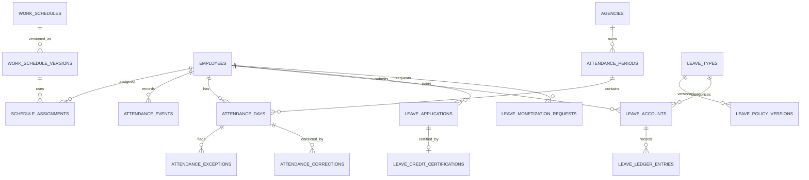

# Attendance and Leave Logical ERD

**Document status:** Draft for review  
**Model level:** Logical ERD  
**Primary profile:** Civilian Philippine National Government Agency  
**Version:** 1.0  
**Date:** August 6, 2026

---

## Shared logical conventions

- Primary keys use UUIDs.
- All agency-owned operational records carry `agency_id`.
- Timestamps are stored in UTC and displayed in Philippine Standard Time by default.
- Status values are constrained enums or reference values, never unrestricted text.
- Effective-dated records use `effective_from` and nullable `effective_to`.
- `created_at`, `created_by_membership_id`, `updated_at`, and `updated_by_membership_id` are included where a record is mutable.
- Ledger, issued, certified, finalized, and audit records are append-only after posting.
- Sensitive values are encrypted or tokenized and are omitted from ordinary logs.
- Normal application deletion is restricted. Historical transactions are voided, superseded, deactivated, or archived.
- PostgreSQL Row-Level Security and physical indexes will be specified in the physical-schema phase.
- Cross-module actions go through owning application services rather than direct table updates.

## Relationship diagram

# Entity definitions

## `work_schedules`

Reusable schedule definition

| Column | Logical type | Null? | Key / rule | Description |
| --- | --- | --- | --- | --- |
| id | uuid | No | PK | Schedule |
| agency_id | uuid | No | FK agencies | Tenant |
| code | string | No |  | Code |
| name | string | No |  | Name |
| schedule_type | enum | No |  | REGULAR, FLEXIBLE, SHIFT, COMPRESSED |
| timezone | string | No |  | Timezone |
| status | enum | No |  | ACTIVE, INACTIVE |
| current_version_id | uuid | Yes | FK work_schedule_versions | Current version |

**Constraints and indexes**

- Unique `(agency_id, code)`.

**Deletion behavior:** Inactivate.
## `work_schedule_versions`

Effective-dated schedule rules

| Column | Logical type | Null? | Key / rule | Description |
| --- | --- | --- | --- | --- |
| id | uuid | No | PK | Version |
| agency_id | uuid | No | FK agencies | Tenant |
| work_schedule_id | uuid | No | FK work_schedules | Schedule |
| version_no | integer | No |  | Version |
| weekly_pattern | json | No |  | Daily start/end and break rules |
| grace_minutes | integer | No |  | Grace period |
| required_minutes_per_day | integer | Yes |  | Expected minutes |
| effective_from | date | No |  | Start |
| effective_to | date | Yes |  | End |

**Constraints and indexes**

- No overlapping active versions.

**Deletion behavior:** Supersede.
## `work_arrangements`

Authorized work arrangement

| Column | Logical type | Null? | Key / rule | Description |
| --- | --- | --- | --- | --- |
| id | uuid | No | PK | Arrangement |
| agency_id | uuid | No | FK agencies | Tenant |
| code | string | No |  | Code |
| name | string | No |  | Name |
| arrangement_type | enum | No |  | OFFICE, WFH, HYBRID, FIELD, OFFICIAL_BUSINESS, OTHER |
| status | enum | No |  | ACTIVE, INACTIVE |

**Constraints and indexes**

- Unique `(agency_id, code)`.

**Deletion behavior:** Inactivate.
## `schedule_assignments`

Effective employee schedule and arrangement

| Column | Logical type | Null? | Key / rule | Description |
| --- | --- | --- | --- | --- |
| id | uuid | No | PK | Assignment |
| agency_id | uuid | No | FK agencies | Tenant |
| employee_id | uuid | No | FK employees | Employee |
| work_schedule_version_id | uuid | No | FK work_schedule_versions | Schedule version |
| work_arrangement_id | uuid | Yes | FK work_arrangements | Arrangement |
| effective_from | date | No |  | Start |
| effective_to | date | Yes |  | End |
| assigned_by_membership_id | uuid | No | FK agency_memberships | Actor |

**Constraints and indexes**

- No conflicting overlapping primary schedule assignments.

**Deletion behavior:** End-date.
## `holiday_calendars`

Agency/location holiday calendar

| Column | Logical type | Null? | Key / rule | Description |
| --- | --- | --- | --- | --- |
| id | uuid | No | PK | Calendar |
| agency_id | uuid | No | FK agencies | Tenant |
| code | string | No |  | Code |
| name | string | No |  | Name |
| region_code | string | Yes |  | Region/location |
| status | enum | No |  | ACTIVE, INACTIVE |

**Constraints and indexes**

- Unique `(agency_id, code)`.

**Deletion behavior:** Inactivate.
## `holidays`

Effective holiday/day classification

| Column | Logical type | Null? | Key / rule | Description |
| --- | --- | --- | --- | --- |
| id | uuid | No | PK | Holiday |
| agency_id | uuid | No | FK agencies | Tenant |
| holiday_calendar_id | uuid | No | FK holiday_calendars | Calendar |
| holiday_date | date | No |  | Date |
| name | string | No |  | Name |
| day_type | enum | No |  | REGULAR_HOLIDAY, SPECIAL_DAY, LOCAL_HOLIDAY, AGENCY_HOLIDAY |
| source_reference | string | Yes |  | Issuance |

**Constraints and indexes**

- Unique `(holiday_calendar_id, holiday_date, day_type)`.

**Deletion behavior:** Correct through version/replacement.
## `attendance_periods`

Review and payroll-cutoff period

| Column | Logical type | Null? | Key / rule | Description |
| --- | --- | --- | --- | --- |
| id | uuid | No | PK | Period |
| agency_id | uuid | No | FK agencies | Tenant |
| code | string | No |  | Period code |
| date_from | date | No |  | Start |
| date_to | date | No |  | End |
| status | enum | No |  | OPEN, FOR_REVIEW, APPROVED, LOCKED, REOPENED |
| locked_at | datetime | Yes |  | Lock |
| locked_by_membership_id | uuid | Yes | FK agency_memberships | Locker |

**Constraints and indexes**

- No overlapping active primary periods for the same payroll profile.

**Deletion behavior:** Retain.
## `attendance_events`

Immutable raw manual or web-clock event

| Column | Logical type | Null? | Key / rule | Description |
| --- | --- | --- | --- | --- |
| id | uuid | No | PK | Event |
| agency_id | uuid | No | FK agencies | Tenant |
| employee_id | uuid | No | FK employees | Employee |
| event_time | datetime | No |  | Timestamp |
| event_type | enum | No |  | TIME_IN, BREAK_OUT, BREAK_IN, TIME_OUT |
| source | enum | No |  | WEB_CLOCK, MANUAL |
| source_reference | string | Yes |  | Request/device metadata |
| entered_by_membership_id | uuid | Yes | FK agency_memberships | Manual actor |
| reason | string | Yes |  | Required for manual entry |
| voided_at | datetime | Yes |  | Void time |
| void_reason | string | Yes |  | Void reason |

**Constraints and indexes**

- Events are not updated; incorrect events are voided and replaced.
- No biometric source enum in MVP.

**Deletion behavior:** Retain; never hard-delete.
## `attendance_days`

Calculated daily attendance result

| Column | Logical type | Null? | Key / rule | Description |
| --- | --- | --- | --- | --- |
| id | uuid | No | PK | Attendance day |
| agency_id | uuid | No | FK agencies | Tenant |
| attendance_period_id | uuid | No | FK attendance_periods | Period |
| employee_id | uuid | No | FK employees | Employee |
| work_date | date | No |  | Work date |
| schedule_assignment_id | uuid | Yes | FK schedule_assignments | Schedule used |
| status | enum | No |  | PENDING, CALCULATED, EXCEPTION, FOR_REVIEW, APPROVED, LOCKED, ADJUSTED |
| worked_minutes | integer | No |  | Worked |
| late_minutes | integer | No |  | Late |
| undertime_minutes | integer | No |  | Undertime |
| absence_minutes | integer | No |  | Absence |
| official_business_minutes | integer | No |  | Official business |
| calculation_version | integer | No |  | Recalculation version |
| rule_snapshot | json | No |  | Applied rules |

**Constraints and indexes**

- Unique `(attendance_period_id, employee_id, work_date, calculation_version)`; one current version.
- Negative minute values prohibited.

**Deletion behavior:** Retain all versions.
## `attendance_exceptions`

Detected attendance issue

| Column | Logical type | Null? | Key / rule | Description |
| --- | --- | --- | --- | --- |
| id | uuid | No | PK | Exception |
| agency_id | uuid | No | FK agencies | Tenant |
| attendance_day_id | uuid | No | FK attendance_days | Day |
| exception_type | enum | No |  | MISSING_EVENT, TARDINESS, UNDERTIME, ABSENCE, OVERLAP, SCHEDULE_MISMATCH, OTHER |
| severity | enum | No |  | INFO, WARNING, BLOCKING |
| status | enum | No |  | OPEN, RESOLVED, WAIVED |
| details | json | No |  | Sanitized details |
| resolved_at | datetime | Yes |  | Resolution |

**Constraints and indexes**

- Blocking exception prevents period lock unless formally waived.

**Deletion behavior:** Retain.
## `attendance_corrections`

Correction request without overwriting raw events

| Column | Logical type | Null? | Key / rule | Description |
| --- | --- | --- | --- | --- |
| id | uuid | No | PK | Correction |
| agency_id | uuid | No | FK agencies | Tenant |
| attendance_day_id | uuid | No | FK attendance_days | Day |
| employee_id | uuid | No | FK employees | Requester/subject |
| status | enum | No |  | DRAFT, SUBMITTED, NEEDS_INFORMATION, APPROVED, REJECTED, CANCELLED, APPLIED |
| requested_events | json | No |  | Requested corrected events |
| reason | string | No |  | Reason |
| submitted_at | datetime | Yes |  | Submission |
| decided_by_membership_id | uuid | Yes | FK agency_memberships | Approver |
| decided_at | datetime | Yes |  | Decision |
| decision_reason | string | Yes |  | Decision basis |

**Constraints and indexes**

- Applied correction creates replacement events or a locked-period adjustment.

**Deletion behavior:** Retain.
## `leave_types`

Stable leave category

| Column | Logical type | Null? | Key / rule | Description |
| --- | --- | --- | --- | --- |
| id | uuid | No | PK | Leave type |
| agency_id | uuid | No | FK agencies | Tenant |
| code | string | No |  | Code |
| name | string | No |  | Name |
| credit_based | boolean | No |  | Uses credits |
| status | enum | No |  | ACTIVE, INACTIVE |
| current_policy_version_id | uuid | Yes | FK leave_policy_versions | Current policy |

**Constraints and indexes**

- Unique `(agency_id, code)`.

**Deletion behavior:** Inactivate.
## `leave_policy_versions`

Effective-dated leave rules

| Column | Logical type | Null? | Key / rule | Description |
| --- | --- | --- | --- | --- |
| id | uuid | No | PK | Policy version |
| agency_id | uuid | No | FK agencies | Tenant |
| leave_type_id | uuid | No | FK leave_types | Type |
| version_no | integer | No |  | Version |
| eligibility_rules | json | No |  | Eligibility |
| accrual_rules | json | No |  | Accrual |
| document_requirements | json | No |  | Required evidence |
| approval_route_code | string | No |  | Workflow route |
| effective_from | date | No |  | Start |
| effective_to | date | Yes |  | End |

**Constraints and indexes**

- No overlapping active versions.

**Deletion behavior:** Supersede.
## `leave_accounts`

Employee balance account for a leave type

| Column | Logical type | Null? | Key / rule | Description |
| --- | --- | --- | --- | --- |
| id | uuid | No | PK | Account |
| agency_id | uuid | No | FK agencies | Tenant |
| employee_id | uuid | No | FK employees | Employee |
| leave_type_id | uuid | No | FK leave_types | Type |
| status | enum | No |  | ACTIVE, FROZEN, CLOSED |
| opened_at | date | No |  | Open date |
| closed_at | date | Yes |  | Close date |

**Constraints and indexes**

- Unique active `(employee_id, leave_type_id)`.

**Deletion behavior:** Close.
## `leave_ledger_entries`

Immutable leave-credit transaction

| Column | Logical type | Null? | Key / rule | Description |
| --- | --- | --- | --- | --- |
| id | uuid | No | PK | Entry |
| agency_id | uuid | No | FK agencies | Tenant |
| leave_account_id | uuid | No | FK leave_accounts | Account |
| entry_type | enum | No |  | OPENING, EARNED, USED, ADJUSTMENT, RESTORATION, MONETIZATION, TERMINAL, REVERSAL |
| quantity_days | decimal | No |  | Signed quantity |
| effective_date | date | No |  | Effective date |
| source_type | string | No |  | Application, accrual, monetization, etc. |
| source_id | uuid | No |  | Source entity |
| reverses_entry_id | uuid | Yes | FK leave_ledger_entries | Original |
| posted_at | datetime | No |  | Posting |
| posted_by_membership_id | uuid | Yes | FK agency_memberships | Actor |

**Constraints and indexes**

- Unique `(source_type, source_id, entry_type)` for idempotency.
- Reversal must reference same account.

**Deletion behavior:** Never delete.
## `leave_applications`

Government leave application

| Column | Logical type | Null? | Key / rule | Description |
| --- | --- | --- | --- | --- |
| id | uuid | No | PK | Application |
| agency_id | uuid | No | FK agencies | Tenant |
| employee_id | uuid | No | FK employees | Employee |
| leave_type_id | uuid | No | FK leave_types | Type |
| policy_version_id | uuid | No | FK leave_policy_versions | Rules used |
| date_from | date | No |  | Start |
| date_to | date | No |  | End |
| requested_days | decimal | No |  | Units |
| status | enum | No |  | DRAFT, SUBMITTED, FOR_CERTIFICATION, FOR_RECOMMENDATION, FOR_APPROVAL, APPROVED, REJECTED, NEEDS_INFORMATION, CANCEL_REQUESTED, CANCELLED, POSTED |
| reason | string | Yes |  | Reason |
| submitted_at | datetime | Yes |  | Submission |

**Constraints and indexes**

- No overlapping approved/posted leave unless policy allows.
- Posted application must have ledger/payroll effects where applicable.

**Deletion behavior:** Retain.
## `leave_credit_certifications`

Certified balance for an application

| Column | Logical type | Null? | Key / rule | Description |
| --- | --- | --- | --- | --- |
| id | uuid | No | PK | Certification |
| agency_id | uuid | No | FK agencies | Tenant |
| leave_application_id | uuid | No | FK leave_applications | Application |
| leave_account_id | uuid | Yes | FK leave_accounts | Account |
| balance_as_of | date | No |  | Balance date |
| certified_balance | decimal | No |  | Balance |
| certified_by_membership_id | uuid | No | FK agency_memberships | Certifier |
| certified_at | datetime | No |  | Certification |

**Constraints and indexes**

- At most one effective certification per workflow version.

**Deletion behavior:** Retain.
## `leave_monetization_requests`

Leave monetization request and payroll handoff

| Column | Logical type | Null? | Key / rule | Description |
| --- | --- | --- | --- | --- |
| id | uuid | No | PK | Request |
| agency_id | uuid | No | FK agencies | Tenant |
| employee_id | uuid | No | FK employees | Employee |
| leave_account_id | uuid | No | FK leave_accounts | Account |
| policy_version_id | uuid | No | FK leave_policy_versions | Rules |
| requested_days | decimal | No |  | Days |
| approved_days | decimal | Yes |  | Approved |
| status | enum | No |  | DRAFT, SUBMITTED, FOR_VALIDATION, FOR_APPROVAL, APPROVED, REJECTED, POSTED_TO_PAYROLL, CANCELLED |
| payroll_input_id | uuid | Yes | FK payroll_inputs | Payroll handoff |

**Constraints and indexes**

- Posting creates one leave ledger debit and one idempotent payroll input.

**Deletion behavior:** Retain.

# Domain invariants

- MVP attendance sources are manual entry and optional authenticated web clock only.
- Raw events are immutable; corrections create new events or adjustment records.
- Locked attendance cannot be directly edited.
- Leave and monetization balances are derived from immutable ledger entries.
