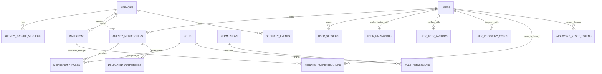

# Identity and Agency Logical ERD

**Document status:** Draft for review  
**Model level:** Logical ERD  
**Primary profile:** Civilian Philippine National Government Agency  
**Version:** 1.0  
**Date:** August 6, 2026

---

## Shared logical conventions

- Primary keys use UUIDs.
- All agency-owned operational records carry `agency_id`.
- Timestamps are stored in UTC and displayed in Philippine Standard Time by default.
- Status values are constrained enums or reference values, never unrestricted text.
- Effective-dated records use `effective_from` and nullable `effective_to`.
- `created_at`, `created_by_membership_id`, `updated_at`, and `updated_by_membership_id` are included where a record is mutable.
- Ledger, issued, certified, finalized, and audit records are append-only after posting.
- Sensitive values are encrypted or tokenized and are omitted from ordinary logs.
- Normal application deletion is restricted. Historical transactions are voided, superseded, deactivated, or archived.
- PostgreSQL Row-Level Security and physical indexes will be specified in the physical-schema phase.
- Cross-module actions go through owning application services rather than direct table updates.

## Relationship diagram

# Entity definitions

## `agencies`

Root tenant and government-agency record.

| Column | Logical type | Null? | Key / rule | Description |
| --- | --- | --- | --- | --- |
| id | uuid | No | PK | Agency identifier |
| code | string | No | Unique per platform | Official/internal agency code |
| name | string | No |  | Official agency name |
| acronym | string | Yes |  | Agency acronym |
| agency_type | enum | No |  | NGA, LGU, SUC, GOCC_ORIGINAL_CHARTER, OTHER |
| status | enum | No |  | DRAFT, ACTIVE, SUSPENDED, ARCHIVED |
| default_timezone | string | No |  | Defaults to Asia/Manila |
| default_currency | string | No |  | Defaults to PHP |
| current_profile_version_id | uuid | Yes | FK agency_profile_versions | Current effective profile |
| created_at | datetime | No |  | Creation timestamp |

**Constraints and indexes**

- Unique index on normalized `code`.
- Only ACTIVE agencies may create normal operational records.

**Deletion behavior:** Archive only; never hard-delete after operational records exist.
## `agency_profile_versions`

Effective-dated agency configuration and policy profile.

| Column | Logical type | Null? | Key / rule | Description |
| --- | --- | --- | --- | --- |
| id | uuid | No | PK | Profile version |
| agency_id | uuid | No | FK agencies | Tenant owner |
| version_no | integer | No | Unique per agency | Sequential version |
| appointing_authority_title | string | Yes |  | Configured authority |
| deployment_profile | enum | No |  | SHARED_SAAS, DEDICATED_CLOUD, AGENCY_HOSTED |
| effective_from | date | No |  | Start date |
| effective_to | date | Yes |  | End date |
| configuration | json | No |  | Non-core versioned settings |
| status | enum | No |  | DRAFT, ACTIVE, SUPERSEDED |

**Constraints and indexes**

- No overlapping ACTIVE effective periods per agency.
- Unique `(agency_id, version_no)`.

**Deletion behavior:** Supersede; do not delete an activated version.
## `users`

Global authenticated identity, independent from agency employment.

| Column | Logical type | Null? | Key / rule | Description |
| --- | --- | --- | --- | --- |
| id | uuid | No | PK | User identity |
| email_normalized | string | No | Unique | Normalized login email |
| display_name | string | No |  | Display name |
| global_status | enum | No |  | ACTIVE, LOCKED, DEACTIVATED |
| email_verified_at | datetime | Yes |  | Verification timestamp |
| last_login_at | datetime | Yes |  | Last successful login |
| created_at | datetime | No |  | Creation timestamp |

**Constraints and indexes**

- Unique normalized email.

**Deletion behavior:** Deactivate only; identity history remains.
## `agency_memberships`

Agency-specific access relationship for a user.

| Column | Logical type | Null? | Key / rule | Description |
| --- | --- | --- | --- | --- |
| id | uuid | No | PK | Membership identifier |
| agency_id | uuid | No | FK agencies | Tenant |
| user_id | uuid | No | FK users | Identity |
| employee_id | uuid | Yes | FK employees | Optional personnel link |
| status | enum | No |  | INVITED, ACTIVE, LOCKED, SUSPENDED, DEACTIVATED |
| primary_organization_unit_id | uuid | Yes | FK organization_units | Default office scope |
| activated_at | datetime | Yes |  | Activation time |
| deactivated_at | datetime | Yes |  | Deactivation time |
| deactivation_reason | string | Yes |  | Reason for removal |

**Constraints and indexes**

- Unique `(agency_id, user_id)`.
- At most one active membership linked to an employee within the same agency.
- `employee_id`, when present, must belong to the same agency.

**Deletion behavior:** Deactivate; never delete after audit or workflow activity.
## `invitations`

Single-use agency membership invitation.

| Column | Logical type | Null? | Key / rule | Description |
| --- | --- | --- | --- | --- |
| id | uuid | No | PK | Invitation |
| agency_id | uuid | No | FK agencies | Tenant |
| email_normalized | string | No |  | Invitee email |
| invited_by_membership_id | uuid | No | FK agency_memberships | Inviter |
| token_hash | string | No | Unique | Hashed single-use token |
| expires_at | datetime | No |  | Expiration |
| accepted_at | datetime | Yes |  | Acceptance |
| cancelled_at | datetime | Yes |  | Cancellation |
| status | enum | No |  | PENDING, ACCEPTED, EXPIRED, CANCELLED |

**Constraints and indexes**

- Only one usable invitation for an email and agency at a time.

**Deletion behavior:** Expire or cancel; purge token material only after retention period.
## `roles`

Agency role or platform-provided role template.

| Column | Logical type | Null? | Key / rule | Description |
| --- | --- | --- | --- | --- |
| id | uuid | No | PK | Role |
| agency_id | uuid | Yes | FK agencies | Null for platform template |
| code | string | No |  | Stable role code |
| name | string | No |  | Display name |
| is_system_template | boolean | No |  | Platform-managed template flag |
| status | enum | No |  | ACTIVE, INACTIVE |

**Constraints and indexes**

- Unique `(agency_id, code)` for agency roles; unique global code for templates.

**Deletion behavior:** Inactivate after assignment history exists.
## `permissions`

Global catalog of atomic application permissions.

| Column | Logical type | Null? | Key / rule | Description |
| --- | --- | --- | --- | --- |
| id | uuid | No | PK | Permission |
| code | string | No | Unique | Example: payroll.periods.finalize |
| domain | string | No |  | Owning module |
| risk_level | enum | No |  | LOW, MEDIUM, HIGH, CRITICAL |
| description | string | No |  | Permission meaning |

**Constraints and indexes**

- Permission codes are immutable once released.

**Deletion behavior:** Never delete; deprecate by application version.
## `role_permissions`

Many-to-many assignment of permissions to roles.

| Column | Logical type | Null? | Key / rule | Description |
| --- | --- | --- | --- | --- |
| role_id | uuid | No | PK/FK roles | Role |
| permission_id | uuid | No | PK/FK permissions | Permission |
| scope_policy | enum | No |  | OWN, DIRECT_REPORTS, ASSIGNED_OFFICE, AGENCY, RESTRICTED |
| granted_at | datetime | No |  | Grant timestamp |
| granted_by_membership_id | uuid | Yes | FK agency_memberships | Granting actor |

**Constraints and indexes**

- Composite PK `(role_id, permission_id, scope_policy)`.

**Deletion behavior:** Revoke by deletion only while a separate audit event preserves the change.
## `membership_roles`

Role assignments for a membership.

| Column | Logical type | Null? | Key / rule | Description |
| --- | --- | --- | --- | --- |
| id | uuid | No | PK | Assignment |
| agency_id | uuid | No | FK agencies | Tenant |
| membership_id | uuid | No | FK agency_memberships | User membership |
| role_id | uuid | No | FK roles | Role |
| effective_from | datetime | No |  | Start |
| effective_to | datetime | Yes |  | End |
| assigned_by_membership_id | uuid | No | FK agency_memberships | Assigning actor |
| reason | string | Yes |  | Assignment reason |

**Constraints and indexes**

- No overlapping active assignment of the same role to the same membership.
- Agency of membership and agency-scoped role must match.

**Deletion behavior:** End-date; do not hard-delete historical assignment.
## `delegated_authorities`

Temporary approval or acting authority.

| Column | Logical type | Null? | Key / rule | Description |
| --- | --- | --- | --- | --- |
| id | uuid | No | PK | Delegation |
| agency_id | uuid | No | FK agencies | Tenant |
| delegator_membership_id | uuid | No | FK agency_memberships | Original authority |
| delegate_membership_id | uuid | No | FK agency_memberships | Acting authority |
| permission_code | string | No | FK-like permissions.code | Delegated capability |
| organization_unit_id | uuid | Yes | FK organization_units | Optional scope |
| effective_from | datetime | No |  | Start |
| effective_to | datetime | No |  | End |
| status | enum | No |  | ACTIVE, REVOKED, EXPIRED |
| authority_document_id | uuid | Yes | FK documents | Supporting authority |

**Constraints and indexes**

- Delegator and delegate must be active members of the same agency.
- End must be after start.
- Delegation may not exceed delegator's authority.

**Deletion behavior:** Revoke or expire.
## `user_sessions`

Application session record when sessions are maintained by the application.

| Column | Logical type | Null? | Key / rule | Description |
| --- | --- | --- | --- | --- |
| id | uuid | No | PK | Session |
| user_id | uuid | No | FK users | Identity |
| agency_membership_id | uuid | Yes | FK agency_memberships | Selected agency context |
| session_token_hash | string | No | Unique | Hashed token identifier |
| created_at | datetime | No |  | Created |
| last_seen_at | datetime | No |  | Activity |
| expires_at | datetime | No |  | Absolute expiry |
| revoked_at | datetime | Yes |  | Revocation |
| revocation_reason | string | Yes |  | Reason |

**Constraints and indexes**

- Session token itself is never stored.
- Deactivated memberships cannot be selected.

**Deletion behavior:** Purge after security retention period.
## `user_passwords`

The User's LingkodHR-owned password. Carries no `agency_id`; visible only in the owning User's context.

| Column | Logical type | Null? | Key / rule | Description |
| --- | --- | --- | --- | --- |
| user_id | uuid | No | PK, FK users | Owning User |
| password_hash | string | No |  | Argon2id PHC string; the password itself is never stored |
| changed_at | datetime | No |  | Last change |
| second_factor_failures | integer | No | ≥ 0 | Consecutive second-factor failures |
| reset_required_at | datetime | Yes |  | When a reset became required |

**Constraints and indexes**

- One password per User.
- Rehashed on successful sign-in when the hash parameters are outdated.

**Deletion behavior:** Cascades with the User.
## `user_totp_factors`

The User's authenticator-app (TOTP) factor. Carries no `agency_id`; visible only in the owning User's context.

| Column | Logical type | Null? | Key / rule | Description |
| --- | --- | --- | --- | --- |
| id | uuid | No | PK | Factor |
| user_id | uuid | No | FK users, unique | Owning User |
| secret_envelope | bytes | No |  | TOTP secret encrypted with `DATA_ENCRYPTION_KEY`, bound to the User and factor |
| last_accepted_step | integer | No |  | Newest accepted 30-second step; older or equal steps are refused |
| created_at | datetime | No |  | Enrollment |

**Constraints and indexes**

- At most one factor per User.
- Only `last_accepted_step` changes; replacing the secret replaces the row.

**Deletion behavior:** Delete on replacement; cascades with the User.
## `user_recovery_codes`

Unused single-use Recovery Codes. Carries no `agency_id`; visible only in the owning User's context.

| Column | Logical type | Null? | Key / rule | Description |
| --- | --- | --- | --- | --- |
| id | uuid | No | PK | Recovery Code |
| user_id | uuid | No | FK users | Owning User |
| code_hash | string | No |  | Hash of the normalized code; the code itself is never stored |
| created_at | datetime | No |  | Issued |

**Constraints and indexes**

- Index on `user_id`.

**Deletion behavior:** Delete when used or when the set is replaced; cascades with the User.
## `pending_authentications`

Short-lived state between sign-in or activation steps, referenced by an HTTP-only cookie. Carries no `agency_id`; visible in the owning User's context or through the hash of its cookie token.

| Column | Logical type | Null? | Key / rule | Description |
| --- | --- | --- | --- | --- |
| id | uuid | No | PK | Pending authentication |
| token_hash | bytes | No | Unique | Hash of the cookie token; the token itself is never stored |
| purpose | enum | No |  | SIGN_IN, ACTIVATION |
| user_id | uuid | Yes | FK users | User signing in; required for SIGN_IN |
| invitation_id | uuid | Yes | FK invitations | Invitation being activated; required for ACTIVATION |
| requested_membership_id | uuid | Yes |  | Agency Membership requested for the session |
| stage | string | No |  | Next step: TOTP, ENROLL_SCAN, or ENROLL_CODES |
| verified_methods | string[] | No |  | Methods already verified, such as `pwd` |
| display_name | string | Yes |  | Activation input |
| password_hash | string | Yes |  | Activation input |
| enrollment_secret_envelope | bytes | Yes |  | TOTP secret being enrolled, encrypted like a factor's and bound to the User and the pending row, whose id becomes the factor id |
| recovery_code_hashes | string[] | No |  | Hashes of the Recovery Codes shown once at enrollment |
| enrollment_accepted_step | integer | Yes |  | Step of the code that confirmed enrollment; the factor's first `last_accepted_step` |
| expires_at | datetime | No | After `created_at` | Sign-in expires after 5 minutes |
| created_at | datetime | No |  | Started |

**Constraints and indexes**

- SIGN_IN requires `user_id` and no `invitation_id`; ACTIVATION requires `invitation_id`.
- At most one SIGN_IN row per User and one ACTIVATION row per invitation; starting over replaces it.
- The final step deletes the row in the transaction that creates the session. For an enrollment, the same transaction writes the factor and the Recovery Code hashes; an abandoned or expired enrollment writes nothing.

**Deletion behavior:** Deleted when completed, replaced, or found expired; cascades with the User or invitation.
## `password_reset_tokens`

Emailed password reset links. Carries no `agency_id`; visible in the owning User's context or through the hash of its token.

| Column | Logical type | Null? | Key / rule | Description |
| --- | --- | --- | --- | --- |
| id | uuid | No | PK | Reset link |
| user_id | uuid | No | FK users | User whose password the link resets |
| token_hash | bytes | No | Unique | SHA-256 hash of the link's token; the token itself is never stored |
| expires_at | datetime | No | After `created_at` | The link works for 30 minutes |
| consumed_at | datetime | Yes |  | Set when a reset completes through the link |
| superseded_at | datetime | Yes |  | Set when a newer request or any password change voids the link |
| created_at | datetime | No |  | Requested |

**Constraints and indexes**

- At most one outstanding link per User (neither consumed nor superseded); a new request supersedes the older one.
- A link ends once: `consumed_at` and `superseded_at` are never both set. Only those two columns are updatable.
- Changing `user_passwords.changed_at`, by any route, supersedes the User's outstanding link. A completing reset consumes its link first.

**Deletion behavior:** Kept while the User exists, so a failed reset can tell a used, superseded, or expired link from an unknown one; cascades with the User.
## `security_events`

Append-only authentication and authorization security events.

| Column | Logical type | Null? | Key / rule | Description |
| --- | --- | --- | --- | --- |
| id | uuid | No | PK | Event |
| agency_id | uuid | Yes | FK agencies | Agency context when applicable |
| user_id | uuid | Yes | FK users | Known user |
| membership_id | uuid | Yes | FK agency_memberships | Known membership |
| event_type | enum | No |  | LOGIN_SUCCESS, LOGIN_FAILURE, LOCK, ROLE_CHANGE, SESSION_REVOKED, etc. |
| occurred_at | datetime | No |  | Event time |
| request_id | string | Yes |  | Request correlation |
| ip_address | string | Yes |  | Protected network metadata |
| email_hash | bytes | Yes |  | Keyed hash (`BLIND_INDEX_KEY`) of the submitted email; the raw email is not stored |
| user_agent | string | Yes |  | Client metadata |
| details | json | No |  | Sanitized metadata |

**Constraints and indexes**

- Append-only; no secrets or full sensitive payloads. Sign-in events never hold a password, code, token, or raw email.
- Indexes on `(email_hash, event_type, occurred_at)` and `(ip_address, event_type, occurred_at)` for sign-in attempt counts.

**Deletion behavior:** Retention-controlled purge only.

# Domain invariants

- Authentication identity is global; authorization is agency-specific.
- `agency_memberships.employee_id` is optional because auditors and administrators may not be employees.
- Role assignment and delegation are effective-dated.
- Critical role changes create `security_events` and business `audit_events`.
- The application derives `agency_id` from the authenticated membership and never trusts a browser-supplied tenant identifier.
