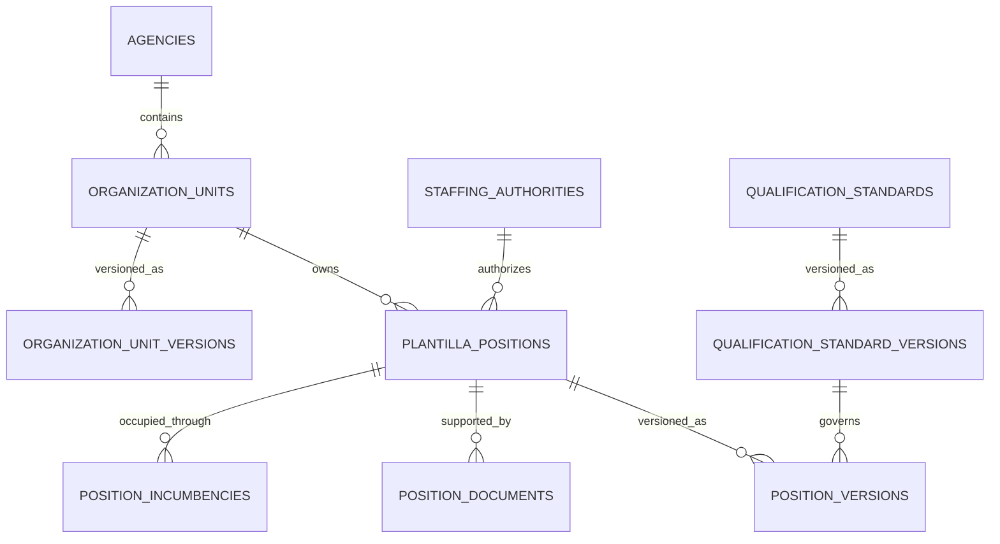

# Organization and Plantilla Logical ERD

**Document status:** Draft for review  
**Model level:** Logical ERD  
**Primary profile:** Civilian Philippine National Government Agency  
**Version:** 1.0  
**Date:** August 6, 2026

---

## Shared logical conventions

- Primary keys use UUIDs.
- All agency-owned operational records carry `agency_id`.
- Timestamps are stored in UTC and displayed in Philippine Standard Time by default.
- Status values are constrained enums or reference values, never unrestricted text.
- Effective-dated records use `effective_from` and nullable `effective_to`.
- `created_at`, `created_by_membership_id`, `updated_at`, and `updated_by_membership_id` are included where a record is mutable.
- Ledger, issued, certified, finalized, and audit records are append-only after posting.
- Sensitive values are encrypted or tokenized and are omitted from ordinary logs.
- Normal application deletion is restricted. Historical transactions are voided, superseded, deactivated, or archived.
- PostgreSQL Row-Level Security and physical indexes will be specified in the physical-schema phase.
- Cross-module actions go through owning application services rather than direct table updates.

## Relationship diagram

# Entity definitions

## `organization_units`

Stable organization-node identity.

| Column | Logical type | Null? | Key / rule | Description |
| --- | --- | --- | --- | --- |
| id | uuid | No | PK | Organization unit |
| agency_id | uuid | No | FK agencies | Tenant |
| code | string | No |  | Agency unit code |
| unit_type | enum | No |  | DEPARTMENT, BUREAU, SERVICE, DIVISION, SECTION, OFFICE, OTHER |
| status | enum | No |  | DRAFT, ACTIVE, INACTIVE, ABOLISHED |
| current_version_id | uuid | Yes | FK organization_unit_versions | Current version |

**Constraints and indexes**

- Unique active `(agency_id, code)`.
- Parent hierarchy is defined in versions and must be acyclic.

**Deletion behavior:** Abolish or inactivate.
## `organization_unit_versions`

Effective-dated name, parent, and leadership structure.

| Column | Logical type | Null? | Key / rule | Description |
| --- | --- | --- | --- | --- |
| id | uuid | No | PK | Version |
| agency_id | uuid | No | FK agencies | Tenant |
| organization_unit_id | uuid | No | FK organization_units | Stable unit |
| version_no | integer | No |  | Version |
| name | string | No |  | Official name |
| parent_unit_id | uuid | Yes | FK organization_units | Parent |
| head_position_id | uuid | Yes | FK plantilla_positions | Head position |
| cost_center_code | string | Yes |  | Cost/responsibility center |
| effective_from | date | No |  | Start |
| effective_to | date | Yes |  | End |
| status | enum | No |  | DRAFT, ACTIVE, SUPERSEDED |

**Constraints and indexes**

- No overlapping active periods per unit.
- Parent must belong to same agency.
- Unit cannot be its own ancestor.

**Deletion behavior:** Supersede.
## `staffing_authorities`

Authority supporting organization or staffing changes.

| Column | Logical type | Null? | Key / rule | Description |
| --- | --- | --- | --- | --- |
| id | uuid | No | PK | Authority |
| agency_id | uuid | No | FK agencies | Tenant |
| authority_type | enum | No |  | LAW, EXECUTIVE_ORDER, DBM_APPROVAL, BOARD_RESOLUTION, OTHER |
| reference_no | string | No |  | Official reference |
| issued_date | date | No |  | Issue date |
| effective_date | date | No |  | Effectivity |
| document_id | uuid | Yes | FK documents | Supporting file |
| status | enum | No |  | ACTIVE, SUPERSEDED, REVOKED |

**Constraints and indexes**

- Unique `(agency_id, authority_type, reference_no)`.

**Deletion behavior:** Supersede or revoke.
## `plantilla_positions`

Stable authorized position or item identity.

| Column | Logical type | Null? | Key / rule | Description |
| --- | --- | --- | --- | --- |
| id | uuid | No | PK | Position |
| agency_id | uuid | No | FK agencies | Tenant |
| item_number | string | No |  | Official item number |
| status | enum | No |  | PROPOSED, AUTHORIZED, VACANT, RESERVED, OCCUPIED, FROZEN, ABOLISHED |
| current_version_id | uuid | Yes | FK position_versions | Current version |
| created_from_authority_id | uuid | Yes | FK staffing_authorities | Creating authority |

**Constraints and indexes**

- Unique active `(agency_id, item_number)`.
- Status changes only through position service.

**Deletion behavior:** Abolish; never delete after authorization.
## `position_versions`

Effective-dated position attributes.

| Column | Logical type | Null? | Key / rule | Description |
| --- | --- | --- | --- | --- |
| id | uuid | No | PK | Version |
| agency_id | uuid | No | FK agencies | Tenant |
| position_id | uuid | No | FK plantilla_positions | Stable position |
| organization_unit_id | uuid | No | FK organization_units | Owning office |
| position_title | string | No |  | Official title |
| parenthetical_title | string | Yes |  | Optional parenthetical title |
| salary_grade | integer | No |  | Salary grade |
| funding_source | string | Yes |  | Funding source |
| employment_category | enum | No |  | PLANTILLA, CASUAL, CONTRACTUAL, OTHER |
| qualification_standard_version_id | uuid | No | FK qualification_standard_versions | Applicable QS |
| effective_from | date | No |  | Start |
| effective_to | date | Yes |  | End |
| version_no | integer | No |  | Version |

**Constraints and indexes**

- No overlapping effective periods per position.
- Salary grade must be within configured range.

**Deletion behavior:** Supersede.
## `qualification_standards`

Stable qualification-standard identity.

| Column | Logical type | Null? | Key / rule | Description |
| --- | --- | --- | --- | --- |
| id | uuid | No | PK | QS |
| agency_id | uuid | No | FK agencies | Tenant |
| code | string | No |  | QS code |
| name | string | No |  | QS name |
| status | enum | No |  | ACTIVE, INACTIVE |
| current_version_id | uuid | Yes | FK qualification_standard_versions | Current version |

**Constraints and indexes**

- Unique `(agency_id, code)` and `(agency_id, name)`.

**Deletion behavior:** Inactivate.
## `qualification_standard_versions`

Effective-dated minimum qualification requirements.

| Column | Logical type | Null? | Key / rule | Description |
| --- | --- | --- | --- | --- |
| id | uuid | No | PK | QS version |
| agency_id | uuid | No | FK agencies | Tenant |
| qualification_standard_id | uuid | No | FK qualification_standards | Stable QS |
| education_requirement | string | Yes |  | Education |
| training_hours_required | decimal | Yes |  | Training hours |
| experience_months_required | integer | Yes |  | Experience |
| eligibility_requirement | string | Yes |  | Civil service eligibility |
| competency_requirements | json | No |  | Structured competency requirements |
| license_requirements | json | No |  | Professional licenses |
| special_requirements | string | Yes |  | Other minimum requirements |
| effective_from | date | No |  | Start |
| effective_to | date | Yes |  | End |
| version_no | integer | No |  | Version |
| domain_status | enum | No |  | ACTIVE, INACTIVE during the effective period |

**Constraints and indexes**

- No overlapping active versions.

**Deletion behavior:** Supersede.
## `position_documents`

Links position and authority documents.

| Column | Logical type | Null? | Key / rule | Description |
| --- | --- | --- | --- | --- |
| id | uuid | No | PK | Link |
| agency_id | uuid | No | FK agencies | Tenant |
| position_id | uuid | No | FK plantilla_positions | Position |
| document_id | uuid | No | FK documents | Document |
| document_type | enum | No |  | PDF, AUTHORITY, RECLASSIFICATION, ABOLITION, OTHER |
| effective_from | date | Yes |  | Effectivity |

**Constraints and indexes**

- Unique `(position_id, document_id, document_type)`.

**Deletion behavior:** Remove link only if document was attached in error and audit is recorded.
## `position_incumbencies`

Historical occupancy of a position by an employee.

| Column | Logical type | Null? | Key / rule | Description |
| --- | --- | --- | --- | --- |
| id | uuid | No | PK | Incumbency |
| agency_id | uuid | No | FK agencies | Tenant |
| position_id | uuid | No | FK plantilla_positions | Position |
| employee_id | uuid | No | FK employees | Incumbent |
| service_segment_id | uuid | No | FK service_segments | Service basis |
| appointment_id | uuid | Yes | FK appointments | Appointment basis |
| effective_from | date | No |  | Start |
| effective_to | date | Yes |  | End |
| status | enum | No |  | ACTIVE, ENDED, VOIDED |
| end_reason | string | Yes |  | Vacancy or movement reason |

**Constraints and indexes**

- Partial unique active incumbency per position.
- One service segment cannot establish two conflicting primary incumbencies.

**Deletion behavior:** End or void; never delete.

# Domain invariants

- Position identity is stable while title, salary grade, office, and QS are versioned.
- `OCCUPIED` requires an active incumbency.
- `VACANT` and `RESERVED` cannot have an active incumbency.
- Reorganization changes create new organization and position versions.
- Abolishing a unit or position preserves all historical versions and incumbencies.
