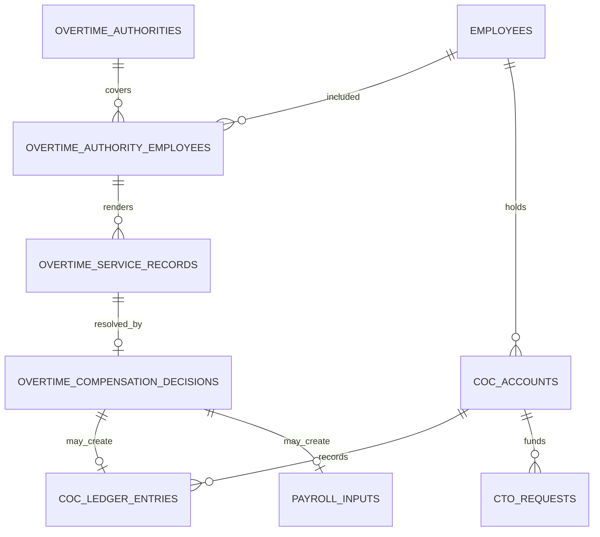

# Overtime, COC, and CTO Logical ERD

**Document status:** Draft for review  
**Model level:** Logical ERD  
**Primary profile:** Civilian Philippine National Government Agency  
**Version:** 1.0  
**Date:** August 6, 2026

---

## Shared logical conventions

- Primary keys use UUIDs.
- All agency-owned operational records carry `agency_id`.
- Timestamps are stored in UTC and displayed in Philippine Standard Time by default.
- Status values are constrained enums or reference values, never unrestricted text.
- Effective-dated records use `effective_from` and nullable `effective_to`.
- `created_at`, `created_by_membership_id`, `updated_at`, and `updated_by_membership_id` are included where a record is mutable.
- Ledger, issued, certified, finalized, and audit records are append-only after posting.
- Sensitive values are encrypted or tokenized and are omitted from ordinary logs.
- Normal application deletion is restricted. Historical transactions are voided, superseded, deactivated, or archived.
- PostgreSQL Row-Level Security and physical indexes will be specified in the physical-schema phase.
- Cross-module actions go through owning application services rather than direct table updates.

## Relationship diagram

# Entity definitions

## `overtime_authorities`

Prior authorization for overtime service

| Column | Logical type | Null? | Key / rule | Description |
| --- | --- | --- | --- | --- |
| id | uuid | No | PK | Authority |
| agency_id | uuid | No | FK agencies | Tenant |
| requesting_unit_id | uuid | No | FK organization_units | Office |
| authority_no | string | No |  | Reference |
| purpose | string | No |  | Necessity |
| date_from | datetime | No |  | Start |
| date_to | datetime | No |  | End |
| proposed_compensation_method | enum | No |  | OVERTIME_PAY, COC, TO_BE_DETERMINED |
| funding_reference | string | Yes |  | Funding |
| status | enum | No |  | DRAFT, SUBMITTED, FOR_REVIEW, APPROVED, REJECTED, ACTIVE, COMPLETED, CANCELLED |
| approved_by_membership_id | uuid | Yes | FK agency_memberships | Approver |

**Constraints and indexes**

- Unique `(agency_id, authority_no)`.
- End must be after start.

**Deletion behavior:** Retain.
## `overtime_authority_employees`

Employees covered by authority

| Column | Logical type | Null? | Key / rule | Description |
| --- | --- | --- | --- | --- |
| id | uuid | No | PK | Coverage |
| agency_id | uuid | No | FK agencies | Tenant |
| overtime_authority_id | uuid | No | FK overtime_authorities | Authority |
| employee_id | uuid | No | FK employees | Employee |
| authorized_hours | decimal | Yes |  | Maximum |
| task_description | string | Yes |  | Assigned work |
| eligibility_snapshot | json | No |  | Eligibility at approval |

**Constraints and indexes**

- Unique `(overtime_authority_id, employee_id)`.

**Deletion behavior:** Retain.
## `overtime_service_records`

Actual overtime rendered

| Column | Logical type | Null? | Key / rule | Description |
| --- | --- | --- | --- | --- |
| id | uuid | No | PK | Service |
| agency_id | uuid | No | FK agencies | Tenant |
| overtime_authority_employee_id | uuid | No | FK overtime_authority_employees | Coverage |
| employee_id | uuid | No | FK employees | Employee |
| service_date | date | No |  | Date |
| claimed_hours | decimal | No |  | Claim |
| actual_hours | decimal | Yes |  | Attendance-validated |
| certified_hours | decimal | Yes |  | Certified |
| accomplishment | string | Yes |  | Output |
| status | enum | No |  | PENDING, RENDERED, FOR_CERTIFICATION, CERTIFIED, NOT_CERTIFIED, FOR_COMPENSATION, COMPENSATED |
| certified_by_membership_id | uuid | Yes | FK agency_memberships | Certifier |

**Constraints and indexes**

- Unique `(overtime_authority_employee_id, service_date)` unless split records are supported.

**Deletion behavior:** Retain.
## `overtime_compensation_decisions`

Final compensation treatment for certified service

| Column | Logical type | Null? | Key / rule | Description |
| --- | --- | --- | --- | --- |
| id | uuid | No | PK | Decision |
| agency_id | uuid | No | FK agencies | Tenant |
| overtime_service_record_id | uuid | No | FK overtime_service_records | Service |
| method | enum | No |  | OVERTIME_PAY, COC, NON_COMPENSABLE |
| approved_hours | decimal | No |  | Hours |
| rate_rule_snapshot | json | No |  | Applied rule |
| funding_validated_by_membership_id | uuid | Yes | FK agency_memberships | Budget validation |
| decided_by_membership_id | uuid | No | FK agency_memberships | Decision actor |
| decided_at | datetime | No |  | Decision |
| payroll_input_id | uuid | Yes | FK payroll_inputs | If OT pay |
| coc_ledger_entry_id | uuid | Yes | FK coc_ledger_entries | If COC |

**Constraints and indexes**

- Exactly one of payroll_input_id or coc_ledger_entry_id for compensable decisions.
- One effective decision per service record.

**Deletion behavior:** Retain; correct via replacement/reversal.
## `coc_accounts`

Employee COC account

| Column | Logical type | Null? | Key / rule | Description |
| --- | --- | --- | --- | --- |
| id | uuid | No | PK | COC account |
| agency_id | uuid | No | FK agencies | Tenant |
| employee_id | uuid | No | FK employees | Employee |
| status | enum | No |  | ACTIVE, FROZEN, CLOSED |
| opened_at | date | No |  | Open |
| closed_at | date | Yes |  | Close |

**Constraints and indexes**

- Unique active account per employee.

**Deletion behavior:** Close.
## `coc_ledger_entries`

Immutable COC transaction

| Column | Logical type | Null? | Key / rule | Description |
| --- | --- | --- | --- | --- |
| id | uuid | No | PK | Entry |
| agency_id | uuid | No | FK agencies | Tenant |
| coc_account_id | uuid | No | FK coc_accounts | Account |
| entry_type | enum | No |  | EARNED, USED, ADJUSTMENT, EXPIRATION, REVERSAL |
| quantity_hours | decimal | No |  | Signed hours |
| effective_date | date | No |  | Date |
| source_type | string | No |  | Source |
| source_id | uuid | No |  | Source ID |
| reverses_entry_id | uuid | Yes | FK coc_ledger_entries | Original |
| expires_at | date | Yes |  | Expiry |
| posted_at | datetime | No |  | Posted |

**Constraints and indexes**

- Unique source key for idempotency.
- Reversal references same account.

**Deletion behavior:** Never delete.
## `cto_requests`

Use COC as compensatory time off

| Column | Logical type | Null? | Key / rule | Description |
| --- | --- | --- | --- | --- |
| id | uuid | No | PK | Request |
| agency_id | uuid | No | FK agencies | Tenant |
| employee_id | uuid | No | FK employees | Employee |
| coc_account_id | uuid | No | FK coc_accounts | Account |
| date_from | datetime | No |  | Start |
| date_to | datetime | No |  | End |
| requested_hours | decimal | No |  | Hours |
| approved_hours | decimal | Yes |  | Approved |
| status | enum | No |  | DRAFT, SUBMITTED, FOR_RECOMMENDATION, FOR_APPROVAL, APPROVED, REJECTED, POSTED, CANCELLED |
| posted_ledger_entry_id | uuid | Yes | FK coc_ledger_entries | Usage entry |
| attendance_day_id | uuid | Yes | FK attendance_days | Attendance effect |

**Constraints and indexes**

- Approved/posting requires available COC balance.
- No overlap with incompatible attendance or leave.

**Deletion behavior:** Retain.

# Domain invariants

- Prior authority is separate from actual service and compensation.
- Requested, authorized, actual, certified, credited, and paid hours remain distinct.
- COC is an immutable ledger.
- CTO posting consumes COC and creates an attendance effect through owning services.
