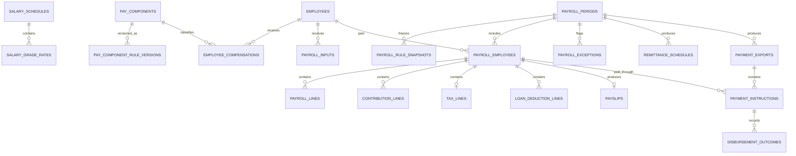

# Government Payroll Logical ERD

**Document status:** Draft for review  
**Model level:** Logical ERD  
**Primary profile:** Civilian Philippine National Government Agency  
**Version:** 1.0  
**Date:** August 6, 2026

---

## Shared logical conventions

- Primary keys use UUIDs.
- All agency-owned operational records carry `agency_id`.
- Timestamps are stored in UTC and displayed in Philippine Standard Time by default.
- Status values are constrained enums or reference values, never unrestricted text.
- Effective-dated records use `effective_from` and nullable `effective_to`.
- `created_at`, `created_by_membership_id`, `updated_at`, and `updated_by_membership_id` are included where a record is mutable.
- Ledger, issued, certified, finalized, and audit records are append-only after posting.
- Sensitive values are encrypted or tokenized and are omitted from ordinary logs.
- Normal application deletion is restricted. Historical transactions are voided, superseded, deactivated, or archived.
- PostgreSQL Row-Level Security and physical indexes will be specified in the physical-schema phase.
- Cross-module actions go through owning application services rather than direct table updates.

## Payroll rule model

Payroll calculates pay for admitted Appointed Personnel through one Appointed
Personnel Payroll Rule Set. There is no payroll profile per personnel
category. Pay basis is an effective-dated fact of the Employee's compensation,
with three variants: monthly full-time salary, proportional part-time salary,
and the official casual daily wage (#27).

JO/COS Service Payments are outside payroll. No entity here holds a Service
Payment, and a JO/COS Worker never has a `payroll_employees` or
`payroll_lines` row (#21, #27).

| Term                               | Where it appears                                                                                                                                                                                                         |
| ---------------------------------- | ------------------------------------------------------------------------------------------------------------------------------------------------------------------------------------------------------------------------ |
| National Payroll Rule Version      | `salary_schedules` with their `salary_grade_rates`, `pay_component_rule_versions`, and the contribution and tax rule versions that `payroll_rule_snapshots` freezes                                                      |
| Agency Payroll Applicability       | The Agency's effective-dated, evidence-backed record that a rule version or conditional component applies: its authority, eligible population, funding, and effective period (#27). Its entity is not specified here yet |
| Native Payroll Component           | A `pay_components` row that the rule set calculates from a National Payroll Rule Version and authoritative source facts                                                                                                  |
| Authorized Payroll Component Input | An evidence-backed amount or quantity for a lawful component the rule set cannot calculate. It carries its authority, source, effective period, eligible person or population, amount or quantity, and approval (#27)    |

A National Payroll Rule Version is immutable. It keeps its issuing authority,
source, verification date, effectivity, supersession, and applicability. An
Agency may activate an applicable version but never copies or overrides its
substance (#27). Whether a version is a platform-wide record or an
Agency-scoped row is decided in #328; the `agency_id` columns on the rule
entities below are unchanged until then.

A missing, expired, or unverified required rule blocks the affected calculation
or finalization. Nothing falls back to an older version, a default rate, or a
formula. No rule version holds a free-form formula, and no user overrides a
rule version or a calculated line (#27, #43).

Three variants are calculated only from an Authorized Payroll Component Input
that carries its authority, and block the affected line without one (#43):

- a medical-allowance cash line requires the Agency grant mode, amount and
  schedule, qualification, and supporting authority. A procured group HMO is
  outside payroll;
- night-shift differential requires the effective-dated percentage the agency
  head selected within the national 20% ceiling. Approved night hours remain
  native source quantities;
- reimbursable RATA requires the approved actual amount. The national
  calculation enforces eligibility and ceilings.

PERA, the clothing and medical allowances, RATA, the bonuses, the cash gift,
and their conditions and amounts are revalidated against each fiscal year's
GAA (#43).

## Relationship diagram

# Entity definitions

## `salary_schedules`

Effective government salary schedule and tranche, held as a National Payroll
Rule Version (#27)

| Column             | Logical type | Null? | Key / rule  | Description               |
| ------------------ | ------------ | ----- | ----------- | ------------------------- |
| id                 | uuid         | No    | PK          | Schedule                  |
| agency_id          | uuid         | No    | FK agencies | Tenant                    |
| code               | string       | No    |             | Code                      |
| name               | string       | No    |             | Name                      |
| issuance_reference | string       | No    |             | DBM/authority reference   |
| effective_from     | date         | No    |             | Start                     |
| effective_to       | date         | Yes   |             | End                       |
| status             | enum         | No    |             | DRAFT, ACTIVE, SUPERSEDED |

**Constraints and indexes**

- No overlapping active schedules. One rule set serves every pay basis, so
  there is no per-profile schedule (#27).
- A schedule is superseded, never edited, and an expired one is never a
  fallback (#27).

**Deletion behavior:** Supersede.

## `salary_grade_rates`

Rate for one grade and step

| Column             | Logical type | Null? | Key / rule          | Description                |
| ------------------ | ------------ | ----- | ------------------- | -------------------------- |
| id                 | uuid         | No    | PK                  | Rate                       |
| salary_schedule_id | uuid         | No    | FK salary_schedules | Schedule                   |
| salary_grade       | integer      | No    |                     | Grade                      |
| salary_step        | integer      | No    |                     | Step                       |
| monthly_rate       | decimal      | No    |                     | Monthly salary             |
| daily_rate_rule    | json         | Yes   |                     | Derived-rate configuration |

**Constraints and indexes**

- Unique `(salary_schedule_id, salary_grade, salary_step)`.
- Rate must be positive.

**Deletion behavior:** Follows schedule.

## `pay_components`

Stable earning, deduction, or contribution component. It is either a Native
Payroll Component or a lawful component that accepts Authorized Payroll
Component Inputs (#27)

| Column                  | Logical type | Null? | Key / rule                     | Description                                       |
| ----------------------- | ------------ | ----- | ------------------------------ | ------------------------------------------------- |
| id                      | uuid         | No    | PK                             | Component                                         |
| agency_id               | uuid         | No    | FK agencies                    | Tenant                                            |
| code                    | string       | No    |                                | Code                                              |
| name                    | string       | No    |                                | Name                                              |
| category                | enum         | No    |                                | EARNING, DEDUCTION, EMPLOYER_SHARE, INFORMATIONAL |
| status                  | enum         | No    |                                | ACTIVE, INACTIVE                                  |
| current_rule_version_id | uuid         | Yes   | FK pay_component_rule_versions | Current rule                                      |

**Constraints and indexes**

- Unique `(agency_id, code)`.
- A component without lawful authority or an allowed classification is
  unsupported. There is no free-form pay item (#27).

**Deletion behavior:** Inactivate.

## `pay_component_rule_versions`

National Payroll Rule Versions for a component: its effective-dated
classification and calculation rules (#27)

| Column                 | Logical type | Null? | Key / rule        | Description                      |
| ---------------------- | ------------ | ----- | ----------------- | -------------------------------- |
| id                     | uuid         | No    | PK                | Rule version                     |
| agency_id              | uuid         | No    | FK agencies       | Tenant                           |
| pay_component_id       | uuid         | No    | FK pay_components | Component                        |
| version_no             | integer      | No    |                   | Version                          |
| calculation_method     | enum         | No    |                   | FIXED, RATE, TABLE               |
| tax_treatment          | json         | No    |                   | Tax classification               |
| contribution_treatment | json         | No    |                   | Contribution bases               |
| accounting_category    | string       | Yes   |                   | Posting/report category          |
| effective_from         | date         | No    |                   | Start                            |
| effective_to           | date         | Yes   |                   | End                              |
| rule_definition        | json         | No    |                   | Validated rate, amount, or table |

**Constraints and indexes**

- No overlapping active versions.
- A version supplies the rate, amount, or table for a fixed calculation. It
  never holds a formula to evaluate, and there is no manual method (#27, #43).
- A version is superseded, never edited (#27).

**Deletion behavior:** Supersede.

## `employee_compensations`

Effective employee compensation assignment

| Column                    | Logical type | Null? | Key / rule          | Description          |
| ------------------------- | ------------ | ----- | ------------------- | -------------------- |
| id                        | uuid         | No    | PK                  | Compensation         |
| agency_id                 | uuid         | No    | FK agencies         | Tenant               |
| employee_id               | uuid         | No    | FK employees        | Employee             |
| pay_component_id          | uuid         | No    | FK pay_components   | Component            |
| source_service_segment_id | uuid         | Yes   | FK service_segments | Service basis        |
| amount                    | decimal      | Yes   |                     | Fixed amount         |
| rate                      | decimal      | Yes   |                     | Rate                 |
| quantity_basis            | string       | Yes   |                     | Monthly/daily/hourly |
| effective_from            | date         | No    |                     | Start                |
| effective_to              | date         | Yes   |                     | End                  |
| status                    | enum         | No    |                     | ACTIVE, INACTIVE     |

**Constraints and indexes**

- No conflicting active assignment for single-instance components.
- An assignment is an evidence-backed Agency fact. It never overrides a
  National Payroll Rule Version (#27).

**Deletion behavior:** End-date.

## `payroll_inputs`

Canonical idempotent inbox from HR modules

| Column           | Logical type | Null? | Key / rule        | Description                            |
| ---------------- | ------------ | ----- | ----------------- | -------------------------------------- |
| id               | uuid         | No    | PK                | Input                                  |
| agency_id        | uuid         | No    | FK agencies       | Tenant                                 |
| employee_id      | uuid         | No    | FK employees      | Employee                               |
| source_module    | enum         | No    |                   | ATTENDANCE, LEAVE, OVERTIME, PERSONNEL |
| source_type      | string       | No    |                   | Source entity type                     |
| source_id        | uuid         | No    |                   | Source entity                          |
| pay_component_id | uuid         | No    | FK pay_components | Component                              |
| effective_date   | date         | No    |                   | Date                                   |
| quantity         | decimal      | Yes   |                   | Units                                  |
| amount           | decimal      | Yes   |                   | Amount                                 |
| status           | enum         | No    |                   | PENDING, CONSUMED, CANCELLED, REVERSED |
| payload_snapshot | json         | No    |                   | Approved source snapshot               |

**Constraints and indexes**

- Unique `(source_module, source_type, source_id, pay_component_id)` for idempotency.

There is no manual source. An amount or quantity that no source module owns
enters only as an Authorized Payroll Component Input (#27). Whether that input
shares this inbox is decided in #328.

For an accepted Monetization Posting, `source_module` is `LEAVE`, `source_type`
identifies the posting, `source_id` is the Monetization Posting, `quantity` is
the approved total credit quantity, and `amount` is calculated by Payroll rather
than supplied by Leave. `payload_snapshot` freezes the per-account allocations,
stable effect key, valuation date, fixed calculator and factor, applicable
policy and authority Document Versions, funding determination, Approval
Decisions, resolved highest-monthly-salary source and value, calculation steps,
rounding authority and result, and owner-service outcome. Missing authoritative
valuation, salary-component, allocation, or rounding facts reject the input.

For an Unpaid Deficit Remainder, `source_module` is `LEAVE`, `source_id` is the
Attendance Deficit Charge, and `quantity` is the remainder in days.
`payload_snapshot` freezes the Attendance Payroll Fact, its minutes, the Work
Date, and the MC41 Table II conversion. Leave supplies no rate or amount.
Payroll takes no tardiness or undertime salary effect from Attendance Payroll
Facts, reads `ABSENCE` facts from Attendance, and raises a blocking exception
for an Employee whose facts in a consumed publication are not all charged
(#329, ADR 0012).

**Deletion behavior:** Cancel/reverse; never edit after consumption.

## `payroll_periods`

One Appointed Personnel payroll run

| Column              | Logical type | Null? | Key / rule  | Description                                                            |
| ------------------- | ------------ | ----- | ----------- | ---------------------------------------------------------------------- |
| id                  | uuid         | No    | PK          | Period                                                                 |
| agency_id           | uuid         | No    | FK agencies | Tenant                                                                 |
| code                | string       | No    |             | Period code                                                            |
| period_from         | date         | No    |             | Start                                                                  |
| period_to           | date         | No    |             | End                                                                    |
| cutoff_at           | datetime     | No    |             | Input cutoff                                                           |
| payment_date        | date         | No    |             | Pay date                                                               |
| status              | enum         | No    |             | DRAFT, CALCULATING, FOR_REVIEW, CERTIFIED, APPROVED, FINALIZED, VOIDED |
| calculation_version | integer      | No    |             | Current version                                                        |
| finalized_at        | datetime     | Yes   |             | Finalization                                                           |
| voided_at           | datetime     | Yes   |             | Void                                                                   |

**Constraints and indexes**

- Unique `(agency_id, code, calculation_version)`.
- A period carries no payroll profile. One run covers every pay basis of the
  Appointed Personnel Payroll Rule Set, and never a JO/COS Service Payment
  (#27).

**Deletion behavior:** Retain permanently per policy.

## `payroll_rule_snapshots`

The National Payroll Rule Versions one payroll run used, frozen (#27)

| Column                     | Logical type | Null? | Key / rule          | Description                       |
| -------------------------- | ------------ | ----- | ------------------- | --------------------------------- |
| id                         | uuid         | No    | PK                  | Snapshot                          |
| agency_id                  | uuid         | No    | FK agencies         | Tenant                            |
| payroll_period_id          | uuid         | No    | FK payroll_periods  | Period                            |
| salary_schedule_id         | uuid         | No    | FK salary_schedules | Salary schedule                   |
| tax_rule_version           | string       | No    |                     | Tax version                       |
| contribution_rule_versions | json         | No    |                     | GSIS/PhilHealth/Pag-IBIG versions |
| pay_component_rule_ids     | json         | No    |                     | Component versions                |
| created_at                 | datetime     | No    |                     | Snapshot time                     |

**Constraints and indexes**

- One effective snapshot per calculation version.

**Deletion behavior:** Immutable.

## `payroll_employees`

Employee result header within payroll

| Column               | Logical type | Null? | Key / rule            | Description                                                 |
| -------------------- | ------------ | ----- | --------------------- | ----------------------------------------------------------- |
| id                   | uuid         | No    | PK                    | Payroll employee                                            |
| agency_id            | uuid         | No    | FK agencies           | Tenant                                                      |
| payroll_period_id    | uuid         | No    | FK payroll_periods    | Period                                                      |
| employee_id          | uuid         | No    | FK employees          | Employee                                                    |
| service_segment_id   | uuid         | Yes   | FK service_segments   | Service basis                                               |
| salary_grade_rate_id | uuid         | Yes   | FK salary_grade_rates | Rate used                                                   |
| status               | enum         | No    |                       | PENDING, CALCULATED, EXCEPTION, REVIEWED, FINALIZED, VOIDED |
| gross_amount         | decimal      | No    |                       | Gross                                                       |
| total_deductions     | decimal      | No    |                       | Deductions                                                  |
| net_amount           | decimal      | No    |                       | Net                                                         |
| calculation_hash     | string       | No    |                       | Integrity hash                                              |

**Constraints and indexes**

- Unique `(payroll_period_id, employee_id)` per calculation version.
- Amounts reconcile to lines.

**Deletion behavior:** Retain.

## `payroll_lines`

Detailed earning/deduction/adjustment line

| Column              | Logical type | Null? | Key / rule                     | Description                                       |
| ------------------- | ------------ | ----- | ------------------------------ | ------------------------------------------------- |
| id                  | uuid         | No    | PK                             | Line                                              |
| agency_id           | uuid         | No    | FK agencies                    | Tenant                                            |
| payroll_employee_id | uuid         | No    | FK payroll_employees           | Employee result                                   |
| pay_component_id    | uuid         | No    | FK pay_components              | Component                                         |
| rule_version_id     | uuid         | Yes   | FK pay_component_rule_versions | Rule                                              |
| payroll_input_id    | uuid         | Yes   | FK payroll_inputs              | Source input                                      |
| line_type           | enum         | No    |                                | EARNING, DEDUCTION, EMPLOYER_SHARE, INFORMATIONAL |
| quantity            | decimal      | Yes   |                                | Units                                             |
| rate                | decimal      | Yes   |                                | Rate                                              |
| amount              | decimal      | No    |                                | Amount                                            |
| taxable_amount      | decimal      | No    |                                | Taxable base                                      |
| contribution_base   | decimal      | No    |                                | Contribution base                                 |
| source_snapshot     | json         | No    |                                | Traceability                                      |

**Constraints and indexes**

- Finalized lines immutable.
- Unique source keys prevent duplicate consumption.
- A calculated line is never overridden. A wrong amount is corrected at its
  source, or after finalization through `payroll_adjustments` (#27).

**Deletion behavior:** Never delete after finalization.

## `contribution_lines`

Detailed statutory contribution result

| Column              | Logical type | Null? | Key / rule           | Description                      |
| ------------------- | ------------ | ----- | -------------------- | -------------------------------- |
| id                  | uuid         | No    | PK                   | Contribution                     |
| agency_id           | uuid         | No    | FK agencies          | Tenant                           |
| payroll_employee_id | uuid         | No    | FK payroll_employees | Payroll employee                 |
| contribution_type   | enum         | No    |                      | GSIS, PHILHEALTH, PAGIBIG, OTHER |
| employee_share      | decimal      | No    |                      | Employee share                   |
| employer_share      | decimal      | No    |                      | Employer share                   |
| compensation_base   | decimal      | No    |                      | Base                             |
| rule_version        | string       | No    |                      | Rule/table version               |

**Constraints and indexes**

- Unique `(payroll_employee_id, contribution_type)` unless split categories exist.

**Deletion behavior:** Immutable after finalization.

## `tax_lines`

Withholding-tax calculation detail

| Column                   | Logical type | Null? | Key / rule           | Description            |
| ------------------------ | ------------ | ----- | -------------------- | ---------------------- |
| id                       | uuid         | No    | PK                   | Tax                    |
| agency_id                | uuid         | No    | FK agencies          | Tenant                 |
| payroll_employee_id      | uuid         | No    | FK payroll_employees | Payroll employee       |
| taxable_compensation     | decimal      | No    |                      | Taxable                |
| non_taxable_compensation | decimal      | No    |                      | Non-taxable            |
| withholding_tax          | decimal      | No    |                      | Tax                    |
| rule_version             | string       | No    |                      | BIR rule/table version |
| year_to_date_snapshot    | json         | No    |                      | YTD values used        |

**Constraints and indexes**

- One effective tax line per payroll employee/calculation version.

**Deletion behavior:** Immutable.

## `loan_deduction_lines`

Government or authorized loan deduction

| Column              | Logical type | Null? | Key / rule           | Description                |
| ------------------- | ------------ | ----- | -------------------- | -------------------------- |
| id                  | uuid         | No    | PK                   | Loan line                  |
| agency_id           | uuid         | No    | FK agencies          | Tenant                     |
| payroll_employee_id | uuid         | No    | FK payroll_employees | Payroll employee           |
| loan_type           | string       | No    |                      | Loan code                  |
| loan_reference      | string       | Yes   |                      | Account/reference          |
| amount              | decimal      | No    |                      | Deduction                  |
| source_reference    | string       | Yes   |                      | Imported/maintained source |

**Deletion behavior:** Immutable after finalization.

## `payroll_exceptions`

Calculation warning or blocker

| Column                    | Logical type | Null? | Key / rule            | Description                          |
| ------------------------- | ------------ | ----- | --------------------- | ------------------------------------ |
| id                        | uuid         | No    | PK                    | Exception                            |
| agency_id                 | uuid         | No    | FK agencies           | Tenant                               |
| payroll_period_id         | uuid         | No    | FK payroll_periods    | Period                               |
| payroll_employee_id       | uuid         | Yes   | FK payroll_employees  | Optional employee                    |
| exception_type            | string       | No    |                       | Type                                 |
| severity                  | enum         | No    |                       | WARNING, BLOCKING                    |
| status                    | enum         | No    |                       | OPEN, ACKNOWLEDGED, RESOLVED, WAIVED |
| details                   | json         | No    |                       | Details                              |
| resolved_by_membership_id | uuid         | Yes   | FK agency_memberships | Resolver                             |

**Constraints and indexes**

- Blocking open exceptions prevent certification/finalization.

**Deletion behavior:** Retain.

## `payslips`

Employee payroll statement metadata

| Column              | Logical type | Null? | Key / rule           | Description                                       |
| ------------------- | ------------ | ----- | -------------------- | ------------------------------------------------- |
| id                  | uuid         | No    | PK                   | Payslip                                           |
| agency_id           | uuid         | No    | FK agencies          | Tenant                                            |
| payroll_employee_id | uuid         | No    | FK payroll_employees | Payroll employee                                  |
| document_id         | uuid         | Yes   | FK documents         | Rendered PDF                                      |
| status              | enum         | No    |                      | GENERATING, READY, RELEASED, WITHHELD, SUPERSEDED |
| released_at         | datetime     | Yes   |                      | Release                                           |
| version_no          | integer      | No    |                      | Version                                           |

**Constraints and indexes**

- Unique `(payroll_employee_id, version_no)`.

**Deletion behavior:** Supersede.

## `payroll_adjustments`

Post-run correction or supplemental item

| Column                       | Logical type | Null? | Key / rule            | Description                                      |
| ---------------------------- | ------------ | ----- | --------------------- | ------------------------------------------------ |
| id                           | uuid         | No    | PK                    | Adjustment                                       |
| agency_id                    | uuid         | No    | FK agencies           | Tenant                                           |
| original_payroll_employee_id | uuid         | No    | FK payroll_employees  | Original result                                  |
| target_payroll_period_id     | uuid         | Yes   | FK payroll_periods    | Future/supplemental run                          |
| adjustment_type              | enum         | No    |                       | SUPPLEMENTAL, REFUND, RECOVERY, VOID_REPLACEMENT |
| reason                       | string       | No    |                       | Reason                                           |
| status                       | enum         | No    |                       | DRAFT, APPROVED, POSTED, CANCELLED               |
| approved_by_membership_id    | uuid         | Yes   | FK agency_memberships | Approver                                         |

**Constraints and indexes**

- Cannot alter original finalized lines.

**Deletion behavior:** Retain.

## `remittance_schedules`

Aggregated remittance/reporting schedule

| Column            | Logical type | Null? | Key / rule         | Description                                 |
| ----------------- | ------------ | ----- | ------------------ | ------------------------------------------- |
| id                | uuid         | No    | PK                 | Schedule                                    |
| agency_id         | uuid         | No    | FK agencies        | Tenant                                      |
| payroll_period_id | uuid         | No    | FK payroll_periods | Period                                      |
| schedule_type     | enum         | No    |                    | GSIS, PHILHEALTH, PAGIBIG, TAX, LOAN, OTHER |
| document_id       | uuid         | Yes   | FK documents       | Output                                      |
| status            | enum         | No    |                    | GENERATING, READY, RELEASED, SUPERSEDED     |
| total_amount      | decimal      | No    |                    | Total                                       |

**Deletion behavior:** Supersede.

## `payment_exports`

Payment Export: a provider-neutral, reviewable set of Payment Instructions from
one finalized payroll. It claims no conformance to, acceptance by, or
settlement through any bank or disbursement system (#28)

| Column                       | Logical type | Null? | Key / rule            | Description                                        |
| ---------------------------- | ------------ | ----- | --------------------- | -------------------------------------------------- |
| id                           | uuid         | No    | PK                    | Payment Export ID                                  |
| agency_id                    | uuid         | No    | FK agencies           | Tenant                                             |
| payroll_period_id            | uuid         | No    | FK payroll_periods    | Finalized payroll                                  |
| contract_version             | string       | No    |                       | Immutable canonical contract version               |
| currency                     | string       | No    |                       | `PHP`                                              |
| generated_at                 | datetime     | No    |                       | Generation timestamp                               |
| generated_by_membership_id   | uuid         | No    | FK agency_memberships | Generator                                          |
| document_id                  | uuid         | No    | FK documents          | Versioned UTF-8 CSV with full destination details  |
| summary_document_id          | uuid         | No    | FK documents          | Reconciliation summary with masked account numbers |
| checksum                     | string       | No    |                       | Checksum of the immutable snapshot                 |
| source_result_count          | integer      | No    |                       | Payroll Employee results in the payroll            |
| source_net_total             | decimal      | No    |                       | Their net total                                    |
| instruction_count            | integer      | No    |                       | Payable Payment Instructions                       |
| instruction_total            | decimal      | No    |                       | Their total                                        |
| excluded_result_count        | integer      | No    |                       | Zero- and negative-net-pay results                 |
| excluded_result_total        | decimal      | No    |                       | Their total                                        |
| supersedes_payment_export_id | uuid         | Yes   | FK payment_exports    | Export this one replaces                           |

**Constraints and indexes**

- Only a FINALIZED payroll produces a Payment Export. A VOIDED payroll is
  ineligible, and JO/COS Service Payments are outside the contract.
- A missing, ineffective, or unverified destination, or any reconciliation
  mismatch, blocks the entire export.
- The export is an immutable, checksummed snapshot. Generating again against
  the same payroll and destination snapshot returns the same artifact.
- A payroll correction or replacement produces a new linked export. So does a
  destination corrected after a Payment Instruction is REJECTED or RETURNED.
  The original is never mutated or resent.
- The export has no status of its own. Generating it marks no one paid, and
  progress is recorded as Disbursement Outcomes.
- Amounts use PHP with two decimal places and no grouping separators, dates
  are ISO, and timestamps are RFC 3339.
- Any semantic or column change creates a new contract version. Every
  historical artifact keeps the version it was generated under.

The MVP stops at controlled download and manual handoff. Exact provider
formats and any email, API, SFTP, or portal delivery wait for an authorized
Pilot Agency's accepted procedure and receiving-system contract (#28).

**Deletion behavior:** Retain securely.

## `payment_instructions`

Payment Instruction: the positive-net-pay direction for one Payroll Employee
result to one designated disbursement destination (#28)

| Column                        | Logical type | Null? | Key / rule              | Description                                |
| ----------------------------- | ------------ | ----- | ----------------------- | ------------------------------------------ |
| id                            | uuid         | No    | PK                      | Payment Instruction ID                     |
| agency_id                     | uuid         | No    | FK agencies             | Tenant                                     |
| payment_export_id             | uuid         | No    | FK payment_exports      | Export                                     |
| payroll_employee_id           | uuid         | No    | FK payroll_employees    | Payroll Employee result                    |
| agency_employee_number        | string       | No    |                         | Agency employee number                     |
| payee_legal_name              | string       | No    |                         | Legal payee name                           |
| destination_type              | string       | No    |                         | Destination type                           |
| institution_identifier_scheme | string       | No    |                         | Identifier scheme                          |
| institution_identifier        | string       | No    |                         | Opaque text; leading zeros preserved       |
| institution_name              | string       | No    |                         | Institution name                           |
| account_identifier            | string       | No    |                         | Opaque text; leading zeros preserved       |
| account_holder_name           | string       | No    |                         | Account-holder name                        |
| amount                        | decimal      | No    |                         | Positive net pay                           |
| payment_reference             | string       | No    |                         | Payment reference                          |
| prior_payment_instruction_id  | uuid         | Yes   | FK payment_instructions | Rejected or returned attempt this replaces |
| retry_reason                  | string       | Yes   |                         | Required when replacing a prior attempt    |

**Constraints and indexes**

- One instruction for each positive-net-pay Payroll Employee result in an
  export, to one destination. Split payments are outside the MVP.
- A zero- or negative-net-pay result produces no instruction and is counted in
  the export's excluded controls rather than silently omitted.
- An instruction snapshots the designated, effective, and verified destination
  at generation. It carries no component-level earning or deduction and no
  government identifier.
- An instruction is never mutated or resent. A retry is a linked new
  instruction in a superseding export, allowed only after REJECTED or
  RETURNED and with a reason.
- A new handoff is blocked while an instruction is SUBMITTED or ACCEPTED.
- A payee or amount change goes through the payroll correction path, not a
  new instruction.

**Deletion behavior:** Retain securely.

## `disbursement_outcomes`

Disbursement Outcome: external evidence of a Payment Instruction's progress or
result after handoff, recorded by the Cashier (#28)

| Column                    | Logical type | Null? | Key / rule              | Description                                      |
| ------------------------- | ------------ | ----- | ----------------------- | ------------------------------------------------ |
| id                        | uuid         | No    | PK                      | Outcome                                          |
| agency_id                 | uuid         | No    | FK agencies             | Tenant                                           |
| payment_instruction_id    | uuid         | No    | FK payment_instructions | Instruction                                      |
| outcome                   | enum         | No    |                         | SUBMITTED, ACCEPTED, REJECTED, SETTLED, RETURNED |
| recorded_by_membership_id | uuid         | No    | FK agency_memberships   | Actor                                            |
| recorded_at               | datetime     | No    |                         | Timestamp                                        |
| external_reference        | string       | Yes   |                         | External batch or reference                      |
| evidence_document_id      | uuid         | Yes   | FK documents            | Supporting evidence                              |
| reason                    | string       | Yes   |                         | Reason, where applicable                         |

**Constraints and indexes**

- Outcomes are recorded per instruction, apart from payroll finalization and
  export generation. Mixed outcomes within one batch are allowed.
- ACCEPTED does not imply SETTLED.

**Deletion behavior:** Retain.

## Payroll Structured Exports

Accounting and budget work stops at two controlled Structured Exports. Neither
is a Payment Export, and the MVP has no direct API, webhook, SFTP exchange,
portal submission, or agency-system adapter (#29).

- **Certified Payroll Review Export:** a versioned export of the certified
  payroll snapshot, for budget or fund validation and accounting review before
  approval. If payroll data changes after it is exported, it is superseded,
  the affected budget and accounting validation is revoked, and a new version
  must be exported and reviewed.
- **Finalized Payroll Accounting Support Export:** an export of the immutable
  finalized payroll result. It stays immutable. A later payee or amount
  correction follows the payroll correction path and produces a linked
  replacement artifact where applicable.

For each, an authorized user records the external reference, outcome,
supporting External Evidence, actor, and timestamp by hand. The HRIS does not
copy or reconstruct the external budget balance or accounting ledger. Creating
or downloading an export never asserts that funds were validated or obligated,
that an entry was posted, or that a receiving system accepted the data (#29).

Their entities are not specified here yet.

# Domain invariants

- One Appointed Personnel Payroll Rule Set calculates every payroll. JO/COS
  Service Payments are outside payroll (#27).
- Upstream HR records enter payroll through idempotent `payroll_inputs`.
- Payroll freezes the salary, tax, contribution, and component National
  Payroll Rule Versions it used (#27).
- A missing, expired, or unverified required rule blocks the affected
  calculation or finalization (#27, #43).
- There is no free-form formula and no override of a calculated line (#27,
  #43).
- Finalized lines are immutable and reconciled to header totals.
- Corrections use adjustments, supplemental payroll, refunds, or void-and-replace.
- A Payment Export marks no one paid. Disbursement Outcomes are recorded
  separately (#28).
- Preparation, certification, approval, and disbursement remain distinct permissions.
