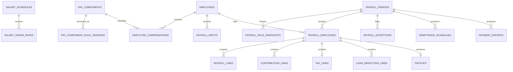

# Government Payroll Logical ERD

**Document status:** Draft for review  
**Model level:** Logical ERD  
**Primary profile:** Civilian Philippine National Government Agency  
**Version:** 1.0  
**Date:** August 6, 2026

---

## Shared logical conventions

- Primary keys use UUIDs.
- All agency-owned operational records carry `agency_id`.
- Timestamps are stored in UTC and displayed in Philippine Standard Time by default.
- Status values are constrained enums or reference values, never unrestricted text.
- Effective-dated records use `effective_from` and nullable `effective_to`.
- `created_at`, `created_by_membership_id`, `updated_at`, and `updated_by_membership_id` are included where a record is mutable.
- Ledger, issued, certified, finalized, and audit records are append-only after posting.
- Sensitive values are encrypted or tokenized and are omitted from ordinary logs.
- Normal application deletion is restricted. Historical transactions are voided, superseded, deactivated, or archived.
- PostgreSQL Row-Level Security and physical indexes will be specified in the physical-schema phase.
- Cross-module actions go through owning application services rather than direct table updates.

## Relationship diagram

# Entity definitions

## `salary_schedules`

Effective government salary schedule/tranche

| Column             | Logical type | Null? | Key / rule  | Description               |
| ------------------ | ------------ | ----- | ----------- | ------------------------- |
| id                 | uuid         | No    | PK          | Schedule                  |
| agency_id          | uuid         | No    | FK agencies | Tenant/profile owner      |
| code               | string       | No    |             | Code                      |
| name               | string       | No    |             | Name                      |
| issuance_reference | string       | No    |             | DBM/authority reference   |
| effective_from     | date         | No    |             | Start                     |
| effective_to       | date         | Yes   |             | End                       |
| status             | enum         | No    |             | DRAFT, ACTIVE, SUPERSEDED |

**Constraints and indexes**

- No overlapping active schedules for same payroll profile.

**Deletion behavior:** Supersede.

## `salary_grade_rates`

Rate for one grade and step

| Column             | Logical type | Null? | Key / rule          | Description                |
| ------------------ | ------------ | ----- | ------------------- | -------------------------- |
| id                 | uuid         | No    | PK                  | Rate                       |
| salary_schedule_id | uuid         | No    | FK salary_schedules | Schedule                   |
| salary_grade       | integer      | No    |                     | Grade                      |
| salary_step        | integer      | No    |                     | Step                       |
| monthly_rate       | decimal      | No    |                     | Monthly salary             |
| daily_rate_rule    | json         | Yes   |                     | Derived-rate configuration |

**Constraints and indexes**

- Unique `(salary_schedule_id, salary_grade, salary_step)`.
- Rate must be positive.

**Deletion behavior:** Follows schedule.

## `pay_components`

Stable earning/deduction component

| Column                  | Logical type | Null? | Key / rule                     | Description                                       |
| ----------------------- | ------------ | ----- | ------------------------------ | ------------------------------------------------- |
| id                      | uuid         | No    | PK                             | Component                                         |
| agency_id               | uuid         | No    | FK agencies                    | Tenant                                            |
| code                    | string       | No    |                                | Code                                              |
| name                    | string       | No    |                                | Name                                              |
| category                | enum         | No    |                                | EARNING, DEDUCTION, EMPLOYER_SHARE, INFORMATIONAL |
| status                  | enum         | No    |                                | ACTIVE, INACTIVE                                  |
| current_rule_version_id | uuid         | Yes   | FK pay_component_rule_versions | Current rule                                      |

**Constraints and indexes**

- Unique `(agency_id, code)`.

**Deletion behavior:** Inactivate.

## `pay_component_rule_versions`

Effective-dated payroll classification/calculation rules

| Column                 | Logical type | Null? | Key / rule        | Description                         |
| ---------------------- | ------------ | ----- | ----------------- | ----------------------------------- |
| id                     | uuid         | No    | PK                | Rule version                        |
| agency_id              | uuid         | No    | FK agencies       | Tenant                              |
| pay_component_id       | uuid         | No    | FK pay_components | Component                           |
| version_no             | integer      | No    |                   | Version                             |
| calculation_method     | enum         | No    |                   | FIXED, RATE, FORMULA, TABLE, MANUAL |
| tax_treatment          | json         | No    |                   | Tax classification                  |
| contribution_treatment | json         | No    |                   | Contribution bases                  |
| accounting_category    | string       | Yes   |                   | Posting/report category             |
| effective_from         | date         | No    |                   | Start                               |
| effective_to           | date         | Yes   |                   | End                                 |
| rule_definition        | json         | No    |                   | Validated formula/table reference   |

**Constraints and indexes**

- No overlapping active versions.
- Formula execution must use approved safe evaluator, not arbitrary code.

**Deletion behavior:** Supersede.

## `employee_compensations`

Effective employee compensation assignment

| Column                    | Logical type | Null? | Key / rule          | Description          |
| ------------------------- | ------------ | ----- | ------------------- | -------------------- |
| id                        | uuid         | No    | PK                  | Compensation         |
| agency_id                 | uuid         | No    | FK agencies         | Tenant               |
| employee_id               | uuid         | No    | FK employees        | Employee             |
| pay_component_id          | uuid         | No    | FK pay_components   | Component            |
| source_service_segment_id | uuid         | Yes   | FK service_segments | Service basis        |
| amount                    | decimal      | Yes   |                     | Fixed amount         |
| rate                      | decimal      | Yes   |                     | Rate                 |
| quantity_basis            | string       | Yes   |                     | Monthly/daily/hourly |
| effective_from            | date         | No    |                     | Start                |
| effective_to              | date         | Yes   |                     | End                  |
| status                    | enum         | No    |                     | ACTIVE, INACTIVE     |

**Constraints and indexes**

- No conflicting active assignment for single-instance components.

**Deletion behavior:** End-date.

## `payroll_inputs`

Canonical idempotent inbox from HR modules

| Column           | Logical type | Null? | Key / rule        | Description                                    |
| ---------------- | ------------ | ----- | ----------------- | ---------------------------------------------- |
| id               | uuid         | No    | PK                | Input                                          |
| agency_id        | uuid         | No    | FK agencies       | Tenant                                         |
| employee_id      | uuid         | No    | FK employees      | Employee                                       |
| source_module    | enum         | No    |                   | ATTENDANCE, LEAVE, OVERTIME, PERSONNEL, MANUAL |
| source_type      | string       | No    |                   | Source entity type                             |
| source_id        | uuid         | No    |                   | Source entity                                  |
| pay_component_id | uuid         | No    | FK pay_components | Component                                      |
| effective_date   | date         | No    |                   | Date                                           |
| quantity         | decimal      | Yes   |                   | Units                                          |
| amount           | decimal      | Yes   |                   | Amount                                         |
| status           | enum         | No    |                   | PENDING, CONSUMED, CANCELLED, REVERSED         |
| payload_snapshot | json         | No    |                   | Approved source snapshot                       |

**Constraints and indexes**

- Unique `(source_module, source_type, source_id, pay_component_id)` for idempotency.

For an accepted Monetization Posting, `source_module` is `LEAVE`, `source_type`
identifies the posting, `source_id` is the Monetization Posting, `quantity` is
the approved total credit quantity, and `amount` is calculated by Payroll rather
than supplied by Leave. `payload_snapshot` freezes the per-account allocations,
stable effect key, valuation date, fixed calculator and factor, applicable
policy and authority Document Versions, funding determination, Approval
Decisions, resolved highest-monthly-salary source and value, calculation steps,
rounding authority and result, and owner-service outcome. Missing authoritative
valuation, salary-component, allocation, or rounding facts reject the input.

**Deletion behavior:** Cancel/reverse; never edit after consumption.

## `payroll_periods`

One payroll run

| Column              | Logical type | Null? | Key / rule  | Description                                                            |
| ------------------- | ------------ | ----- | ----------- | ---------------------------------------------------------------------- |
| id                  | uuid         | No    | PK          | Period                                                                 |
| agency_id           | uuid         | No    | FK agencies | Tenant                                                                 |
| code                | string       | No    |             | Period code                                                            |
| payroll_profile     | enum         | No    |             | PLANTILLA, CASUAL, CONTRACTUAL, JO_COS                                 |
| period_from         | date         | No    |             | Start                                                                  |
| period_to           | date         | No    |             | End                                                                    |
| cutoff_at           | datetime     | No    |             | Input cutoff                                                           |
| payment_date        | date         | No    |             | Pay date                                                               |
| status              | enum         | No    |             | DRAFT, CALCULATING, FOR_REVIEW, CERTIFIED, APPROVED, FINALIZED, VOIDED |
| calculation_version | integer      | No    |             | Current version                                                        |
| finalized_at        | datetime     | Yes   |             | Finalization                                                           |
| voided_at           | datetime     | Yes   |             | Void                                                                   |

**Constraints and indexes**

- Unique `(agency_id, payroll_profile, period_from, period_to, calculation_version)`.

**Deletion behavior:** Retain permanently per policy.

## `payroll_rule_snapshots`

Frozen rule references used by payroll

| Column                     | Logical type | Null? | Key / rule          | Description                       |
| -------------------------- | ------------ | ----- | ------------------- | --------------------------------- |
| id                         | uuid         | No    | PK                  | Snapshot                          |
| agency_id                  | uuid         | No    | FK agencies         | Tenant                            |
| payroll_period_id          | uuid         | No    | FK payroll_periods  | Period                            |
| salary_schedule_id         | uuid         | No    | FK salary_schedules | Salary schedule                   |
| tax_rule_version           | string       | No    |                     | Tax version                       |
| contribution_rule_versions | json         | No    |                     | GSIS/PhilHealth/Pag-IBIG versions |
| pay_component_rule_ids     | json         | No    |                     | Component versions                |
| created_at                 | datetime     | No    |                     | Snapshot time                     |

**Constraints and indexes**

- One effective snapshot per calculation version.

**Deletion behavior:** Immutable.

## `payroll_employees`

Employee result header within payroll

| Column               | Logical type | Null? | Key / rule            | Description                                                 |
| -------------------- | ------------ | ----- | --------------------- | ----------------------------------------------------------- |
| id                   | uuid         | No    | PK                    | Payroll employee                                            |
| agency_id            | uuid         | No    | FK agencies           | Tenant                                                      |
| payroll_period_id    | uuid         | No    | FK payroll_periods    | Period                                                      |
| employee_id          | uuid         | No    | FK employees          | Employee                                                    |
| service_segment_id   | uuid         | Yes   | FK service_segments   | Service basis                                               |
| salary_grade_rate_id | uuid         | Yes   | FK salary_grade_rates | Rate used                                                   |
| status               | enum         | No    |                       | PENDING, CALCULATED, EXCEPTION, REVIEWED, FINALIZED, VOIDED |
| gross_amount         | decimal      | No    |                       | Gross                                                       |
| total_deductions     | decimal      | No    |                       | Deductions                                                  |
| net_amount           | decimal      | No    |                       | Net                                                         |
| calculation_hash     | string       | No    |                       | Integrity hash                                              |

**Constraints and indexes**

- Unique `(payroll_period_id, employee_id)` per calculation version.
- Amounts reconcile to lines.

**Deletion behavior:** Retain.

## `payroll_lines`

Detailed earning/deduction/adjustment line

| Column              | Logical type | Null? | Key / rule                     | Description                                       |
| ------------------- | ------------ | ----- | ------------------------------ | ------------------------------------------------- |
| id                  | uuid         | No    | PK                             | Line                                              |
| agency_id           | uuid         | No    | FK agencies                    | Tenant                                            |
| payroll_employee_id | uuid         | No    | FK payroll_employees           | Employee result                                   |
| pay_component_id    | uuid         | No    | FK pay_components              | Component                                         |
| rule_version_id     | uuid         | Yes   | FK pay_component_rule_versions | Rule                                              |
| payroll_input_id    | uuid         | Yes   | FK payroll_inputs              | Source input                                      |
| line_type           | enum         | No    |                                | EARNING, DEDUCTION, EMPLOYER_SHARE, INFORMATIONAL |
| quantity            | decimal      | Yes   |                                | Units                                             |
| rate                | decimal      | Yes   |                                | Rate                                              |
| amount              | decimal      | No    |                                | Amount                                            |
| taxable_amount      | decimal      | No    |                                | Taxable base                                      |
| contribution_base   | decimal      | No    |                                | Contribution base                                 |
| source_snapshot     | json         | No    |                                | Traceability                                      |
| is_manual_override  | boolean      | No    |                                | Override flag                                     |
| override_reason     | string       | Yes   |                                | Required if override                              |

**Constraints and indexes**

- Finalized lines immutable.
- Unique source keys prevent duplicate consumption.

**Deletion behavior:** Never delete after finalization.

## `contribution_lines`

Detailed statutory contribution result

| Column              | Logical type | Null? | Key / rule           | Description                      |
| ------------------- | ------------ | ----- | -------------------- | -------------------------------- |
| id                  | uuid         | No    | PK                   | Contribution                     |
| agency_id           | uuid         | No    | FK agencies          | Tenant                           |
| payroll_employee_id | uuid         | No    | FK payroll_employees | Payroll employee                 |
| contribution_type   | enum         | No    |                      | GSIS, PHILHEALTH, PAGIBIG, OTHER |
| employee_share      | decimal      | No    |                      | Employee share                   |
| employer_share      | decimal      | No    |                      | Employer share                   |
| compensation_base   | decimal      | No    |                      | Base                             |
| rule_version        | string       | No    |                      | Rule/table version               |

**Constraints and indexes**

- Unique `(payroll_employee_id, contribution_type)` unless split categories exist.

**Deletion behavior:** Immutable after finalization.

## `tax_lines`

Withholding-tax calculation detail

| Column                   | Logical type | Null? | Key / rule           | Description            |
| ------------------------ | ------------ | ----- | -------------------- | ---------------------- |
| id                       | uuid         | No    | PK                   | Tax                    |
| agency_id                | uuid         | No    | FK agencies          | Tenant                 |
| payroll_employee_id      | uuid         | No    | FK payroll_employees | Payroll employee       |
| taxable_compensation     | decimal      | No    |                      | Taxable                |
| non_taxable_compensation | decimal      | No    |                      | Non-taxable            |
| withholding_tax          | decimal      | No    |                      | Tax                    |
| rule_version             | string       | No    |                      | BIR rule/table version |
| year_to_date_snapshot    | json         | No    |                      | YTD values used        |

**Constraints and indexes**

- One effective tax line per payroll employee/calculation version.

**Deletion behavior:** Immutable.

## `loan_deduction_lines`

Government or authorized loan deduction

| Column              | Logical type | Null? | Key / rule           | Description                |
| ------------------- | ------------ | ----- | -------------------- | -------------------------- |
| id                  | uuid         | No    | PK                   | Loan line                  |
| agency_id           | uuid         | No    | FK agencies          | Tenant                     |
| payroll_employee_id | uuid         | No    | FK payroll_employees | Payroll employee           |
| loan_type           | string       | No    |                      | Loan code                  |
| loan_reference      | string       | Yes   |                      | Account/reference          |
| amount              | decimal      | No    |                      | Deduction                  |
| source_reference    | string       | Yes   |                      | Imported/maintained source |

**Deletion behavior:** Immutable after finalization.

## `payroll_exceptions`

Calculation warning or blocker

| Column                    | Logical type | Null? | Key / rule            | Description                          |
| ------------------------- | ------------ | ----- | --------------------- | ------------------------------------ |
| id                        | uuid         | No    | PK                    | Exception                            |
| agency_id                 | uuid         | No    | FK agencies           | Tenant                               |
| payroll_period_id         | uuid         | No    | FK payroll_periods    | Period                               |
| payroll_employee_id       | uuid         | Yes   | FK payroll_employees  | Optional employee                    |
| exception_type            | string       | No    |                       | Type                                 |
| severity                  | enum         | No    |                       | WARNING, BLOCKING                    |
| status                    | enum         | No    |                       | OPEN, ACKNOWLEDGED, RESOLVED, WAIVED |
| details                   | json         | No    |                       | Details                              |
| resolved_by_membership_id | uuid         | Yes   | FK agency_memberships | Resolver                             |

**Constraints and indexes**

- Blocking open exceptions prevent certification/finalization.

**Deletion behavior:** Retain.

## `payslips`

Employee payroll statement metadata

| Column              | Logical type | Null? | Key / rule           | Description                                       |
| ------------------- | ------------ | ----- | -------------------- | ------------------------------------------------- |
| id                  | uuid         | No    | PK                   | Payslip                                           |
| agency_id           | uuid         | No    | FK agencies          | Tenant                                            |
| payroll_employee_id | uuid         | No    | FK payroll_employees | Payroll employee                                  |
| document_id         | uuid         | Yes   | FK documents         | Rendered PDF                                      |
| status              | enum         | No    |                      | GENERATING, READY, RELEASED, WITHHELD, SUPERSEDED |
| released_at         | datetime     | Yes   |                      | Release                                           |
| version_no          | integer      | No    |                      | Version                                           |

**Constraints and indexes**

- Unique `(payroll_employee_id, version_no)`.

**Deletion behavior:** Supersede.

## `payroll_adjustments`

Post-run correction or supplemental item

| Column                       | Logical type | Null? | Key / rule            | Description                                      |
| ---------------------------- | ------------ | ----- | --------------------- | ------------------------------------------------ |
| id                           | uuid         | No    | PK                    | Adjustment                                       |
| agency_id                    | uuid         | No    | FK agencies           | Tenant                                           |
| original_payroll_employee_id | uuid         | No    | FK payroll_employees  | Original result                                  |
| target_payroll_period_id     | uuid         | Yes   | FK payroll_periods    | Future/supplemental run                          |
| adjustment_type              | enum         | No    |                       | SUPPLEMENTAL, REFUND, RECOVERY, VOID_REPLACEMENT |
| reason                       | string       | No    |                       | Reason                                           |
| status                       | enum         | No    |                       | DRAFT, APPROVED, POSTED, CANCELLED               |
| approved_by_membership_id    | uuid         | Yes   | FK agency_memberships | Approver                                         |

**Constraints and indexes**

- Cannot alter original finalized lines.

**Deletion behavior:** Retain.

## `remittance_schedules`

Aggregated remittance/reporting schedule

| Column            | Logical type | Null? | Key / rule         | Description                                 |
| ----------------- | ------------ | ----- | ------------------ | ------------------------------------------- |
| id                | uuid         | No    | PK                 | Schedule                                    |
| agency_id         | uuid         | No    | FK agencies        | Tenant                                      |
| payroll_period_id | uuid         | No    | FK payroll_periods | Period                                      |
| schedule_type     | enum         | No    |                    | GSIS, PHILHEALTH, PAGIBIG, TAX, LOAN, OTHER |
| document_id       | uuid         | Yes   | FK documents       | Output                                      |
| status            | enum         | No    |                    | GENERATING, READY, RELEASED, SUPERSEDED     |
| total_amount      | decimal      | No    |                    | Total                                       |

**Deletion behavior:** Supersede.

## `payment_exports`

Approved payment/bank export

| Column                     | Logical type | Null? | Key / rule            | Description                               |
| -------------------------- | ------------ | ----- | --------------------- | ----------------------------------------- |
| id                         | uuid         | No    | PK                    | Export                                    |
| agency_id                  | uuid         | No    | FK agencies           | Tenant                                    |
| payroll_period_id          | uuid         | No    | FK payroll_periods    | Period                                    |
| format_code                | string       | No    |                       | Bank/disbursement format                  |
| document_id                | uuid         | No    | FK documents          | Secure export file                        |
| record_count               | integer      | No    |                       | Rows                                      |
| total_amount               | decimal      | No    |                       | Total                                     |
| generated_by_membership_id | uuid         | No    | FK agency_memberships | Generator                                 |
| status                     | enum         | No    |                       | GENERATED, RELEASED, REJECTED, SUPERSEDED |

**Constraints and indexes**

- Only FINALIZED payroll may produce releaseable exports.

**Deletion behavior:** Retain securely.

# Domain invariants

- Upstream HR records enter payroll through idempotent `payroll_inputs`.
- Payroll freezes salary, tax, contribution, and component-rule versions.
- Finalized lines are immutable and reconciled to header totals.
- Corrections use adjustments, supplemental payroll, refunds, or void-and-replace.
- Preparation, certification, approval, and disbursement remain distinct permissions.
