# Government Payroll Logical ERD

**Document status:** Draft for review  
**Model level:** Logical ERD  
**Primary profile:** Civilian Philippine National Government Agency  
**Version:** 1.0  
**Date:** August 6, 2026

---

## Shared logical conventions

- Primary keys use UUIDs.
- All agency-owned operational records carry `agency_id`.
- Timestamps are stored in UTC and displayed in Philippine Standard Time by default.
- Status values are constrained enums or reference values, never unrestricted text.
- Effective-dated records use `effective_from` and nullable `effective_to`.
- `created_at`, `created_by_membership_id`, `updated_at`, and `updated_by_membership_id` are included where a record is mutable.
- Ledger, issued, certified, finalized, and audit records are append-only after posting.
- Sensitive values are encrypted or tokenized and are omitted from ordinary logs.
- Normal application deletion is restricted. Historical transactions are voided, superseded, deactivated, or archived.
- PostgreSQL Row-Level Security and physical indexes will be specified in the physical-schema phase.
- Cross-module actions go through owning application services rather than direct table updates.

## Payroll rule model

Payroll calculates pay for admitted Appointed Personnel through one Appointed
Personnel Payroll Rule Set. There is no payroll profile per personnel
category. Pay basis is an effective-dated Personnel fact that Payroll reads
(#619), with three variants: monthly full-time salary, proportional part-time
salary, and the official casual daily wage (#27).

JO/COS Service Payments are outside payroll. No entity here holds a Service
Payment, and a JO/COS Worker never has a `payroll_employees` or
`payroll_lines` row (#21, #27).

| Term                               | Where it appears                                                                         |
| ---------------------------------- | ---------------------------------------------------------------------------------------- |
| National Payroll Rule Version      | `national_payroll_rule_versions`, with `salary_grade_rates` for the salary schedule kind |
| Agency Payroll Applicability       | `agency_payroll_applicabilities`                                                         |
| Native Payroll Component           | A `pay_components` row that a calculator computes from a National Payroll Rule Version   |
| Authorized Payroll Component Input | `authorized_payroll_component_inputs`, for a `pay_components` row that accepts one       |
| Payroll Period                     | `payroll_periods`                                                                        |
| Payroll Input                      | `payroll_inputs`                                                                         |
| Payroll Employee Result            | `payroll_employees`                                                                      |
| Payroll Line                       | `payroll_lines`                                                                          |
| Payroll Hold                       | `payroll_holds`                                                                          |

National Payroll Rule Versions and the pay component catalogue are
platform-wide (#328,
[ADR 0013](../adr/0013-platform-wide-national-payroll-rule-versions.md)). They
carry no `agency_id`, and the application role can only read them. The
`hris_operator` command loads each version from a reviewed file that cites the
research register. A version is immutable from load, so there is no draft. It
applies to every Agency by its effectivity, with no Agency activation, copy, or
override (#27).

Each rule kind has one calculator in code. A version holds only that kind's
typed parameters: its rates, amounts, tables, and ceilings. No row holds a
formula or a calculation method, and no user overrides a rule version or a
calculated line (#27, #43). The 22-day daily-rate divisor lives in the
calculator, citing RA No. 6758, sec. 7.

A rule that rests on a fiscal year's GAA ends on 31 December of that year and
needs a successor version. A continuing statute has an open end. There is no
unverified state: a rule that is not loaded is a missing rule (#328). PERA, the
clothing and medical allowances, RATA, the bonuses, the cash gift, and their
conditions and amounts are revalidated this way against each fiscal year's GAA
(#43).

A missing or expired required rule blocks the affected calculation or
finalization. Nothing falls back to an older version, a default rate, or a
formula (#27, #43).

An Agency acts on rules only through Agency Payroll Applicability. A
conditional component stays off until the Agency records its authority,
funding, and effective period for the whole Agency or for one named Employee
(#27, #328).

Three variants are calculated only from an Authorized Payroll Component Input
that carries its authority, and block the affected line without one (#43):

- a medical-allowance cash line requires the Agency grant mode, amount and
  schedule, qualification, and supporting authority. A procured group HMO is
  outside payroll;
- night-shift differential requires the effective-dated percentage the agency
  head selected within the national 20% ceiling. Approved night hours are the
  night-duty fact Attendance publishes at Attendance Period Lock: worked
  scheduled-duty minutes between 18:00 and 06:00. Night overtime is excluded,
  because stacking with overtime pay is unexamined (#328, #347);
- reimbursable RATA requires the approved actual amount. The national
  calculation enforces eligibility and ceilings.

## Relationship diagram

```mermaid
erDiagram
    NATIONAL_PAYROLL_RULE_VERSIONS ||--o{ SALARY_GRADE_RATES : contains
    PAY_COMPONENTS ||--o{ AGENCY_PAYROLL_APPLICABILITIES : switched_on_by
    PAY_COMPONENTS ||--o{ AUTHORIZED_PAYROLL_COMPONENT_INPUTS : valued_by
    EMPLOYEES ||--o{ PAYROLL_INPUTS : receives
    PAYROLL_PERIODS ||--o{ PAYROLL_PERIOD_COMPONENTS : names
    PAYROLL_PERIODS ||--o{ PAYROLL_RULE_SNAPSHOTS : freezes
    PAYROLL_RULE_SNAPSHOTS ||--o{ PAYROLL_RULE_SNAPSHOT_ITEMS : lists
    NATIONAL_PAYROLL_RULE_VERSIONS ||--o{ PAYROLL_RULE_SNAPSHOT_ITEMS : frozen_as
    PAYROLL_PERIODS ||--o{ PAYROLL_EMPLOYEES : includes
    PAYROLL_PERIODS ||--o{ PAYROLL_HOLDS : holds_out
    EMPLOYEES ||--o{ PAYROLL_EMPLOYEES : paid
    PAYROLL_EMPLOYEES ||--o{ PAYROLL_LINES : contains
    PAYROLL_LINES ||--o{ PAYROLL_LINE_SOURCES : rests_on
    PAYROLL_INPUTS ||--o{ PAYROLL_LINE_SOURCES : source_of
    PAYROLL_EMPLOYEES ||--o{ CONTRIBUTION_LINES : contains
    PAYROLL_EMPLOYEES ||--o| TAX_LINES : contains
    PAYROLL_EMPLOYEES ||--o{ LOAN_DEDUCTION_LINES : contains
    PAYROLL_EMPLOYEES ||--o| PAYSLIPS : produces
    PAYROLL_PERIODS ||--o{ PAYROLL_CONSUMED_ATTENDANCE_FACTS : consumes
    PAYROLL_PERIODS ||--o{ PAYROLL_EXCEPTIONS : flags
    PAYROLL_PERIODS ||--o{ REMITTANCE_SCHEDULES : produces
    PAYROLL_PERIODS ||--o{ PAYMENT_EXPORTS : produces
    PAYMENT_EXPORTS ||--o{ PAYMENT_INSTRUCTIONS : contains
    PAYROLL_EMPLOYEES ||--o{ PAYMENT_INSTRUCTIONS : paid_through
    PAYMENT_INSTRUCTIONS ||--o{ DISBURSEMENT_OUTCOMES : records
```

# Entity definitions

## `national_payroll_rule_versions`

One National Payroll Rule Version, held once for the whole platform (#27,
#328, ADR 0013)

| Column                     | Logical type | Null? | Key / rule                        | Description                                                                     |
| -------------------------- | ------------ | ----- | --------------------------------- | ------------------------------------------------------------------------------- |
| id                         | uuid         | No    | PK                                | Rule version                                                                    |
| rule_kind                  | enum         | No    |                                   | The code-defined kind and its calculator. `SALARY_SCHEDULE` is the first (#331) |
| code                       | string       | No    |                                   | Code                                                                            |
| name                       | string       | No    |                                   | Name                                                                            |
| issuing_authority          | string       | No    |                                   | Issuing body                                                                    |
| issuance_reference         | string       | No    |                                   | Issuance number, section, and date                                              |
| source_url                 | string       | No    |                                   | Link to the source read                                                         |
| verified_on                | date         | No    |                                   | Date the source was read                                                        |
| verified_by                | string       | No    |                                   | Who verified it                                                                 |
| effective_from             | date         | No    |                                   | Start                                                                           |
| effective_to               | date         | Yes   |                                   | The rule's own expiry. Required for a GAA-year rule                             |
| supersedes_rule_version_id | uuid         | Yes   | FK national_payroll_rule_versions | Version this one replaces                                                       |
| parameters                 | json         | No    |                                   | The kind's typed parameters. Empty for a salary schedule, whose rates are rows  |
| loaded_at                  | datetime     | No    |                                   | Load time                                                                       |

**Constraints and indexes**

- No `agency_id`. The application role reads only, and only the
  `hris_operator` load command inserts.
- A version is never updated or deleted. A correction or a new issuance is a
  successor that names the version it supersedes and takes over from its own
  `effective_from`.
- At most one version of a kind is in effect on any date. The load refuses a
  version that would break this.
- A date past a version's `effective_to` with no successor is a missing rule.
  An expired or superseded version is never a fallback (#27).
- `parameters` is validated against the kind's schema in code at load. It
  never holds a formula (#27, #43).
- The source is a link and citation, not a Document Version, because Documents
  are Agency-owned.

**Deletion behavior:** Supersede.

## `salary_grade_rates`

Rate for one grade and step of a `SALARY_SCHEDULE` version

| Column          | Logical type | Null? | Key / rule                        | Description     |
| --------------- | ------------ | ----- | --------------------------------- | --------------- |
| id              | uuid         | No    | PK                                | Rate            |
| rule_version_id | uuid         | No    | FK national_payroll_rule_versions | Salary schedule |
| salary_grade    | integer      | No    |                                   | Grade           |
| salary_step     | integer      | No    |                                   | Step            |
| monthly_rate    | decimal      | No    |                                   | Monthly salary  |

**Constraints and indexes**

- Unique `(rule_version_id, salary_grade, salary_step)`.
- Rate must be positive.
- There is no derived-rate column. The calculator derives the daily rate as
  the monthly rate ÷ 22.

**Deletion behavior:** Follows its rule version.

## `pay_components`

The fixed, platform-wide catalogue of lawful earning, deduction, and
contribution components (#27, #328)

| Column                   | Logical type | Null? | Key / rule | Description                                       |
| ------------------------ | ------------ | ----- | ---------- | ------------------------------------------------- |
| id                       | uuid         | No    | PK         | Component                                         |
| code                     | string       | No    |            | Code                                              |
| name                     | string       | No    |            | Name                                              |
| category                 | enum         | No    |            | EARNING, DEDUCTION, EMPLOYER_SHARE, INFORMATIONAL |
| is_conditional           | boolean      | No    |            | Needs an Agency Payroll Applicability             |
| is_gaa_revalidated       | boolean      | No    |            | Revalidated against each fiscal year's GAA (#43)  |
| accepts_authorized_input | boolean      | No    |            | Takes an Authorized Payroll Component Input       |
| reporting_category       | string       | Yes   |            | Report category                                   |

**Constraints and indexes**

- Unique `code`. No `agency_id`: an Agency cannot add or change a component,
  and there is no free-form pay item (#27).
- Rows are loaded with the rule versions (ADR 0013).
- The components that accept an Authorized Payroll Component Input are a closed
  list: honoraria, hazard pay, subsistence, laundry, special-law benefits,
  agency-specific compensation, medical-allowance cash, the night-shift
  differential rate, and reimbursable RATA (#27, #43). Any other bonus or
  incentive enters as agency-specific compensation with its issuance (#328).

**Deletion behavior:** Retain.

There is no `employee_compensations` entity. Grade, step, pay basis, and
employment fraction are Personnel facts (#619), conditional entitlement is an
Agency Payroll Applicability, and an amount no rule computes is an Authorized
Payroll Component Input (#328).

## `agency_payroll_applicabilities`

Agency Payroll Applicability: the Agency's record that a conditional component
applies (#27, #328)

| Column                        | Logical type | Null? | Key / rule            | Description                            |
| ----------------------------- | ------------ | ----- | --------------------- | -------------------------------------- |
| id                            | uuid         | No    | PK                    | Applicability                          |
| agency_id                     | uuid         | No    | FK agencies           | Tenant                                 |
| pay_component_id              | uuid         | No    | FK pay_components     | Conditional component                  |
| scope                         | enum         | No    |                       | AGENCY, EMPLOYEE                       |
| employee_id                   | uuid         | Yes   | FK employees          | The named Employee, for EMPLOYEE scope |
| authority_document_version_id | uuid         | No    | FK document_versions  | Authority                              |
| funding_reference             | string       | No    |                       | Funding source                         |
| effective_from                | date         | No    |                       | Start                                  |
| effective_to                  | date         | Yes   |                       | End                                    |
| recorded_by_membership_id     | uuid         | No    | FK agency_memberships | Recorder                               |
| recorded_at                   | datetime     | No    |                       | Record time                            |

**Constraints and indexes**

- The component is conditional. An unconditional rule needs no record.
- The scope is the whole Agency or one named Employee. There is no population
  rule by office, position, or grade. National eligibility stays in the
  calculator.
- Records for one component and one scope target never overlap.
- For a GAA-revalidated component, `effective_to` is required and falls no
  later than 31 December of the fiscal year of `effective_from`. Renewal is a
  new record.
- A record is ended by bringing `effective_to` forward. Nothing else changes.

**Deletion behavior:** End-date.

## `authorized_payroll_component_inputs`

Authorized Payroll Component Input: an approved, effective-dated amount, rate,
or quantity for a component that accepts one (#27, #43, #328)

| Column                        | Logical type | Null? | Key / rule            | Description                            |
| ----------------------------- | ------------ | ----- | --------------------- | -------------------------------------- |
| id                            | uuid         | No    | PK                    | Input                                  |
| agency_id                     | uuid         | No    | FK agencies           | Tenant                                 |
| pay_component_id              | uuid         | No    | FK pay_components     | Component that accepts an input        |
| scope                         | enum         | No    |                       | AGENCY, EMPLOYEE                       |
| employee_id                   | uuid         | Yes   | FK employees          | The named Employee, for EMPLOYEE scope |
| value_kind                    | enum         | No    |                       | AMOUNT, RATE, QUANTITY                 |
| value                         | decimal      | No    |                       | The amount, rate, or quantity          |
| payment_schedule              | enum         | No    |                       | ONCE, EACH_REGULAR_PERIOD              |
| authority_document_version_id | uuid         | No    | FK document_versions  | Authority                              |
| source_reference              | string       | No    |                       | Source of the value                    |
| effective_from                | date         | No    |                       | Start                                  |
| effective_to                  | date         | Yes   |                       | End                                    |
| status                        | enum         | No    |                       | RECORDED, APPROVED, CANCELLED          |
| recorded_by_membership_id     | uuid         | No    | FK agency_memberships | Recorder                               |
| approved_by_membership_id     | uuid         | Yes   | FK agency_memberships | Approver                               |
| approved_at                   | datetime     | Yes   |                       | Approval                               |
| consumed_by_payroll_period_id | uuid         | Yes   | FK payroll_periods    | The payroll that paid a ONCE input     |

**Constraints and indexes**

- It is not a Payroll Input and never enters `payroll_inputs`. Calculation
  reads approved, effective inputs, and the snapshot freezes the ones it used.
- The recorder and the approver are different people.
- An approved input is never edited. It is ended by bringing `effective_to`
  forward, or replaced by a new input.
- It carries its own authority, period, and Agency or Employee, so it needs no
  Agency Payroll Applicability.
- A national ceiling is checked natively: a night-shift rate above 20% and a
  reimbursable RATA amount above its ceiling are refused (#43).
- An `EACH_REGULAR_PERIOD` input is used by every regular Payroll Period in its
  effective period. A `ONCE` input is paid exactly once, by the first payroll
  finalized after its approval that pays its component.

**Deletion behavior:** Cancel before approval; end-date after.

## `payroll_inputs`

Payroll Input: the idempotent inbox for what Leave and Overtime post to Payroll

| Column                        | Logical type | Null? | Key / rule         | Description                                                                       |
| ----------------------------- | ------------ | ----- | ------------------ | --------------------------------------------------------------------------------- |
| id                            | uuid         | No    | PK                 | Input                                                                             |
| agency_id                     | uuid         | No    | FK agencies        | Tenant                                                                            |
| employee_id                   | uuid         | No    | FK employees       | Employee                                                                          |
| source_module                 | enum         | No    |                    | LEAVE, OVERTIME                                                                   |
| input_kind                    | enum         | No    |                    | LEAVE_WITHOUT_PAY, UNPAID_DEFICIT_REMAINDER, MONETIZATION_EARNING, OVERTIME_HOURS |
| source_key                    | string       | No    |                    | The source's stable effect key                                                    |
| source_type                   | string       | No    |                    | Source entity type                                                                |
| source_id                     | uuid         | No    |                    | Source entity                                                                     |
| effective_date                | date         | No    |                    | First Work Date, or the valuation date                                            |
| quantity                      | decimal      | Yes   |                    | Units                                                                             |
| amount                        | decimal      | Yes   |                    | Amount, for MONETIZATION_EARNING only                                             |
| status                        | enum         | No    |                    | PENDING, CONSUMED, CANCELLED, REVERSED                                            |
| payload_snapshot              | json         | No    |                    | Approved source snapshot                                                          |
| payload_hash                  | string       | No    |                    | Hash of the request, for retry matching                                           |
| accepted_at                   | datetime     | No    |                    | Acceptance time                                                                   |
| consumed_by_payroll_period_id | uuid         | Yes   | FK payroll_periods | The finalized payroll that consumed it                                            |

**Constraints and indexes**

- Unique `(agency_id, source_module, source_key)` for idempotency. A retry with
  the same key and the same payload returns the existing input. The same key
  with a different payload is rejected.
- The source names an input kind, never a pay component. Payroll maps the kind
  to its component.
- Only Leave and Overtime post here. Payroll reads Attendance Payroll Facts
  through Attendance's application service and salary facts through
  Personnel's (#329, #619). An Authorized Payroll Component Input is a separate
  record (#328).
- Sources send quantities and provenance, never a rate. Only
  `MONETIZATION_EARNING` carries an amount, which Payroll computes at
  acceptance (#161).
- An input belongs to no period when it is accepted. A calculation picks up
  every `PENDING` input accepted at or before its cutoff, and finalization
  marks it `CONSUMED`
  ([ADR 0014](../adr/0014-consume-payroll-sources-by-cutoff.md)).

There is no manual source. Of the Leave allocation kinds, only
`LEAVE_WITHOUT_PAY` needs a Payroll Input: `LEAVE_ACCOUNT` and `NON_CREDIT` are
paid and have no salary effect (#328).

For leave without pay, Leave posts one input per `LEAVE_WITHOUT_PAY` allocation
line. `quantity` is the line's total days, and `payload_snapshot` freezes the
day quantity for each Work Date. Payroll groups the days by calendar month and
values each month's days at the monthly salary in effect on those Work Dates,
÷ 22 (CSC MC No. 8, s. 2014; #328).

For an accepted Monetization Posting, `source_type` identifies the posting,
`source_id` is the Monetization Posting, `quantity` is the approved total
credit quantity, and `amount` is calculated by Payroll rather than supplied by
Leave. `payload_snapshot` freezes the per-account allocations, stable effect
key, valuation date, fixed calculator and factor, applicable policy and
authority Document Versions, funding determination, Approval Decisions,
resolved highest-monthly-salary source and value, calculation steps, rounding
authority and result, and owner-service outcome. Missing authoritative
valuation, salary-component, allocation, or rounding facts reject the input.
The temporary `payroll_monetization_earning_inputs` table folds into this one
(#339).

For an Unpaid Deficit Remainder, `source_id` is the Attendance Deficit Charge,
and `quantity` is the remainder in days. `payload_snapshot` freezes the
Attendance Payroll Fact, its minutes, the Work Date, and the MC41 Table II
conversion. Leave supplies no rate or amount. Payroll takes no tardiness or
undertime salary effect from Attendance Payroll Facts, reads `ABSENCE` facts
from Attendance, and raises a blocking exception for an Employee whose facts in
a consumed publication are not all charged (#329, ADR 0012).

What a source correction does to a pending, consumed, or finalized input, and
whether the monetization table's `SUPERSEDED` status survives beside
`CANCELLED` and `REVERSED`, is decided in #330.

**Deletion behavior:** Cancel/reverse; never edit after consumption.

## `payroll_periods`

Payroll Period: one payroll run of one Agency (#328)

| Column              | Logical type | Null? | Key / rule  | Description                                                            |
| ------------------- | ------------ | ----- | ----------- | ---------------------------------------------------------------------- |
| id                  | uuid         | No    | PK          | Period                                                                 |
| agency_id           | uuid         | No    | FK agencies | Tenant                                                                 |
| code                | string       | No    |             | Period code                                                            |
| run_type            | enum         | No    |             | REGULAR, SPECIAL                                                       |
| period_from         | date         | No    |             | Coverage start                                                         |
| period_to           | date         | No    |             | Coverage end                                                           |
| cutoff_at           | datetime     | No    |             | Source cutoff                                                          |
| payment_date        | date         | No    |             | The one pay date                                                       |
| status              | enum         | No    |             | DRAFT, CALCULATING, FOR_REVIEW, CERTIFIED, APPROVED, FINALIZED, VOIDED |
| calculation_version | integer      | No    |             | Latest calculation version; 0 before the first                         |
| finalized_at        | datetime     | Yes   |             | Finalization                                                           |
| voided_at           | datetime     | Yes   |             | Void                                                                   |

**Constraints and indexes**

- Unique `(agency_id, code)`. `calculation_version` counts the recalculations
  of one run and is not part of its identity.
- A regular period covers exactly one calendar month
  ([ADR 0015](../adr/0015-regular-payroll-period-is-one-calendar-month.md)).
  The Agency sets only the cutoff and the payment date.
- No duplicate: two regular periods that are not `VOIDED` never overlap, so a
  void-and-replace period can reuse the month.
- An Agency has at most one regular period that is not `FINALIZED` or `VOIDED`
  (ADR 0014).
- A special period names the components it pays in
  `payroll_period_components`. It pays no basic salary and no contributions,
  reads no attendance, and may overlap a regular period's dates. It withholds
  tax on its taxable lines through the same tax calculator and year-to-date
  figures as a regular period.
- A period carries no payroll profile. One run covers every pay basis of the
  Appointed Personnel Payroll Rule Set, and never a JO/COS Service Payment
  (#27).
- Calculation cannot start before `cutoff_at`. The Payroll Preparer may move
  the cutoff while the period is `DRAFT`, with an Audit Event (ADR 0014).

**Deletion behavior:** Retain permanently per policy.

## `payroll_period_components`

The components a special Payroll Period pays

| Column            | Logical type | Null? | Key / rule             | Description       |
| ----------------- | ------------ | ----- | ---------------------- | ----------------- |
| agency_id         | uuid         | No    | FK agencies            | Tenant            |
| payroll_period_id | uuid         | No    | PK, FK payroll_periods | Special period    |
| pay_component_id  | uuid         | No    | PK, FK pay_components  | Component it pays |

**Constraints and indexes**

- Only a special period has rows, and it has at least one.
- A special period takes only the sources of the components it names.

**Deletion behavior:** Follows its period.

## `payroll_rule_snapshots`

The rule and Agency records one calculation version used, frozen when
calculation starts (#27, #328)

| Column              | Logical type | Null? | Key / rule         | Description                          |
| ------------------- | ------------ | ----- | ------------------ | ------------------------------------ |
| id                  | uuid         | No    | PK                 | Snapshot                             |
| agency_id           | uuid         | No    | FK agencies        | Tenant                               |
| payroll_period_id   | uuid         | No    | FK payroll_periods | Period                               |
| calculation_version | integer      | No    |                    | Calculation version                  |
| cutoff_at           | datetime     | No    |                    | The cutoff in force for this version |
| created_at          | datetime     | No    |                    | Snapshot time                        |

**Constraints and indexes**

- Unique `(payroll_period_id, calculation_version)`.
- A missing or expired required rule refuses the snapshot with a reason.

**Deletion behavior:** Immutable.

## `payroll_rule_snapshot_items`

One record a snapshot froze

| Column                                | Logical type | Null? | Key / rule                             | Description           |
| ------------------------------------- | ------------ | ----- | -------------------------------------- | --------------------- |
| id                                    | uuid         | No    | PK                                     | Item                  |
| agency_id                             | uuid         | No    | FK agencies                            | Tenant                |
| payroll_rule_snapshot_id              | uuid         | No    | FK payroll_rule_snapshots              | Snapshot              |
| national_payroll_rule_version_id      | uuid         | Yes   | FK national_payroll_rule_versions      | Rule version used     |
| agency_payroll_applicability_id       | uuid         | Yes   | FK agency_payroll_applicabilities      | Applicability used    |
| authorized_payroll_component_input_id | uuid         | Yes   | FK authorized_payroll_component_inputs | Authorized input used |

**Constraints and indexes**

- Exactly one of the three references is set.
- The snapshot lists every rule version in effect on any date of the period,
  so a tranche change inside the period yields two versions of one kind.
- An item is a reference, not a copy. The records it names are immutable in
  substance, so the references reproduce the calculation hash.

**Deletion behavior:** Immutable.

### A rule that arrives after a snapshot

Nothing recalculates silently (#27, #328).

| Period state            | Effect of a newly loaded version in effect for the period                                                                            |
| ----------------------- | ------------------------------------------------------------------------------------------------------------------------------------ |
| `DRAFT`                 | The next calculation's snapshot uses it                                                                                              |
| `FOR_REVIEW`            | A blocking exception. Certification is refused until the period is recalculated                                                      |
| `CERTIFIED`, `APPROVED` | The snapshot stands and the period is flagged. The officer returns it, or finalizes it and corrects through the #330 correction path |
| `FINALIZED`             | Correction only                                                                                                                      |

This narrows #27's "a retroactive rule recalculates open payrolls" to payrolls
not yet certified.

## `payroll_employees`

Payroll Employee Result: one Employee's outcome in one calculation version

| Column                      | Logical type | Null? | Key / rule         | Description                                                 |
| --------------------------- | ------------ | ----- | ------------------ | ----------------------------------------------------------- |
| id                          | uuid         | No    | PK                 | Result                                                      |
| agency_id                   | uuid         | No    | FK agencies        | Tenant                                                      |
| payroll_period_id           | uuid         | No    | FK payroll_periods | Period                                                      |
| calculation_version         | integer      | No    |                    | Calculation version                                         |
| employee_id                 | uuid         | No    | FK employees       | Employee                                                    |
| compensation_basis_snapshot | json         | No    |                    | The frozen compensation basis                               |
| status                      | enum         | No    |                    | PENDING, CALCULATED, EXCEPTION, REVIEWED, FINALIZED, VOIDED |
| gross_amount                | decimal      | No    |                    | Gross                                                       |
| total_deductions            | decimal      | No    |                    | Deductions                                                  |
| net_amount                  | decimal      | No    |                    | Net                                                         |
| calculation_hash            | string       | No    |                    | Integrity hash                                              |

**Constraints and indexes**

- Unique `(payroll_period_id, calculation_version, employee_id)`. Results are
  append-only: a recalculation writes a new version and never overwrites an
  earlier one, because certification, the Certified Payroll Review Export, and
  its checkpoint reviews each bind one exact version (#29, #328).
- `compensation_basis_snapshot` freezes what #332 resolved: each continuous
  segment's Service Segment, salary grade, step, pay basis, employment
  fraction, salary rate, and their sources. A step increment inside the period
  yields two segments.
- Amounts reconcile to lines.
- An Employee under a Payroll Hold has no result in that period.

**Deletion behavior:** Retain.

## `payroll_holds`

Payroll Hold: one Employee left out of a Payroll Period (#328)

| Column                  | Logical type | Null? | Key / rule            | Description                       |
| ----------------------- | ------------ | ----- | --------------------- | --------------------------------- |
| id                      | uuid         | No    | PK                    | Hold                              |
| agency_id               | uuid         | No    | FK agencies           | Tenant                            |
| payroll_period_id       | uuid         | No    | FK payroll_periods    | Period                            |
| employee_id             | uuid         | No    | FK employees          | Held Employee                     |
| payroll_exception_id    | uuid         | No    | FK payroll_exceptions | The blocking exception it answers |
| reason                  | string       | No    |                       | Reason                            |
| placed_by_membership_id | uuid         | No    | FK agency_memberships | Payroll Preparer                  |
| placed_at               | datetime     | No    |                       | Placement                         |
| lifted_by_membership_id | uuid         | Yes   | FK agency_memberships | Who lifted it                     |
| lifted_at               | datetime     | Yes   |                       | Lift                              |

**Constraints and indexes**

- One active hold per period and Employee.
- A hold answers an Employee-level blocking exception and is placed or lifted
  only while the period is `DRAFT`. A period-wide block, such as a missing rule
  every Employee needs, cannot be held out.
- A hold waives nothing. The held Employee gets no result, stays on the
  exception report with the hold's reason, and keeps their Payroll Inputs and
  Attendance Payroll Facts unconsumed.
- How a held Employee is paid later is decided in #330. A special period
  cannot do it, because it pays no basic salary.

**Deletion behavior:** Retain.

## `payroll_lines`

Payroll Line: one calculated earning, deduction, employer share, or
informational amount

| Column              | Logical type | Null? | Key / rule                        | Description                                       |
| ------------------- | ------------ | ----- | --------------------------------- | ------------------------------------------------- |
| id                  | uuid         | No    | PK                                | Line                                              |
| agency_id           | uuid         | No    | FK agencies                       | Tenant                                            |
| payroll_employee_id | uuid         | No    | FK payroll_employees              | Payroll Employee Result                           |
| pay_component_id    | uuid         | No    | FK pay_components                 | Component                                         |
| rule_version_id     | uuid         | Yes   | FK national_payroll_rule_versions | Rule                                              |
| line_type           | enum         | No    |                                   | EARNING, DEDUCTION, EMPLOYER_SHARE, INFORMATIONAL |
| quantity            | decimal      | Yes   |                                   | Units                                             |
| rate                | decimal      | Yes   |                                   | Rate                                              |
| amount              | decimal      | No    |                                   | Amount                                            |
| taxable_amount      | decimal      | No    |                                   | Taxable base                                      |
| contribution_base   | decimal      | No    |                                   | Contribution base                                 |
| source_snapshot     | json         | No    |                                   | Traceability                                      |

**Constraints and indexes**

- Finalized lines immutable.
- A calculated line is never overridden. A wrong amount is corrected at its
  source, or after finalization through `payroll_adjustments` (#27).

**Deletion behavior:** Never delete after finalization.

## `payroll_line_sources`

The source records one Payroll Line rests on

| Column                                | Logical type | Null? | Key / rule                             | Description             |
| ------------------------------------- | ------------ | ----- | -------------------------------------- | ----------------------- |
| id                                    | uuid         | No    | PK                                     | Link                    |
| agency_id                             | uuid         | No    | FK agencies                            | Tenant                  |
| payroll_line_id                       | uuid         | No    | FK payroll_lines                       | Line                    |
| payroll_input_id                      | uuid         | Yes   | FK payroll_inputs                      | Payroll Input           |
| attendance_payroll_fact_id            | uuid         | Yes   | FK attendance_payroll_facts            | Attendance Payroll Fact |
| authorized_payroll_component_input_id | uuid         | Yes   | FK authorized_payroll_component_inputs | Authorized input        |

**Constraints and indexes**

- Exactly one of the three references is set.
- A line can rest on several sources, and a source on several lines: one
  month's leave-without-pay deduction can cover several inputs, and one input
  can span two months.

**Deletion behavior:** Follows its line.

## `payroll_consumed_attendance_facts`

Payroll's record that a finalized payroll consumed an Attendance Payroll Fact

| Column                     | Logical type | Null? | Key / rule                  | Description       |
| -------------------------- | ------------ | ----- | --------------------------- | ----------------- |
| id                         | uuid         | No    | PK                          | Consumption       |
| agency_id                  | uuid         | No    | FK agencies                 | Tenant            |
| attendance_payroll_fact_id | uuid         | No    | FK attendance_payroll_facts | Fact              |
| payroll_period_id          | uuid         | No    | FK payroll_periods          | Finalized payroll |
| consumed_at                | datetime     | No    |                             | Finalization time |

**Constraints and indexes**

- Unique `(agency_id, attendance_payroll_fact_id)`: a fact is consumed exactly
  once (ADR 0014).
- A calculation reads every fact, in an original or an adjustment publication,
  published at or before its cutoff and not listed here. An adjustment
  publication's facts are consumed as their own deltas.
- Rows are written in the finalization transaction. Attendance's tables are
  never updated.

**Deletion behavior:** Immutable.

## `contribution_lines`

Detailed statutory contribution result

| Column              | Logical type | Null? | Key / rule                        | Description                                       |
| ------------------- | ------------ | ----- | --------------------------------- | ------------------------------------------------- |
| id                  | uuid         | No    | PK                                | Contribution                                      |
| agency_id           | uuid         | No    | FK agencies                       | Tenant                                            |
| payroll_employee_id | uuid         | No    | FK payroll_employees              | Payroll Employee Result                           |
| contribution_type   | enum         | No    |                                   | GSIS, PHILHEALTH, PAGIBIG, EMPLOYEES_COMPENSATION |
| employee_share      | decimal      | No    |                                   | Employee share                                    |
| employer_share      | decimal      | No    |                                   | Employer share                                    |
| compensation_base   | decimal      | No    |                                   | Base                                              |
| rule_version_id     | uuid         | No    | FK national_payroll_rule_versions | Rule version                                      |

**Constraints and indexes**

- Unique `(payroll_employee_id, contribution_type)`.
- `EMPLOYEES_COMPENSATION` is employer-only: its employee share is zero (#27).
  There is no `OTHER` type.

**Deletion behavior:** Immutable after finalization.

## `tax_lines`

Withholding-tax calculation detail

| Column                   | Logical type | Null? | Key / rule                        | Description             |
| ------------------------ | ------------ | ----- | --------------------------------- | ----------------------- |
| id                       | uuid         | No    | PK                                | Tax                     |
| agency_id                | uuid         | No    | FK agencies                       | Tenant                  |
| payroll_employee_id      | uuid         | No    | FK payroll_employees              | Payroll Employee Result |
| taxable_compensation     | decimal      | No    |                                   | Taxable                 |
| non_taxable_compensation | decimal      | No    |                                   | Non-taxable             |
| withholding_tax          | decimal      | No    |                                   | Tax                     |
| rule_version_id          | uuid         | No    | FK national_payroll_rule_versions | BIR rule version        |
| year_to_date_snapshot    | json         | No    |                                   | YTD values used         |

**Constraints and indexes**

- One tax line per Payroll Employee Result.

**Deletion behavior:** Immutable.

## `loan_deduction_lines`

Government or authorized loan deduction

| Column              | Logical type | Null? | Key / rule           | Description                |
| ------------------- | ------------ | ----- | -------------------- | -------------------------- |
| id                  | uuid         | No    | PK                   | Loan line                  |
| agency_id           | uuid         | No    | FK agencies          | Tenant                     |
| payroll_employee_id | uuid         | No    | FK payroll_employees | Payroll Employee Result    |
| loan_type           | string       | No    |                      | Loan code                  |
| loan_reference      | string       | Yes   |                      | Account/reference          |
| amount              | decimal      | No    |                      | Deduction                  |
| source_reference    | string       | Yes   |                      | Imported/maintained source |

**Deletion behavior:** Immutable after finalization.

## `payroll_exceptions`

Calculation warning or blocker

| Column                    | Logical type | Null? | Key / rule            | Description                                   |
| ------------------------- | ------------ | ----- | --------------------- | --------------------------------------------- |
| id                        | uuid         | No    | PK                    | Exception                                     |
| agency_id                 | uuid         | No    | FK agencies           | Tenant                                        |
| payroll_period_id         | uuid         | No    | FK payroll_periods    | Period                                        |
| calculation_version       | integer      | No    |                       | Calculation version that raised it            |
| employee_id               | uuid         | Yes   | FK employees          | The Employee, for an Employee-level exception |
| exception_type            | string       | No    |                       | Type                                          |
| severity                  | enum         | No    |                       | WARNING, BLOCKING                             |
| status                    | enum         | No    |                       | OPEN, ACKNOWLEDGED, RESOLVED                  |
| details                   | json         | No    |                       | Details                                       |
| reason                    | string       | Yes   |                       | Acknowledgement or resolution reason          |
| resolved_by_membership_id | uuid         | Yes   | FK agency_memberships | Resolver                                      |

**Constraints and indexes**

- An open blocking exception prevents certification and finalization.
- No blocking exception can be waived, so there is no `WAIVED` status. It ends
  only when its cause is fixed and the period recalculated, or, for one
  Employee, when a Payroll Hold leaves that Employee out (#27, #328).
- Only a warning can be acknowledged, and it needs a reason.
- It names the Employee, not a result, because a blocked Employee may have no
  result.

These block (#27, #43, #329, #613, #328): a missing or expired required rule;
an `INDETERMINATE` compensation basis; an Employee who served only part of the
month; an Employee whose tardiness and undertime facts in a consumed
publication are not all charged; a missing Authorized Payroll Component Input
for medical-allowance cash, the night-shift rate, or reimbursable RATA; a rule
version loaded after the snapshot of a `FOR_REVIEW` period; a source another
payroll consumed first, found at finalization; and an unresolved contribution
reconciliation difference, which blocks finalization.

These warn: variance against the prior period, zero net pay, and an Attendance
Period that ended before the cutoff and is not locked.

The severity of negative net pay is not decided here. #28 already lets a
finalized payroll hold a negative-net-pay result.

**Deletion behavior:** Retain.

## `payslips`

Employee payroll statement metadata

| Column              | Logical type | Null? | Key / rule           | Description                                       |
| ------------------- | ------------ | ----- | -------------------- | ------------------------------------------------- |
| id                  | uuid         | No    | PK                   | Payslip                                           |
| agency_id           | uuid         | No    | FK agencies          | Tenant                                            |
| payroll_employee_id | uuid         | No    | FK payroll_employees | Payroll Employee Result                           |
| document_id         | uuid         | Yes   | FK documents         | Rendered PDF                                      |
| status              | enum         | No    |                      | GENERATING, READY, RELEASED, WITHHELD, SUPERSEDED |
| released_at         | datetime     | Yes   |                      | Release                                           |
| version_no          | integer      | No    |                      | Version                                           |

**Constraints and indexes**

- Unique `(payroll_employee_id, version_no)`.

**Deletion behavior:** Supersede.

## `payroll_adjustments`

Post-run correction or supplemental item

| Column                       | Logical type | Null? | Key / rule            | Description                                      |
| ---------------------------- | ------------ | ----- | --------------------- | ------------------------------------------------ |
| id                           | uuid         | No    | PK                    | Adjustment                                       |
| agency_id                    | uuid         | No    | FK agencies           | Tenant                                           |
| original_payroll_employee_id | uuid         | No    | FK payroll_employees  | Original result                                  |
| target_payroll_period_id     | uuid         | Yes   | FK payroll_periods    | Future/supplemental run                          |
| adjustment_type              | enum         | No    |                       | SUPPLEMENTAL, REFUND, RECOVERY, VOID_REPLACEMENT |
| reason                       | string       | No    |                       | Reason                                           |
| status                       | enum         | No    |                       | DRAFT, APPROVED, POSTED, CANCELLED               |
| approved_by_membership_id    | uuid         | Yes   | FK agency_memberships | Approver                                         |

**Constraints and indexes**

- Cannot alter original finalized lines.

**Deletion behavior:** Retain.

## `remittance_schedules`

Aggregated remittance/reporting schedule

| Column            | Logical type | Null? | Key / rule         | Description                                 |
| ----------------- | ------------ | ----- | ------------------ | ------------------------------------------- |
| id                | uuid         | No    | PK                 | Schedule                                    |
| agency_id         | uuid         | No    | FK agencies        | Tenant                                      |
| payroll_period_id | uuid         | No    | FK payroll_periods | Period                                      |
| schedule_type     | enum         | No    |                    | GSIS, PHILHEALTH, PAGIBIG, TAX, LOAN, OTHER |
| document_id       | uuid         | Yes   | FK documents       | Output                                      |
| status            | enum         | No    |                    | GENERATING, READY, RELEASED, SUPERSEDED     |
| total_amount      | decimal      | No    |                    | Total                                       |

**Deletion behavior:** Supersede.

## `payment_exports`

Payment Export: a provider-neutral, reviewable set of Payment Instructions from
one finalized payroll. It claims no conformance to, acceptance by, or
settlement through any bank or disbursement system (#28)

| Column                       | Logical type | Null? | Key / rule            | Description                                        |
| ---------------------------- | ------------ | ----- | --------------------- | -------------------------------------------------- |
| id                           | uuid         | No    | PK                    | Payment Export ID                                  |
| agency_id                    | uuid         | No    | FK agencies           | Tenant                                             |
| payroll_period_id            | uuid         | No    | FK payroll_periods    | Finalized payroll                                  |
| contract_version             | string       | No    |                       | Immutable canonical contract version               |
| currency                     | string       | No    |                       | `PHP`                                              |
| generated_at                 | datetime     | No    |                       | Generation timestamp                               |
| generated_by_membership_id   | uuid         | No    | FK agency_memberships | Generator                                          |
| document_id                  | uuid         | No    | FK documents          | Versioned UTF-8 CSV with full destination details  |
| summary_document_id          | uuid         | No    | FK documents          | Reconciliation summary with masked account numbers |
| checksum                     | string       | No    |                       | Checksum of the immutable snapshot                 |
| source_result_count          | integer      | No    |                       | Payroll Employee Results in the payroll            |
| source_net_total             | decimal      | No    |                       | Their net total                                    |
| instruction_count            | integer      | No    |                       | Payable Payment Instructions                       |
| instruction_total            | decimal      | No    |                       | Their total                                        |
| excluded_result_count        | integer      | No    |                       | Zero- and negative-net-pay results                 |
| excluded_result_total        | decimal      | No    |                       | Their total                                        |
| supersedes_payment_export_id | uuid         | Yes   | FK payment_exports    | Export this one replaces                           |

**Constraints and indexes**

- Only a FINALIZED payroll produces a Payment Export. A VOIDED payroll is
  ineligible, and JO/COS Service Payments are outside the contract.
- A missing, ineffective, or unverified destination, or any reconciliation
  mismatch, blocks the entire export.
- The export is an immutable, checksummed snapshot. Generating again against
  the same payroll and destination snapshot returns the same artifact.
- A payroll correction or replacement produces a new linked export. So does a
  destination corrected after a Payment Instruction is REJECTED or RETURNED.
  The original is never mutated or resent.
- The export has no status of its own. Generating it marks no one paid, and
  progress is recorded as Disbursement Outcomes.
- Amounts use PHP with two decimal places and no grouping separators, dates
  are ISO, and timestamps are RFC 3339.
- Any semantic or column change creates a new contract version. Every
  historical artifact keeps the version it was generated under.

The MVP stops at controlled download and manual handoff. Exact provider
formats and any email, API, SFTP, or portal delivery wait for an authorized
Pilot Agency's accepted procedure and receiving-system contract (#28).

**Deletion behavior:** Retain securely.

## `payment_instructions`

Payment Instruction: the positive-net-pay direction for one Payroll Employee
Result to one designated disbursement destination (#28)

| Column                        | Logical type | Null? | Key / rule              | Description                                |
| ----------------------------- | ------------ | ----- | ----------------------- | ------------------------------------------ |
| id                            | uuid         | No    | PK                      | Payment Instruction ID                     |
| agency_id                     | uuid         | No    | FK agencies             | Tenant                                     |
| payment_export_id             | uuid         | No    | FK payment_exports      | Export                                     |
| payroll_employee_id           | uuid         | No    | FK payroll_employees    | Payroll Employee Result                    |
| agency_employee_number        | string       | No    |                         | Agency employee number                     |
| payee_legal_name              | string       | No    |                         | Legal payee name                           |
| destination_type              | string       | No    |                         | Destination type                           |
| institution_identifier_scheme | string       | No    |                         | Identifier scheme                          |
| institution_identifier        | string       | No    |                         | Opaque text; leading zeros preserved       |
| institution_name              | string       | No    |                         | Institution name                           |
| account_identifier            | string       | No    |                         | Opaque text; leading zeros preserved       |
| account_holder_name           | string       | No    |                         | Account-holder name                        |
| amount                        | decimal      | No    |                         | Positive net pay                           |
| payment_reference             | string       | No    |                         | Payment reference                          |
| prior_payment_instruction_id  | uuid         | Yes   | FK payment_instructions | Rejected or returned attempt this replaces |
| retry_reason                  | string       | Yes   |                         | Required when replacing a prior attempt    |

**Constraints and indexes**

- One instruction for each positive-net-pay Payroll Employee Result in an
  export, to one destination. Split payments are outside the MVP.
- A zero- or negative-net-pay result produces no instruction and is counted in
  the export's excluded controls rather than silently omitted.
- An instruction snapshots the designated, effective, and verified destination
  at generation. It carries no component-level earning or deduction and no
  government identifier.
- An instruction is never mutated or resent. A retry is a linked new
  instruction in a superseding export, allowed only after REJECTED or
  RETURNED and with a reason.
- A new handoff is blocked while an instruction is SUBMITTED or ACCEPTED.
- A payee or amount change goes through the payroll correction path, not a
  new instruction.

**Deletion behavior:** Retain securely.

## `disbursement_outcomes`

Disbursement Outcome: external evidence of a Payment Instruction's progress or
result after handoff, recorded by the Cashier (#28)

| Column                    | Logical type | Null? | Key / rule              | Description                                      |
| ------------------------- | ------------ | ----- | ----------------------- | ------------------------------------------------ |
| id                        | uuid         | No    | PK                      | Outcome                                          |
| agency_id                 | uuid         | No    | FK agencies             | Tenant                                           |
| payment_instruction_id    | uuid         | No    | FK payment_instructions | Instruction                                      |
| outcome                   | enum         | No    |                         | SUBMITTED, ACCEPTED, REJECTED, SETTLED, RETURNED |
| recorded_by_membership_id | uuid         | No    | FK agency_memberships   | Actor                                            |
| recorded_at               | datetime     | No    |                         | Timestamp                                        |
| external_reference        | string       | Yes   |                         | External batch or reference                      |
| evidence_document_id      | uuid         | Yes   | FK documents            | Supporting evidence                              |
| reason                    | string       | Yes   |                         | Reason, where applicable                         |

**Constraints and indexes**

- Outcomes are recorded per instruction, apart from payroll finalization and
  export generation. Mixed outcomes within one batch are allowed.
- ACCEPTED does not imply SETTLED.

**Deletion behavior:** Retain.

## Payroll Structured Exports

Accounting and budget work stops at two controlled Structured Exports. Neither
is a Payment Export, and the MVP has no direct API, webhook, SFTP exchange,
portal submission, or agency-system adapter (#29).

- **Certified Payroll Review Export:** a versioned export of the certified
  payroll snapshot, for budget or fund validation and accounting review before
  approval. If payroll data changes after it is exported, it is superseded,
  the affected budget and accounting validation is revoked, and a new version
  must be exported and reviewed.
- **Finalized Payroll Accounting Support Export:** an export of the immutable
  finalized payroll result. It stays immutable. A later payee or amount
  correction follows the payroll correction path and produces a linked
  replacement artifact where applicable.

For each, an authorized user records the external reference, outcome,
supporting External Evidence, actor, and timestamp by hand. The HRIS does not
copy or reconstruct the external budget balance or accounting ledger. Creating
or downloading an export never asserts that funds were validated or obligated,
that an entry was posted, or that a receiving system accepted the data (#29).

Their entities are not specified here yet.

# Domain invariants

- One Appointed Personnel Payroll Rule Set calculates every payroll. JO/COS
  Service Payments are outside payroll (#27).
- National Payroll Rule Versions and the pay component catalogue are
  platform-wide and read-only to the application (ADR 0013).
- Leave and Overtime effects enter payroll through idempotent `payroll_inputs`.
  Payroll reads Attendance and Personnel facts through their owning services
  (#328).
- A Payroll Period consumes each source exactly once, by cutoff (ADR 0014).
- Each calculation version freezes the National Payroll Rule Versions, Agency
  Payroll Applicability records, and Authorized Payroll Component Inputs it
  used (#27, #328).
- A missing or expired required rule blocks the affected calculation or
  finalization (#27, #43).
- No blocking exception is waived. A Payroll Hold leaves one Employee out and
  waives nothing (#328).
- There is no free-form formula and no override of a calculated line (#27,
  #43).
- Finalized lines are immutable and reconciled to header totals.
- Corrections use adjustments, supplemental payroll, refunds, or void-and-replace.
- A Payment Export marks no one paid. Disbursement Outcomes are recorded
  separately (#28).
- Preparation, certification, approval, and disbursement remain distinct permissions.
