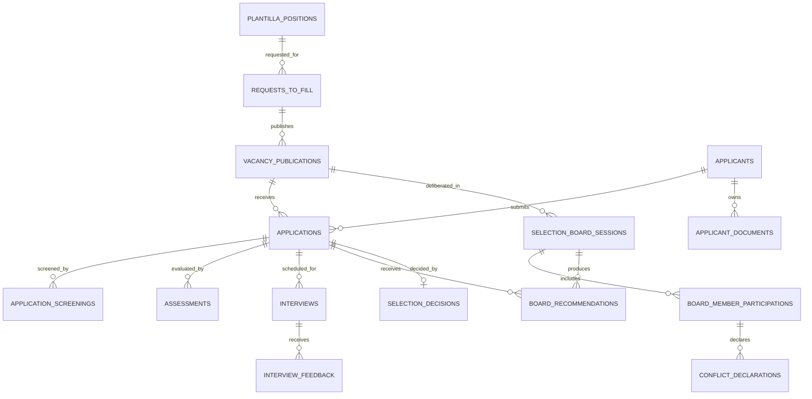

# Recruitment and Selection Logical ERD

**Document status:** Draft for review  
**Model level:** Logical ERD  
**Primary profile:** Civilian Philippine National Government Agency  
**Version:** 1.0  
**Date:** August 6, 2026

---

## Shared logical conventions

- Primary keys use UUIDs.
- All agency-owned operational records carry `agency_id`.
- Timestamps are stored in UTC and displayed in Philippine Standard Time by default.
- Status values are constrained enums or reference values, never unrestricted text.
- Effective-dated records use `effective_from` and nullable `effective_to`.
- `created_at`, `created_by_membership_id`, `updated_at`, and `updated_by_membership_id` are included where a record is mutable.
- Ledger, issued, certified, finalized, and audit records are append-only after posting.
- Sensitive values are encrypted or tokenized and are omitted from ordinary logs.
- Normal application deletion is restricted. Historical transactions are voided, superseded, deactivated, or archived.
- PostgreSQL Row-Level Security and physical indexes will be specified in the physical-schema phase.
- Cross-module actions go through owning application services rather than direct table updates.

## Relationship diagram

# Entity definitions

## `requests_to_fill`

Request to recruit for a vacant authorized position

| Column | Logical type | Null? | Key / rule | Description |
| --- | --- | --- | --- | --- |
| id | uuid | No | PK | Request |
| agency_id | uuid | No | FK agencies | Tenant |
| position_id | uuid | No | FK plantilla_positions | Vacant item |
| requesting_unit_id | uuid | No | FK organization_units | Requesting office |
| requested_by_membership_id | uuid | No | FK agency_memberships | Requester |
| justification | string | No |  | Business basis |
| status | enum | No |  | DRAFT, SUBMITTED, FOR_REVIEW, APPROVED, REJECTED, CANCELLED, CLOSED |
| submitted_at | datetime | Yes |  | Submission |
| approved_at | datetime | Yes |  | Approval |

**Constraints and indexes**

- Only VACANT or approved FROZEN-release positions may be requested.
- One active request-to-fill per position unless agency permits parallel publication.

**Deletion behavior:** Cancel or close.
## `vacancy_publications`

One official posting or republication cycle

| Column | Logical type | Null? | Key / rule | Description |
| --- | --- | --- | --- | --- |
| id | uuid | No | PK | Publication |
| agency_id | uuid | No | FK agencies | Tenant |
| request_to_fill_id | uuid | No | FK requests_to_fill | Approved request |
| publication_no | string | No |  | Publication reference |
| qualification_standard_version_id | uuid | No | FK qualification_standard_versions | Frozen QS |
| opening_date | date | No |  | Opening |
| closing_date | date | No |  | Closing |
| channels | json | No |  | CSC/agency channels |
| status | enum | No |  | DRAFT, FOR_APPROVAL, PUBLISHED, CLOSED, CANCELLED, REPUBLISHED |
| republication_of_id | uuid | Yes | FK vacancy_publications | Prior cycle |

**Constraints and indexes**

- Unique `(agency_id, publication_no)`.
- Closing date must not precede opening date.

**Deletion behavior:** Close or cancel.
## `applicants`

Person-level recruitment identity, separate from user and employee

| Column | Logical type | Null? | Key / rule | Description |
| --- | --- | --- | --- | --- |
| id | uuid | No | PK | Applicant |
| agency_id | uuid | No | FK agencies | Tenant |
| first_name | string | No |  | Name |
| middle_name | string | Yes |  | Name |
| last_name | string | No |  | Name |
| suffix | string | Yes |  | Suffix |
| email_normalized | string | Yes |  | Contact |
| mobile_number | string | Yes |  | Contact |
| privacy_notice_version | string | No |  | Consent version |
| consented_at | datetime | No |  | Consent time |
| deduplication_key | string | Yes |  | Protected matching key |

**Constraints and indexes**

- Potential duplicates are reviewed, not automatically merged.

**Deletion behavior:** Retention-controlled anonymization or archival.
## `applicant_documents`

Applicant-supplied document metadata

| Column | Logical type | Null? | Key / rule | Description |
| --- | --- | --- | --- | --- |
| id | uuid | No | PK | Document link |
| agency_id | uuid | No | FK agencies | Tenant |
| applicant_id | uuid | No | FK applicants | Applicant |
| document_id | uuid | No | FK documents | Stored file |
| document_type | enum | No |  | PDS, RESUME, ELIGIBILITY, DIPLOMA, TRAINING, LICENSE, OTHER |
| verified_at | datetime | Yes |  | Verification |
| verified_by_membership_id | uuid | Yes | FK agency_memberships | Verifier |

**Constraints and indexes**

- Unique logical document link per applicant and version.

**Deletion behavior:** Retain according to applicant-record policy.
## `applications`

Applicant submission to a publication

| Column | Logical type | Null? | Key / rule | Description |
| --- | --- | --- | --- | --- |
| id | uuid | No | PK | Application |
| agency_id | uuid | No | FK agencies | Tenant |
| vacancy_publication_id | uuid | No | FK vacancy_publications | Vacancy |
| applicant_id | uuid | No | FK applicants | Applicant |
| application_no | string | No |  | Agency reference |
| status | enum | No |  | RECEIVED, INCOMPLETE, QUALIFIED, NOT_QUALIFIED, FOR_ASSESSMENT, FOR_INTERVIEW, FOR_DELIBERATION, RECOMMENDED, NOT_RECOMMENDED, SELECTED, NOT_SELECTED, WITHDRAWN, CLOSED |
| received_at | datetime | No |  | Receipt |
| withdrawn_at | datetime | Yes |  | Withdrawal |

**Constraints and indexes**

- Unique `(vacancy_publication_id, applicant_id)` unless resubmission versioning is enabled.
- Final statuses require decision reason.

**Deletion behavior:** Close; never delete after screening.
## `application_screenings`

Versioned qualification screening result

| Column | Logical type | Null? | Key / rule | Description |
| --- | --- | --- | --- | --- |
| id | uuid | No | PK | Screening |
| agency_id | uuid | No | FK agencies | Tenant |
| application_id | uuid | No | FK applications | Application |
| qualification_standard_version_id | uuid | No | FK qualification_standard_versions | QS used |
| result | enum | No |  | QUALIFIED, NOT_QUALIFIED, INCOMPLETE, FOR_REVIEW |
| education_result | enum | No |  | MEETS, DOES_NOT_MEET, UNVERIFIED |
| training_result | enum | No |  | MEETS, DOES_NOT_MEET, UNVERIFIED |
| experience_result | enum | No |  | MEETS, DOES_NOT_MEET, UNVERIFIED |
| eligibility_result | enum | No |  | MEETS, DOES_NOT_MEET, UNVERIFIED |
| screened_by_membership_id | uuid | No | FK agency_memberships | Screener |
| screened_at | datetime | No |  | Time |
| reason | string | Yes |  | Decision basis |

**Constraints and indexes**

- Latest accepted screening drives application status; earlier screenings remain.

**Deletion behavior:** Never delete; supersede.
## `assessments`

Assessment definition and schedule for an application

| Column | Logical type | Null? | Key / rule | Description |
| --- | --- | --- | --- | --- |
| id | uuid | No | PK | Assessment |
| agency_id | uuid | No | FK agencies | Tenant |
| application_id | uuid | No | FK applications | Application |
| assessment_type | enum | No |  | WRITTEN, PRACTICAL, COMPETENCY, PSYCHOMETRIC, OTHER |
| scheduled_at | datetime | Yes |  | Schedule |
| maximum_score | decimal | Yes |  | Maximum |
| score | decimal | Yes |  | Result |
| rating | string | Yes |  | Qualitative result |
| status | enum | No |  | SCHEDULED, COMPLETED, CANCELLED, NO_SHOW |
| evaluated_by_membership_id | uuid | Yes | FK agency_memberships | Evaluator |

**Constraints and indexes**

- Score must be within valid range when both values exist.

**Deletion behavior:** Retain.
## `interviews`

Interview event for an application

| Column | Logical type | Null? | Key / rule | Description |
| --- | --- | --- | --- | --- |
| id | uuid | No | PK | Interview |
| agency_id | uuid | No | FK agencies | Tenant |
| application_id | uuid | No | FK applications | Application |
| scheduled_at | datetime | No |  | Schedule |
| location_or_link | string | Yes |  | Venue |
| status | enum | No |  | SCHEDULED, COMPLETED, CANCELLED, NO_SHOW |
| panel_name | string | Yes |  | Panel label |

**Constraints and indexes**

- Completed interviews should have feedback or an exception reason.

**Deletion behavior:** Retain.
## `interview_feedback`

Structured feedback by interviewer

| Column | Logical type | Null? | Key / rule | Description |
| --- | --- | --- | --- | --- |
| id | uuid | No | PK | Feedback |
| agency_id | uuid | No | FK agencies | Tenant |
| interview_id | uuid | No | FK interviews | Interview |
| interviewer_membership_id | uuid | No | FK agency_memberships | Interviewer |
| score | decimal | Yes |  | Score |
| recommendation | enum | No |  | PROCEED, HOLD, DO_NOT_PROCEED |
| comments | string | Yes |  | Feedback |
| submitted_at | datetime | No |  | Submission |

**Constraints and indexes**

- Unique `(interview_id, interviewer_membership_id)`.

**Deletion behavior:** Immutable after deliberation; amendment requires new version.
## `selection_board_sessions`

HRMPSB or equivalent deliberation

| Column | Logical type | Null? | Key / rule | Description |
| --- | --- | --- | --- | --- |
| id | uuid | No | PK | Session |
| agency_id | uuid | No | FK agencies | Tenant |
| vacancy_publication_id | uuid | No | FK vacancy_publications | Vacancy |
| session_date | date | No |  | Date |
| status | enum | No |  | DRAFT, SCHEDULED, IN_PROGRESS, COMPLETED, CANCELLED |
| quorum_required | integer | No |  | Required count |
| minutes_document_id | uuid | Yes | FK documents | Minutes |

**Constraints and indexes**

- Completed session must satisfy quorum or record an authorized exception.

**Deletion behavior:** Retain.
## `board_member_participations`

Board member participation and role

| Column | Logical type | Null? | Key / rule | Description |
| --- | --- | --- | --- | --- |
| id | uuid | No | PK | Participation |
| agency_id | uuid | No | FK agencies | Tenant |
| session_id | uuid | No | FK selection_board_sessions | Session |
| membership_id | uuid | No | FK agency_memberships | Member |
| board_role | enum | No |  | CHAIR, MEMBER, SECRETARIAT, OBSERVER |
| attendance_status | enum | No |  | PRESENT, ABSENT, RECUSED |
| signed_at | datetime | Yes |  | Acknowledgment |

**Constraints and indexes**

- Unique `(session_id, membership_id)`.

**Deletion behavior:** Retain.
## `conflict_declarations`

Conflict-of-interest declaration

| Column | Logical type | Null? | Key / rule | Description |
| --- | --- | --- | --- | --- |
| id | uuid | No | PK | Declaration |
| agency_id | uuid | No | FK agencies | Tenant |
| participation_id | uuid | No | FK board_member_participations | Board member |
| application_id | uuid | Yes | FK applications | Specific applicant if applicable |
| has_conflict | boolean | No |  | Conflict result |
| details | string | Yes |  | Protected explanation |
| declared_at | datetime | No |  | Time |

**Constraints and indexes**

- A conflicted participant cannot score or recommend the affected application.

**Deletion behavior:** Retain.
## `board_recommendations`

Board recommendation for an application

| Column | Logical type | Null? | Key / rule | Description |
| --- | --- | --- | --- | --- |
| id | uuid | No | PK | Recommendation |
| agency_id | uuid | No | FK agencies | Tenant |
| session_id | uuid | No | FK selection_board_sessions | Session |
| application_id | uuid | No | FK applications | Application |
| rank_no | integer | Yes |  | Rank |
| recommendation | enum | No |  | RECOMMENDED, NOT_RECOMMENDED, RESERVE |
| composite_score | decimal | Yes |  | Final score |
| reason | string | Yes |  | Basis |
| approved_at | datetime | Yes |  | Board completion |

**Constraints and indexes**

- Unique `(session_id, application_id)`.

**Deletion behavior:** Immutable after session completion; amendment is versioned.
## `selection_decisions`

Appointing-authority decision

| Column | Logical type | Null? | Key / rule | Description |
| --- | --- | --- | --- | --- |
| id | uuid | No | PK | Decision |
| agency_id | uuid | No | FK agencies | Tenant |
| application_id | uuid | No | FK applications | Application |
| decision | enum | No |  | SELECTED, NOT_SELECTED, RETURNED |
| decided_by_membership_id | uuid | No | FK agency_memberships | Authority |
| decided_at | datetime | No |  | Decision time |
| reason | string | Yes |  | Basis |
| authority_document_id | uuid | Yes | FK documents | Decision evidence |

**Constraints and indexes**

- At most one effective final selection decision per application.
- Only one selected application may proceed for one reserved item unless appointment is cancelled.

**Deletion behavior:** Never delete; supersede with formal correction.

# Domain invariants

- Recruitment must reference a valid authorized position and approved request-to-fill.
- The qualification-standard version is frozen at publication/screening time.
- AI summaries cannot write final screening, recommendation, or selection results.
- Board participation and conflict declarations are preserved for audit.
