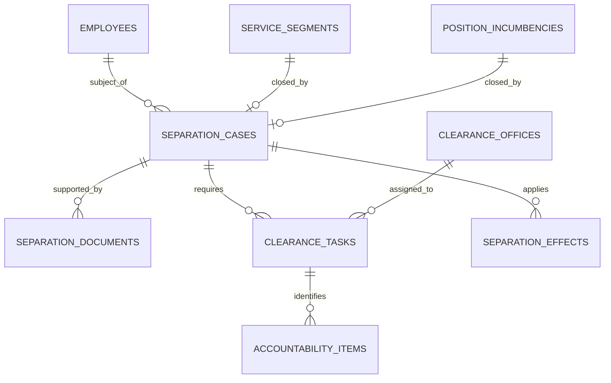

# Separation Logical ERD

**Document status:** Draft for review  
**Model level:** Logical ERD  
**Primary profile:** Civilian Philippine National Government Agency  
**Version:** 1.0  
**Date:** August 6, 2026

---

## Shared logical conventions

- Primary keys use UUIDs.
- All agency-owned operational records carry `agency_id`.
- Timestamps are stored in UTC and displayed in Philippine Standard Time by default.
- Status values are constrained enums or reference values, never unrestricted text.
- Effective-dated records use `effective_from` and nullable `effective_to`.
- `created_at`, `created_by_membership_id`, `updated_at`, and `updated_by_membership_id` are included where a record is mutable.
- Ledger, issued, certified, finalized, and audit records are append-only after posting.
- Sensitive values are encrypted or tokenized and are omitted from ordinary logs.
- Normal application deletion is restricted. Historical transactions are voided, superseded, deactivated, or archived.
- PostgreSQL Row-Level Security and physical indexes will be specified in the physical-schema phase.
- Cross-module actions go through owning application services rather than direct table updates.

## Relationship diagram

# Entity definitions

## `separation_cases`

Formal employee separation workflow

| Column | Logical type | Null? | Key / rule | Description |
| --- | --- | --- | --- | --- |
| id | uuid | No | PK | Case |
| agency_id | uuid | No | FK agencies | Tenant |
| employee_id | uuid | No | FK employees | Employee |
| separation_type | enum | No |  | RESIGNATION, RETIREMENT, TRANSFER, EXPIRATION, TERMINATION, DEATH, REORGANIZATION, OTHER |
| proposed_effective_date | date | No |  | Proposed date |
| approved_effective_date | date | Yes |  | Approved date |
| status | enum | No |  | DRAFT, SUBMITTED, FOR_REVIEW, APPROVED, CLEARANCE_IN_PROGRESS, CLEARED, EFFECTIVE, CANCELLED |
| reason | string | Yes |  | Reason |
| initiated_by_membership_id | uuid | No | FK agency_memberships | Initiator |
| approved_by_membership_id | uuid | Yes | FK agency_memberships | Approver |
| service_segment_id | uuid | Yes | FK service_segments | Segment to close |
| position_incumbency_id | uuid | Yes | FK position_incumbencies | Incumbency to close |

**Constraints and indexes**

- Only one active separation case per employee unless prior case cancelled.
- Effectuation date closes service and occupancy.

**Deletion behavior:** Retain.
## `separation_documents`

Separation supporting document link

| Column | Logical type | Null? | Key / rule | Description |
| --- | --- | --- | --- | --- |
| id | uuid | No | PK | Link |
| agency_id | uuid | No | FK agencies | Tenant |
| separation_case_id | uuid | No | FK separation_cases | Case |
| document_id | uuid | No | FK documents | Document |
| document_type | enum | No |  | RESIGNATION, ACCEPTANCE, RETIREMENT, DEATH_CERTIFICATE, NOTICE, AUTHORITY, OTHER |

**Constraints and indexes**

- Unique `(separation_case_id, document_id, document_type)`.

**Deletion behavior:** Retain.
## `clearance_offices`

Agency offices that participate in clearance

| Column | Logical type | Null? | Key / rule | Description |
| --- | --- | --- | --- | --- |
| id | uuid | No | PK | Clearance office |
| agency_id | uuid | No | FK agencies | Tenant |
| organization_unit_id | uuid | No | FK organization_units | Office |
| code | string | No |  | Code |
| name | string | No |  | Display name |
| sequence_no | integer | No |  | Workflow order |
| required_by_default | boolean | No |  | Required flag |
| status | enum | No |  | ACTIVE, INACTIVE |

**Constraints and indexes**

- Unique `(agency_id, code)`.

**Deletion behavior:** Inactivate.
## `clearance_tasks`

One office clearance task in a case

| Column | Logical type | Null? | Key / rule | Description |
| --- | --- | --- | --- | --- |
| id | uuid | No | PK | Task |
| agency_id | uuid | No | FK agencies | Tenant |
| separation_case_id | uuid | No | FK separation_cases | Case |
| clearance_office_id | uuid | No | FK clearance_offices | Office |
| assigned_membership_id | uuid | Yes | FK agency_memberships | Clearing officer |
| status | enum | No |  | PENDING, IN_PROGRESS, CLEARED, WITH_ACCOUNTABILITY, WAIVED, CANCELLED |
| started_at | datetime | Yes |  | Start |
| completed_at | datetime | Yes |  | Completion |
| comments | string | Yes |  | Comments |
| waived_by_membership_id | uuid | Yes | FK agency_memberships | Authority |

**Constraints and indexes**

- Unique `(separation_case_id, clearance_office_id)` unless repeated task versions are enabled.

**Deletion behavior:** Retain.
## `accountability_items`

Outstanding property, cash, document, or obligation

| Column | Logical type | Null? | Key / rule | Description |
| --- | --- | --- | --- | --- |
| id | uuid | No | PK | Item |
| agency_id | uuid | No | FK agencies | Tenant |
| clearance_task_id | uuid | No | FK clearance_tasks | Task |
| accountability_type | enum | No |  | PROPERTY, CASH, RECORD, DOCUMENT, FINANCIAL, OTHER |
| reference_no | string | Yes |  | Reference |
| description | string | No |  | Description |
| amount | decimal | Yes |  | Financial amount |
| status | enum | No |  | OPEN, RESOLVED, WAIVED |
| resolved_at | datetime | Yes |  | Resolution |
| resolution_document_id | uuid | Yes | FK documents | Evidence |

**Constraints and indexes**

- Task cannot be CLEARED while OPEN items exist.

**Deletion behavior:** Retain.
## `separation_effects`

Idempotent record of downstream separation effects

| Column | Logical type | Null? | Key / rule | Description |
| --- | --- | --- | --- | --- |
| id | uuid | No | PK | Effect |
| agency_id | uuid | No | FK agencies | Tenant |
| separation_case_id | uuid | No | FK separation_cases | Case |
| effect_type | enum | No |  | CLOSE_SERVICE, VACATE_POSITION, STOP_SCHEDULE, STOP_PAYROLL, DEACTIVATE_MEMBERSHIP, REVOKE_SESSIONS |
| target_type | string | No |  | Target entity |
| target_id | uuid | No |  | Target |
| applied_at | datetime | Yes |  | Applied |
| status | enum | No |  | PENDING, APPLIED, FAILED, REVERSED |
| failure_reason | string | Yes |  | Failure |

**Constraints and indexes**

- Unique `(separation_case_id, effect_type, target_id)` for idempotency.

**Deletion behavior:** Retain.

# Domain invariants

- Separation approval, clearance, effectuation, and access revocation are distinct steps.
- Effectuation closes service and occupancy without deleting history.
- Downstream effects are idempotent and retryable.
- Accountabilities block clearance unless resolved or formally waived.
