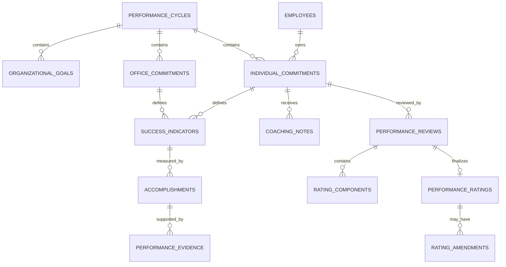

# SPMS Logical ERD

**Document status:** Draft for review  
**Model level:** Logical ERD  
**Primary profile:** Civilian Philippine National Government Agency  
**Version:** 1.0  
**Date:** August 6, 2026

---

## Shared logical conventions

- Primary keys use UUIDs.
- All agency-owned operational records carry `agency_id`.
- Timestamps are stored in UTC and displayed in Philippine Standard Time by default.
- Status values are constrained enums or reference values, never unrestricted text.
- Effective-dated records use `effective_from` and nullable `effective_to`.
- `created_at`, `created_by_membership_id`, `updated_at`, and `updated_by_membership_id` are included where a record is mutable.
- Ledger, issued, certified, finalized, and audit records are append-only after posting.
- Sensitive values are encrypted or tokenized and are omitted from ordinary logs.
- Normal application deletion is restricted. Historical transactions are voided, superseded, deactivated, or archived.
- PostgreSQL Row-Level Security and physical indexes will be specified in the physical-schema phase.
- Cross-module actions go through owning application services rather than direct table updates.

## Relationship diagram

# Entity definitions

## `performance_cycles`

Agency SPMS cycle

| Column | Logical type | Null? | Key / rule | Description |
| --- | --- | --- | --- | --- |
| id | uuid | No | PK | Cycle |
| agency_id | uuid | No | FK agencies | Tenant |
| code | string | No |  | Cycle code |
| name | string | No |  | Cycle name |
| period_from | date | No |  | Start |
| period_to | date | No |  | End |
| status | enum | No |  | DRAFT, PLANNING, ACTIVE, MIDYEAR_REVIEW, RATING, CALIBRATION, FINALIZED, CLOSED, CANCELLED |
| policy_version | string | No |  | SPMS policy version |
| rating_scale | json | No |  | Approved scale |

**Constraints and indexes**

- Unique `(agency_id, code)`.
- Period end after start.

**Deletion behavior:** Close/cancel; retain.
## `organizational_goals`

Agency or office strategic goal

| Column | Logical type | Null? | Key / rule | Description |
| --- | --- | --- | --- | --- |
| id | uuid | No | PK | Goal |
| agency_id | uuid | No | FK agencies | Tenant |
| performance_cycle_id | uuid | No | FK performance_cycles | Cycle |
| parent_goal_id | uuid | Yes | FK organizational_goals | Parent |
| organization_unit_id | uuid | Yes | FK organization_units | Owning office |
| code | string | No |  | Goal code |
| description | string | No |  | Goal |
| weight | decimal | Yes |  | Weight |
| status | enum | No |  | DRAFT, ACTIVE, INACTIVE |

**Constraints and indexes**

- Goal hierarchy must be acyclic.

**Deletion behavior:** Inactivate.
## `office_commitments`

OPCR/DPCR or equivalent office commitment

| Column | Logical type | Null? | Key / rule | Description |
| --- | --- | --- | --- | --- |
| id | uuid | No | PK | Commitment |
| agency_id | uuid | No | FK agencies | Tenant |
| performance_cycle_id | uuid | No | FK performance_cycles | Cycle |
| organization_unit_id | uuid | No | FK organization_units | Office |
| responsible_membership_id | uuid | Yes | FK agency_memberships | Office head |
| version_no | integer | No |  | Version |
| status | enum | No |  | DRAFT, SUBMITTED, APPROVED, RETURNED, ACTIVE, FINALIZED, SUPERSEDED |

**Constraints and indexes**

- One active commitment per office/cycle unless agency profile allows subtypes.

**Deletion behavior:** Supersede.
## `individual_commitments`

IPCR or equivalent employee commitment

| Column | Logical type | Null? | Key / rule | Description |
| --- | --- | --- | --- | --- |
| id | uuid | No | PK | Commitment |
| agency_id | uuid | No | FK agencies | Tenant |
| performance_cycle_id | uuid | No | FK performance_cycles | Cycle |
| employee_id | uuid | No | FK employees | Employee |
| supervisor_employee_id | uuid | No | FK employees | Supervisor |
| version_no | integer | No |  | Version |
| status | enum | No |  | DRAFT, SUBMITTED, APPROVED, RETURNED, ACTIVE, FOR_RATING, RATED, FINALIZED, AMENDED |
| submitted_at | datetime | Yes |  | Submission |
| approved_at | datetime | Yes |  | Approval |

**Constraints and indexes**

- One current active version per employee/cycle.
- Supervisor must be authorized by hierarchy or delegation.

**Deletion behavior:** Supersede.
## `success_indicators`

Target and measurement definition

| Column | Logical type | Null? | Key / rule | Description |
| --- | --- | --- | --- | --- |
| id | uuid | No | PK | Indicator |
| agency_id | uuid | No | FK agencies | Tenant |
| office_commitment_id | uuid | Yes | FK office_commitments | Office commitment |
| individual_commitment_id | uuid | Yes | FK individual_commitments | Individual commitment |
| organizational_goal_id | uuid | Yes | FK organizational_goals | Aligned goal |
| sequence_no | integer | No |  | Ordering |
| output_description | string | No |  | Output/outcome |
| measure | string | No |  | Measure |
| target | string | No |  | Target |
| weight | decimal | No |  | Weight |
| quality_criteria | string | Yes |  | Quality |
| efficiency_criteria | string | Yes |  | Efficiency |
| timeliness_criteria | string | Yes |  | Timeliness |

**Constraints and indexes**

- Exactly one of office_commitment_id or individual_commitment_id is required.
- Weights must satisfy agency policy.

**Deletion behavior:** Follows commitment version.
## `accomplishments`

Actual accomplishment against indicator

| Column | Logical type | Null? | Key / rule | Description |
| --- | --- | --- | --- | --- |
| id | uuid | No | PK | Accomplishment |
| agency_id | uuid | No | FK agencies | Tenant |
| success_indicator_id | uuid | No | FK success_indicators | Indicator |
| employee_id | uuid | No | FK employees | Employee |
| period_from | date | No |  | Start |
| period_to | date | No |  | End |
| actual_result | string | No |  | Actual |
| quantity_value | decimal | Yes |  | Optional numeric |
| submitted_at | datetime | Yes |  | Submission |
| status | enum | No |  | DRAFT, SUBMITTED, VERIFIED, RETURNED |

**Constraints and indexes**

- Employee must own or be assigned to the indicator.

**Deletion behavior:** Retain.
## `performance_evidence`

Document/reference supporting an accomplishment

| Column | Logical type | Null? | Key / rule | Description |
| --- | --- | --- | --- | --- |
| id | uuid | No | PK | Evidence |
| agency_id | uuid | No | FK agencies | Tenant |
| accomplishment_id | uuid | No | FK accomplishments | Accomplishment |
| document_id | uuid | Yes | FK documents | File |
| external_reference | string | Yes |  | Reference |
| description | string | Yes |  | Description |
| verified_at | datetime | Yes |  | Verification |

**Constraints and indexes**

- At least one document or external reference.

**Deletion behavior:** Retain.
## `coaching_notes`

Monitoring and coaching record

| Column | Logical type | Null? | Key / rule | Description |
| --- | --- | --- | --- | --- |
| id | uuid | No | PK | Note |
| agency_id | uuid | No | FK agencies | Tenant |
| individual_commitment_id | uuid | No | FK individual_commitments | Commitment |
| employee_id | uuid | No | FK employees | Employee |
| supervisor_employee_id | uuid | No | FK employees | Supervisor |
| note_date | date | No |  | Date |
| note | string | No |  | Coaching record |
| visibility | enum | No |  | EMPLOYEE_AND_SUPERVISOR, HR_RESTRICTED |

**Constraints and indexes**

- Restricted visibility enforced at field/record level.

**Deletion behavior:** Retain.
## `performance_reviews`

Supervisor/calibration review

| Column | Logical type | Null? | Key / rule | Description |
| --- | --- | --- | --- | --- |
| id | uuid | No | PK | Review |
| agency_id | uuid | No | FK agencies | Tenant |
| individual_commitment_id | uuid | No | FK individual_commitments | Commitment |
| review_type | enum | No |  | MIDYEAR, FINAL, CALIBRATION, APPEAL |
| reviewer_membership_id | uuid | No | FK agency_memberships | Reviewer |
| status | enum | No |  | DRAFT, SUBMITTED, RETURNED, APPROVED |
| comments | string | Yes |  | Review comments |
| submitted_at | datetime | Yes |  | Submission |

**Constraints and indexes**

- Reviewer cannot be unauthorized self-reviewer.

**Deletion behavior:** Retain.
## `rating_components`

Detailed ratings for indicators/competencies

| Column | Logical type | Null? | Key / rule | Description |
| --- | --- | --- | --- | --- |
| id | uuid | No | PK | Component |
| agency_id | uuid | No | FK agencies | Tenant |
| performance_review_id | uuid | No | FK performance_reviews | Review |
| success_indicator_id | uuid | Yes | FK success_indicators | Indicator |
| component_type | enum | No |  | OUTPUT, QUALITY, EFFICIENCY, TIMELINESS, COMPETENCY |
| raw_score | decimal | No |  | Score |
| weighted_score | decimal | No |  | Weighted |
| rating_basis | string | Yes |  | Basis |

**Constraints and indexes**

- Scores within configured rating scale.

**Deletion behavior:** Immutable after final rating.
## `performance_ratings`

Final cycle rating

| Column | Logical type | Null? | Key / rule | Description |
| --- | --- | --- | --- | --- |
| id | uuid | No | PK | Rating |
| agency_id | uuid | No | FK agencies | Tenant |
| individual_commitment_id | uuid | No | FK individual_commitments | Commitment |
| performance_review_id | uuid | No | FK performance_reviews | Final review |
| overall_score | decimal | No |  | Score |
| adjectival_rating | string | No |  | Rating |
| finalized_by_membership_id | uuid | No | FK agency_memberships | Approver |
| finalized_at | datetime | No |  | Finalization |
| status | enum | No |  | FINALIZED, SUPERSEDED |

**Constraints and indexes**

- One active final rating per commitment version.

**Deletion behavior:** Supersede only through amendment.
## `rating_amendments`

Controlled amendment to a final rating

| Column | Logical type | Null? | Key / rule | Description |
| --- | --- | --- | --- | --- |
| id | uuid | No | PK | Amendment |
| agency_id | uuid | No | FK agencies | Tenant |
| original_rating_id | uuid | No | FK performance_ratings | Original |
| replacement_rating_id | uuid | No | FK performance_ratings | Replacement |
| reason | string | No |  | Reason |
| authority_document_id | uuid | Yes | FK documents | Authority |
| approved_by_membership_id | uuid | No | FK agency_memberships | Approver |
| approved_at | datetime | No |  | Approval |

**Constraints and indexes**

- Original remains accessible.

**Deletion behavior:** Never delete.

# Domain invariants

- Commitments and indicators are versioned by cycle.
- Final ratings are immutable; corrections create replacement ratings and amendments.
- Supervisor and calibration authority are validated against hierarchy/delegation.
- Evidence access follows employee, supervisor, HR, and audit scope.
