# Philippine Public-Sector HRIS MVP

## Business Process Workflow Specification

**Document status:** Draft for review  
**Source:** Philippine Public-Sector HRIS MVP BRD v1.0  
**Primary implementation profile:** Civilian National Government Agency  
**Version:** 1.0  
**Date:** August 5, 2026  

---

# 1. Purpose

This document defines the core public-sector HR workflows that will drive the ERD, status models, permission matrix, API design, and acceptance tests.

The workflow set differs materially from a private-sector HRIS because the public-sector lifecycle begins with an authorized position and continues through merit selection, appointment, assumption to duty, service records, government attendance and leave, salary-grade payroll, SPMS, and formal separation.

---

# 2. Workflow Principles

1. Recruitment for a plantilla appointment begins with a valid vacant position.
2. Appointment issuance does not by itself establish actual service; assumption to duty must be recorded.
3. Every personnel action must preserve history.
4. Attendance, leave, overtime, payroll, and performance use effective-dated rules.
5. Payroll preparation, certification, approval, and payment responsibilities may be separated.
6. Finalized payroll and issued personnel records are not silently edited.
7. Government forms and rule versions are traceable.
8. AI output is advisory and requires human validation.
9. Biometric-device integrations and biometric file imports are outside MVP.
10. Agency profiles control differences among NGAs, LGUs, SUCs, and GOCCs with original charters.

---

# 3. Workflow Index

| ID | Workflow |
| ------ | -------------------------------------------------- |
| WF-001 | User Invitation, Login, and Agency Access |
| WF-002 | Plantilla Position Creation and Vacancy Control |
| WF-003 | Vacancy Publication and Merit Selection |
| WF-004 | Appointment Issuance, CSC Tracking, and Assumption |
| WF-005 | PDS, Employee Onboarding, and Service Record |
| WF-006 | Personnel Action and Position Movement |
| WF-007 | Attendance and Daily Time Record |
| WF-008 | Leave Application and Leave-Credit Ledger |
| WF-009 | Overtime Authority, COC/CTO, and Overtime Pay |
| WF-010 | Government Payroll |
| WF-011 | SPMS Performance Cycle |
| WF-012 | Separation, Clearance, and Access Revocation |
| WF-013 | AI-Assisted HR Action |

---

# 4. WF-001 — User Invitation, Login, and Agency Access

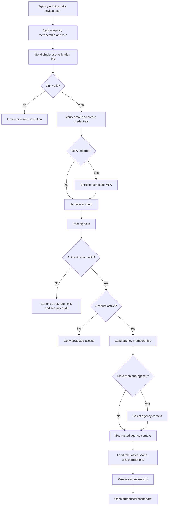

Key states:

```text
INVITED → ACTIVE → LOCKED | SUSPENDED | DEACTIVATED
```

---

# 5. WF-002 — Plantilla Position Creation and Vacancy Control

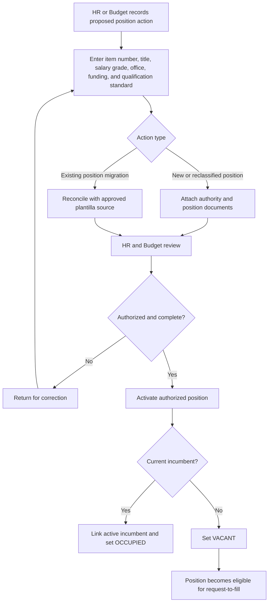

Position states:

```text
PROPOSED
AUTHORIZED
VACANT
RESERVED
OCCUPIED
FROZEN
ABOLISHED
```

Controls:

- one active incumbent per item unless an approved exception exists;
- effective-dated title, grade, office, and status;
- abolition never deletes position history.

---

# 6. WF-003 — Vacancy Publication and Merit Selection

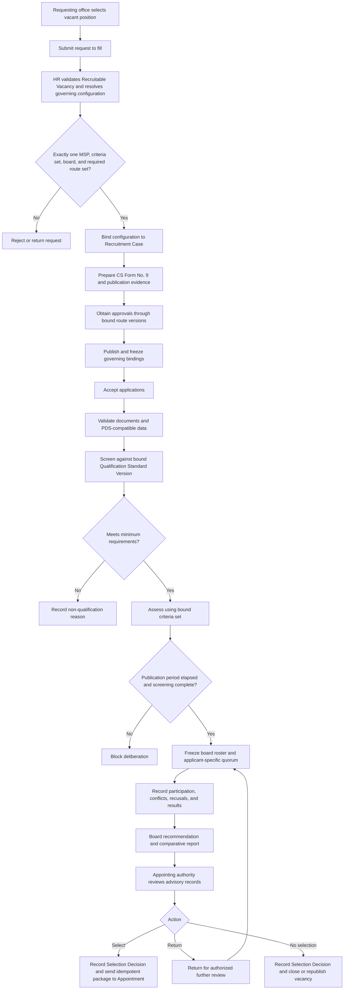

Required audit:

- publication;
- screening;
- assessment;
- board attendance and recommendation;
- appointing-authority decision;
- conflict-of-interest declaration.

AI may summarize credentials but cannot make the final decision.

---

# 7. WF-004 — Appointment Issuance, CSC Tracking, and Assumption

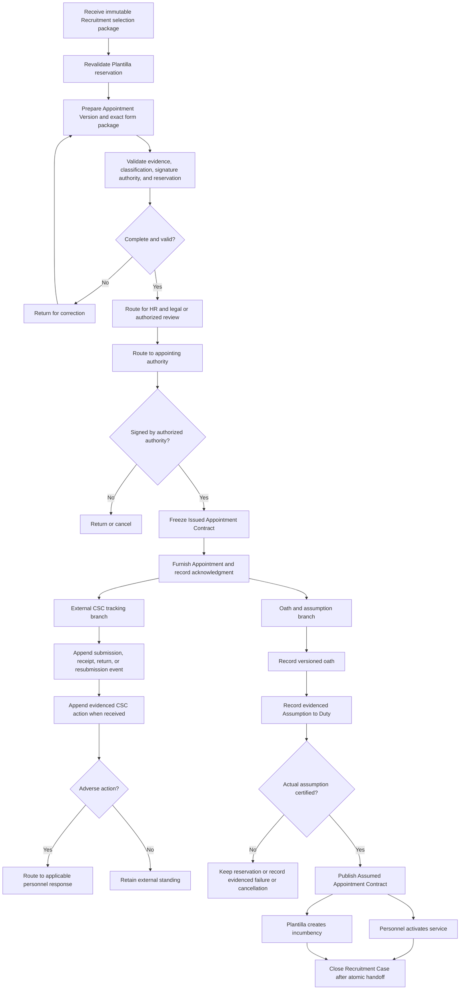

Appointment states:

```text
DRAFT
FOR_REVIEW
FOR_SIGNATURE
ISSUED
CANCELLED
```

`SUBMITTED`, `RETURNED`, `VALIDATED`, and `INVALIDATED` describe external events or a derived external standing, not Appointment workflow states. CSC tracking does not gate the oath or assumption branch. Selection and issuance do not activate service.

---

# 8. WF-005 — PDS, Employee Onboarding, and Service Record

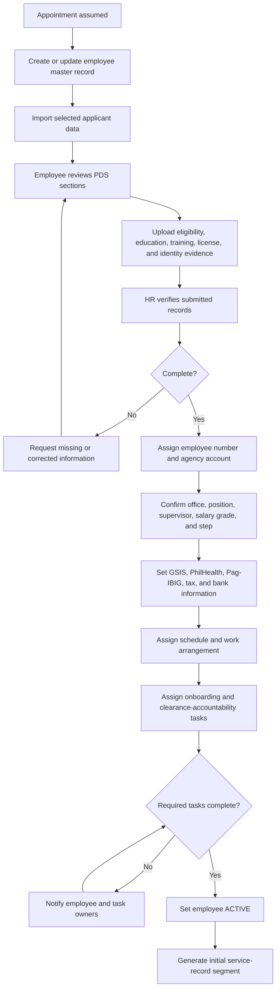

Personnel records preserve versions and evidence. PDS corrections do not overwrite prior certified versions.

---

# 9. WF-006 — Personnel Action and Position Movement

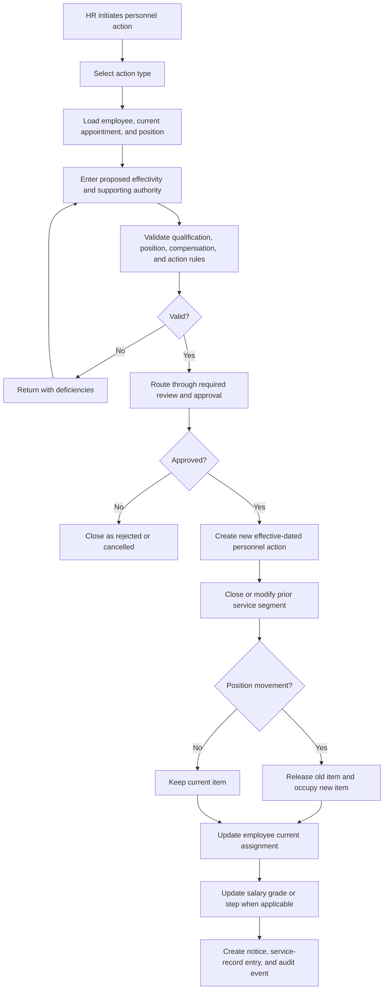

Action types include promotion, transfer, reappointment, reassignment, detail, designation, salary adjustment, step increment, and separation.

---

# 10. WF-007 — Attendance and Daily Time Record

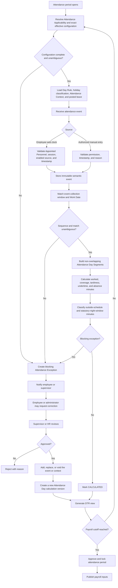

An ordinary daytime DTR presents semantic events through the familiar AM In, AM Out, PM In, and PM Out slots. Overnight duty remains one Work Date beginning on the local date of `TIME_IN`; its view uses duty and break labels with actual dates and times. Complete events on a rest day create Unscheduled Service, not approved overtime or COC. No biometric import exists in MVP.

---

# 11. WF-008 — Leave Application and Leave-Credit Ledger

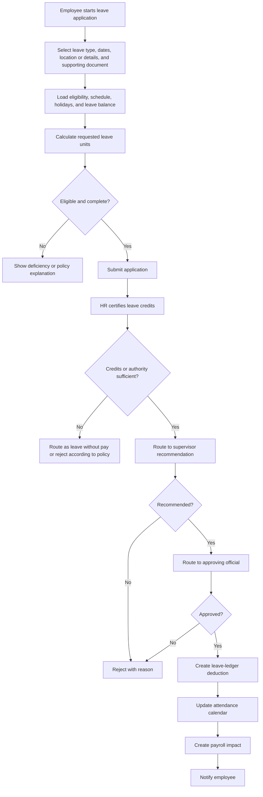

### Leave monetization

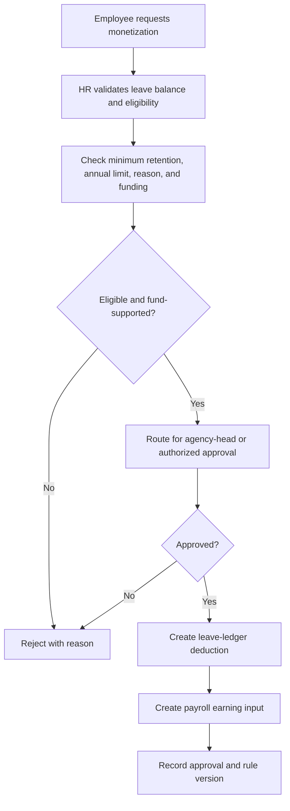

---

# 12. WF-009 — Overtime Authority, COC/CTO, and Overtime Pay

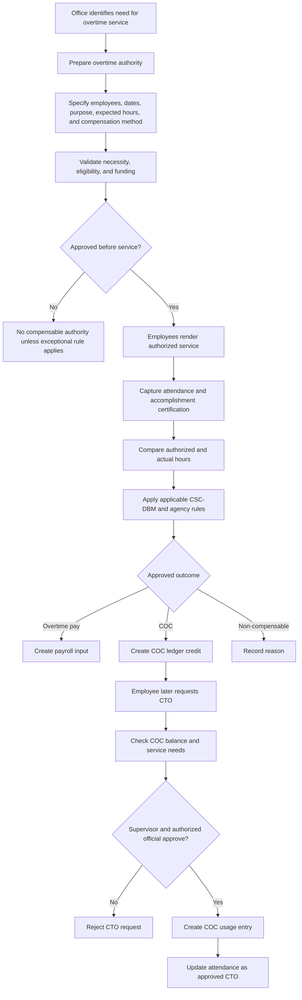

Requested, authorized, actual, credited, used, and paid values are stored separately.

---

# 13. WF-010 — Government Payroll

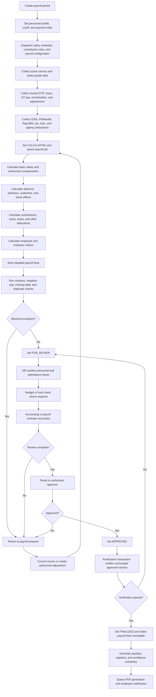

Correction after finalization:

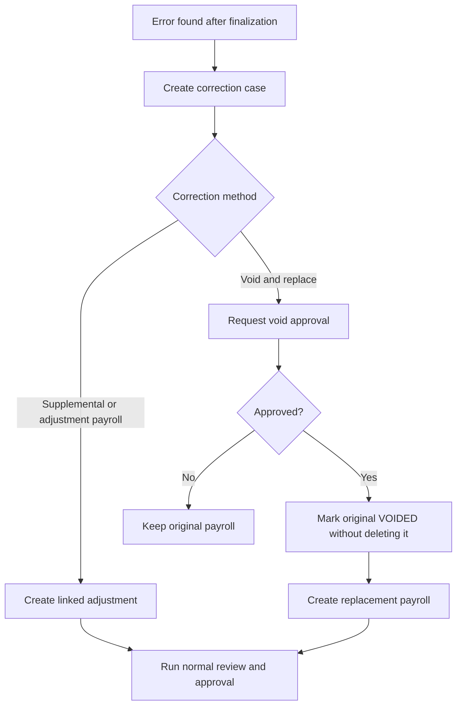

---

# 14. WF-011 — SPMS Performance Cycle

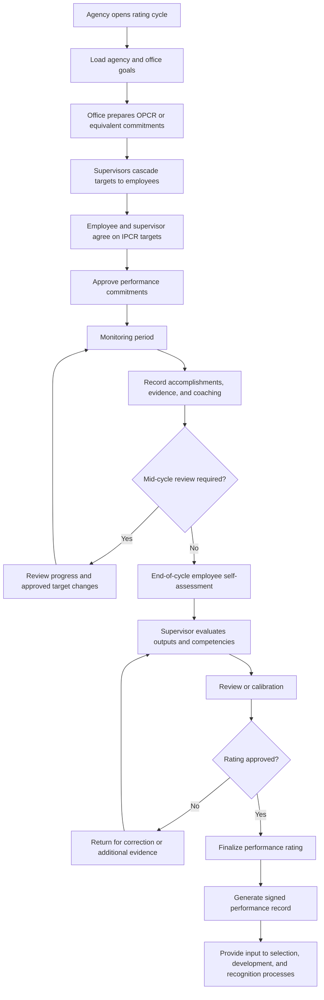

Finalized ratings require controlled amendment, not direct editing.

---

# 15. WF-012 — Separation, Clearance, and Access Revocation

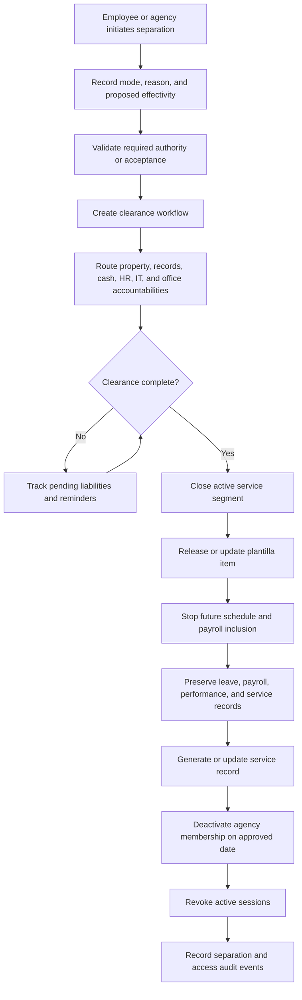

Retirement-benefit calculation remains outside MVP.

---

# 16. WF-013 — AI-Assisted HR Action

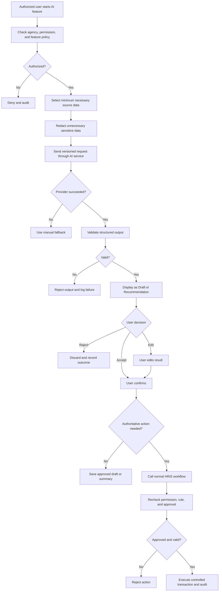

---

# 17. Status and Entity Implications

The workflow set requires at least these major domains:

```text
Identity and Agency
- users
- agencies
- memberships
- roles
- permissions
- sessions
- security_events

Organization and Plantilla
- organization_units
- positions
- position_histories
- qualification_standards
- position_documents

Recruitment and Appointment
- requests_to_fill
- vacancy_publications
- applicants
- applications
- assessments
- selection_board_sessions
- recommendations
- appointments
- appointment_submissions
- oaths
- assumptions

Personnel Records
- employees
- pds_versions
- eligibilities
- education_records
- training_records
- work_experiences
- service_segments
- personnel_actions
- employee_documents
- saln_compliance_records

Attendance and Leave
- work_schedules
- work_schedule_versions
- work_schedule_day_rules
- work_arrangements
- work_arrangement_versions
- schedule_assignments
- holiday_calendar_versions
- attendance_events
- attendance_contexts
- attendance_days
- attendance_day_segments
- attendance_exceptions
- attendance_corrections
- leave_types
- leave_accounts
- leave_ledger_entries
- leave_applications

Overtime
- overtime_authorities
- overtime_service_records
- coc_ledger_entries
- cto_requests
- overtime_pay_inputs

Payroll
- salary_schedules
- pay_components
- employee_compensation
- payroll_periods
- payroll_employees
- payroll_lines
- deductions
- contribution_lines
- payslips

Performance
- performance_cycles
- office_commitments
- individual_commitments
- success_indicators
- accomplishments
- performance_reviews
- ratings

Shared
- approval_requests
- approval_steps
- notifications
- audit_events
- documents
- ai_requests
```

---

# 18. Approval

| Role | Name | Decision | Date |
| ----------------------------- | ---- | -------- | ---- |
| Product Owner |  | Pending |  |
| Government HR / HRMO Reviewer |  | Pending |  |
| Payroll / Accounting Reviewer |  | Pending |  |
| Technical Owner |  | Pending |  |

---

# 19. Change Log

| Version | Date | Description |
| ------- | -------------- | ---------------------------------------------------------------------------- |
| 1.0 | August 5, 2026 | Replaced private-sector workflows with Philippine public-sector HR workflows |
