# Philippine Public-Sector HRIS MVP

## Business Process Workflow Specification

**Document status:** Draft for review  
**Source:** Philippine Public-Sector HRIS MVP BRD v1.0  
**Primary implementation profile:** Civilian National Government Agency  
**Version:** 1.0  
**Date:** August 5, 2026

---

# 1. Purpose

This document defines the core public-sector HR workflows that will drive the ERD, status models, permission matrix, API design, and acceptance tests.

The workflow set differs materially from a private-sector HRIS because the public-sector lifecycle begins with an authorized position and continues through merit selection, appointment, assumption to duty, service records, government attendance and leave, salary-grade payroll, SPMS, and formal separation.

---

# 2. Workflow Principles

1. Recruitment for a plantilla appointment begins with a valid vacant position.
2. Appointment issuance does not by itself establish actual service; assumption to duty must be recorded.
3. Every personnel action must preserve history.
4. Attendance, leave, overtime, payroll, and performance use effective-dated rules.
5. Payroll preparation, certification, approval, and payment responsibilities may be separated.
6. Finalized payroll and issued personnel records are not silently edited.
7. Government forms and rule versions are traceable.
8. AI output is advisory and requires human validation.
9. Biometric-device integrations and biometric file imports are outside MVP.
10. Agency profiles control differences among NGAs, LGUs, SUCs, and GOCCs with original charters.

---

# 3. Workflow Index

| ID     | Workflow                                           |
| ------ | -------------------------------------------------- |
| WF-001 | User Invitation, Login, and Agency Access          |
| WF-002 | Plantilla Position Creation and Vacancy Control    |
| WF-003 | Vacancy Publication and Merit Selection            |
| WF-004 | Appointment Issuance, CSC Tracking, and Assumption |
| WF-005 | PDS, Employee Onboarding, and Service Record       |
| WF-006 | Personnel Action and Position Movement             |
| WF-007 | Attendance and Daily Time Record                   |
| WF-008 | Leave Application and Leave-Credit Ledger          |
| WF-009 | Overtime Authority, COC/CTO, and Overtime Pay      |
| WF-010 | Government Payroll                                 |
| WF-011 | SPMS Performance Cycle                             |
| WF-012 | Separation, Clearance, and Access Revocation       |
| WF-013 | AI-Assisted HR Action                              |

---

# 4. WF-001 — User Invitation, Login, and Agency Access

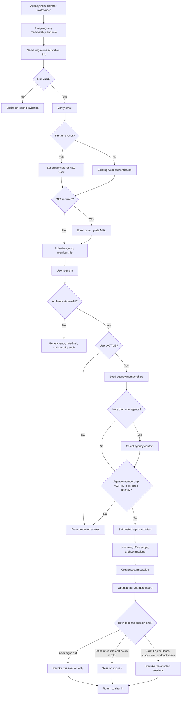

Sign-out ends only the current session and records a `SESSION_REVOKED` Security
Event with reason `USER_LOGOUT`. `docs/hris-controls.md` §5.1, User Session,
lists every way a session ends.

User states:

```text
ACTIVE
LOCKED
```

Agency Membership states:

```text
INVITED
ACTIVE
SUSPENDED
DEACTIVATED
```

---

# 5. WF-002 — Plantilla Position Creation and Vacancy Control

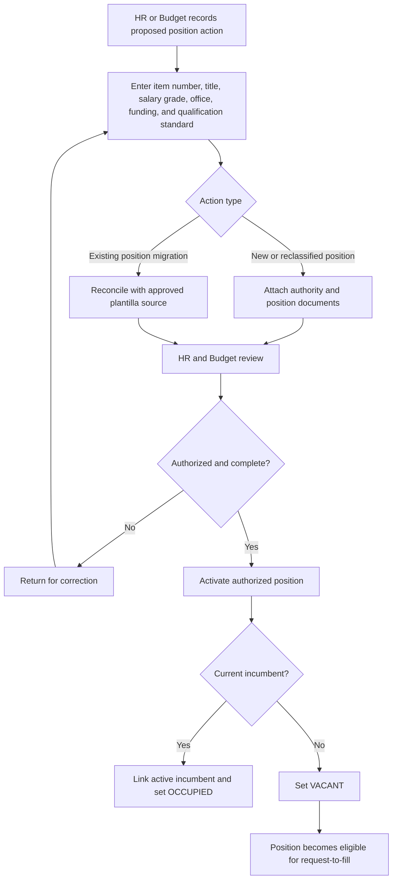

Position states:

```text
PROPOSED
AUTHORIZED
VACANT
RESERVED
OCCUPIED
FROZEN
ABOLISHED
```

Controls:

- one active incumbent per item unless an approved exception exists;
- effective-dated title, grade, office, and status;
- abolition never deletes position history.

---

# 6. WF-003 — Vacancy Publication and Merit Selection

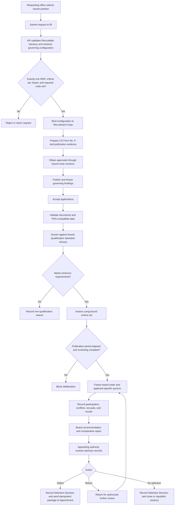

Required audit:

- publication;
- screening;
- assessment;
- board attendance and recommendation;
- appointing-authority decision;
- conflict-of-interest declaration.

AI may summarize credentials but cannot make the final decision.

---

# 7. WF-004 — Appointment Issuance, CSC Tracking, and Assumption

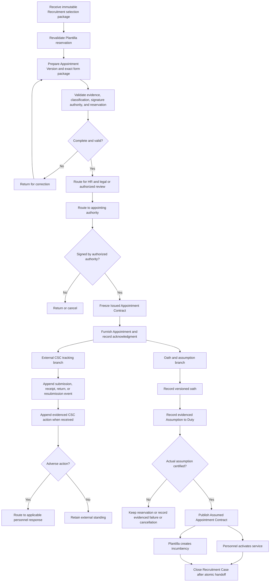

Appointment states:

```text
DRAFT
FOR_REVIEW
FOR_SIGNATURE
ISSUED
CANCELLED
```

`SUBMITTED`, `RETURNED`, `VALIDATED`, and `INVALIDATED` describe external events or a derived external standing, not Appointment workflow states. CSC tracking does not gate the oath or assumption branch. Selection and issuance do not activate service.

---

# 8. WF-005 — PDS, Employee Onboarding, and Service Record

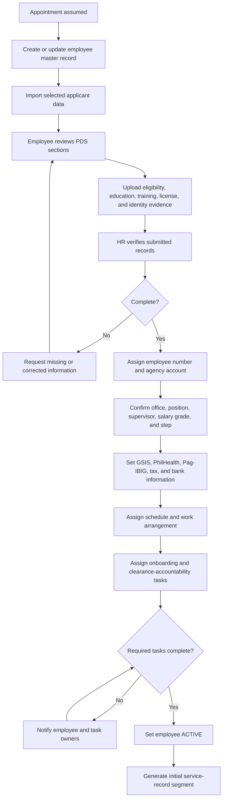

Personnel records preserve versions and evidence. PDS corrections do not overwrite prior certified versions.

---

# 9. WF-006 — Personnel Action and Position Movement

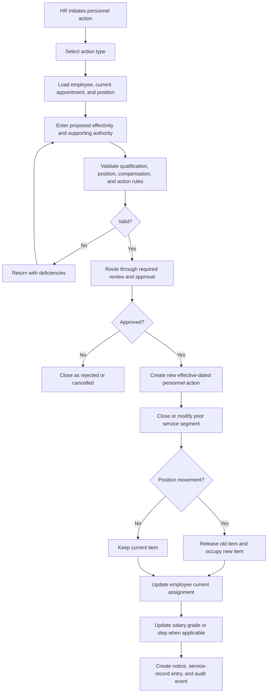

Action types include promotion, transfer, reappointment, reassignment, detail, designation, salary adjustment, step increment, and separation.

---

# 10. WF-007 — Attendance and Daily Time Record

```mermaid
flowchart TD
    A[Attendance period opens] --> B[Resolve Attendance Applicability and exact effective configuration]
    B --> C{Configuration complete and unambiguous?}
    C -- No --> D[Create blocking Attendance Exception]
    C -- Yes --> E[Load Day Rule, holiday classification, Attendance Context, and posted leave]
    E --> F[Receive attendance event]
    F --> G{Source}
    G -- Employee web clock --> H[Validate Appointed Personnel, session, enabled source, and timestamp]
    G -- Authorized manual entry --> I[Validate permission, timestamp, and reason]
    H --> J[Store immutable semantic event]
    I --> J
    J --> K[Match event collection window and Work Date]
    K --> L{Sequence and match unambiguous?}
    L -- No --> D
    L -- Yes --> M[Build non-overlapping Attendance Day Segments]
    M --> N[Calculate worked, coverage, tardiness, undertime, and absence minutes]
    N --> O[Classify outside-schedule and statutory-night-window minutes]
    O --> P{Blocking exception?}
    P -- Yes --> D
    P -- No --> Q[Mark CALCULATED]
    D --> R[Notify Employee or HR]
    R --> S[Employee or HR Administrator submits evidence-backed correction]
    S --> T[Build impact preview for every affected Work Date and period]
    T --> U[HR Officer reviews factual correction]
    U --> V{Approved?}
    V -- No --> W[Reject or return with reason]
    V -- Yes, open period --> X[Atomically record effect and recalculate affected days]
    V -- Yes, locked period --> XA[Set FOR_AUTHORIZATION]
    XA --> XB[Different HR Administrator authorizes grouped locked adjustment]
    XB --> X
    X --> P
    Q --> Y[Employee reviews Daily Time Record Preview]
    Y --> Z[Employee submits exact Attendance Day versions]
    Z --> AA[HR Officer reviews and approves submission]
    AA --> AB{All applicable submissions and days approved?}
    AB -- No --> B
    AB -- Yes --> AC[Create immutable Attendance Period Version FOR_REVIEW]
    AC --> AD[HR Officer reviews complete period snapshot]
    AD --> AE{Approved?}
    AE -- Returned --> B
    AE -- Yes --> AF[Different HR Administrator runs lock reconciliation]
    AF --> AG{All lock checks pass?}
    AG -- No --> AH[Remain APPROVED with no partial outputs]
    AG -- Yes --> AI[Atomically lock, create finalized DTRs, publish attendance payroll facts, and append audit and outbox records]
    AI --> AJ{Later approved correction?}
    AJ -- No --> AK[Retain locked version and outputs]
    AJ -- Yes --> XA
```

An ordinary daytime DTR presents semantic events through the familiar AM In, AM Out, PM In, and PM Out slots. Overnight duty remains one Work Date beginning on the local date of `TIME_IN`; its view uses duty and break labels with actual dates and times. A preview is explicitly unfinalized. Each lock creates separately retained Finalized Daily Time Records and an idempotent Attendance Payroll Publication. A locked correction produces successor Attendance Day and Attendance Period Versions, corrected DTRs, and a delta publication without changing the predecessor.

Complete events on a rest day create Unscheduled Service, not approved overtime or COC. Outside-schedule and statutory-night-window minutes remain separate factual candidate-hours handoffs to Phase 8. No biometric import exists in MVP.

---

# 11. WF-008 — Leave Application and Leave-Credit Ledger

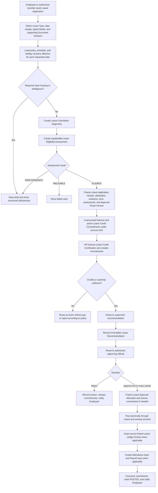

Calculation preserves the unit prescribed by the governing source. A statutory
calendar-day benefit is not converted to an ordinary working-day ledger debit,
and a benefit outside vacation and sick leave credits does not create a posting
to those accounts.

The posted balance is derived only from immutable Leave Ledger Entries. HR
certification atomically creates separate Leave Credit Commitments; an unposted
commitment is never represented as a ledger entry, and a commitment raised
earlier the same day still counts as an active commitment. Every allocation kind
is authorized by the bound Leave Policy Version: a charging policy approves
against its certified account and classifies only the quantity the account
cannot cover as leave without pay, while a paid non-ledger policy is non-credit
and an unpaid policy is leave without pay. An authorized partial approval may
replace the certified commitment only with a linked, smaller successor. Charging
a different account, or moving credit-covered quantity to unpaid leave, requires
a successor version and recertification. Posting consumes the active commitment.
Withdrawal, rejection, material return, or supersession releases it. Commitments
do not silently expire.

A material change after submission creates a new immutable Leave Application
Version and restarts evaluation, certification, and routing. Reviewer comments,
assignments, and notifications do not create application versions. Shared
Approval Routes own tasks and immutable Approval Decisions; Leave owns the
domain validations and records the certification, Leave Recommendation, and
Leave Approval Allocation. A negative recommendation remains advisory unless an
evidenced route provides otherwise.

Posting is a separate atomic Leave-owned command. It uses stable effect keys and
owning application services to create every required ledger, Attendance, and
Payroll effect. An authoritative failure rolls back the command and leaves the
application approved for retry. Notifications and document delivery use the
outbox after commit.

### Withdrawal, cancellation, and correction

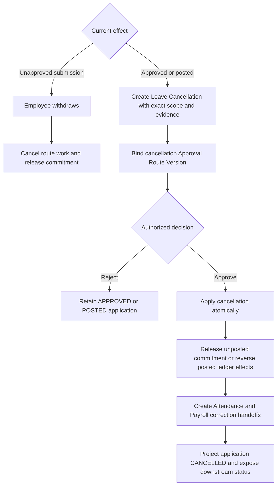

Whole posted cancellation exactly reverses each original ledger entry. Partial
cancellation fully reverses affected original entries and posts replacements for
the retained effect. Original effective dates and later posting timestamps
preserve both effective history and knowledge history. If Attendance is locked
or a Payroll Input has been consumed, the owning subsystem accepts an idempotent
adjustment handoff rather than rewriting history. Cancellation remains approved
with its original posting effective if the atomic application command fails.

### Mandatory or forced leave

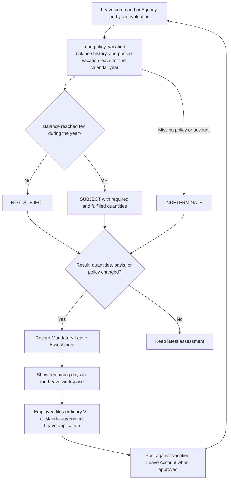

The ordinary civilian NGA baseline is five working days for an Employee whose
vacation balance reached ten during the calendar year (MC41 section 25). Any
posted vacation leave dated in that year counts, whether filed as vacation
leave or as mandatory or forced leave, and may be continuous or intermittent.
Leave posting, applied cancellation, policy activation, and vacation ledger
entries re-evaluate in the same transaction; a Leave Administrator evaluates
the Agency for a new year. The Leave workspace prompts the Employee; Phase 7
sends no notification. An assessment never posts forfeiture, and Phase 7 does
not post forfeiture at all, so the section 25 exigency cancellation and
retirement or resignation exceptions are not evaluated.

### Leave monetization

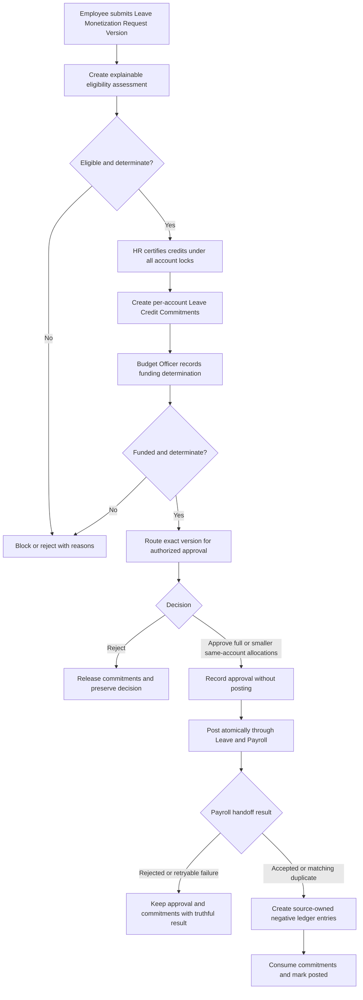

Payroll resolves and freezes the authoritative salary source, fixed calculator,
factor, evidence-backed valuation and rounding configuration, and calculated
amount in its Monetization Earning Input. Leave never supplies a free-form
salary or payout amount. Missing authority or configuration is indeterminate and
blocks the ledger deduction.

Withdrawal, rejection, material return, supersession, invalid eligibility, or
invalid funding releases commitments. An approved Monetization Adjustment uses
one atomic owner-service command. Pending Payroll Inputs are cancelled or
replaced; consumed inputs receive a linked adjustment. Leave restores credits
only after Payroll accepts the correction handoff, and finalized payroll remains
immutable. A failed handoff leaves the original posting effective for retry.

### Terminal-leave input preservation

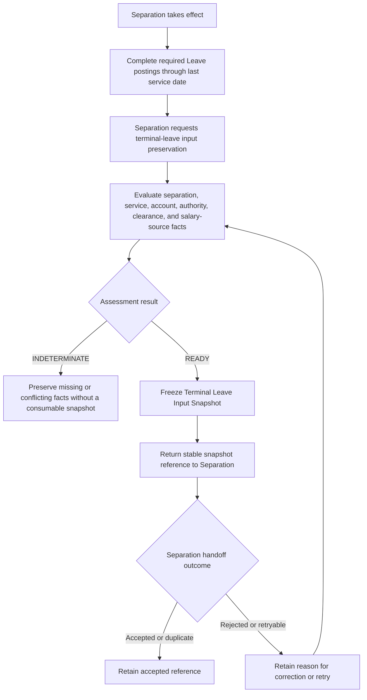

The snapshot uses the effective separation or last service date for its balance
cutoff and states a separate ledger-knowledge cutoff. A corrected source creates
a reasoned successor rather than rewriting history. Phase 7 does not compute a
terminal benefit, create a terminal ledger posting, or send a terminal Payroll
Input.

---

# 12. WF-009 — Overtime Authority, COC/CTO, and Overtime Pay

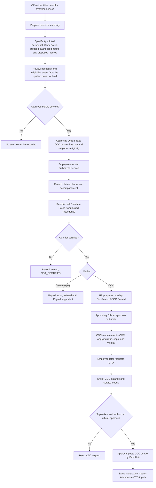

Claimed, authorized, actual, certified, credited, used, and paid values are stored separately.

---

# 13. WF-010 — Government Payroll

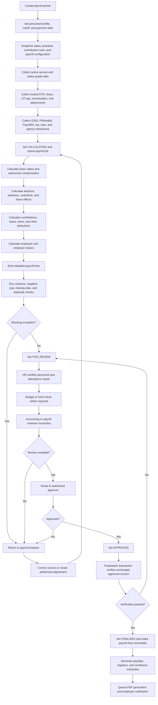

Correction after finalization:

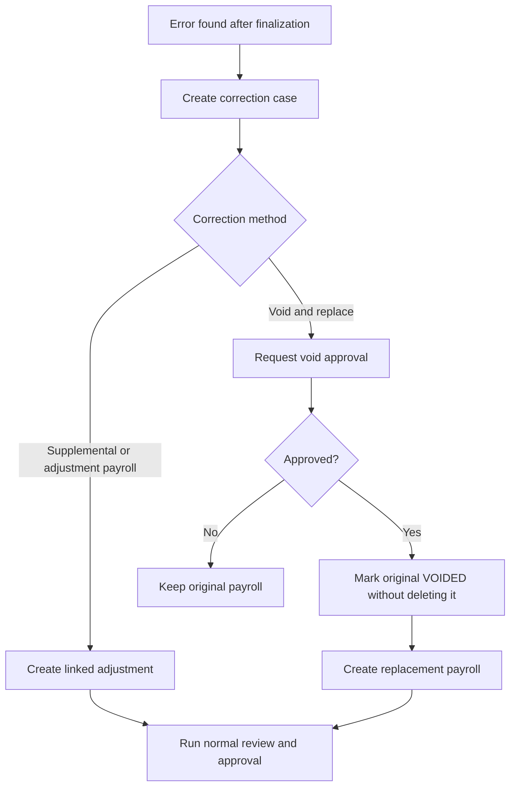

---

# 14. WF-011 — SPMS Performance Cycle

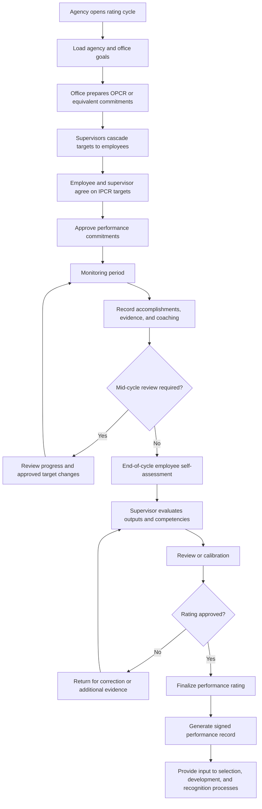

Finalized ratings require controlled amendment, not direct editing.

---

# 15. WF-012 — Separation, Clearance, and Access Revocation

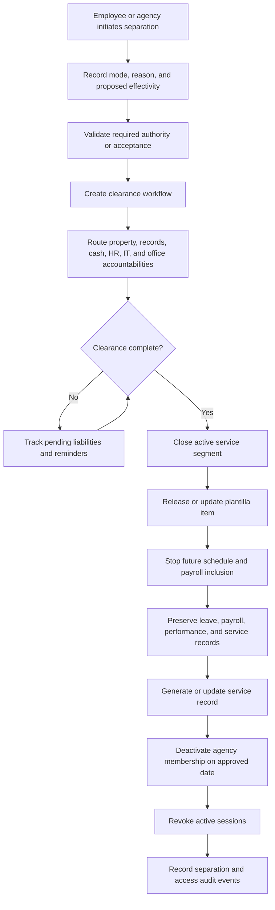

Retirement-benefit calculation remains outside MVP.

---

# 16. WF-013 — AI-Assisted HR Action

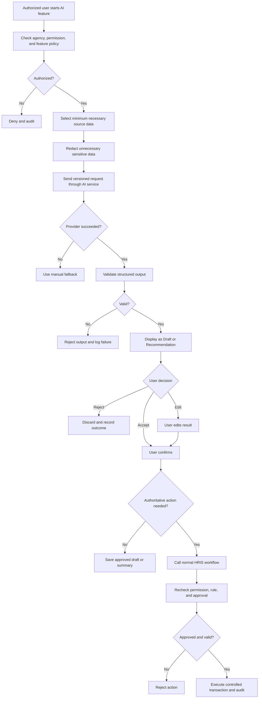

---

# 17. Status and Entity Implications

The workflow set requires at least these major domains:

```text
Identity and Agency
- users
- agencies
- memberships
- roles
- permissions
- sessions
- security_events

Organization and Plantilla
- organization_units
- positions
- position_histories
- qualification_standards
- position_documents

Recruitment and Appointment
- requests_to_fill
- vacancy_publications
- applicants
- applications
- assessments
- selection_board_sessions
- recommendations
- appointments
- appointment_submissions
- oaths
- assumptions

Personnel Records
- employees
- pds_versions
- eligibilities
- education_records
- training_records
- work_experiences
- service_segments
- personnel_actions
- employee_documents
- saln_compliance_records

Attendance and Leave
- work_schedules
- work_schedule_versions
- work_schedule_day_rules
- work_arrangements
- work_arrangement_versions
- schedule_assignments
- holiday_calendar_versions
- attendance_events
- attendance_contexts
- attendance_days
- attendance_day_segments
- attendance_exceptions
- attendance_corrections
- leave_types
- leave_accounts
- leave_ledger_entries
- leave_applications

Overtime
- overtime_authorities
- overtime_service_records
- coc_ledger_entries
- cto_requests
- overtime_pay_inputs

Payroll
- salary_schedules
- pay_components
- employee_compensation
- payroll_periods
- payroll_employees
- payroll_lines
- deductions
- contribution_lines
- payslips

Performance
- performance_cycles
- office_commitments
- individual_commitments
- success_indicators
- accomplishments
- performance_reviews
- ratings

Shared
- approval_requests
- approval_steps
- notifications
- audit_events
- documents
- ai_requests
```

---

# 18. Approval

| Role                          | Name | Decision | Date |
| ----------------------------- | ---- | -------- | ---- |
| Product Owner                 |      | Pending  |      |
| Government HR / HRMO Reviewer |      | Pending  |      |
| Payroll / Accounting Reviewer |      | Pending  |      |
| Technical Owner               |      | Pending  |      |

---

# 19. Change Log

| Version | Date           | Description                                                                  |
| ------- | -------------- | ---------------------------------------------------------------------------- |
| 1.0     | August 5, 2026 | Replaced private-sector workflows with Philippine public-sector HR workflows |
